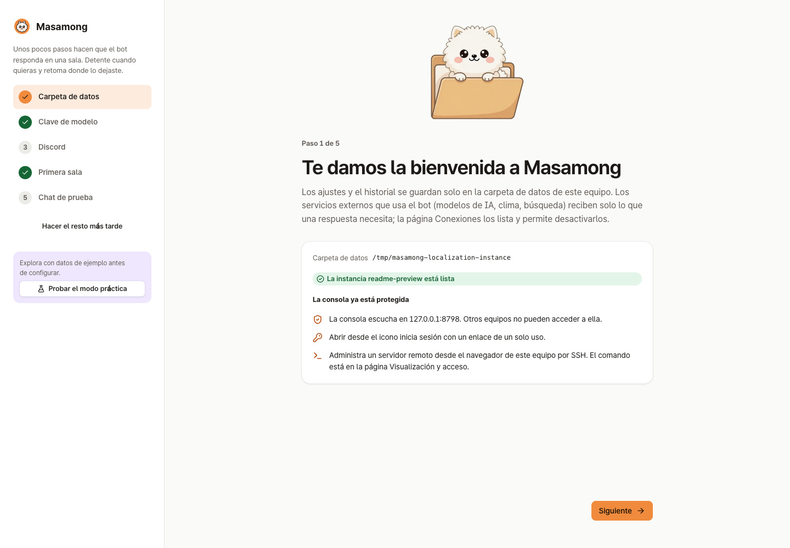
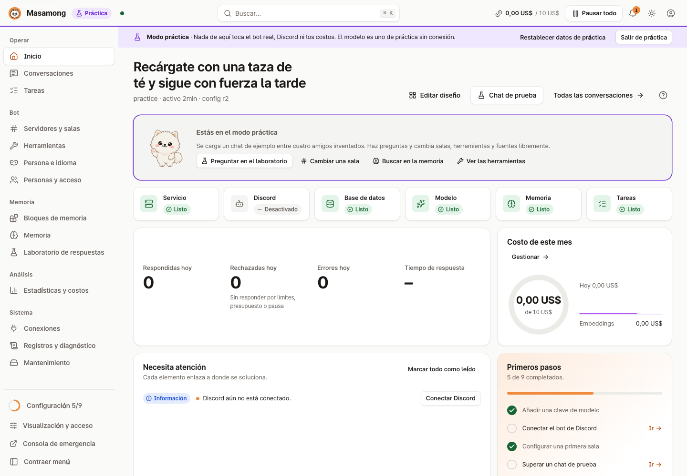
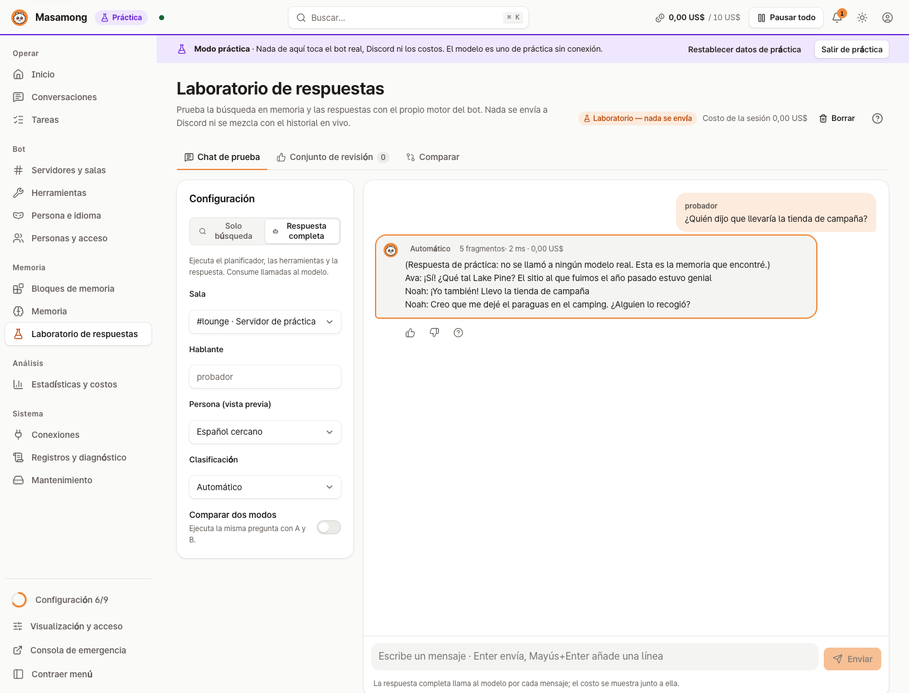
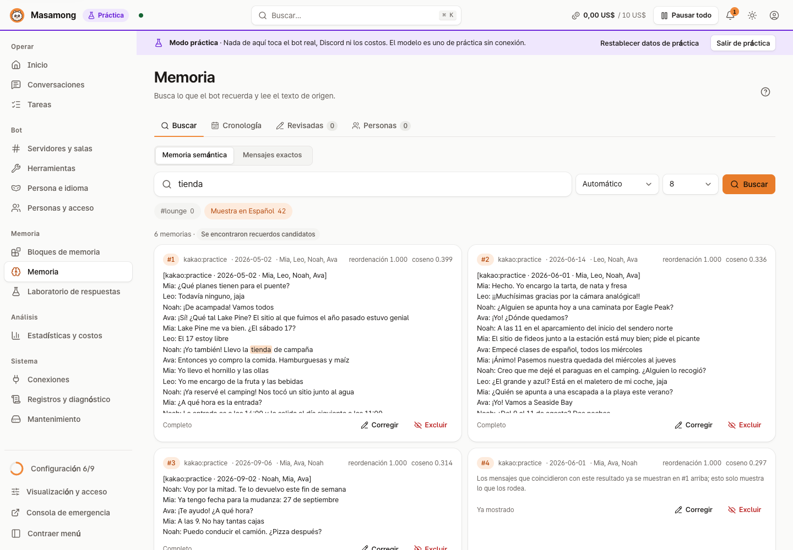
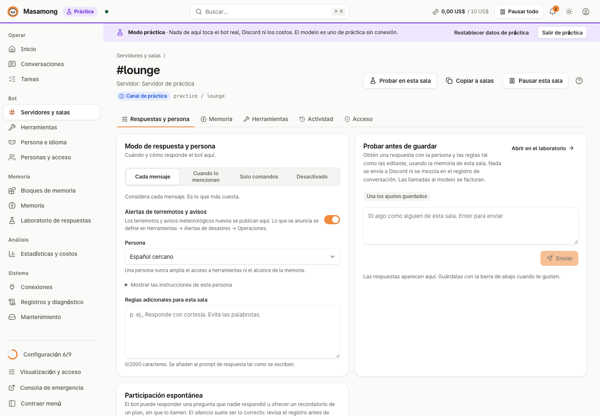
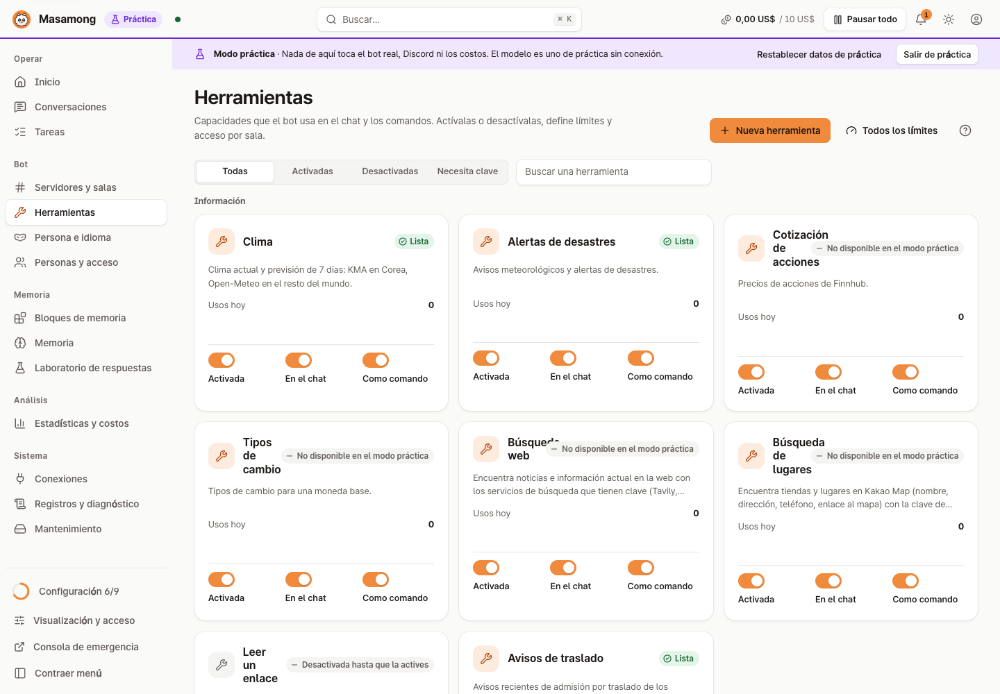

# Masamong 2
[English](README.md) | [한국어](README.ko.md) | [日本語](README.ja.md) | [简体中文](README.zh-Hans.md) | **Español**

   


> Masamong 2 es el sucesor de [Masamong](https://github.com/kim0040/masamong) (Python, 2025–2026; repositorio archivado). Hereda sus funciones y lo aprendido al operarlo, reescrito en Go. El Masamong original dejó de recibir soporte y actualizaciones el 2026-10-13, y su configuración personal se puede importar ([cómo](docs/STORAGE.md#이전-봇-개인-설정-가져오기-migrationapply)).

**Masamong es un bot de IA que convive en el servidor de Discord de tus amigos.** Recuerda lo que se dijo en la sala y responde a preguntas como «¿dónde decidimos ir de acampada?» como lo haría un amigo, y consulta el tiempo, las cotizaciones, los tipos de cambio, los sitios donde comer y las noticias en mitad de una conversación. Se configura en una consola web que solo se abre en tu propio ordenador.

En resumen:

- **Habla como un amigo** — una personalidad y reglas de respuesta para cada sala
- **Recuerda la sala** — mensajes de Discord en vivo y chats de KakaoTalk importados; cada sala busca solo en su propia memoria
- **Consulta cosas** — tiempo, avisos y terremotos, bolsa, tipos de cambio, búsqueda web, lugares, imágenes, encuestas, resúmenes
- **Ayudantes personales** — recordatorios, una fortuna matutina por MD, suscripciones a avisos escolares
- **Controla los costes** — un presupuesto mensual y límites por herramienta y por persona
- **Se ejecuta en tu máquina** — instalas tu propia copia y usas tus propias claves de API; la consola se enlaza a `127.0.0.1` y el modo de práctica te deja explorar gratis

Versión: `1.0.0`

**Contenido**: [Capturas de pantalla](#capturas-de-pantalla) · [Qué hace](#qué-hace) · [Primeros pasos](#primeros-pasos) · [Instalar con IA](#instalar-con-un-agente-de-ia) · [Usando el bot en Discord](#4-usando-el-bot-en-discord) · [Costes y servicios externos](#costes-y-servicios-externos) · [Documentación](#documentación) · [Desarrollo](#desarrollo) · [Colaboradores](#colaboradores) · [Licencia](#licencia) · [Aviso legal](#aviso-legal)

## Capturas de pantalla

| Primera configuración | Inicio |
|---|---|
|  |  |
| **Laboratorio de respuestas** — pregunta con los ajustes de una sala y consulta la evidencia, el coste y el tiempo | **Explorador de memoria** — busca lo que el bot recuerda, corrígelo o exclúyelo |
|  |  |
| **Ajustes de sala** — cuándo responder, personalidad, reglas adicionales, probar antes de guardar | **Herramientas** — tiempo, alertas, bolsa, divisas, búsqueda, lugares: activación y límites |
|  |  |

Todas las capturas son del **modo de práctica** (un chat de ejemplo entre cuatro personas inventadas, con un modelo simulado sin conexión). No se muestra la conversación de ninguna persona real. Consulta las capturas de los demás idiomas en la [galería de capturas por idioma](docs/images/readme/README.md).

## Qué hace

- **Habla como un amigo**: cada sala recibe una personalidad (informal, formal o la tuya propia) y una regla de respuesta (cada mensaje / cuando lo llamen / solo comandos / desactivado). El coreano, el inglés, el japonés, el chino simplificado y el español vienen integrados.
- **Recuerda la sala**: los mensajes de Discord en vivo y los chats de KakaoTalk importados (CSV) se convierten en memoria. Cada sala busca **solo en la memoria asociada a ella**; las demás salas, servidores y MD nunca se mezclan. Lo que no está en la memoria no se inventa.
- **Herramientas**: tiempo (KMA en Corea, Open-Meteo en el resto del mundo), publicaciones automáticas de terremotos y avisos meteorológicos, cotizaciones, tipos de cambio, búsqueda web, lugares (Kakao Map), lectura de enlaces, imágenes, encuestas, resúmenes de canal, quién habló más. El bot las usa por su cuenta en la conversación, o tú usas comandos como `!clima Seúl` o `/weather`. Cuando una herramienta no tiene respuesta, el bot sigue hablando en lugar de mostrar una tarjeta de error.
- **Ayudantes personales**: recordatorios («recuérdame mañana a las 3», confirmados antes de programarse), una fortuna matutina por MD, suscripciones a avisos escolares. Cada uno necesita su propio consentimiento, que puede retirarse y borrarse en cualquier momento.
- **Intervención** (opcional): el bot puede meterse en preguntas sin responder o en planes. Desactivada / solo registrar la decisión / hablar de verdad.
- **Control de costes**: presupuesto mensual, límites diarios por herramienta y por persona, un registro de costes por modelo. Se detiene al alcanzar el presupuesto.
- **Consola**: comprobaciones de estado, historial de conversaciones (por qué el bot respondió como lo hizo, paso a paso), registros, copia de seguridad y restauración, diagnósticos. Solo se enlaza a `127.0.0.1`; llega a un servidor remoto mediante un túnel SSH.
- **Modo de práctica**: explora con datos de ejemplo, sin claves y sin coste.

## Primeros pasos

La forma más rápida **no necesita Git ni Go**: un solo comando ([Instalación rápida](#instalación-rápida)) descarga la versión para tu sistema operativo y tu CPU. **Git** y **Go 1.27 o posterior** solo hacen falta para compilar desde el código fuente. La primera versión pública es la **v1.0.0**; todas están en la página de [Releases](https://github.com/kim0040/masamong2/releases).

No se necesitan permisos de administrador. Los programas se instalan en tu carpeta de usuario, y al desinstalar se conservan tus datos.

### Instalación rápida

macOS, Linux, FreeBSD:

```bash
curl -fsSL https://raw.githubusercontent.com/kim0040/masamong2/main/install.sh | sh
```

Windows (PowerShell):

```powershell
irm https://raw.githubusercontent.com/kim0040/masamong2/main/install.ps1 | iex
```

El script descarga la versión para tu sistema operativo y tu CPU, la comprueba con `SHA256SUMS` y la instala en tu carpeta de usuario. En macOS, Linux y FreeBSD, si esa carpeta no está en el PATH, también añade una línea a tu perfil de la shell (`--no-modify-path` lo evita; las opciones se pasan así: `| sh -s -- --no-modify-path`). Para elegir una versión usa `MASAMONG_VERSION=v1.0.0` (`curl -fsSL … | MASAMONG_VERSION=v1.0.0 sh`; en PowerShell, antes `$env:MASAMONG_VERSION = 'v1.0.0'`). Al terminar, abre una terminal nueva y ejecuta `masamong open`, o usa la ruta completa que imprime el script.

### Instalar con un agente de IA

¿Usas Claude Code, Codex, Cursor, Gemini CLI u otro agente de programación? Pega este prompt. El agente instala Masamong en ese equipo siguiendo [INSTALL.md](INSTALL.md); por defecto, con la descarga de la versión publicada, que no necesita Git ni Go. Muestra cada comando antes de ejecutarlo y pregunta antes de instalar lo que haga falta, como Git y Go para compilar desde el código fuente.

```text
Instálame Masamong. Primero lee entero https://raw.githubusercontent.com/kim0040/masamong2/main/INSTALL.md y luego sigue sus pasos uno a uno en este equipo. No me pidas pegar en este chat un token de Discord ni una clave de API; las escribiré yo en la consola de Masamong.
```

Lo mismo desde una terminal, en una línea. En macOS y Linux (bash o zsh):

```bash
claude "$(curl -fsSL https://raw.githubusercontent.com/kim0040/masamong2/main/INSTALL.md)"     # Codex: codex "$(curl -fsSL …)"
```

En PowerShell, `$(curl …)` no funciona; pasa el texto del prompt directamente (también sirve en bash, zsh y cmd):

```powershell
claude "Instálame Masamong. Primero lee entero https://raw.githubusercontent.com/kim0040/masamong2/main/INSTALL.md y luego sigue sus pasos uno a uno en este equipo. No me pidas pegar en este chat un token de Discord ni una clave de API; las escribiré yo en la consola de Masamong."
codex "Instálame Masamong. Primero lee entero https://raw.githubusercontent.com/kim0040/masamong2/main/INSTALL.md y luego sigue sus pasos uno a uno en este equipo. No me pidas pegar en este chat un token de Discord ni una clave de API; las escribiré yo en la consola de Masamong."
```

Con Gemini CLI, Cursor u otros agentes, pega el prompt en el chat del agente.

INSTALL.md son instrucciones en texto plano que puedes leer antes de dárselas. Las claves siempre van en la consola (que las guarda en el llavero del sistema), nunca en el chat.

¿Prefieres hacerlo tú? Sigue los pasos de abajo.

### 1. Instalación

Compilar desde el código fuente requiere Git y Go 1.27 o posterior. Si prefieres no hacerlo, usa la [instalación rápida](#instalación-rápida) de arriba.

<details open>
<summary><b>macOS</b></summary>

```bash
# ¿No tienes Go? brew install go (o descarga el .pkg desde https://go.dev/dl)
# Para crear el icono de la barra de menús, instala las herramientas de línea de comandos de Xcode: xcode-select --install
git clone https://github.com/kim0040/masamong2.git
cd masamong2
./install.sh --app      # también crea ~/Applications/Masamong.app (opcional)
~/.local/bin/masamong open     # o en una terminal nueva: masamong open
```

Abre y cierra desde el icono de la barra de menús. Para iniciarlo al iniciar sesión: `masamong autostart on`.
</details>

<details>
<summary><b>Windows 10 / 11</b></summary>

En PowerShell:

```powershell
# ¿No tienes Git o Go? winget install Git.Git GoLang.Go (después, abre una nueva ventana de PowerShell)
git clone https://github.com/kim0040/masamong2.git
cd masamong2
powershell -ExecutionPolicy Bypass -File .\install.ps1
masamong open
```

Se instala en `%LOCALAPPDATA%\Programs\Masamong` y lo añade al PATH de **tu usuario**. Abre y cierra desde el icono del área de notificación.

Una ventana de PowerShell que ya estaba abierta no ve el PATH nuevo, así que ejecuta `masamong open` en una ventana de PowerShell **nueva**. Para seguir en la misma ventana, usa la ruta completa (el instalador imprime esta línea al terminar):

```powershell
& "$env:LOCALAPPDATA\Programs\Masamong\masamong.exe" open
```

Sin Go (ni Git), ejecuta `install.ps1` desde el `masamong_windows_amd64.zip` de la versión (`arm64` para portátiles ARM). Incluso basta el script solo: si no hay Go ni programas a su lado, descarga ese ZIP de Releases y lo comprueba con `SHA256SUMS` antes de instalar.
</details>

<details>
<summary><b>Linux (escritorio · servidor · Raspberry Pi)</b></summary>

```bash
# Los paquetes Go de la distribución suelen ser antiguos: instala Go desde https://go.dev/doc/install (go version → 1.27+)
git clone https://github.com/kim0040/masamong2.git
cd masamong2
./install.sh            # instala en ~/.local/bin y añade la ruta a PATH (abre una terminal nueva)
~/.local/bin/masamong open           # abre el navegador en un escritorio; o en una terminal nueva: masamong open
```

En un **servidor sin interfaz gráfica**, inicia allí el servicio y conéctate desde tu propio ordenador por SSH:

```bash
# En el servidor
masamong start
masamong autostart on          # se inicia tras reiniciar (servicio de usuario de systemd)
loginctl enable-linger $USER   # sigue en ejecución al cerrar sesión (una sola vez)

# En tu ordenador (con masamong instalado)
masamong connect user@server
```

Incluso en un servidor, la consola escucha solo en `127.0.0.1`, así que no hay que abrir ningún puerto.
</details>

<details>
<summary><b>Actualizar · desinstalar</b></summary>

Si instalaste una versión publicada: consola → **Mantenimiento → Actualizar ahora**, o vuelve a ejecutar el comando de instalación rápida. Si compilaste desde el código fuente:

```bash
cd masamong2 && git pull && ./install.sh   # actualizar: el servicio en ejecución se reinicia con la nueva versión
./install.sh --uninstall                   # desinstalar (Windows: install.ps1 -Uninstall, que también quita su entrada del PATH); los datos se conservan
```

Carpeta de datos: macOS `~/Library/Application Support/Masamong`, Linux `~/.local/share/masamong`, Windows `%APPDATA%\Masamong`. Para ejecutar una instancia aparte: `masamong --data-root <carpeta> open`.
</details>

Opciones de instalación y solución de problemas: [wiki › Instalación](https://github.com/kim0040/masamong2/wiki/Installation), [wiki › Solución de problemas](https://github.com/kim0040/masamong2/wiki/Troubleshooting).

### 2. Primera configuración en la consola

`masamong open` inicia el servicio y abre en tu navegador un enlace de inicio de sesión de un solo uso. No hay contraseña ni cuenta que crear. Un asistente de configuración te guía por:

1. **Carpeta de datos** — todos los ajustes y la memoria viven solo aquí.
2. **Clave del modelo** — una clave de API de OpenRouter, CometAPI, un servicio compatible con OpenAI, Gemini, etc.; se eligen por ti modelos recomendados.
3. **Bot de Discord** — crea una aplicación y un bot en el [Discord Developer Portal](https://discord.com/developers/applications), activa **Message Content Intent** y pega el token. Añade el bot a tu servidor con el enlace de invitación que se muestra.
4. **Primera sala** — el canal en el que responde el bot y su personalidad.
5. **Chat de prueba** — ve una respuesta sin publicarla en el canal.

Para explorar primero sin claves, pulsa **Probar el modo práctica** en la primera pantalla.

### 3. Añadir memoria (opcional)

En **Bloques de memoria → Importar**, sube una exportación de chat de KakaoTalk (CSV): vista previa → tiempo y coste estimados → indexación en segundo plano; después, asocia el bloque a una sala. Los mensajes de Discord se recuerdan desde el momento en que el bot se une, y se rellenan hasta 7 días perdidos mientras estaba desconectado. Avisa a las personas de una sala antes de importar su conversación.

### 4. Usando el bot en Discord

Simplemente háblale (según la regla de respuesta de la sala, puede que tengas que mencionarlo).

```text
@Masamong ¿va a llover en Seúl este fin de semana?
¿quién dijo la última vez que traería la tienda de campaña?
encuentra una cafetería acogedora en Hongdae
```

Los comandos también funcionan. Los comandos con prefijo necesitan el Message Content Intent. Las palabras de prefijo siguen el idioma del bot (se muestra el español).

| Prefijo | Barra | Qué hace |
|---|---|---|
| `!clima Busan` | `/weather` | Tiempo actual y previsión de hasta 14 días (aproximada más allá de una semana) |
| `!alertas` | `/alerts` | Avisos meteorológicos, terremotos |
| `!cotizacion AAPL` | `/quote` | Cotización de acciones |
| `!cambio USD` | `/fx` | Tipos de cambio |
| `!buscar …` | `/search` | Búsqueda web |
| `!lugares Seongsu cafe` | `/places` | Encontrar lugares (Kakao Map) |
| `!imagen …` | `/image` | Dibujar una imagen |
| `!encuesta pregunta \| opción1, opción2` | `/poll` | Encuesta de Discord |
| `!resumen` | `/summary` | Resumir la conversación reciente |
| `!ranking` | `/ranking` | Quién habló más en esta sala |
| `!recordar …` | `/remind` | Fijar un recordatorio |
| `!fortuna` | `/fortune` | La fortuna de hoy |
| `!ayuda` | `/help` | Comandos disponibles ahora mismo |

Lista completa y cómo cambiar los nombres: [wiki › Herramientas y límites](https://github.com/kim0040/masamong2/wiki/Tools-and-Limits).

## Costes y servicios externos

Masamong en sí, su base de datos (SQLite), la consola, las copias de seguridad, la búsqueda por palabras clave y el modo de práctica son **gratis**, sin suscripción. Solo pagas por las **API externas que conectas**, directamente a esas empresas.

| Para qué | Servicio | Clave | Conviene saber |
|---|---|---|---|
| Chat, indexación de memoria, imágenes | OpenRouter, CometAPI, NanoGPT, Gemini, compatible con OpenAI | sí | Pago por uso; limítalo con el presupuesto mensual (normalmente menos de un céntimo por respuesta) |
| Tiempo, avisos y terremotos en Corea | KMA (Korea Meteorological Administration) | sí (gratis) | Sin clave, el tiempo de Corea también procede de Open-Meteo |
| Tiempo en el resto del mundo | Open-Meteo | no | La API gratuita es **solo para uso no comercial**; se requiere atribución (CC BY 4.0) |
| Lugares, búsqueda | Kakao | sí (cuota gratuita) | |
| Búsqueda web | Linkup, Tavily, Exa, Serper, Brave, TinyFish y otros | sí | Precio según el servicio |
| Cotizaciones | Finnhub | sí | **Uso personal**; compartir los datos con otros requiere la aprobación de Finnhub |
| Tipos de cambio | ExchangeRate-API | sí | **No se permite redistribuir** los datos |
| Lectura de enlaces | Jina Reader | no | Desactivada por defecto; envía el enlace a un servicio externo |

Una herramienta sin su clave se comporta como si estuviera desactivada, y el bot solo dice que esa función no está disponible. Para los servicios con condiciones sobre compartir datos (bolsa, divisas), comprueba si se permite publicar sus datos en una sala compartida ([backlog › condiciones de los servicios externos](docs/BACKLOG.md#2-외부-서비스-약관), en coreano).

## Plataformas compatibles

| SO | Arquitecturas |
|---|---|
| macOS 12+ | arm64, amd64 (icono de la barra de menús) |
| Linux | amd64, arm64, armv7 (Raspberry Pi), riscv64 |
| Windows 10+ | amd64, arm64 (icono del área de notificación) |
| FreeBSD | amd64, arm64 (servicio y consola, sin icono) |

Las claves y los tokens que escribes en la consola se guardan en el Llavero de macOS, en el **Administrador de credenciales** de Windows o, en Linux y FreeBSD, en un archivo solo para el propietario (`0600`) dentro de la carpeta de datos. Los archivos se protegen solo con permisos, no están cifrados; en Windows, una carpeta de datos indicada con `--data-root` también se restringe a tu cuenta, SYSTEM y Administrators. Con `MASAMONG_SECRET_STORE=file` se usan archivos en todos los sistemas. Los archivos de configuración, los registros y las copias de seguridad nunca contienen una clave, solo una referencia a ella.

## Documentación

La wiki está en inglés y coreano; los demás documentos están en coreano.

- [Wiki (inglés)](https://github.com/kim0040/masamong2/wiki/English) — instalación, inicio rápido, Discord, bloques de memoria, herramientas y límites, referencia de configuración, solución de problemas (fuente: [docs/wiki](docs/wiki/English.md))
- [Galería de capturas por idioma](docs/images/readme/README.md) · [Índice de documentación](docs/README.md) · [Backlog](docs/BACKLOG.md) · [Mapa del repositorio](docs/REPO_MAP.md)
- [Operaciones de memoria](docs/memory-operations.md) · [Herramientas e idiomas](docs/tools-and-languages.md) · [Política de datos brutos](docs/RAW_DATA_POLICY.md)

## Desarrollo

```bash
go test ./... && go vet ./...
python3 scripts/license_audit.py
make ui        # tras cambiar la consola, reconstruye ui/dist (también hay que incluirlo en el commit)
make try       # ejecuta una instancia de prueba separada de la real (~/.masamong-try)
               # Windows: powershell -ExecutionPolicy Bypass -File .\start-test.ps1 (opciones -Reset -Check -Stop)
```

Estructura del código y reglas: [CONTRIBUTING.md](CONTRIBUTING.md) y [wiki › Guía de desarrollo](https://github.com/kim0040/masamong2/wiki/Development-Guide). Nunca subas al repositorio ni publiques conversaciones reales, IDs de usuario, claves o bases de datos de producción. Informa de los problemas de seguridad al contacto indicado en [SECURITY.md](SECURITY.md).

## Colaboradores

- **Hyunmin Kim (김현민)** — autor · [mini0227kim@gmail.com](mailto:mini0227kim@gmail.com)

Masamong es un proyecto de tiempo libre de un estudiante universitario, creado y cuidado entre clases y la vida cotidiana. Se usa a diario con amigos y se mejora siempre que hay tiempo, pero no ha pasado por el pulido de un producto de empresa: puede que te encuentres con asperezas, comodidades que faltan o respuestas lentas. Se comparte con la esperanza de que te resulte útil de todos modos.

Los informes de errores y las ideas son bienvenidos como issues; las respuestas pueden tardar, pero se leen todas.

## Licencia

El código y la documentación de Masamong se publican bajo la [Licencia MIT](LICENSE): cualquiera puede usarlos, cambiarlos y redistribuirlos gratis, conservando el aviso de copyright y de licencia.

- Cada biblioteca, fuente y conjunto de iconos de terceros que se distribuye con él tiene una licencia libre y redistribuible (MIT, BSD, Apache-2.0, ISC, MPL-2.0, SIL OFL 1.1); ninguna es de pago, no comercial, GPL ni AGPL. El controlador MySQL con licencia MPL-2.0 se usa sin modificar y se indica la ubicación de su código fuente. Véanse [THIRD_PARTY_NOTICES.md](THIRD_PARTY_NOTICES.md), [THIRD_PARTY_LICENSES.txt](THIRD_PARTY_LICENSES.txt) y la [auditoría de licencias](docs/license-audit.md).
- El arte de la mascota y del banner se creó con generación de imágenes por IA (Grok, OpenAI) y luego se editó. Los créditos están en [THIRD_PARTY_NOTICES.md](THIRD_PARTY_NOTICES.md#brand-artwork).
- La Licencia MIT cubre el **código**. Los datos de las API externas y el uso de esos servicios se rigen por las condiciones de cada empresa (véase [Costes y servicios externos](#costes-y-servicios-externos)).

## Aviso legal

- **Este es un proyecto personal.** Masamong lo crea y mantiene una sola persona en su tiempo libre, no una empresa ni una organización. No hay ninguna promesa de soporte, actualizaciones o correcciones de seguridad.
- **Se ofrece tal cual.** Como dice la Licencia MIT, no hay garantía de ningún tipo, y el autor no es responsable de ningún daño derivado de su uso (pérdida de datos, facturas de API inesperadas, cuentas suspendidas, etc.).
- **Las respuestas de la IA pueden ser erróneas.** No uses las respuestas del bot, incluidas cotizaciones, tipos de cambio, noticias y fortunas, para decisiones de inversión, salud, legales, de seguridad u otras decisiones importantes. Las fortunas son solo por diversión.
- **Las publicaciones de desastres no sustituyen a las alertas oficiales.** Las publicaciones de terremotos y avisos meteorológicos pueden llegar tarde o faltar. Obtén la información de seguridad en los canales oficiales (alertas de emergencia, el servicio meteorológico nacional).
- **Tú pagas tus propios costes.** Todas las API externas se llaman con las claves de quien instala y se facturan a su cuenta. El límite de presupuesto ayuda, pero no puede garantizar que un proveedor no cobre más. Mantener las claves a salvo es tu responsabilidad.
- **Los registros de conversaciones y los datos personales son responsabilidad del operador.** Masamong almacena las conversaciones de las salas y las usa como memoria. Quien lo instale debe avisar a las personas de la sala y obtener su consentimiento, y debe cumplir las leyes aplicables (como las de protección de datos personales) y las condiciones de Discord, KakaoTalk y los demás servicios. Las funciones de retirada del consentimiento y borrado ayudan, pero no sustituyen a las obligaciones legales.
- **Cumple tú mismo las condiciones de cada servicio externo.** Algunas API gratuitas son solo para uso no comercial o prohíben compartir sus datos. Para un bot público o uso comercial, revisa las condiciones de cada servicio.
- **Marcas registradas**: Discord, KakaoTalk, Kakao Map y los nombres de los servicios de IA y de datos pertenecen a sus propietarios. Masamong no está afiliado ni patrocinado por ninguno de ellos, ni cuenta con su respaldo.
