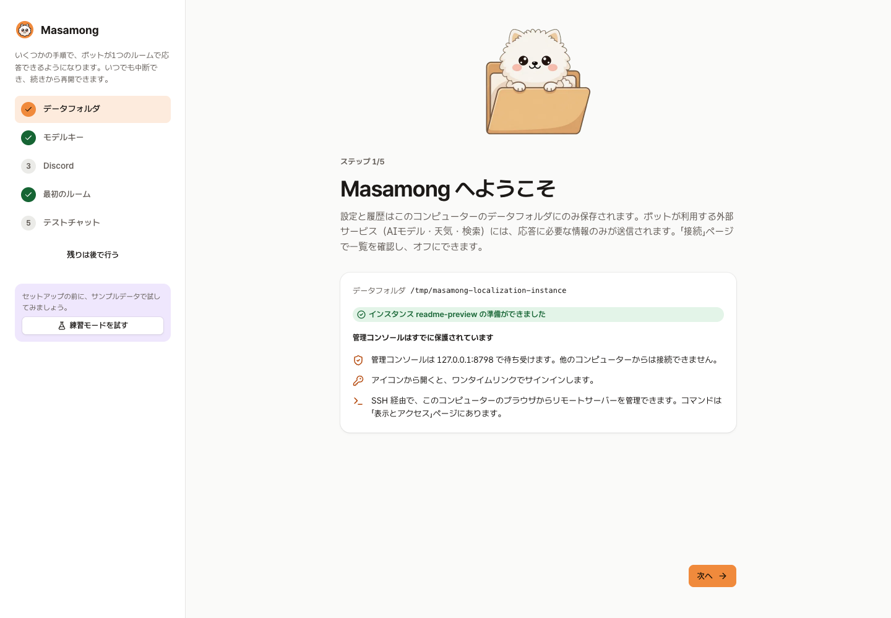
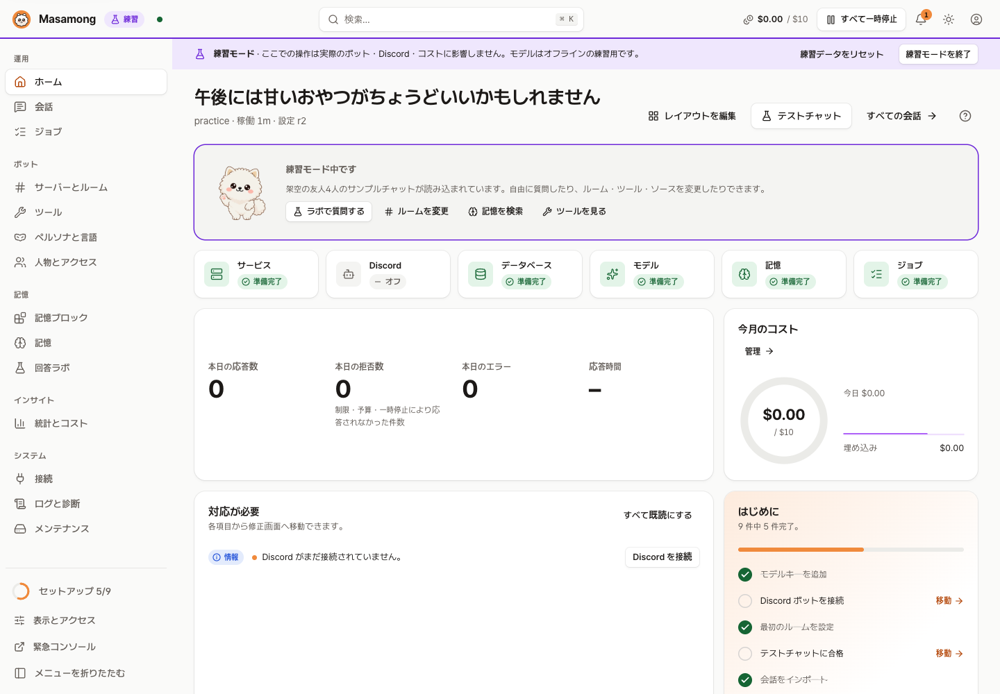
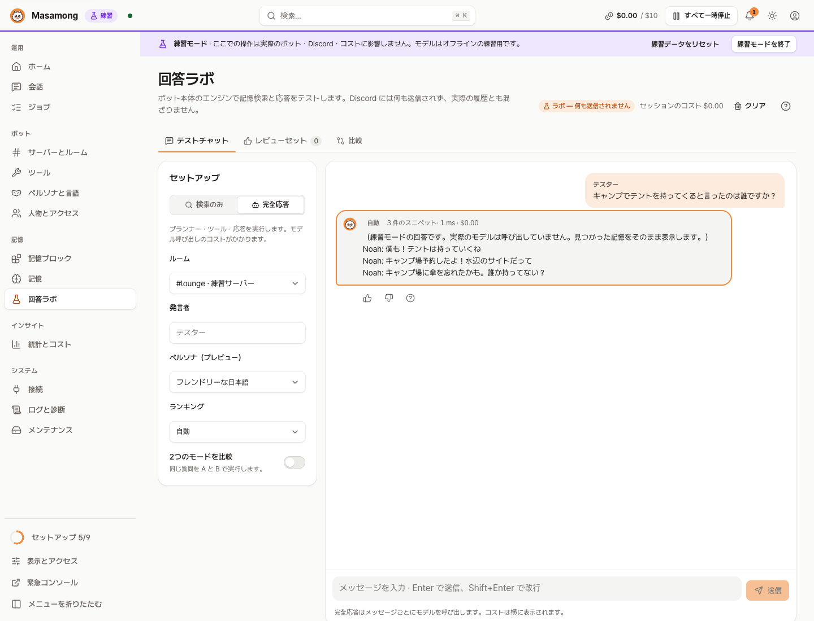
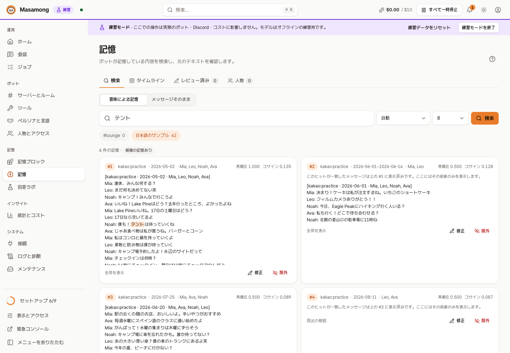
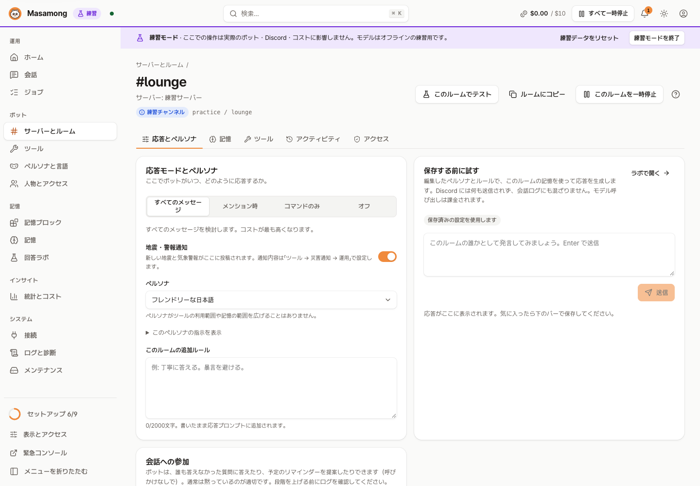
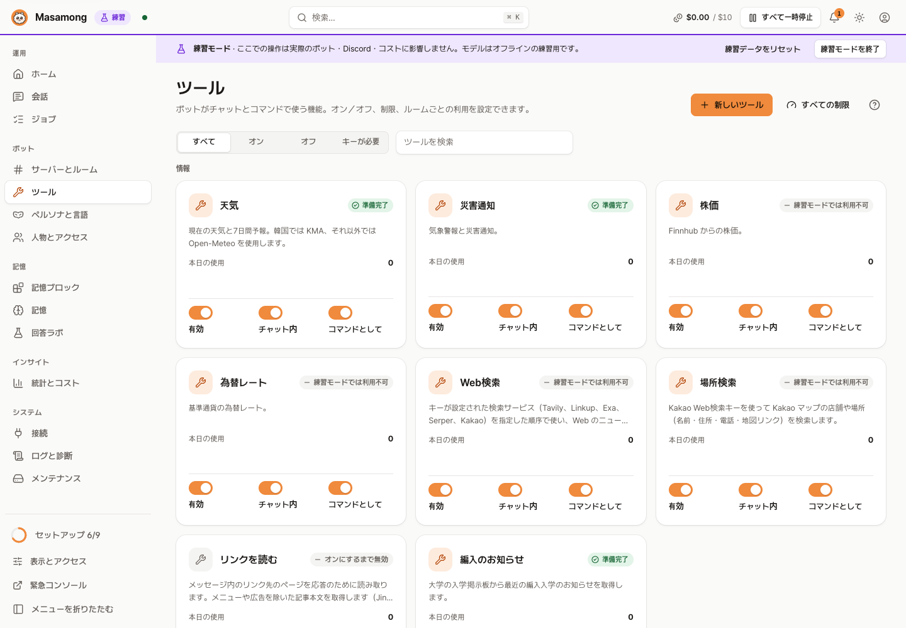

# Masamong 2

[English](README.md) | [한국어](README.ko.md) | **日本語** | [简体中文](README.zh-Hans.md) | [Español](README.es.md)

   


> Masamong 2 は [Masamong](https://github.com/kim0040/masamong)（Python、2025–2026、アーカイブ済み）の後継です。旧版の機能と運用の経験を引き継ぎ、Go で作り直しました。旧 Masamong は 2026-10-13 にサポートと更新を終了し、その個人設定は取り込めます（[方法](docs/STORAGE.md#이전-봇-개인-설정-가져오기-migrationapply)）。

**Masamongは、友だちのDiscordサーバーで一緒に過ごすAIボットです。** 部屋で交わされた会話を覚えていて、「キャンプはどこに行くって決めたっけ？」のような質問に友だちのように答えます。会話の途中で天気・株価・為替・おいしいお店・ニュースを調べることもできます。設定は、自分のパソコンでだけ開くWebコンソールで行います。

要点:

- **友だちのように話す** — 部屋ごとのペルソナと返信ルール
- **部屋のことを覚えている** — Discordのリアルタイムメッセージと取り込んだKakaoTalkチャット。各部屋は自分の記憶だけを検索します
- **調べものをしてくれる** — 天気、警報・地震（韓国）、株価、為替、ウェブ検索、場所、画像、投票、要約
- **個人向けのヘルパー** — リマインダー、朝の運勢DM、学校のお知らせ購読（韓国の大学）
- **費用を抑える** — 月間予算と、ツールごと・人ごとの上限
- **自分のマシンで動く** — 自分のコピーをインストールし、自分のAPIキーを使います。コンソールは`127.0.0.1`にだけバインドされ、練習モードなら無料で試せます

バージョン: `1.0.0`

**目次**: [スクリーンショット](#スクリーンショット) · [できること](#できること) · [はじめかた](#はじめかた) · [AIでインストール](#aiコーディングエージェントでインストールする) · [Discordで使う](#4-discordで使う) · [費用と外部サービス](#費用と外部サービス) · [ドキュメント](#ドキュメント) · [開発](#開発) · [貢献者](#貢献者) · [ライセンス](#ライセンス) · [免責事項](#免責事項)

## スクリーンショット

| 初回セットアップ | ホーム |
|---|---|
|  |  |
| **回答ラボ** — 部屋の設定で質問し、根拠・費用・時間を確認 | **記憶エクスプローラー** — ボットが覚えている内容を検索し、修正・除外 |
|  |  |
| **部屋の設定** — 返信するタイミング、ペルソナ、追加ルール、保存前のテスト | **ツール** — 天気、警報、株価、為替、検索、場所: オン/オフと上限 |
|  |  |

スクリーンショットはすべて**練習モード**（架空の4人のサンプルチャット、オフラインのモックモデル）で撮影したものです。実在の人物の会話は表示されていません。他の言語の画面は[言語別スクリーンショット一覧](docs/images/readme/README.md)をご覧ください。

## できること

- **友だちのように話す**: 部屋ごとにペルソナ（カジュアル、丁寧、または自作）と返信ルール（すべてのメッセージ / 呼ばれたとき / コマンドのみ / オフ）を設定できます。韓国語・英語・日本語・簡体字中国語・スペイン語に対応しています。
- **部屋のことを覚える**: Discordのリアルタイムメッセージと取り込んだKakaoTalkチャット（CSV）が記憶になります。各部屋は**自分に紐づいた記憶だけ**を検索し、他の部屋・サーバー・DMが混ざることはありません。記憶にないことは作り話しません。
- **ツール**: 天気（韓国はKMA、海外はOpen-Meteo）、地震・気象警報の自動投稿（韓国）、株価、為替、ウェブ検索、韓国の場所（Kakao Map）、リンクの読み取り、画像、投票、チャンネル要約、トップトーカー。会話の中でボットが自分で呼び出すか、`!天気 東京`や`/weather`のようなコマンドで使います。ツールが答えを出せないときは、エラーカードを出す代わりに会話を続けます。
- **個人向けヘルパー**: リマインダー（「明日の3時に知らせて」、予約前に確認）、朝の運勢DM、学校のお知らせ購読（韓国の大学）。それぞれ個別の同意が必要で、いつでも撤回・削除できます。
- **韓国向けの機能**: 警報・地震（KMA）、場所検索（Kakao Map）、学校のお知らせは韓国だけが対象です。韓国以外の言語とタイムゾーンでセットアップしたインスタンスでは、警報と学校のお知らせが最初はオフです。**設定と履歴 → 機能スイッチ**でオンにできます。天気、株価、為替、ウェブ検索はどこでも使えます。
- **割り込み**（任意）: 誰も答えていない質問や予定にボットが入っていくことができます。オフ / 判断の記録のみ / 実際に話す。
- **費用管理**: 月間予算、ツールごと・人ごとの1日上限、モデルごとの費用台帳。予算に達すると止まります。
- **コンソール**: 状態確認、会話履歴（ボットがなぜそう答えたかを順を追って確認）、ログ、バックアップと復元、診断。`127.0.0.1`にだけバインドされ、リモートサーバーへはSSHトンネル経由で接続します。
- **練習モード**: サンプルデータで、キーも費用もなしに試せます。

## はじめかた

いちばん早い方法は**GitもGoも不要**です。コマンド1つ（[クイックインストール](#クイックインストール)）で、お使いのOS・CPU向けのリリースをダウンロードしてインストールします。**Git**と**Go 1.27以降**が必要なのは、ソースからビルドする場合だけです。最初の公開リリースは**v1.0.0**で、すべてのバージョンは[Releases](https://github.com/kim0040/masamong2/releases)ページにあります。

管理者権限は不要です。プログラムはユーザーフォルダに入り、アンインストールしてもデータは残ります。

### クイックインストール

macOS、Linux、FreeBSD:

```bash
curl -fsSL https://raw.githubusercontent.com/kim0040/masamong2/main/install.sh | sh
```

Windows（PowerShell）:

```powershell
irm https://raw.githubusercontent.com/kim0040/masamong2/main/install.ps1 | iex
```

スクリプトがお使いのOS・CPU向けのリリースをダウンロードし、`SHA256SUMS`で確認してからユーザーフォルダにインストールします。macOS・Linux・FreeBSDでは、インストール先がPATHになければシェルのプロファイルに1行追加します（`--no-modify-path`でスキップできます。オプションは`| sh -s -- --no-modify-path`のように渡します）。バージョンを指定するには`MASAMONG_VERSION=v1.0.0`を使います（`curl -fsSL … | MASAMONG_VERSION=v1.0.0 sh`。PowerShellでは先に`$env:MASAMONG_VERSION = 'v1.0.0'`を実行します）。終わったら新しいターミナルを開いて`masamong open`を実行するか、スクリプトが表示したフルパスで実行してください。

### AIコーディングエージェントでインストールする

Claude Code、Codex、Cursor、Gemini CLIなどのコーディングエージェントを使っているなら、次のプロンプトを貼り付けてください。エージェントが[INSTALL.md](INSTALL.md)に沿ってそのコンピューターにインストールします。標準はGitもGoも不要なリリースのダウンロードです。コマンドは実行前に表示し、ソースビルド用のGitやGoなど追加で必要なものがあれば先に確認します。

```text
Masamongをインストールして。まず https://raw.githubusercontent.com/kim0040/masamong2/main/INSTALL.md を最後まで読んでから、このコンピューターでその手順を順番に進めて。DiscordのトークンやAPIキーをこのチャットに貼るよう頼まないで。キーは自分でMasamongのコンソールに入力します。
```

ターミナルから1行で。macOSとLinux（bashまたはzsh）では:

```bash
claude "$(curl -fsSL https://raw.githubusercontent.com/kim0040/masamong2/main/INSTALL.md)"     # Codex: codex "$(curl -fsSL …)"
```

PowerShellでは`$(curl …)`が使えないため、プロンプトの文章をそのまま渡します（bash、zsh、cmdでも使えます）:

```powershell
claude "Masamongをインストールして。まず https://raw.githubusercontent.com/kim0040/masamong2/main/INSTALL.md を最後まで読んでから、このコンピューターでその手順を順番に進めて。DiscordのトークンやAPIキーをこのチャットに貼るよう頼まないで。キーは自分でMasamongのコンソールに入力します。"
codex "Masamongをインストールして。まず https://raw.githubusercontent.com/kim0040/masamong2/main/INSTALL.md を最後まで読んでから、このコンピューターでその手順を順番に進めて。DiscordのトークンやAPIキーをこのチャットに貼るよう頼まないで。キーは自分でMasamongのコンソールに入力します。"
```

Gemini CLI、Cursorなど他のエージェントでは、プロンプトをエージェントのチャットに貼り付けてください。

INSTALL.mdは渡す前に自分で読めるふつうの手順書です。キーはチャットではなく、必ずコンソールに入力します（コンソールがOSのキーチェーンに保管します）。

自分で進める場合は、以下の手順に従ってください。

### 1. インストール

ソースからビルドするにはGitとGo 1.27以降が必要です。不要なら上の[クイックインストール](#クイックインストール)を使ってください。

<details open>
<summary><b>macOS</b></summary>

```bash
# Goがない場合は brew install go（または https://go.dev/dl の .pkg）
# メニューバーアイコンにはXcodeコマンドラインツール: xcode-select --install
git clone https://github.com/kim0040/masamong2.git
cd masamong2
./install.sh --app      # ~/Applications/Masamong.app もビルドします（任意）
~/.local/bin/masamong open     # または新しいターミナルで: masamong open
```

メニューバーアイコンから開いたり終了したりします。ログイン時に起動するには: `masamong autostart on`。
</details>

<details>
<summary><b>Windows 10 / 11</b></summary>

PowerShellで:

```powershell
# GitやGoがない場合は winget install Git.Git GoLang.Go（その後、新しいPowerShellを開く）
git clone https://github.com/kim0040/masamong2.git
cd masamong2
powershell -ExecutionPolicy Bypass -File .\install.ps1
masamong open
```

`%LOCALAPPDATA%\Programs\Masamong`にインストールされ、**ユーザー**のPATHに追加されます。通知領域のアイコンから開いたり終了したりします。

すでに開いていたPowerShellのウィンドウは新しいPATHを認識しないため、`masamong open`は**新しい**PowerShellウィンドウで実行してください。同じウィンドウで続ける場合はフルパスで実行します（インストールの最後に同じ行が表示されます）。

```powershell
& "$env:LOCALAPPDATA\Programs\Masamong\masamong.exe" open
```

Go（とGit）がない場合は、リリースの`masamong_windows_amd64.zip`（ARMノートPCは`arm64`）から`install.ps1`を実行します。スクリプトだけでも構いません。Goも隣のプログラムもなければ、ReleasesからそのZIPをダウンロードし、`SHA256SUMS`と照合してからインストールします。
</details>

<details>
<summary><b>Linux（デスクトップ · サーバー · Raspberry Pi）</b></summary>

```bash
# ディストリビューションのGoパッケージは古いことが多いため、https://go.dev/doc/install から入手（go version → 1.27+）
git clone https://github.com/kim0040/masamong2.git
cd masamong2
./install.sh            # ~/.local/bin にインストールしてPATHに追加（新しいターミナルを開く）
~/.local/bin/masamong open           # デスクトップではブラウザが開きます; または新しいターミナルで: masamong open
```

**ヘッドレスサーバー**では、サーバー側でサービスを起動し、自分のパソコンからSSH経由で接続します:

```bash
# サーバー側
masamong start
masamong autostart on          # 再起動後も起動（systemdユーザーサービス）
loginctl enable-linger $USER   # ログアウト後も動かす（1回だけ）

# 自分のパソコン側（masamongインストール済み）
masamong connect user@server
```

サーバー上でもコンソールは`127.0.0.1`だけをリッスンするため、ポートを開ける必要はありません。
</details>

<details>
<summary><b>更新 · アンインストール</b></summary>

リリースからインストールした場合は、コンソールの**メンテナンス → 今すぐ更新**を押すか、クイックインストールのコマンドをもう一度実行します。ソースからビルドした場合:

```bash
cd masamong2 && git pull && ./install.sh   # 更新: 起動中のサービスは新バージョンで再起動します
./install.sh --uninstall                   # アンインストール（Windows: install.ps1 -Uninstall。PATHの項目も削除）。データは残ります
```

データフォルダ: macOS `~/Library/Application Support/Masamong`、Linux `~/.local/share/masamong`、Windows `%APPDATA%\Masamong`。別のインスタンスを動かすには: `masamong --data-root <folder> open`。
</details>

インストールオプションとトラブルシューティング: [wiki › インストール](https://github.com/kim0040/masamong2/wiki/Installation)、[wiki › トラブルシューティング](https://github.com/kim0040/masamong2/wiki/Troubleshooting)。

### 2. コンソールでの初回セットアップ

`masamong open`はサービスを起動し、ブラウザで1回限りのサインインリンクを開きます。パスワードやアカウントの作成はありません。セットアップウィザードが順に案内します:

1. **データフォルダ** — すべての設定と記憶はここにだけ保存されます。
2. **モデルキー** — OpenRouter、CometAPI、OpenAI互換サービス、GeminiなどのAPIキー。おすすめのモデルが自動で選ばれます。
3. **Discordボット** — [Discord Developer Portal](https://discord.com/developers/applications)でアプリとボットを作成し、**Message Content Intent**をオンにして、トークンを貼り付けます。表示された招待リンクでボットをサーバーに追加します。
4. **最初の部屋** — ボットが返信するチャンネルと、そのペルソナ。
5. **テストチャット** — チャンネルに投稿せずに返信を確認できます。

まずキーなしで試したいときは、最初の画面で**練習モードを試す**を押してください。

### 3. 記憶を追加する（任意）

**記憶ブロック → インポート**で、KakaoTalkのチャットエクスポート（CSV）をアップロードします: プレビュー → 所要時間と費用の見積もり → バックグラウンドでインデックス作成、その後ブロックを部屋に紐づけます。Discordのメッセージはボットが参加した瞬間から記憶され、オフの間に逃した最大7日分が補われます。部屋の会話を取り込む前に、その部屋の人たちに伝えてください。

### 4. Discordで使う

話しかけるだけです（部屋の返信ルールによってはメンションが必要な場合があります）。

```text
@Masamong 今週末、ソウルは雨が降る？
前にテントを持ってくるって言ったの誰だっけ？
ホンデで居心地のいいカフェを探して
```

コマンドも使えます。プレフィックスコマンドにはMessage Content Intentが必要です。プレフィックスの言葉はボットの言語に合わせて変わります（ここでは日本語）。

| プレフィックス | スラッシュ | できること |
|---|---|---|
| `!天気 大阪` | `/weather` | 現在の天気と最大14日間の予報（1週間を超えると大まか） |
| `!警報` | `/alerts` | 気象警報・地震 |
| `!株価 AAPL` | `/quote` | 株価 |
| `!為替 USD` | `/fx` | 為替レート |
| `!検索 …` | `/search` | ウェブ検索 |
| `!場所 聖水 カフェ` | `/places` | 韓国の場所を探す（Kakao Map） |
| `!画像 …` | `/image` | 絵を描く |
| `!投票 質問 \| A, B` | `/poll` | Discord投票 |
| `!要約` | `/summary` | 最近の会話を要約 |
| `!ランキング` | `/ranking` | この部屋で一番話した人 |
| `!リマインド 明日の3時 …` | `/remind` | リマインダーを設定 |
| `!運勢` | `/fortune` | 今日の運勢 |
| `!ヘルプ` | `/help` | 今使えるコマンド |

全リストと名前の変更: [wiki › ツールと上限](https://github.com/kim0040/masamong2/wiki/Tools-and-Limits)。

## 費用と外部サービス

Masamong本体、データベース（SQLite）、コンソール、バックアップ、キーワード検索、練習モードは**無料**で、サブスクリプションはありません。費用がかかるのは**自分が接続した外部API**だけで、各社に直接支払います。

| 用途 | サービス | キー | 補足 |
|---|---|---|---|
| チャット、記憶のインデックス作成、画像 | OpenRouter、CometAPI、NanoGPT、Gemini、OpenAI互換 | 必要 | 従量課金。月間予算で上限を設定できます（通常、返信1回あたり1セント未満） |
| 韓国の天気・警報・地震 | KMA（韓国気象庁） | 必要（無料） | キーがない場合、韓国の天気もOpen-Meteoから取得します |
| 海外の天気 | Open-Meteo | 不要 | 無料APIは**非商用のみ**。クレジット表記が必要（CC BY 4.0） |
| 場所、検索 | Kakao | 必要（無料枠） | |
| ウェブ検索 | Linkup、Tavily、Exa、Serper、Brave、TinyFishなど | 必要 | サービスごとに価格が異なります |
| 株価 | Finnhub | 必要 | **個人利用**。データを他人と共有するにはFinnhubの承認が必要です |
| 為替レート | ExchangeRate-API | 必要 | データの**再配布は禁止** |
| リンクの読み取り | Jina Reader | 不要 | 既定ではオフ。リンクを外部サービスに送信します |

キーのないツールはオフと同じように動作し、ボットはその機能が使えないとだけ伝えます。データ共有の条件があるサービス（株価、為替）については、共有の部屋にそのデータを投稿してよいか確認してください（[backlog › 外部サービスの規約](docs/BACKLOG.md#2-외부-서비스-약관)、韓国語）。

## 対応プラットフォーム

| OS | アーキテクチャ |
|---|---|
| macOS 12+ | arm64、amd64（メニューバーアイコン） |
| Linux | amd64、arm64、armv7（Raspberry Pi）、riscv64 |
| Windows 10+ | amd64、arm64（通知領域アイコン） |
| FreeBSD | amd64、arm64（サービスとコンソール、アイコンなし） |

コンソールで入力したキーとトークンは、macOSではキーチェーン、Windowsでは**資格情報マネージャー**、LinuxとFreeBSDではデータフォルダ内の所有者専用ファイル（`0600`）に保存されます。ファイルは権限で守られているだけで、暗号化はされません。Windowsでは`--data-root`で指定したデータフォルダも、自分のアカウント・SYSTEM・Administratorsだけがアクセスできるように絞られます。`MASAMONG_SECRET_STORE=file`を設定すると、どのOSでもファイルに保存します。設定ファイル・ログ・バックアップに含まれるのはキーそのものではなく参照だけです。

## ドキュメント

wikiは英語と韓国語で、その他のドキュメントは韓国語です。

- [Wiki（英語）](https://github.com/kim0040/masamong2/wiki/English) — インストール、クイックスタート、Discord、記憶ブロック、ツールと上限、設定リファレンス、トラブルシューティング（ソース: [docs/wiki](docs/wiki/English.md)）
- [言語別スクリーンショット](docs/images/readme/README.md) · [ドキュメント索引](docs/README.md) · [バックログ](docs/BACKLOG.md) · [リポジトリマップ](docs/REPO_MAP.md)
- [記憶の運用](docs/memory-operations.md) · [ツールと言語](docs/tools-and-languages.md) · [生データポリシー](docs/RAW_DATA_POLICY.md)

## 開発

```bash
go test ./... && go vet ./...
python3 scripts/license_audit.py
make ui        # コンソールを変更したら ui/dist を再ビルド（コミットもする）
make try       # 本番とは別のテストインスタンスを起動（~/.masamong-try）
               # Windows: powershell -ExecutionPolicy Bypass -File .\start-test.ps1（フラグ -Reset -Check -Stop）
```

コードの構成とルール: [CONTRIBUTING.md](CONTRIBUTING.md)と[wiki › 開発ガイド](https://github.com/kim0040/masamong2/wiki/Development-Guide)。実際の会話・ユーザーID・キー・本番データベースをコミットしたり投稿したりしないでください。セキュリティの問題は[SECURITY.md](SECURITY.md)の連絡先へ報告してください。

## 貢献者

- **Hyeonmin Kim (김현민)** — 作者 · [mini0227kim@gmail.com](mailto:mini0227kim@gmail.com)

Masamongは大学生が空き時間に作っているプロジェクトで、授業と日常生活の合間に開発・保守しています。毎日友だちと使っていて、時間があるときに改善していますが、企業製品のような磨き込みはされていません。粗削りなところ、不便なところ、遅い返信などに遭遇するかもしれません。それでも役に立てばと思い、公開しています。

バグ報告やアイデアはissueで歓迎します。返信は遅いかもしれませんが、すべて目を通しています。

## ライセンス

Masamongのコードとドキュメントは[MIT License](LICENSE)で公開されています。著作権とライセンス表示を保持すれば、誰でも自由に使用・変更・再配布できます。

- 同梱されているすべてのサードパーティライブラリ・フォント・アイコンセットは、自由に再配布できるライセンス（MIT、BSD、Apache-2.0、ISC、MPL-2.0、SIL OFL 1.1）です。有償・非商用・GPL・AGPLのものはありません。MPL-2.0のMySQLドライバは未改変で使用しており、ソースの場所を記載しています。[THIRD_PARTY_NOTICES.md](THIRD_PARTY_NOTICES.md)、[THIRD_PARTY_LICENSES.txt](THIRD_PARTY_LICENSES.txt)、[ライセンス監査](docs/license-audit.md)をご覧ください。
- マスコットとバナーのアートはAI画像生成（Grok、OpenAI）で作成し、その後編集しました。クレジットは[THIRD_PARTY_NOTICES.md](THIRD_PARTY_NOTICES.md#brand-artwork)にあります。
- MIT Licenseが対象とするのは**コード**です。外部APIのデータとそのサービスの利用は、各社の規約に従います（[費用と外部サービス](#費用と外部サービス)参照）。

## 免責事項

- **これは個人プロジェクトです。** Masamongは企業や組織ではなく、1人が空き時間に作って保守しています。サポート・更新・セキュリティ修正は約束されていません。
- **現状のまま提供されます。** MIT Licenseにあるとおり、いかなる保証もなく、使用によって生じた損害（データの損失、予期しないAPI請求、アカウント停止など）について作者は責任を負いません。
- **AIの回答は間違っていることがあります。** 株価・為替・ニュース・運勢を含め、ボットの回答を投資・健康・法律・安全などの重要な判断に使わないでください。運勢はお楽しみです。
- **災害の投稿は公式の警報の代わりにはなりません。** 地震や気象警報の投稿は遅れたり欠けたりすることがあります。安全に関する情報は公式チャンネル（緊急警報、国の気象機関）から入手してください。
- **費用は自分で支払います。** すべての外部APIはインストールした人のキーで呼び出され、その人に請求されます。予算上限は助けになりますが、プロバイダーがそれ以上請求しないことを保証するものではありません。キーの管理は自分の責任です。
- **会話の記録と個人データは運用者の責任です。** Masamongは部屋の会話を保存し、記憶として使います。インストールした人は、部屋の人たちに伝えて同意を得る必要があり、適用される法律（個人情報保護法など）とDiscord・KakaoTalkなどの規約を守らなければなりません。同意の撤回・削除機能は助けになりますが、法的な義務の代わりにはなりません。
- **各外部サービスの規約は自分で守ってください。** 一部の無料APIは非商用のみ、またはデータの共有を禁止しています。公開ボットや商用利用の場合は、各サービスの規約を確認してください。
- **商標**: Discord、KakaoTalk、Kakao Map、およびAI・データサービスの名称は、それぞれの所有者に帰属します。Masamongはこれらのいずれとも提携・スポンサー・推奨関係にありません。
