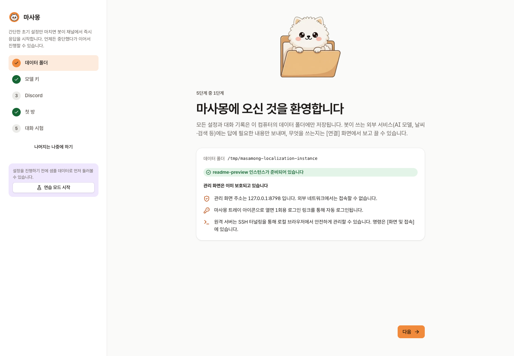
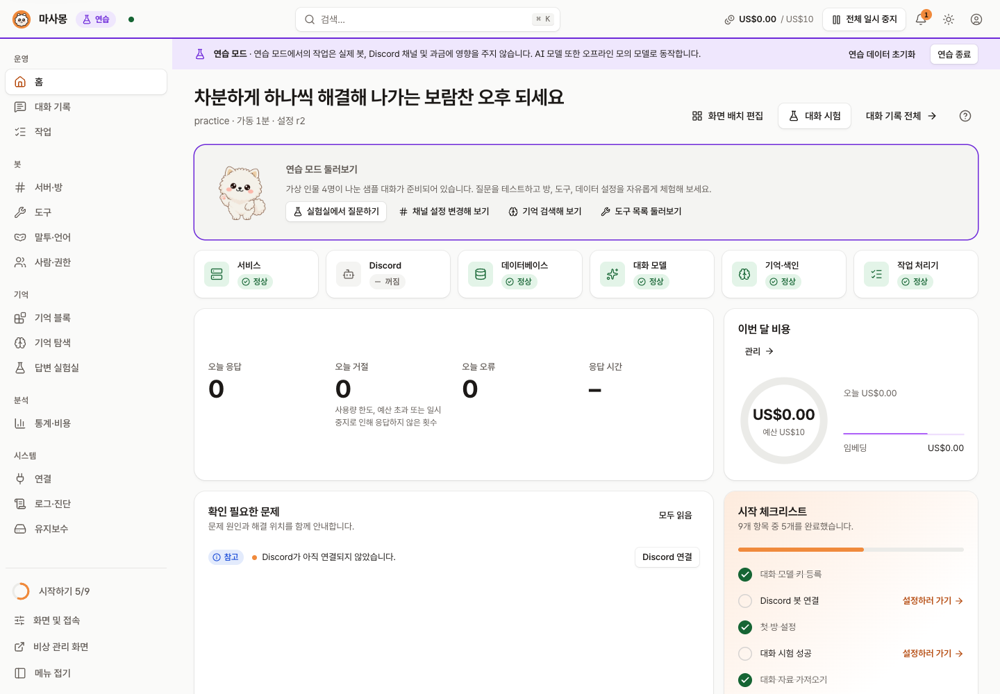
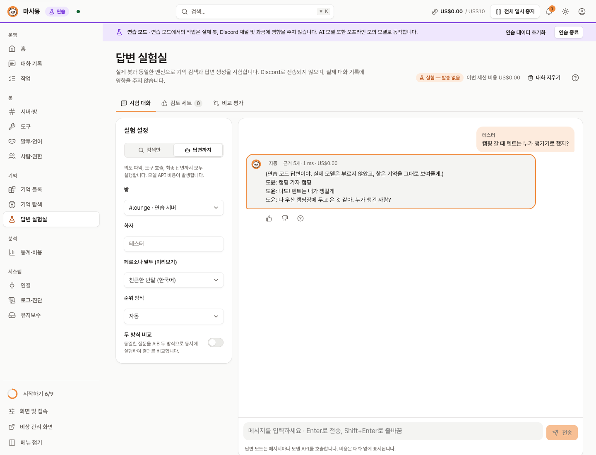
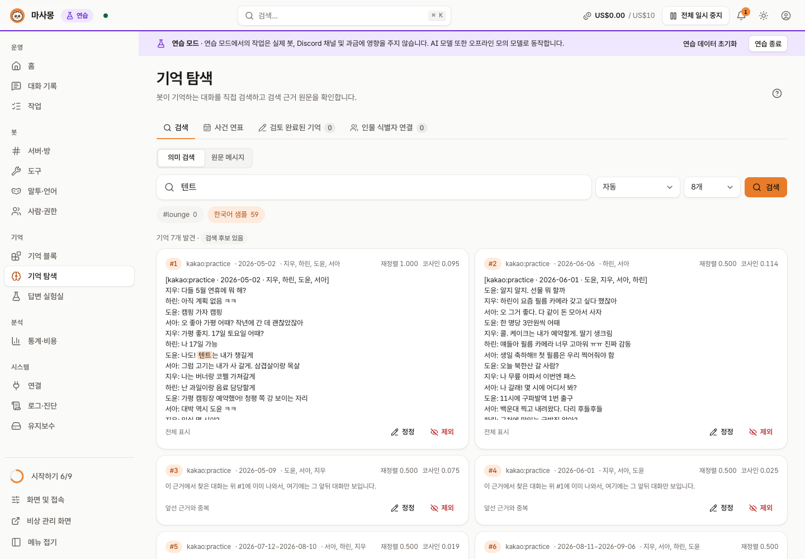
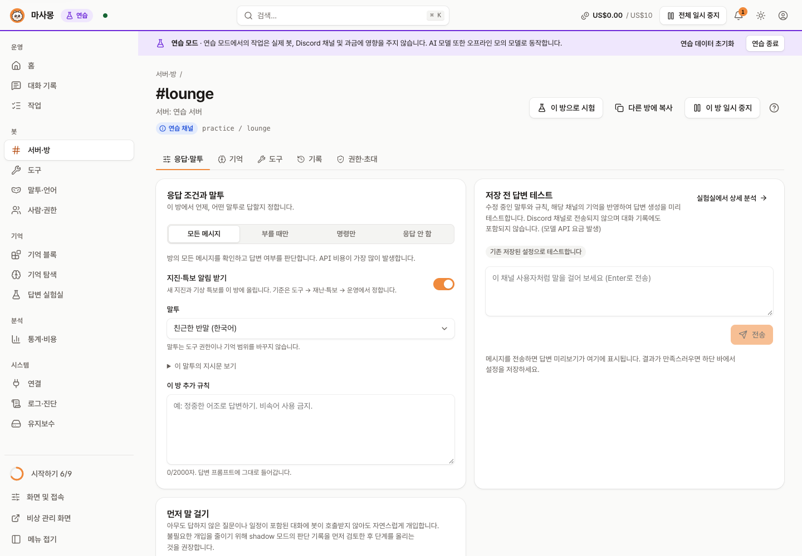
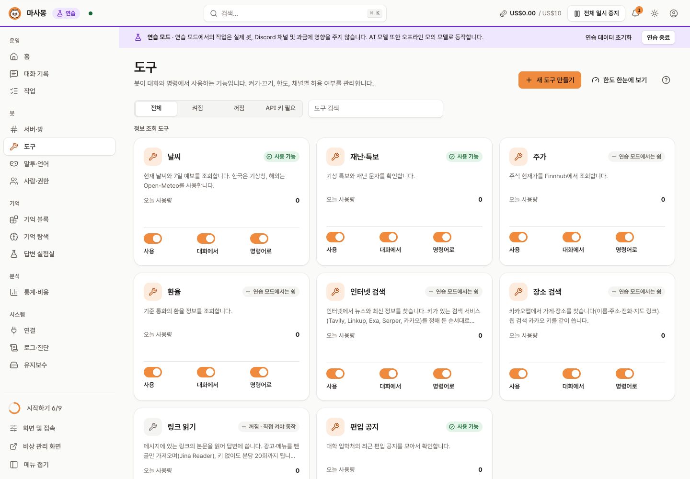

# 마사몽 (Masamong 2)

[English](README.md) | **한국어** | [日本語](README.ja.md) | [简体中文](README.zh-Hans.md) | [Español](README.es.md)

   


> 마사몽 2는 [마사몽](https://github.com/kim0040/masamong)(Python, 2025–2026)을 잇는 후속 버전입니다. 구 마사몽의 기능과 운영 경험을 이어받아 Go로 새로 만들었습니다. 구 마사몽은 2026-10-13부로 지원과 업데이트를 마쳤고, 구 마사몽의 개인 설정은 가져올 수 있습니다([방법](docs/STORAGE.md#이전-봇-개인-설정-가져오기-migrationapply)).

**마사몽은 친구들 Discord 방에서 같이 수다 떠는 AI 봇입니다.** 방에서 오간 대화를 기억해 두었다가 "저번에 캠핑 어디로 가기로 했더라?" 같은 질문에 친구처럼 답하고, 날씨·주가·환율·맛집·뉴스 검색도 대화하다가 바로 해 줍니다. 봇 설정은 내 컴퓨터에서만 열리는 웹 관리 화면에서 합니다.

한눈에 보기:

- **친구처럼 대화** — 방마다 말투와 답하는 조건을 정합니다
- **방 대화 기억** — 실시간 Discord 대화와 가져온 카카오톡 대화를 기억하고, 방마다 연결한 기억만 찾습니다
- **바로 찾아주는 도구** — 날씨·특보·지진, 주가, 환율, 웹 검색, 장소, 그림, 투표, 요약
- **개인 편의** — 알림, 아침 운세 DM, 학교·편입 공지 구독
- **비용 관리** — 월 예산과 도구별·사람별 한도
- **내 컴퓨터에서** — 각자 자기 컴퓨터나 서버에 설치해 자기 API 키로 돌립니다. 관리 화면은 `127.0.0.1`에만 열리고, 연습 모드로 무료로 둘러볼 수 있습니다

현재 버전: `0.2.0-dev`

**목차**: [화면](#화면) · [할 수 있는 것](#할-수-있는-것) · [시작하기](#시작하기) · [AI로 설치](#ai-코딩-에이전트로-설치하기) · [Discord에서 쓰기](#4-discord에서-쓰기) · [비용과 외부 서비스](#비용과-외부-서비스) · [문서](#문서) · [개발](#개발) · [기여자](#기여자) · [라이선스](#라이선스) · [면책 조항](#면책-조항)

## 화면

| 첫 설정 | 홈 |
|---|---|
|  |  |
| **답변 실험실** — 방 설정 그대로 질문해 보고 근거·비용·시간을 확인 | **기억 탐색** — 봇이 기억하는 대화를 직접 찾아보고 정정·제외 |
|  |  |
| **방 설정** — 언제 답할지, 말투, 추가 규칙, 저장 전 답변 테스트 | **도구** — 날씨·특보·주가·환율·검색·장소 등 켜기/끄기와 한도 |
|  |  |

화면은 모두 **연습 모드**(가상 인물 4명의 샘플 대화, 오프라인 모의 모델)에서 찍었습니다. 실제 사람의 대화는 들어 있지 않습니다. 다른 언어 화면은 [언어별 스크린샷 모음](docs/images/readme/README.md)에서 볼 수 있습니다.

## 할 수 있는 것

- **친구처럼 대화**: 방마다 말투(반말·존댓말·직접 쓴 페르소나)와 답하는 조건(모든 메시지 / 부를 때만 / 명령만 / 안 함)을 정합니다. 한국어·영어·일본어·중국어(간체)·스페인어를 기본 지원합니다.
- **방 대화 기억**: 실시간 Discord 대화와 가져온 카카오톡 대화(CSV)를 기억해 답에 씁니다. 방마다 **연결해 둔 기억만** 찾고, 다른 방·서버·DM의 대화는 섞지 않습니다. 기억에 없는 일은 지어내지 않고 모른다고 합니다.
- **도구**: 날씨(국내 기상청, 해외 Open-Meteo), 지진·기상특보 자동 알림, 주가, 환율, 웹 검색, 장소·맛집(카카오맵), 링크 읽기, 그림 그리기, 투표, 채널 요약, 수다왕 순위. 대화 중에 알아서 부르거나 `!날씨 서울`, `/weather`처럼 명령으로 부릅니다. 도구가 답을 못 주면 오류 카드 대신 대화로 이어 갑니다.
- **개인 편의**: "내일 3시에 알려줘" 알림(확인 후 예약), 아침 운세 DM, 학교·편입 공지 구독. 기능마다 따로 동의를 받고, 언제든 철회·삭제할 수 있습니다.
- **먼저 말 걸기**(선택): 아무도 답하지 않은 질문이나 약속을 보면 봇이 끼어듭니다. 끄기 / 판단만 기록 / 실제로 말 걸기 중에서 고릅니다.
- **비용 관리**: 월 예산, 도구별 하루 한도, 사람별 한도, 모델별 비용 장부. 예산을 넘으면 멈춥니다.
- **관리 화면**: 상태 점검, 대화 기록(봇이 왜 그렇게 답했는지 단계별로), 로그, 백업·복원, 진단. 화면은 `127.0.0.1`에만 열리고, 원격 서버는 SSH 터널로 접속합니다.
- **연습 모드**: 키 없이, 돈 안 들이고 샘플 데이터로 둘러볼 수 있습니다.

## 시작하기

준비물은 **Git**과 **Go 1.27 이상**뿐입니다(설치 스크립트가 소스를 빌드합니다). Go가 없으면 설치 스크립트가 [Releases](https://github.com/kim0040/masamong2/releases)의 내 OS·CPU용 압축 파일을 씁니다. 직접 풀어 둔 파일이든, 스크립트가 내려받는 파일이든 됩니다. **아직 공개된 릴리스는 없으니** 지금은 Go로 소스에서 설치하세요.

관리자 권한은 필요 없습니다. 프로그램은 내 사용자 폴더에 설치되고, 지워도 데이터 폴더는 남습니다.

### AI 코딩 에이전트로 설치하기

Claude Code, Codex, Cursor, Gemini CLI 같은 코딩 에이전트를 쓴다면 아래 프롬프트를 붙여 넣으세요. 에이전트가 [INSTALL.md](INSTALL.md)를 따라 그 컴퓨터에 설치합니다. 명령은 실행 전에 보여 주고, Git이나 Go를 설치해야 하면 먼저 묻습니다.

```text
마사몽을 설치해 줘. 먼저 https://raw.githubusercontent.com/kim0040/masamong2/main/INSTALL.md 을 끝까지 읽고, 이 컴퓨터에서 그 단계를 차례대로 진행해 줘. Discord 토큰이나 API 키를 이 대화에 붙여 넣으라고 하지 마. 키는 내가 마사몽 관리 화면에 직접 넣을게.
```

터미널에서 한 줄로:

```bash
claude "$(curl -fsSL https://raw.githubusercontent.com/kim0040/masamong2/main/INSTALL.md)"     # Codex: codex "$(curl -fsSL …)"
```

INSTALL.md는 넘기기 전에 직접 읽어 볼 수 있는 평범한 안내문입니다. 키는 언제나 대화가 아니라 관리 화면에 넣습니다(관리 화면이 OS 키체인에 보관합니다).

직접 설치하려면 아래 단계를 따르세요.

### 1. 설치

<details open>
<summary><b>macOS</b></summary>

```bash
# Go가 없으면: brew install go   (또는 https://go.dev/dl 의 .pkg)
# 메뉴 막대 아이콘까지 빌드하려면 Xcode 명령줄 도구: xcode-select --install
git clone https://github.com/kim0040/masamong2.git
cd masamong2
./install.sh --app      # ~/Applications/Masamong.app 도 함께 만듦 (--app 없이도 됨)
masamong open
```

메뉴 막대 아이콘으로 열고 닫을 수 있습니다. 로그인할 때 자동으로 켜려면 `masamong autostart on`.
</details>

<details>
<summary><b>Windows 10 / 11</b></summary>

PowerShell에서:

```powershell
# Git·Go가 없으면: winget install Git.Git GoLang.Go   (설치 후 PowerShell을 새로 열기)
git clone https://github.com/kim0040/masamong2.git
cd masamong2
powershell -ExecutionPolicy Bypass -File .\install.ps1
masamong open
```

`%LOCALAPPDATA%\Programs\Masamong`에 설치되고 **사용자** PATH에 추가됩니다. 알림 영역 아이콘으로 열고 닫습니다.

이미 열려 있던 PowerShell 창은 새 PATH를 보지 못하므로 `masamong open`은 **새** PowerShell 창에서 실행하세요. 같은 창에서 이어 가려면 전체 경로로 실행합니다(설치가 끝날 때 이 줄을 그대로 출력해 줍니다).

```powershell
& "$env:LOCALAPPDATA\Programs\Masamong\masamong.exe" open
```

Go(와 Git)가 없다면 릴리스의 `masamong_windows_amd64.zip`(ARM 노트북은 `arm64`)에서 `install.ps1`을 실행합니다. 스크립트만 있어도 됩니다. Go도 없고 옆에 프로그램도 없으면 Releases에서 그 ZIP을 내려받아 `SHA256SUMS`와 대조한 뒤에야 설치합니다.
</details>

<details>
<summary><b>Linux (데스크톱 · 서버 · Raspberry Pi)</b></summary>

```bash
# Go는 배포판 패키지가 오래된 경우가 많으니 https://go.dev/doc/install 에서 받으세요 (go version → 1.27 이상)
git clone https://github.com/kim0040/masamong2.git
cd masamong2
./install.sh            # ~/.local/bin 에 설치, PATH 자동 추가 (새 터미널 열기)
masamong open           # 데스크톱이면 브라우저가 열림
```

**화면 없는 서버**에서는 서비스만 켜고, 내 컴퓨터에서 SSH로 접속합니다.

```bash
# 서버에서
masamong start
masamong autostart on   # 재부팅 후에도 자동 시작 (systemd 사용자 서비스)
loginctl enable-linger $USER   # 로그아웃해도 계속 돌게 (한 번만)

# 내 컴퓨터에서 (masamong이 설치돼 있어야 함)
masamong connect user@server
```

관리 화면은 서버에서도 `127.0.0.1`에만 열리므로 포트를 바깥에 열 필요가 없습니다.
</details>

<details>
<summary><b>업데이트 · 삭제</b></summary>

```bash
cd masamong2 && git pull && ./install.sh        # 업데이트: 돌고 있던 서비스도 새 버전으로 다시 켜짐
./install.sh --uninstall                         # 삭제 (Windows: install.ps1 -Uninstall, PATH 항목도 지움). 데이터는 남음
```

데이터 폴더: macOS `~/Library/Application Support/Masamong`, Linux `~/.local/share/masamong`, Windows `%APPDATA%\Masamong`. 다른 폴더로 따로 띄우려면 `masamong --data-root <폴더> open`.
</details>

설치 옵션과 문제 해결은 [위키 › 설치](https://github.com/kim0040/masamong2/wiki/설치), [위키 › 문제 해결](https://github.com/kim0040/masamong2/wiki/문제-해결).

### 2. 관리 화면에서 첫 설정

`masamong open`이 서비스를 띄우고 브라우저에 1회용 로그인 링크를 엽니다. 비밀번호나 계정 만들기는 없습니다. 첫 설정 마법사가 차례로 안내합니다.

1. **데이터 폴더** 확인 — 모든 설정과 기억은 이 폴더에만 저장됩니다.
2. **모델 키** — OpenRouter, CometAPI, OpenAI 호환 서비스, Gemini 등에서 받은 API 키를 넣으면 추천 모델이 정해집니다.
3. **Discord 봇** — [Discord Developer Portal](https://discord.com/developers/applications)에서 앱과 봇을 만들고 **Message Content Intent**를 켠 뒤 토큰을 넣습니다. 화면에 나오는 초대 링크로 서버에 봇을 추가합니다.
4. **첫 방** — 봇이 답할 채널과 말투를 고릅니다.
5. **대화 시험** — 실제 채널에 보내지 않고 답을 미리 봅니다.

키 없이 먼저 보고 싶으면 첫 화면의 **연습 모드 시작**을 누릅니다.

### 3. 기억 넣기 (선택)

**기억 블록 → 가져오기**에서 카카오톡 대화 내보내기 CSV를 올리면 미리보기 → 예상 시간·비용 확인 → 백그라운드 색인 순으로 진행되고, 끝나면 원하는 방에 연결합니다. Discord 대화는 봇이 들어간 뒤부터 자동으로 쌓이고, 봇이 꺼져 있던 동안의 대화도 최근 7일까지 다시 채웁니다. 다른 사람의 대화를 넣기 전에는 그 방 사람들에게 꼭 알리세요.

### 4. Discord에서 쓰기

그냥 말을 걸면 됩니다(방의 응답 조건에 따라 멘션이 필요할 수 있습니다).

```text
마사몽 이번 주말 서울 비 와?
저번에 텐트 누가 챙기기로 했지?
홍대 분위기 좋은 카페 찾아줘
```

명령으로도 부를 수 있습니다. 느낌표 명령은 Message Content Intent가 켜져 있어야 합니다.

| 느낌표 명령 | 슬래시 명령 | 하는 일 |
|---|---|---|
| `!날씨 부산` | `/weather` | 현재 날씨와 최대 14일 예보(일주일 너머는 대략적) |
| `!특보`, `!지진` | `/alerts` | 기상특보·지진 |
| `!시세 삼성전자` | `/quote` | 주가 |
| `!환율 USD` | `/fx` | 환율 |
| `!검색 …` | `/search` | 웹 검색 |
| `!맛집 성수동 카페` | `/places` | 장소 찾기(카카오맵) |
| `!그림 …` | `/image` | 그림 그리기 |
| `!투표 질문 \| 보기1, 보기2` | `/poll` | Discord 투표 |
| `!요약` | `/summary` | 최근 대화 요약 |
| `!수다왕` | `/ranking` | 이 방에서 말 많이 한 사람 |
| `!알림 내일 3시 …` | `/remind` | 알림 예약 |
| `!운세` | `/fortune` | 오늘의 운세 |
| `!도움말` | `/help` | 지금 쓸 수 있는 명령 |

전체 목록과 이름 바꾸기는 [위키 › 도구와 한도](https://github.com/kim0040/masamong2/wiki/도구와-한도).

## 비용과 외부 서비스

마사몽 프로그램 자체, 데이터베이스(SQLite), 관리 화면, 백업, 키워드 검색, 연습 모드는 **무료**이고 구독도 없습니다. 돈이 드는 것은 **직접 연결한 외부 API**뿐이고, 요금은 그 회사에 직접 냅니다.

| 쓰는 곳 | 서비스 | 키 | 알아 둘 것 |
|---|---|---|---|
| 대화·기억 색인·그림 | OpenRouter, CometAPI, NanoGPT, Gemini, OpenAI 호환 | 필요 | 쓴 만큼 과금. 관리 화면의 월 예산으로 상한을 둡니다(한 번 대화에 보통 1센트 미만) |
| 국내 날씨·특보·지진 | 기상청 | 필요(무료) | 키가 없으면 국내 날씨도 Open-Meteo로 대신함 |
| 해외 날씨 | Open-Meteo | 불필요 | 무료 API는 **비상업용만**, 출처 표시(CC BY 4.0) |
| 장소·검색 | 카카오 | 필요(무료 쿼터) | |
| 웹 검색 | Linkup, Tavily, Exa, Serper, Brave, TinyFish 등 | 필요 | 서비스별 요금 |
| 주가 | Finnhub | 필요 | **개인용**. 받은 데이터를 다른 사람과 공유하려면 Finnhub 승인 필요 |
| 환율 | ExchangeRate-API | 필요 | 데이터 **재배포 금지** |
| 링크 읽기 | Jina Reader | 불필요 | 기본 꺼짐. 링크 주소를 외부로 보냄 |

키를 넣지 않은 도구는 꺼진 것처럼 동작하고, 봇은 그 기능이 지금 안 된다고만 말합니다. 주가·환율처럼 데이터 공유 조건이 있는 서비스는 여럿이 보는 방에서 써도 되는지 각 약관을 확인하세요([추후 작업 › 외부 서비스 약관](docs/BACKLOG.md#2-외부-서비스-약관-라이선스와-별개)).

## 지원 환경

| 운영체제 | 아키텍처 |
|---|---|
| macOS 12 이상 | arm64, amd64 (메뉴 막대 아이콘) |
| Linux | amd64, arm64, armv7(Raspberry Pi), riscv64 |
| Windows 10 이상 | amd64, arm64 (알림 영역 아이콘) |
| FreeBSD | amd64, arm64 (아이콘 없이 서비스·관리 화면) |

콘솔에서 입력한 키·토큰은 macOS에서는 키체인에, Windows에서는 **자격 증명 관리자**에, Linux·FreeBSD에서는 데이터 폴더의 소유자 전용 파일(`0600`)에 저장합니다. 파일은 권한으로만 보호할 뿐 암호화하지 않습니다. Windows에서는 `--data-root`로 지정한 데이터 폴더도 내 계정·SYSTEM·Administrators만 접근하도록 좁힙니다. `MASAMONG_SECRET_STORE=file`을 설정하면 어디서나 파일로 저장합니다. 설정 파일·로그·백업에는 키 원문이 아니라 참조만 들어갑니다.

## 문서

- [서비스 위키](https://github.com/kim0040/masamong2/wiki) (한국어 · [English](https://github.com/kim0040/masamong2/wiki/English)) — 설치, 빠른 시작, Discord 연결, 기억 블록, 도구와 한도, 설정 레퍼런스, 문제 해결 (원본: [docs/wiki](docs/wiki/Home.md))
- [언어별 화면 모음](docs/images/readme/README.md) · [문서 목차](docs/README.md) · [추후 작업](docs/BACKLOG.md) · [저장소 지도](docs/REPO_MAP.md)
- [기억 운영](docs/memory-operations.md) · [도구와 언어](docs/tools-and-languages.md) · [원문 데이터 처리 정책](docs/RAW_DATA_POLICY.md)

## 개발

```bash
go test ./... && go vet ./...
python3 scripts/license_audit.py
make ui        # 관리 화면을 고쳤을 때: ui/dist 다시 빌드(함께 커밋)
make try       # 실제 인스턴스와 분리된 테스트 인스턴스(~/.masamong-try)로 실행
               # Windows: powershell -ExecutionPolicy Bypass -File .\start-test.ps1 (플래그 -Reset -Check -Stop)
```

코드 구조와 규칙은 [CONTRIBUTING.md](CONTRIBUTING.md)와 [위키 › 개발 가이드](https://github.com/kim0040/masamong2/wiki/개발-가이드)에 있습니다. 실제 대화, 사용자 ID, 키, 운영 DB는 커밋·이슈에 올리지 마세요. 보안 문제는 [SECURITY.md](SECURITY.md)의 연락처로 알려 주세요.

## 기여자

- **김현민 (Hyunmin Kim)** — 만든 사람 · [mini0227kim@gmail.com](mailto:mini0227kim@gmail.com)

마사몽은 대학생이 수업과 일상 사이 틈틈이 만들고 돌보는 개인 프로젝트입니다. 친구들과 매일 쓰면서 시간이 되는 만큼 조금씩 다듬고 있지만, 회사 제품처럼 매끈하지는 않아 거친 부분이나 아쉬운 점, 느린 답변이 있을 수 있습니다. 그래도 누군가에게 도움이 되었으면 하는 마음으로 공개했으니, 너그럽게 봐 주시고 편하게 써 주세요.

버그 제보와 제안은 이슈로 남겨 주세요. 답이 늦을 수 있지만 하나씩 읽고 있습니다.

## 라이선스

마사몽의 코드와 문서는 [MIT License](LICENSE)로 배포합니다. 누구나 무료로 쓰고, 고치고, 다시 배포할 수 있습니다(저작권 표시와 라이선스 문구 유지).

- 함께 배포되는 제3자 라이브러리·글꼴·아이콘은 모두 무료로 재배포할 수 있는 라이선스(MIT, BSD, Apache-2.0, ISC, MPL-2.0, SIL OFL 1.1)이고, 유료·비상업·GPL/AGPL 조건은 없습니다. MPL-2.0인 MySQL 드라이버는 수정 없이 쓰며 원본 위치를 고지합니다. 자세한 내용은 [THIRD_PARTY_NOTICES.md](THIRD_PARTY_NOTICES.md), [THIRD_PARTY_LICENSES.txt](THIRD_PARTY_LICENSES.txt), [라이선스 감사](docs/license-audit.md).
- 마스코트·배너 그림은 AI 이미지 생성(Grok, OpenAI)으로 만든 뒤 다듬었습니다. 출처 표기는 [THIRD_PARTY_NOTICES.md](THIRD_PARTY_NOTICES.md#brand-artwork)에 있습니다.
- MIT 라이선스는 **코드**에 대한 것입니다. 외부 API로 받은 데이터와 서비스 이용에는 각 회사의 약관이 따로 적용됩니다(위 [비용과 외부 서비스](#비용과-외부-서비스)).

## 면책 조항

- **개인 프로젝트입니다.** 마사몽은 한 사람이 여가 시간에 만들고 돌보는 프로젝트로, 회사나 단체가 운영하는 서비스가 아닙니다. 지원·업데이트·보안 패치를 약속하지 않습니다.
- **있는 그대로(AS IS) 제공합니다.** MIT 라이선스 문구대로 어떤 보증도 없고, 이 프로그램을 쓰다가 생긴 손해(데이터 손실, 예상치 못한 API 요금, 계정 정지 등)에 대해 만든 사람은 책임지지 않습니다.
- **AI 답은 틀릴 수 있습니다.** 주가·환율·뉴스·운세를 포함한 봇의 답을 투자, 건강, 법률, 안전 같은 중요한 결정에 쓰지 마세요. 운세는 재미로만 보세요.
- **재난 알림은 공식 알림을 대신하지 않습니다.** 지진·기상특보 알림은 늦거나 빠질 수 있습니다. 안전에 관한 정보는 긴급재난문자, 기상청 등 공식 경로로 확인하세요.
- **비용은 본인 부담입니다.** 모든 외부 API는 설치한 사람의 키로 호출되고 요금도 그 사람에게 청구됩니다. 예산 한도 기능이 있지만 공급자 쪽 과금을 막아 준다는 보장은 없습니다. 키 관리도 본인 책임입니다.
- **대화 기록과 개인정보는 운영자 책임입니다.** 마사몽은 방 대화를 저장하고 기억으로 씁니다. 봇을 설치한 사람은 방 사람들에게 알리고 동의를 받아야 하며, 개인정보 보호법 등 관련 법과 Discord·카카오톡 등 각 서비스의 약관을 지켜야 합니다. 동의 철회·삭제 기능은 돕는 도구일 뿐 법적 의무를 대신하지 않습니다.
- **외부 서비스 약관은 각자 지켜야 합니다.** 일부 무료 API는 비상업용이거나 데이터 공유를 금지합니다. 공개 봇이나 상업 용도로 쓰려면 각 약관을 직접 확인하세요.
- **상표**: Discord, KakaoTalk, 카카오맵 및 각 AI·데이터 서비스의 이름과 상표는 각 소유자의 것입니다. 마사몽은 이 회사들과 관계가 없고, 후원이나 보증을 받지 않았습니다.
