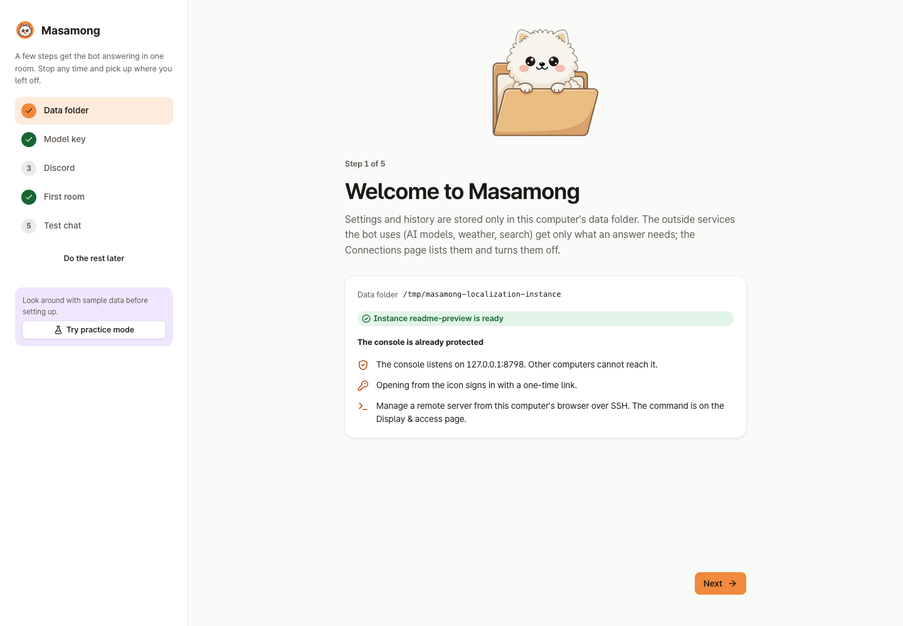
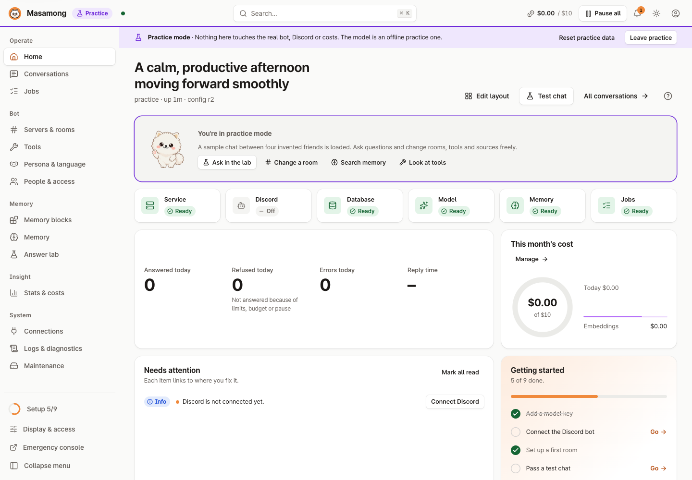
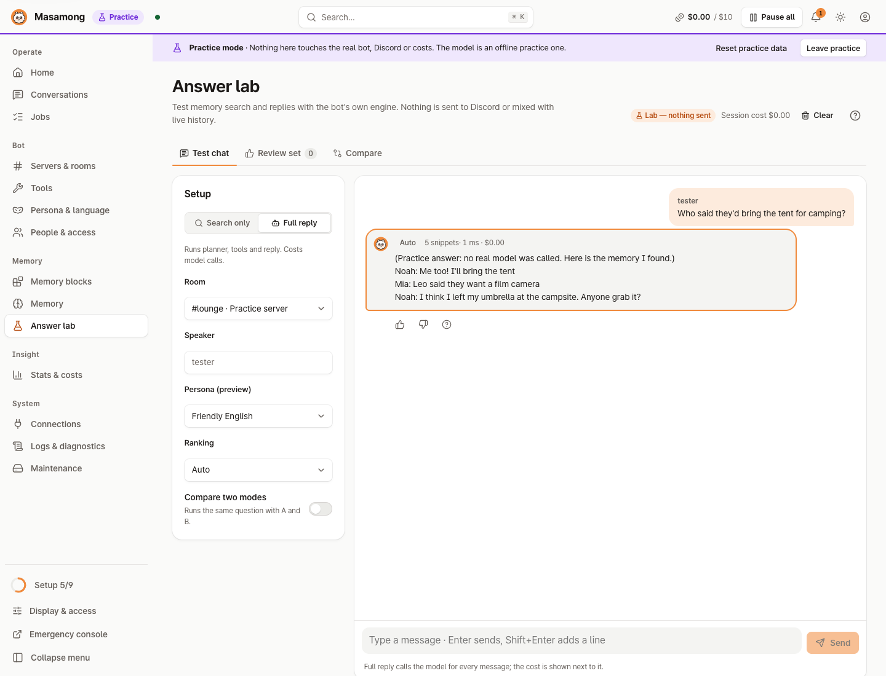
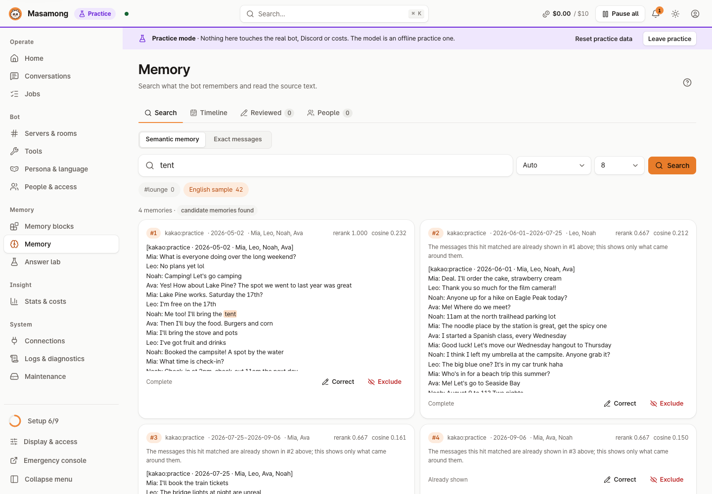
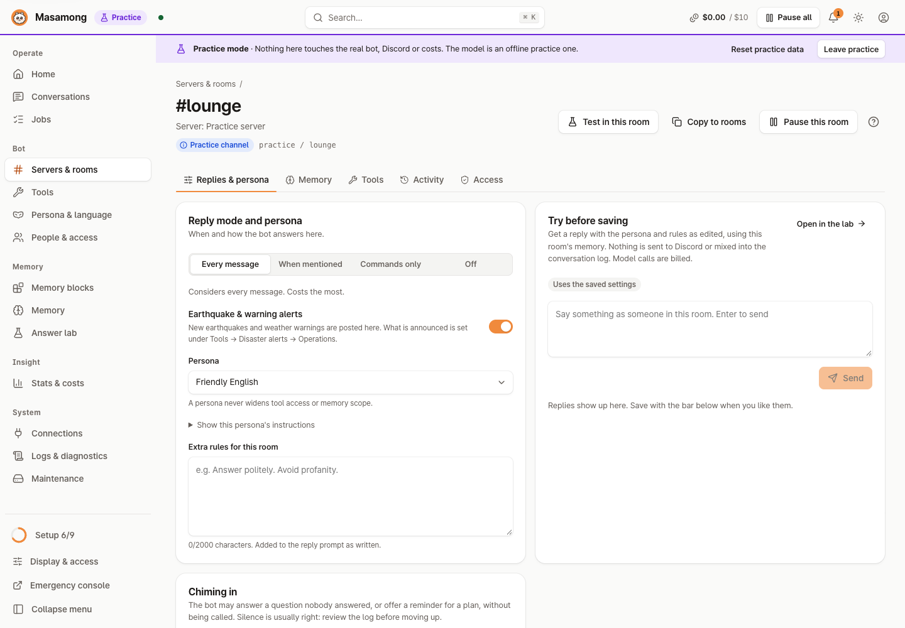
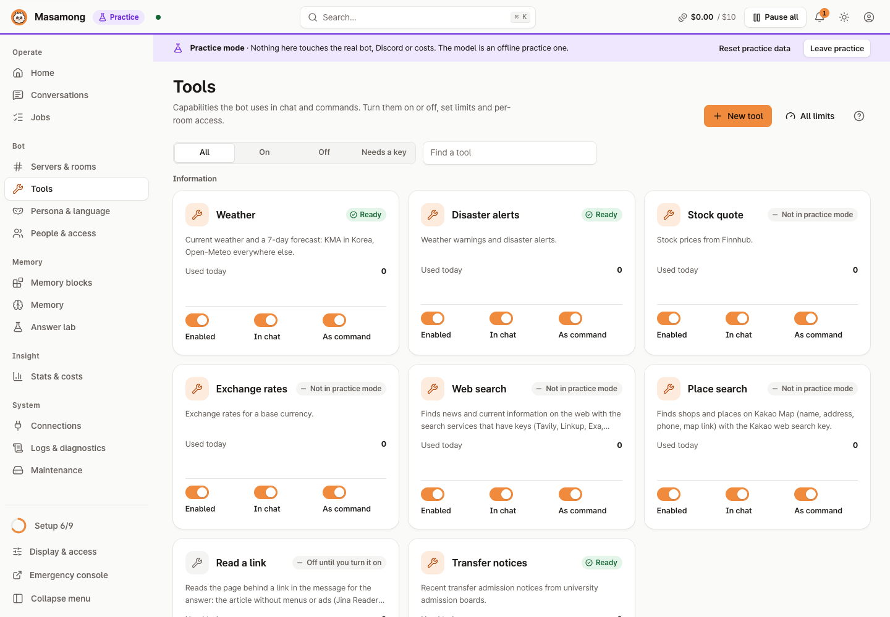

# Masamong 2

**English** | [한국어](README.ko.md) | [日本語](README.ja.md) | [简体中文](README.zh-Hans.md) | [Español](README.es.md)

   


> Masamong 2 is the successor to [Masamong](https://github.com/kim0040/masamong) (Python, 2025–2026; archived). It carries over that bot's features and lessons, rebuilt in Go. The original Masamong stopped receiving support and updates on 2026-10-13, and its personal settings can be imported ([how](docs/STORAGE.md#이전-봇-개인-설정-가져오기-migrationapply)).

**Masamong is an AI bot that hangs out in your friends' Discord server.** It remembers what was said in the room and answers questions like "where did we decide to go camping?" the way a friend would, and it looks up the weather, stock prices, exchange rates, places to eat and the news in the middle of a conversation. You set it up in a web console that only opens on your own computer.

In short:

- **Talks like a friend** — a persona and reply rules for each room
- **Remembers the room** — live Discord messages and imported KakaoTalk chats; each room searches only its own memory
- **Looks things up** — weather, warnings and earthquakes (Korea), stocks, exchange rates, web search, places, pictures, polls, summaries
- **Personal helpers** — reminders, a morning fortune DM, school notice subscriptions (Korean universities)
- **Keeps costs in check** — a monthly budget and per-tool, per-person limits
- **Runs on your machine** — you install your own copy and use your own API keys; the console binds to `127.0.0.1`, and practice mode lets you look around for free

Version: `1.0.0`

**Contents**: [Screenshots](#screenshots) · [What it does](#what-it-does) · [Getting started](#getting-started) · [Install with AI](#install-with-an-ai-coding-agent) · [Using it in Discord](#4-using-it-in-discord) · [Costs and outside services](#costs-and-outside-services) · [Docs](#docs) · [Development](#development) · [Contributors](#contributors) · [License](#license) · [Disclaimer](#disclaimer)

## Screenshots

| First setup | Home |
|---|---|
|  |  |
| **Answer lab** — ask with a room's settings, see the evidence, cost and timing | **Memory explorer** — search what the bot remembers, correct or exclude it |
|  |  |
| **Room settings** — when to reply, persona, extra rules, test before saving | **Tools** — weather, alerts, stocks, FX, search, places: on/off and limits |
|  |  |

All screenshots are from **practice mode** (a sample chat between four made-up people, an offline mock model). No real person's conversation is shown. See the [five-language screenshot gallery](docs/images/readme/README.md) for every localized view.

## What it does

- **Talks like a friend**: each room gets a persona (casual, polite, or your own) and a reply rule (every message / when called / commands only / off). Korean, English, Japanese, Simplified Chinese and Spanish are built in.
- **Remembers the room**: live Discord messages and imported KakaoTalk chats (CSV) become memory. Each room searches **only the memory attached to it**; other rooms, servers and DMs never mix in. What is not in memory is not made up.
- **Tools**: weather (KMA in Korea, Open-Meteo elsewhere), automatic earthquake and weather-warning posts (Korea), stock quotes, exchange rates, web search, places in Korea (Kakao Map), link reading, pictures, polls, channel summaries, top talkers. The bot calls them on its own in conversation, or you use commands like `!weather London` or `/weather`. When a tool has no answer, the bot carries on talking instead of showing an error card.
- **Personal helpers**: reminders ("remind me tomorrow at 3", confirmed before scheduling), a morning fortune DM, school notice subscriptions (Korean universities). Each needs its own consent, which can be withdrawn and deleted at any time.
- **Korea-only parts**: warnings and earthquakes (KMA), place search (Kakao Map) and school notices cover Korea only. An instance set up in another language and time zone starts with warnings and school notices off; turn them on in **Settings & history → Feature switches**. Weather, stocks, exchange rates and web search work everywhere.
- **Chiming in** (optional): the bot can step in on unanswered questions or plans. Off / log the decision only / actually speak.
- **Cost control**: monthly budget, daily limits per tool and per person, a cost ledger per model. It stops at the budget.
- **Console**: status checks, conversation history (why the bot answered the way it did, step by step), logs, backup and restore, diagnostics. It binds to `127.0.0.1` only; reach a remote server through an SSH tunnel.
- **Practice mode**: look around with sample data, no keys, no cost.

## Getting started

The quickest way needs **no Git and no Go**: one command ([Quick install](#quick-install)) downloads the release for your OS and CPU. **Git** and **Go 1.27 or later** are only needed to build from source. The first public release is **v1.0.0**; every version is on the [Releases](https://github.com/kim0040/masamong2/releases) page.

No administrator rights are needed. The programs go into your user folder, and uninstalling keeps your data.

### Quick install

macOS, Linux, FreeBSD:

```bash
curl -fsSL https://raw.githubusercontent.com/kim0040/masamong2/main/install.sh | sh
```

Windows (PowerShell):

```powershell
irm https://raw.githubusercontent.com/kim0040/masamong2/main/install.ps1 | iex
```

The script downloads the release for your OS and CPU, checks it against `SHA256SUMS` and installs it into your user folder. On macOS, Linux and FreeBSD it also adds one line to your shell profile if that folder is not on PATH (`--no-modify-path` skips it; pass options like `| sh -s -- --no-modify-path`). Pin a version with `MASAMONG_VERSION=v1.0.0` (`curl -fsSL … | MASAMONG_VERSION=v1.0.0 sh`; in PowerShell run `$env:MASAMONG_VERSION = 'v1.0.0'` first). When it ends, open a new terminal and run `masamong open`, or use the full path the script prints.

### Install with an AI coding agent

Using Claude Code, Codex, Cursor, Gemini CLI or another coding agent? Paste this prompt into it. It installs Masamong on that computer by following [INSTALL.md](INSTALL.md): by default the release download, which needs no Git or Go. It shows each command before running it and asks before installing anything it needs, such as Git and Go for a source build.

```text
Install Masamong for me. First read https://raw.githubusercontent.com/kim0040/masamong2/main/INSTALL.md in full, then follow it step by step on this computer. Never ask me to paste a Discord token or an API key into this chat; I will type those into the Masamong console myself.
```

The same from a terminal, in one line. On macOS and Linux (bash or zsh):

```bash
claude "$(curl -fsSL https://raw.githubusercontent.com/kim0040/masamong2/main/INSTALL.md)"     # Codex: codex "$(curl -fsSL …)"
```

In PowerShell, `$(curl …)` does not work, so pass the prompt text itself (this also works in bash, zsh and cmd):

```powershell
claude "Install Masamong for me. First read https://raw.githubusercontent.com/kim0040/masamong2/main/INSTALL.md in full, then follow it step by step on this computer. Never ask me to paste a Discord token or an API key into this chat; I will type those into the Masamong console myself."
codex "Install Masamong for me. First read https://raw.githubusercontent.com/kim0040/masamong2/main/INSTALL.md in full, then follow it step by step on this computer. Never ask me to paste a Discord token or an API key into this chat; I will type those into the Masamong console myself."
```

For Gemini CLI, Cursor and other agents, paste the prompt into the agent's chat.

INSTALL.md is plain-text instructions you can read before handing it over. Keys always go into the console (and from there into your OS keychain), never into the chat.

Prefer to do it yourself? Follow the steps below.

### 1. Install

Building from source needs Git and Go 1.27+. If you would rather not, use the [quick install](#quick-install) above.

<details open>
<summary><b>macOS</b></summary>

```bash
# No Go? brew install go   (or the .pkg from https://go.dev/dl)
# For the menu bar icon, the Xcode command line tools: xcode-select --install
git clone https://github.com/kim0040/masamong2.git
cd masamong2
./install.sh --app      # also builds ~/Applications/Masamong.app (optional)
~/.local/bin/masamong open     # or in a new terminal: masamong open
```

Open and quit from the menu bar icon. To start at login: `masamong autostart on`.
</details>

<details>
<summary><b>Windows 10 / 11</b></summary>

In PowerShell:

```powershell
# No Git or Go? winget install Git.Git GoLang.Go   (then open a new PowerShell)
git clone https://github.com/kim0040/masamong2.git
cd masamong2
powershell -ExecutionPolicy Bypass -File .\install.ps1
masamong open
```

It installs into `%LOCALAPPDATA%\Programs\Masamong` and adds it to your **user** PATH. Open and quit from the notification area icon.

A PowerShell window that was already open does not see the new PATH, so run `masamong open` in a **new** PowerShell window. To continue in the same window, use the full path (the installer prints this line at the end):

```powershell
& "$env:LOCALAPPDATA\Programs\Masamong\masamong.exe" open
```

Without Go (or Git), run `install.ps1` from the release `masamong_windows_amd64.zip` (`arm64` for ARM laptops). Even the script alone is enough: with no Go and no programs next to it, it downloads that ZIP from Releases and checks it against `SHA256SUMS` before installing.
</details>

<details>
<summary><b>Linux (desktop · server · Raspberry Pi)</b></summary>

```bash
# Distribution Go packages are often too old: get Go from https://go.dev/doc/install (go version → 1.27+)
git clone https://github.com/kim0040/masamong2.git
cd masamong2
./install.sh            # installs into ~/.local/bin and adds it to PATH (open a new terminal)
~/.local/bin/masamong open           # opens a browser on a desktop; or in a new terminal: masamong open
```

On a **headless server**, start the service there and connect from your own computer over SSH:

```bash
# on the server
masamong start
masamong autostart on          # start again after a reboot (systemd user service)
loginctl enable-linger $USER   # keep running after you log out (once)

# on your computer (with masamong installed)
masamong connect user@server
```

`masamong connect` opens the console in your browser, already signed in. Press `Ctrl+C` when you are done (the bot keeps running on the server). Even on a server the console listens on `127.0.0.1` only, so no port has to be opened.

First time? Follow "Opening the console of a remote server" in [Wiki › Admin console](https://github.com/kim0040/masamong2/wiki/Admin-Console): it covers a separate SSH key file, opening it with `ssh` alone when Masamong is not on your computer, and what to do for each error message.
</details>

<details>
<summary><b>Update · uninstall</b></summary>

Installed from a release: console → **Maintenance** → **Update now**, or run the quick-install command again. Built from source:

```bash
cd masamong2 && git pull && ./install.sh   # update: a running service restarts on the new version
./install.sh --uninstall                   # uninstall (Windows: install.ps1 -Uninstall, which also removes its PATH entry); data stays
```

Data folder: macOS `~/Library/Application Support/Masamong`, Linux `~/.local/share/masamong`, Windows `%APPDATA%\Masamong`. To run a separate instance: `masamong --data-root <folder> open`.
</details>

Install options and troubleshooting: [wiki › Installation](https://github.com/kim0040/masamong2/wiki/Installation), [wiki › Troubleshooting](https://github.com/kim0040/masamong2/wiki/Troubleshooting).

### 2. First setup in the console

`masamong open` starts the service and opens a one-time sign-in link in your browser. There is no password or account to create. A setup wizard walks you through:

1. **Data folder** — every setting and memory lives here only.
2. **Model key** — an API key from OpenRouter, CometAPI, an OpenAI-compatible service, Gemini and so on; recommended models are picked for you.
3. **Discord bot** — create an app and a bot in the [Discord Developer Portal](https://discord.com/developers/applications), turn on **Message Content Intent**, and paste the token. Add the bot to your server with the invite link shown.
4. **First room** — the channel the bot answers in, and its persona.
5. **Test chat** — see a reply without posting to the channel.

To look around without keys first, press **Try practice mode** on the first screen.

### 3. Add memory (optional)

In **Memory blocks → Import**, upload a KakaoTalk chat export (CSV): preview → estimated time and cost → background indexing, then attach the block to a room. Discord messages are remembered from the moment the bot joins, and up to 7 days missed while it was off are filled in. Tell the people in a room before you import their conversation.

### 4. Using it in Discord

Just talk to it (depending on the room's reply rule you may need to mention it).

```text
@Masamong will it rain in Seoul this weekend?
who said they'd bring the tent last time?
find a cozy cafe in Hongdae
```

Commands work too. Prefix commands need the Message Content Intent. The prefix words follow the bot's language (English shown).

| Prefix | Slash | What it does |
|---|---|---|
| `!weather Paris` | `/weather` | Current weather and a forecast up to 14 days (rough beyond a week) |
| `!alerts` | `/alerts` | Weather warnings, earthquakes |
| `!quote AAPL` | `/quote` | Stock quote |
| `!fx USD` | `/fx` | Exchange rates |
| `!search …` | `/search` | Web search |
| `!places Seongsu cafe` | `/places` | Find places in Korea (Kakao Map) |
| `!image …` | `/image` | Draw a picture |
| `!poll question \| a, b` | `/poll` | Discord poll |
| `!summary` | `/summary` | Summarize recent conversation |
| `!ranking` | `/ranking` | Who talked most in this room |
| `!remind …` | `/remind` | Set a reminder |
| `!fortune` | `/fortune` | Today's fortune |
| `!help` | `/help` | Commands available right now |

Full list and renaming: [wiki › Tools and limits](https://github.com/kim0040/masamong2/wiki/Tools-and-Limits).

## Costs and outside services

Masamong itself, its database (SQLite), the console, backups, keyword search and practice mode are **free**, with no subscription. You only pay for **outside APIs you connect**, directly to those companies.

| Used for | Service | Key | Good to know |
|---|---|---|---|
| Chat, memory indexing, pictures | OpenRouter, CometAPI, NanoGPT, Gemini, OpenAI-compatible | yes | Pay per use; cap it with the monthly budget (usually under a cent per reply) |
| Weather, warnings, earthquakes in Korea | KMA (Korea Meteorological Administration) | yes (free) | Without a key, Korean weather also comes from Open-Meteo |
| Weather elsewhere | Open-Meteo | no | The free API is **non-commercial only**; credit required (CC BY 4.0) |
| Places, search | Kakao | yes (free quota) | |
| Web search | Linkup, Tavily, Exa, Serper, Brave, TinyFish and others | yes | Priced per service |
| Stock quotes | Finnhub | yes | **Personal use**; sharing the data with others needs Finnhub's approval |
| Exchange rates | ExchangeRate-API | yes | **No redistribution** of the data |
| Link reading | Jina Reader | no | Off by default; sends the link to an outside service |

A tool without its key acts as if it were off, and the bot just says that feature is not available. For services with data-sharing terms (stocks, FX), check whether posting their data in a shared room is allowed ([backlog › outside service terms](docs/BACKLOG.md#2-외부-서비스-약관), Korean).

## Supported platforms

| OS | Architectures |
|---|---|
| macOS 12+ | arm64, amd64 (menu bar icon) |
| Linux | amd64, arm64, armv7 (Raspberry Pi), riscv64 |
| Windows 10+ | amd64, arm64 (notification area icon) |
| FreeBSD | amd64, arm64 (service and console, no icon) |

Keys and tokens typed in the console go into the macOS Keychain, **Windows Credential Manager**, or on Linux and FreeBSD an owner-only file (`0600`) in the data folder. Those files are protected by permissions only, not encrypted; on Windows, a data folder given with `--data-root` is also locked down to your account, SYSTEM and Administrators. `MASAMONG_SECRET_STORE=file` forces files everywhere. Config files, logs and backups never contain a key, only a reference to it.

## Docs

The wiki is in English and Korean; the other documents are in Korean.

- [Wiki (English)](https://github.com/kim0040/masamong2/wiki/English) — installation, quick start, Discord, memory blocks, tools and limits, configuration reference, troubleshooting (source: [docs/wiki](docs/wiki/English.md))
- [Screenshot gallery](docs/images/readme/README.md) · [Docs index](docs/README.md) · [Backlog](docs/BACKLOG.md) · [Repository map](docs/REPO_MAP.md)
- [Memory operations](docs/memory-operations.md) · [Tools and languages](docs/tools-and-languages.md) · [Raw data policy](docs/RAW_DATA_POLICY.md)

## Development

```bash
go test ./... && go vet ./...
python3 scripts/license_audit.py
make ui        # after changing the console: rebuild ui/dist (commit it too)
make try       # run a test instance separate from your real one (~/.masamong-try)
               # Windows: powershell -ExecutionPolicy Bypass -File .\start-test.ps1 (flags -Reset -Check -Stop)
```

Code layout and rules: [CONTRIBUTING.md](CONTRIBUTING.md) and [wiki › Development guide](https://github.com/kim0040/masamong2/wiki/Development-Guide). Never commit or post real conversations, user IDs, keys or production databases. Report security problems to the contact in [SECURITY.md](SECURITY.md).

## Contributors

- **Hyeonmin Kim (김현민)** — author · [mini0227kim@gmail.com](mailto:mini0227kim@gmail.com)

Masamong is a spare-time project by a university student, built and looked after between classes and everyday life. It is used every day with friends and improved whenever there is time, but it has not been through the polish of a company product — you may run into rough edges, missing conveniences or slow replies. It is shared in the hope that you find it useful anyway.

Bug reports and ideas are welcome as issues; replies may be slow, but every one is read.

## License

Masamong's code and docs are released under the [MIT License](LICENSE): anyone may use, change and redistribute them for free, keeping the copyright and license notice.

- Every third-party library, font and icon set shipped with it is under a free, redistributable license (MIT, BSD, Apache-2.0, ISC, MPL-2.0, SIL OFL 1.1); none is paid, non-commercial, GPL or AGPL. The MPL-2.0 MySQL driver is used unmodified and its source location is noted. See [THIRD_PARTY_NOTICES.md](THIRD_PARTY_NOTICES.md), [THIRD_PARTY_LICENSES.txt](THIRD_PARTY_LICENSES.txt) and the [license audit](docs/license-audit.md).
- The mascot and banner art were made with AI image generation (Grok, OpenAI) and then edited. Credits are in [THIRD_PARTY_NOTICES.md](THIRD_PARTY_NOTICES.md#brand-artwork).
- The MIT License covers the **code**. Data from outside APIs, and the use of those services, fall under each company's own terms (see [Costs and outside services](#costs-and-outside-services)).

## Disclaimer

- **This is a personal project.** Masamong is built and maintained by one person in their spare time, not by a company or organization. There is no promise of support, updates or security fixes.
- **It is provided as is.** As the MIT License says, there is no warranty of any kind, and the author is not liable for any harm from using it (lost data, unexpected API bills, suspended accounts, and so on).
- **AI answers can be wrong.** Do not use the bot's answers, including stock prices, exchange rates, news and fortunes, for investment, health, legal, safety or other important decisions. Fortunes are for fun.
- **Disaster posts do not replace official alerts.** Earthquake and weather-warning posts can be late or missing. Get safety information from official channels (emergency alerts, the national weather service).
- **You pay your own costs.** Every outside API is called with the installer's own keys and billed to them. The budget limit helps but cannot guarantee a provider will not charge more. Keeping keys safe is your responsibility.
- **Conversation records and personal data are the operator's responsibility.** Masamong stores room conversations and uses them as memory. Whoever installs it must tell the people in the room and get their consent, and must follow the applicable laws (such as personal-data protection laws) and the terms of Discord, KakaoTalk and the other services. The consent-withdrawal and deletion features help, but do not replace legal duties.
- **Follow each outside service's terms yourself.** Some free APIs are non-commercial only or forbid sharing their data. For a public bot or commercial use, check each service's terms.
- **Trademarks**: Discord, KakaoTalk, Kakao Map and the names of the AI and data services belong to their owners. Masamong is not affiliated with, sponsored or endorsed by any of them.
