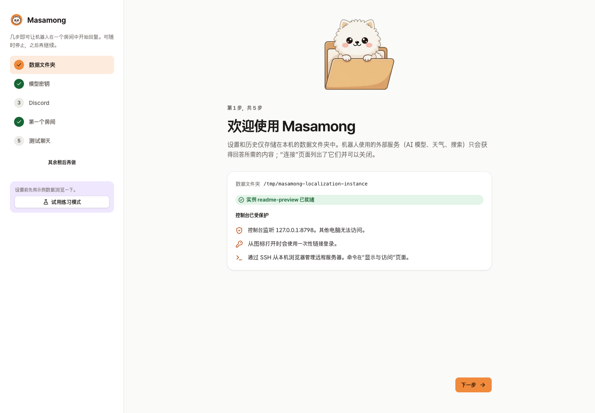
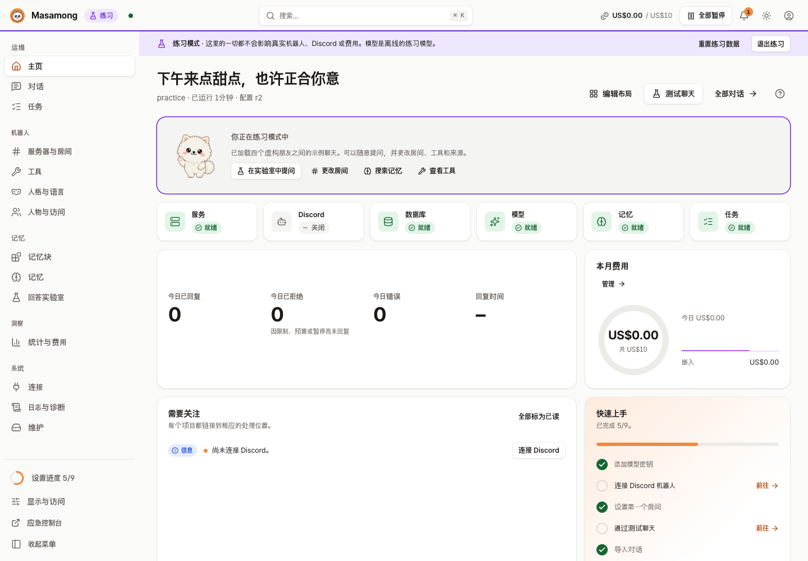
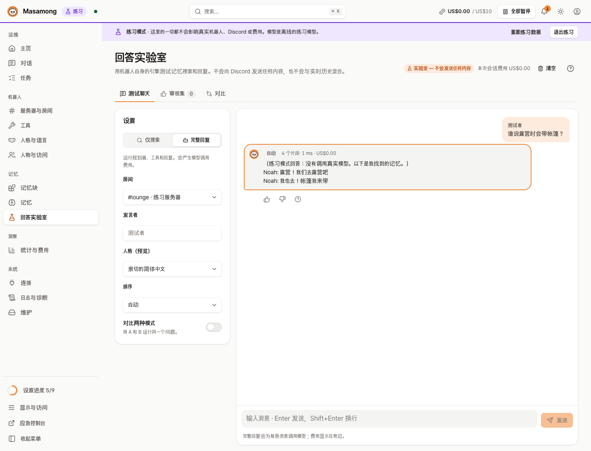
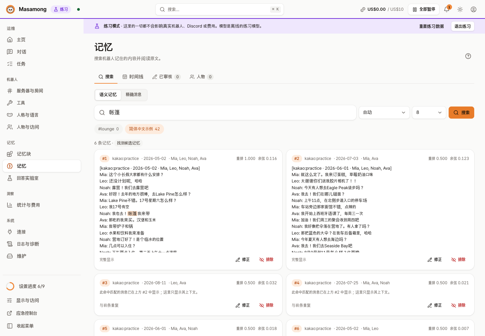
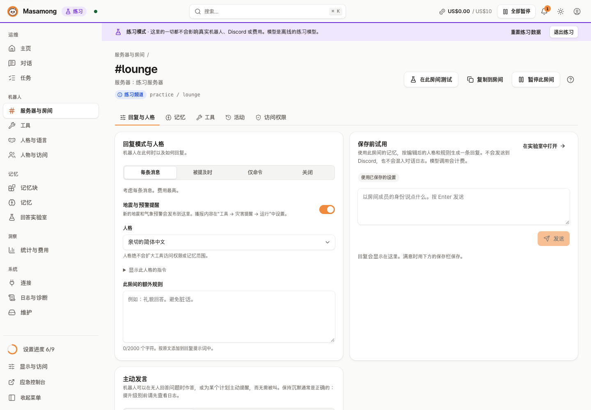
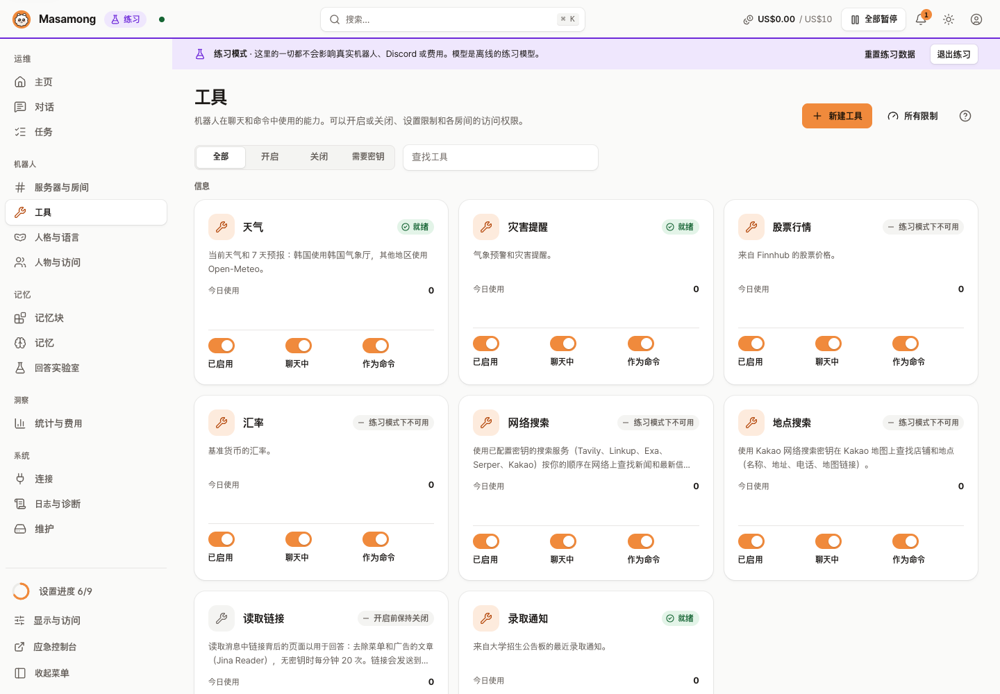

# Masamong 2

[English](README.md) | [한국어](README.ko.md) | [日本語](README.ja.md) | **简体中文** | [Español](README.es.md)

   


> Masamong 2 是 [Masamong](https://github.com/kim0040/masamong)（Python，2025–2026）的后继版本。它继承了旧版的功能和运营经验，用 Go 重新编写。旧版 Masamong 已于 2026-10-13 停止支持和更新，其个人设置可以导入（[方法](docs/STORAGE.md#이전-봇-개인-설정-가져오기-migrationapply)）。

**Masamong 是一个常驻在你朋友 Discord 服务器里的 AI 机器人。** 它会记住房间里说过的话，像朋友一样回答“我们上次决定去哪里露营来着？”这样的问题，还能在聊天过程中查询天气、股价、汇率、餐厅和新闻。你可以在只在自己电脑上打开的 Web 控制台里完成设置。

简单来说：

- **像朋友一样聊天** —— 每个房间可设置人设和回复规则
- **记住房间** —— 实时 Discord 消息和导入的 KakaoTalk 聊天记录；每个房间只搜索自己的记忆
- **查询信息** —— 天气、预警和地震、股票、汇率、网络搜索、地点、图片、投票、总结
- **个人助手** —— 提醒、每日早间运势私信、学校通知订阅
- **控制成本** —— 每月预算以及按工具、按人设置的限额
- **运行在你自己的机器上** —— 你安装自己的副本并使用自己的 API 密钥；控制台只绑定 `127.0.0.1`，练习模式可以免费体验

版本：`0.2.0-dev`

**目录**：[截图](#截图) · [功能](#功能) · [快速开始](#快速开始) · [用 AI 安装](#用-ai-编程助手安装) · [在 Discord 中使用](#4-在-discord-中使用) · [费用与外部服务](#费用与外部服务) · [文档](#文档) · [开发](#开发) · [贡献者](#贡献者) · [许可证](#许可证) · [免责声明](#免责声明)

## 截图

| 首次设置 | 首页 |
|---|---|
|  |  |
| **回答实验室** —— 用房间的设置提问，查看依据、费用和耗时 | **记忆浏览器** —— 搜索机器人记住的内容，进行修正或排除 |
|  |  |
| **房间设置** —— 何时回复、人设、附加规则，保存前先测试 | **工具** —— 天气、预警、股票、汇率、搜索、地点：开关和限额 |
|  |  |

所有截图都来自**练习模式**（四个虚构人物之间的示例聊天，使用离线的模拟模型）。不会显示任何真人的对话。其他语言的界面截图请参阅[多语言截图集](docs/images/readme/README.md)。

## 功能

- **像朋友一样聊天**：每个房间都可以设置人设（随意、礼貌或自定义）和回复规则（每条消息 / 被叫到时 / 仅命令 / 关闭）。内置韩语、英语、日语、简体中文和西班牙语。
- **记住房间**：实时 Discord 消息和导入的 KakaoTalk 聊天记录（CSV）会成为记忆。每个房间**只搜索属于自己的记忆**；其他房间、服务器和私信绝不会混入。记忆里没有的内容，机器人不会编造。
- **工具**：天气（韩国用 KMA，其他地区用 Open-Meteo）、地震和天气预警自动推送、股票行情、汇率、网络搜索、地点（Kakao Map）、链接阅读、图片、投票、频道总结、发言排行。机器人会在对话中自行调用这些工具，你也可以使用 `!天气 Seoul` 或 `/weather` 这样的命令。当工具查不到结果时，机器人会继续聊天，而不是显示错误卡片。
- **个人助手**：提醒（“明天 3 点提醒我”，确认后才会创建）、每日早间运势私信、学校通知订阅。每项功能都需要单独同意，随时可以撤回并删除。
- **主动搭话**（可选）：机器人可以介入无人回答的问题或计划。关闭 / 仅记录判断 / 实际发言。
- **成本控制**：每月预算、按工具和按人设置的每日限额、按模型记录的费用账本。达到预算就会停止。
- **控制台**：状态检查、对话历史（逐步查看机器人为什么这样回答）、日志、备份与恢复、诊断。只绑定 `127.0.0.1`；访问远程服务器请通过 SSH 隧道。
- **练习模式**：用示例数据随便体验，不需要密钥，也不产生费用。

## 快速开始

你只需要 **Git** 和 **Go 1.27 或更高版本**（安装脚本会从源码构建）。没有 Go 时，安装脚本会使用 [Releases](https://github.com/kim0040/masamong2/releases) 中适合你操作系统和 CPU 的压缩包：可以是你自己解压的，也可以由脚本下载。**目前还没有发布任何版本**，所以现在请用 Go 从源码安装。

不需要管理员权限。程序会安装到你的用户文件夹，卸载后数据仍会保留。

### 用 AI 编程助手安装

如果你在用 Claude Code、Codex、Cursor、Gemini CLI 等编程助手，把下面的提示词粘贴进去即可。它会按照 [INSTALL.md](INSTALL.md) 在那台电脑上安装，每条命令执行前都会先给你看；需要安装 Git 或 Go 时会先问你。

```text
帮我安装 Masamong。先完整读一遍 https://raw.githubusercontent.com/kim0040/masamong2/main/INSTALL.md ，然后在这台电脑上按步骤依次执行。不要让我把 Discord 令牌或 API 密钥粘贴到这个对话里；密钥我会自己填进 Masamong 控制台。
```

在终端里一行搞定：

```bash
claude "$(curl -fsSL https://raw.githubusercontent.com/kim0040/masamong2/main/INSTALL.md)"     # Codex: codex "$(curl -fsSL …)"
```

INSTALL.md 是普通的说明文本，交给助手前你可以自己先读一遍。密钥永远填在控制台里（由控制台存进系统钥匙串），不要发到对话里。

想自己动手的话，按下面的步骤来。

### 1. 安装

<details open>
<summary><b>macOS</b></summary>

```bash
# 没有 Go？brew install go   （或从 https://go.dev/dl 下载 .pkg）
# 想要菜单栏图标，需要 Xcode 命令行工具：xcode-select --install
git clone https://github.com/kim0040/masamong2.git
cd masamong2
./install.sh --app      # 同时构建 ~/Applications/Masamong.app（可选）
masamong open
```

从菜单栏图标打开和退出。开机自启：`masamong autostart on`。
</details>

<details>
<summary><b>Windows 10 / 11</b></summary>

在 PowerShell 中：

```powershell
# 没有 Git 或 Go？winget install Git.Git GoLang.Go   （然后打开新的 PowerShell）
git clone https://github.com/kim0040/masamong2.git
cd masamong2
powershell -ExecutionPolicy Bypass -File .\install.ps1
masamong open
```

会安装到 `%LOCALAPPDATA%\Programs\Masamong` 并添加到**用户** PATH。从通知区域图标打开和退出。

已经打开的 PowerShell 窗口看不到新的 PATH，所以请在**新**的 PowerShell 窗口中运行 `masamong open`。想在同一个窗口继续，请使用完整路径（安装结束时会打印同样的一行）：

```powershell
& "$env:LOCALAPPDATA\Programs\Masamong\masamong.exe" open
```

没有 Go（和 Git）时，请在发布包 `masamong_windows_amd64.zip`（ARM 笔记本用 `arm64`）中运行 `install.ps1`。只有这个脚本也可以：既没有 Go、旁边也没有程序时，它会从 Releases 下载该 ZIP，并用 `SHA256SUMS` 校验后才安装。
</details>

<details>
<summary><b>Linux（桌面 · 服务器 · Raspberry Pi）</b></summary>

```bash
# 发行版自带的 Go 往往太旧：请从 https://go.dev/doc/install 获取（go version → 1.27+）
git clone https://github.com/kim0040/masamong2.git
cd masamong2
./install.sh            # 安装到 ~/.local/bin 并添加到 PATH（打开新终端）
masamong open           # 在桌面上打开浏览器
```

在**无图形界面的服务器**上，先在服务器上启动服务，再从自己的电脑通过 SSH 连接：

```bash
# 在服务器上
masamong start
masamong autostart on          # 重启后自动启动（systemd 用户服务）
loginctl enable-linger $USER   # 注销后继续运行（只需一次）

# 在你自己的电脑上（已安装 masamong）
masamong connect user@server
```

即使在服务器上，控制台也只监听 `127.0.0.1`，因此无需开放任何端口。
</details>

<details>
<summary><b>更新 · 卸载</b></summary>

```bash
cd masamong2 && git pull && ./install.sh   # 更新：正在运行的服务会重启到新版本
./install.sh --uninstall                   # 卸载（Windows：install.ps1 -Uninstall，同时删除其 PATH 条目）；数据保留
```

数据文件夹：macOS `~/Library/Application Support/Masamong`，Linux `~/.local/share/masamong`，Windows `%APPDATA%\Masamong`。要运行独立实例：`masamong --data-root <folder> open`。
</details>

安装选项和疑难解答：[wiki › 安装](https://github.com/kim0040/masamong2/wiki/Installation)、[wiki › 疑难解答](https://github.com/kim0040/masamong2/wiki/Troubleshooting)。

### 2. 在控制台完成首次设置

`masamong open` 会启动服务，并在浏览器中打开一次性登录链接。不需要创建密码或账号。设置向导会依次引导你完成：

1. **数据文件夹** — 所有设置和记忆都只保存在这里。
2. **模型密钥** — 来自 OpenRouter、CometAPI、OpenAI 兼容服务、Gemini 等的 API 密钥；系统会为你推荐合适的模型。
3. **Discord 机器人** — 在 [Discord Developer Portal](https://discord.com/developers/applications) 中创建应用和机器人，打开 **Message Content Intent**，然后粘贴 token。用界面上显示的邀请链接把机器人添加到你的服务器。
4. **第一个房间** — 机器人回复的频道及其人设。
5. **测试聊天** — 不发布到频道就能预览回复。

想先不填密钥体验一下，请在第一个界面点击 **开始练习模式**。

### 3. 添加记忆（可选）

在**记忆块 → 导入**中上传 KakaoTalk 聊天记录导出文件（CSV）：预览 → 预计时间和费用 → 后台索引，完成后把该记忆块连接到房间。Discord 消息从机器人加入的那一刻起就会被记住，机器人离线期间最多 7 天的消息也会补全。导入他人的对话之前，请务必告知该房间的成员。

### 4. 在 Discord 中使用

直接和它说话即可（根据房间的回复规则，可能需要 @ 它）。

```text
@Masamong 这周末首尔会下雨吗？
上次说带帐篷的是谁来着？
帮我找一家弘大附近氛围好的咖啡厅
```

也可以使用命令。前缀命令需要开启 Message Content Intent。前缀词跟随机器人的语言（此处显示的是中文）。

| 前缀命令 | 斜杠命令 | 功能 |
|---|---|---|
| `!天气 Busan` | `/weather` | 当前天气和最长 14 天的预报（超过一周较粗略） |
| `!预警`, `!灾害` | `/alerts` | 天气预警、地震 |
| `!行情 AAPL` | `/quote` | 股票行情 |
| `!汇率 USD` | `/fx` | 汇率 |
| `!搜索 …` | `/search` | 网络搜索 |
| `!地点 Seongsu cafe` | `/places` | 查找地点（Kakao Map） |
| `!图片 …` | `/image` | 画图 |
| `!投票 问题 \| 选项1, 选项2` | `/poll` | Discord 投票 |
| `!总结` | `/summary` | 总结最近的对话 |
| `!排名` | `/ranking` | 这个房间里谁发言最多 |
| `!提醒 明天下午3点 …` | `/remind` | 设置提醒 |
| `!运势` | `/fortune` | 今日运势 |
| `!帮助` | `/help` | 当前可用的命令 |

完整列表和重命名：[wiki › 工具与限额](https://github.com/kim0040/masamong2/wiki/Tools-and-Limits)。

## 费用与外部服务

Masamong 本身、其数据库（SQLite）、控制台、备份、关键词搜索和练习模式都是**免费的**，没有订阅。你只需为**自己连接的外部 API** 付费，费用直接付给相应的公司。

| 用途 | 服务 | 密钥 | 须知 |
|---|---|---|---|
| 对话、记忆索引、图片 | OpenRouter, CometAPI, NanoGPT, Gemini, OpenAI 兼容 | 需要 | 按用量计费；可用每月预算设置上限（每次回复通常不到 1 美分） |
| 韩国天气、预警、地震 | KMA（韩国气象厅） | 需要（免费） | 没有密钥时，韩国天气也会改用 Open-Meteo |
| 其他地区天气 | Open-Meteo | 不需要 | 免费 API **仅限非商业用途**；需要署名（CC BY 4.0） |
| 地点、搜索 | Kakao | 需要（免费额度） | |
| 网络搜索 | Linkup, Tavily, Exa, Serper, Brave, TinyFish 等 | 需要 | 各服务单独计费 |
| 股票行情 | Finnhub | 需要 | **个人使用**；与他人共享数据需要 Finnhub 批准 |
| 汇率 | ExchangeRate-API | 需要 | 数据**禁止再分发** |
| 链接阅读 | Jina Reader | 不需要 | 默认关闭；会把链接发送到外部服务 |

没有密钥的工具会像关闭一样，机器人只会说该功能目前不可用。对于有数据共享条款的服务（股票、汇率），请确认是否可以在多人房间里发布其数据（[backlog › 外部服务条款](docs/BACKLOG.md#2-외부-서비스-약관-라이선스와-별개)，韩语）。

## 支持的平台

| 操作系统 | 架构 |
|---|---|
| macOS 12+ | arm64, amd64（菜单栏图标） |
| Linux | amd64, arm64, armv7（Raspberry Pi）, riscv64 |
| Windows 10+ | amd64, arm64（通知区域图标） |
| FreeBSD | amd64, arm64（服务和控制台，无图标） |

在控制台输入的密钥和 token，在 macOS 上存入钥匙串，在 Windows 上存入**凭据管理器**，在 Linux 和 FreeBSD 上存入数据文件夹中仅所有者可访问的文件（`0600`）。文件只靠权限保护，并未加密。在 Windows 上，用 `--data-root` 指定的数据文件夹也会被收紧为只有你的账户、SYSTEM 和 Administrators 可以访问。设置 `MASAMONG_SECRET_STORE=file` 后，所有系统都改为存入文件。配置文件、日志和备份中只有密钥的引用，绝不会包含密钥本身。

## 文档

Wiki 有英语和韩语版本；其他文档为韩语。

- [Wiki（英语）](https://github.com/kim0040/masamong2/wiki/English) — 安装、快速开始、Discord、记忆块、工具和限额、配置参考、疑难解答（源文件：[docs/wiki](docs/wiki/English.md)）
- [多语言截图集](docs/images/readme/README.md) · [文档索引](docs/README.md) · [待办事项](docs/BACKLOG.md) · [仓库地图](docs/REPO_MAP.md)
- [记忆运维](docs/memory-operations.md) · [工具与语言](docs/tools-and-languages.md) · [原始数据政策](docs/RAW_DATA_POLICY.md)

## 开发

```bash
go test ./... && go vet ./...
python3 scripts/license_audit.py
make ui        # 修改控制台后：重新构建 ui/dist（一并提交）
make try       # 运行与正式实例分离的测试实例（~/.masamong-try）
               # Windows：powershell -ExecutionPolicy Bypass -File .\start-test.ps1（参数 -Reset -Check -Stop）
```

代码结构与规则见 [CONTRIBUTING.md](CONTRIBUTING.md) 和 [wiki › 开发指南](https://github.com/kim0040/masamong2/wiki/Development-Guide)。切勿提交或发布真实对话、用户 ID、密钥或生产数据库。安全问题的联系方式见 [SECURITY.md](SECURITY.md)。

## 贡献者

- **Hyunmin Kim (김현민)** — 作者 · [mini0227kim@gmail.com](mailto:mini0227kim@gmail.com)

Masamong 是一名大学生利用课余时间做的项目，在课程和日常生活之间一点点开发和维护。它每天都在朋友之间使用，有空就会改进，但没有经过公司产品那样的打磨——你可能会遇到粗糙的地方、缺少的便利功能或较慢的回复。分享出来，是希望它对你有所帮助。

欢迎通过 issue 提交 bug 报告和想法；回复可能较慢，但每一条都会被阅读。

## 许可证

Masamong 的代码和文档以 [MIT License](LICENSE) 发布：任何人都可以免费使用、修改和再分发，只需保留版权和许可声明。

- 随附的每个第三方库、字体和图标集都采用可免费再分发的许可证（MIT, BSD, Apache-2.0, ISC, MPL-2.0, SIL OFL 1.1）；没有付费、非商业、GPL 或 AGPL 条款。MPL-2.0 的 MySQL 驱动未经修改使用，并注明了其源码位置。详见 [THIRD_PARTY_NOTICES.md](THIRD_PARTY_NOTICES.md)、[THIRD_PARTY_LICENSES.txt](THIRD_PARTY_LICENSES.txt) 和[许可证审计](docs/license-audit.md)。
- 吉祥物和横幅图使用 AI 图像生成（Grok, OpenAI）制作后经过编辑。来源标注见 [THIRD_PARTY_NOTICES.md](THIRD_PARTY_NOTICES.md#brand-artwork)。
- MIT 许可证覆盖的是**代码**。来自外部 API 的数据以及这些服务的使用，适用各公司自己的条款（见[费用与外部服务](#费用与外部服务)）。

## 免责声明

- **这是个人项目。** Masamong 由一个人利用业余时间开发和维护，而不是公司或组织。不承诺提供支持、更新或安全修复。
- **按“原样”提供。** 正如 MIT 许可证所述，不提供任何形式的担保，作者对使用它造成的任何损害（数据丢失、意外的 API 账单、账号被封等）不承担责任。
- **AI 的回答可能是错的。** 不要将机器人的回答（包括股价、汇率、新闻和运势）用于投资、健康、法律、安全等重要决定。运势仅供娱乐。
- **灾害推送不能替代官方警报。** 地震和天气预警推送可能延迟或遗漏。安全信息请通过官方渠道（紧急警报、国家气象部门）获取。
- **费用由你自己承担。** 所有外部 API 都使用安装者自己的密钥调用，账单也由其承担。预算限额有帮助，但无法保证服务商不会收取更多费用。妥善保管密钥是你的责任。
- **对话记录和个人数据由运营者负责。** Masamong 会存储房间对话并将其用作记忆。安装它的人必须告知房间里的成员并取得同意，还必须遵守适用法律（如个人信息保护法）以及 Discord、KakaoTalk 等服务的条款。同意撤回和删除功能有帮助，但不能替代法律义务。
- **请自行遵守每个外部服务的条款。** 一些免费 API 仅限非商业用途或禁止共享其数据。用于公开机器人或商业用途时，请逐一确认各服务的条款。
- **商标**：Discord、KakaoTalk、Kakao Map 以及各 AI 和数据服务的名称属于其各自所有者。Masamong 与这些公司无关联，也未获得其赞助或认可。
