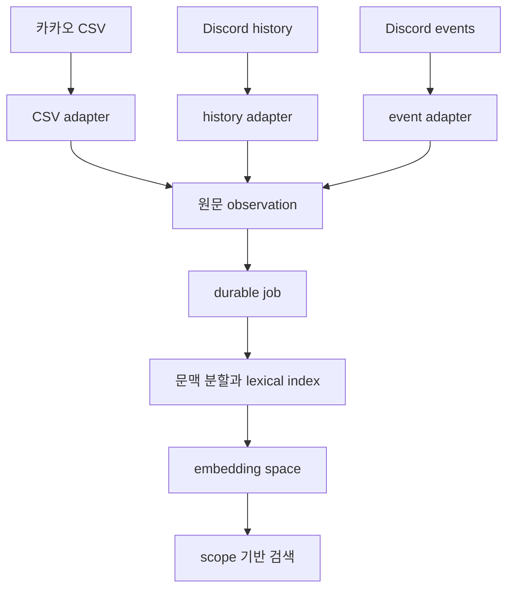

# 원문 데이터 처리 정책

이 문서는 기억 파이프라인이 원문을 가져오고 분리하고 다시 처리하는 기준이다. 기존 임베딩, 요약, 주장, window, chunk 같은 파생 결과보다 우선한다.

## 허용 입력

- Discord history/archive의 원문 메시지 필드와 이후 수신한 create/edit/delete 이벤트
- 사용자가 직접 고른 카카오톡 CSV
- 동의, 제외, 목적, 채널 연결처럼 검색 범위를 정하는 운영 정보

기존 임베딩, 요약, 주장, window, chunk, 로컬 vector store는 새 인덱스의 입력으로 쓰지 않는다. 원문과 파생 결과를 구분하고, 파생 결과는 recipe와 embedding space가 바뀌면 다시 만든다.

범위를 정한 예외: 방 기억(L1 방 상태, L2 에피소드)은 근거 observation ID가 붙은 짧은 파생 문장을 저장한다. 근거 원문이 지워지거나 동의가 철회되면 함께 숨기거나 지운다([ADR-17](adr/ADR-17-derived-room-memory.md)).

## 출처와 범위

- platform, source room, source file, native ID, ordinal, 원문과 시간 의미를 보존한다.
- collection은 분석 단위다. 채널 연결, 권한 부여, 인물 병합을 자동으로 뜻하지 않는다.
- 여러 CSV를 한 collection으로 묶을 때도 각 파일과 방의 provenance를 유지한다.
- 표시명, 비슷한 시각, 인접 메시지만으로 사람, 답장, 사건을 합치지 않는다.
- Discord 계정과 카카오 표시명의 연결은 사람이 확인한 별도 revision으로 관리한다.

채널별 검색 범위는 revision이 있는 view로 설정한다. source를 연결하거나 해제하면 scope fingerprint를 바꾸고 이전 결과를 새 범위에 재사용하지 않는다. 원문 내용이 같다면 view 변경만으로 전수 재임베딩하지 않는다.

## 공통 처리 흐름

adapter 뒤에서는 같은 원문, 문맥, 임베딩, 검색 계약을 쓴다. Discord의 안정 ID, bot flag, UTC offset을 카카오 형식에 맞추기 위해 버리지 않는다. 카카오에 없는 reply와 계정 ID는 `unknown`으로 둔다.

## 가져오기와 검증

- 입력 파일을 덮어쓰지 않는다.
- 파일 hash와 행 수를 확인하고 malformed row를 조용히 버리지 않는다.
- 같은 파일 재가져오기의 idempotency와 서로 다른 원문 관찰의 의미상 중복을 구분한다.
- 날짜가 없는 레코드에 시간을 만들어 넣지 않는다.
- 원문 보유가 외부 모델 전송이나 다른 채널 공유의 동의를 뜻하지 않는다.
- 본문, 사용자 ID, 키와 로컬 경로를 로그나 공개 문서에 출력하지 않는다.
- 큰 파일이 메모리를 다 쓰지 못하게 한다. 스트림으로 읽고 한도(파일당 1 GiB, 필드 64 KiB, 행 256 KiB)를 두며, 기록은 배치(최대 256건 또는 약 2 MiB) 단위로 되돌릴 수 있게 한다. Kakao CSV는 방·시각·화자·본문과 동일 행의 출현 순번으로 안정 ID를 만든다. 같은 시각의 동일 메시지도 각각 보존하며, 편집한 파일을 다시 가져와도 변경되지 않은 행은 건너뛴다. 저장된 별칭으로 업그레이드 전 ID와 CSV·오프라인 원문 간 ID를 함께 인식한다. 한 시각 그룹에 서로 다른 메시지가 너무 많으면 안전한 한도를 넘었다는 현지화 안내를 보여 주고 방·기간별로 파일을 나누도록 한다.

## 삭제와 철회

- 원문 삭제·수정과 동의 철회는 파생 결과와, 그 원문을 인용한 다른 기록에도 닿아야 한다. 대화 문맥·저장된 메시지·검색 인덱스는 바로 반영한다. 대화 턴의 근거, 실험실·기억 검토, 평가 문항 사본은 내구성 있는 백그라운드 작업이 지우며, 처리 중 종료되면 다음 시작 때 이어서 끝낸다. 연습 모드 사본은 즉시 지운다.
- 근거는 원문의 복사본이 아니라 참조(observation ID, 원 메시지 ID, 단방향 화자 참조)로 저장하고, 본문은 보여 줄 때 현재 원문에서 조회한다. 지운 메시지와 철회한 사람은 조회되지 않는다.
- 출처 정보가 생기기 전의 옛 기록은 남은 ID나 특징적인 문장으로 찾아 같은 방식으로 지운다. 짧고 흔한 메시지(12자 미만)는 오삭제를 막으려고 문장으로 일괄 매칭하지 않는다. 그래서 끝내 찾지 못한 기록은 보관 기간(`retention.turn_detail_days`)이 지나야 사라진다.
- 봇 자신의 답변, 올려 둔 원본 파일, 이전에 만든 백업은 이 처리에서 다시 쓰지 않고 각자의 보관 정책을 따른다.

로컬 준비 도구와 산출물은 `.private/`, `test-sandbox/`, `.masamong-scratch/`에 둔다. 이 경로는 Git에서 제외한다. 제품의 카카오 가져오기와 Discord 수집 운영은 [기억 운영](memory-operations.md), 수명주기는 [source-lifecycle.md](rag/source-lifecycle.md)를 따른다.

## 샌드박스

`experimental/rag-leaf-parent/`는 같은 정책을 따르는 개발용 샌드박스다. 샌드박스 결과만으로 제품 품질이나 운영 준비 완료를 선언하지 않는다. 검색 동작을 바꾸면 Go 구현과 parity 테스트를 함께 확인한다.
