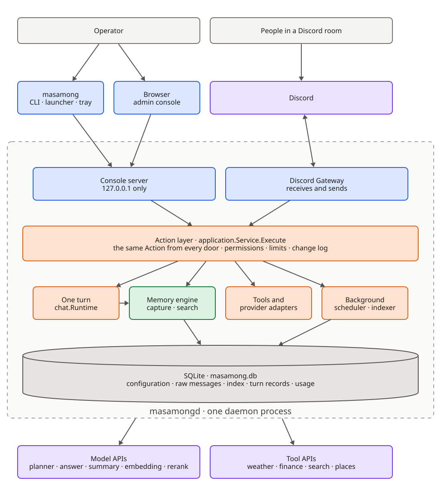

[한국어](README.md) | **English**

# Masamong architecture at a glance

> **In one line**: Masamong is two Go programs on your own computer, a daemon and a CLI. Discord, the admin console and the CLI all go through one Action layer and write to one SQLite file.

**In three minutes**

- **What it is**: a bot that hangs out in a Discord room of friends. It remembers what was said there and uses tools such as weather, quotes and web search when they help.
- **Where it runs**: on the operator's computer or one server. The daemon `masamongd` stays on; `masamong` is the handle that starts it, stops it and sends it commands.
- **Three doors, one path**: Discord, the admin console (a browser) and the CLI all call the same Actions through `application.Service.Execute`.
- **One reply**: wait for the room's turn → check limits → planner and tool loop → memory search → answer model → send and record.
- **Memory**: raw messages are stored first. The search index (leaves and vectors), room memory (L1, L2) and person memory are built on top. When a raw message goes, what was built on it goes too.
- **What leaves the machine**: calls to model APIs and tool APIs, nothing else. The data stays in `masamong.db` on your computer.

## The big picture

<picture><source media="(prefers-color-scheme: dark)" srcset="diagrams/overview.en-dark.svg"></picture>

Diagram source: [diagrams/overview.en.d2](diagrams/overview.en.d2)

The CLI arrow shows the path while the daemon runs. When the daemon is off, the CLI opens the same data folder itself and runs the same Action. [system.en.md](system.en.md) has the exact boundaries.

## The pages

| Page | The question it answers |
|---|---|
| [system.en.md](system.en.md) | How many processes are there, how are the packages layered, and what lives where |
| [message-flow.en.md](message-flow.en.md) | What happens between one message and its reply, and what happens when something fails |
| [memory.en.md](memory.en.md) | How memory is built and read, how far a deletion reaches, and where money is spent |
| [data-model.en.md](data-model.en.md) | Which SQLite tables exist and who writes them; retention, backups and upgrades |
| [console-and-ops.en.md](console-and-ops.en.md) | How the console, the CLI and Actions relate; sign-in, the supervisor, updates, releases and branches |
| [providers-and-tools.en.md](providers-and-tools.en.md) | Model roles, host families, fallbacks, budgets, the tool registry and language packs |
| [decisions.en.md](decisions.en.md) | Why it was built this way, which alternatives were dropped and why, and what we decided not to do |
| [glossary.en.md](glossary.en.md) | Terms such as leaf, L1, L2, episode, claim, window and pilot |

Documents outside this folder are in Korean, except the wiki, which has an English page for every Korean one. Links below say so where it matters.

## Reading paths

<b>5 minutes</b>: I only want to know what is where

1. The diagram on this page.
2. The three-minute summary and the layer diagram in [system.en.md](system.en.md).
3. [glossary.en.md](glossary.en.md) for any word you do not know.

<b>30 minutes</b>: I have a patch to make

1. The working rules and product principles in the [maintainer guide](../MAINTAINING.md) (Korean).
2. [message-flow.en.md](message-flow.en.md) or [memory.en.md](memory.en.md), whichever covers the area you will change.
3. The summary table in [decisions.en.md](decisions.en.md) for that area, so you do not propose something that was already dropped.
4. The [generated code map](../code-map/README.md) to find the Action, command or tool you will touch.

<b>In depth</b>: I want the reasoning too

1. The folded entries of [decisions.en.md](decisions.en.md), area by area.
2. The original decision records (Korean): [ADR-16](../adr/ADR-16-gui-default-svelte-console.md), [ADR-17](../adr/ADR-17-derived-room-memory.md), [ADR-18](../adr/ADR-18-idle-room-unloading.md).
3. The design rationale (Korean): [memory, conversation and tools](../plan-memory-conversation.md), [retrieval](../rag/retrieval-v2.md), [embedding width measurements](../rag/embedding-width-2026-10.md).
4. Operations (Korean): [memory operations](../memory-operations.md), [tools and languages](../tools-and-languages.md).
5. What incidents taught us (Korean): [postmortems](../postmortems/README.md), [defensive patterns](../defensive-patterns.md).

## Things that are easy to mix up

There are three programs you can start, and they are different

| Name | How to open it | Data |
|---|---|---|
| The product | `masamong open`, port 8787 by default | the default data folder |
| The quick test instance | `start-test.command`, `start-test.ps1` on Windows, or `make try` | `~/.masamong-try` |
| The retrieval sandbox (Python) | `start-sandbox.command`, port 8765 | `test-sandbox/data/` |

The sandbox is a development tool for comparing retrieval methods. It does not use the product database ([TEST_SANDBOX.md](../TEST_SANDBOX.md), Korean).

One feature is one Action

- A new feature registers an Action in `internal/catalog` and implements it in `internal/application`.
- The console, the CLI, Discord commands and chat tools only call that Action.
- Screen code never opens the database.

A retrieval change is made in two places

- Compare it in the Python sandbox (`experimental/rag-leaf-parent`), then port it to Go under `internal/memory`.
- `make parity` checks that both give the same results.
- A console change also commits `ui/dist`, the output of `make ui`.

---

As of v1.8.0 (2026-11-24). This folder replaces the earlier `docs/ARCHITECTURE.html`. When the code changes, the page that describes it changes with it. Code is pointed at by file path and symbol name, never by line number.
