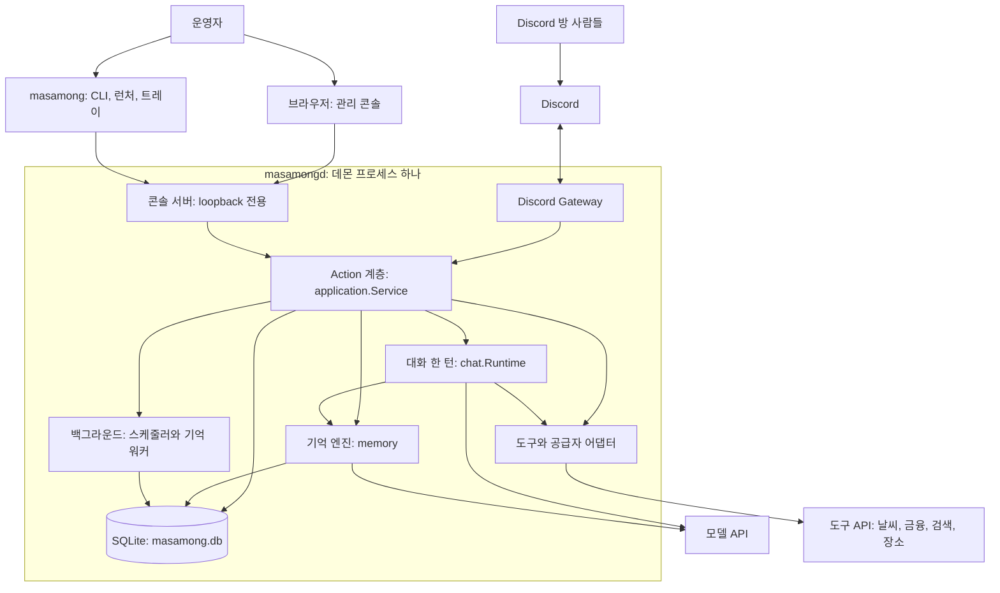

# 마사몽 구조 한눈에 보기

> **한 줄 요약**: 마사몽은 내 컴퓨터에서 도는 Go 프로그램 두 개(데몬과 CLI)이고, Discord 대화·관리 콘솔·CLI가 모두 같은 Action 계층을 거쳐 SQLite 파일 하나를 쓴다.

**3분 요약**

- **무엇인가**: 친구들 Discord 방에서 같이 떠드는 봇이다. 방에서 오간 말을 기억하고, 필요하면 날씨·시세·검색 같은 도구를 쓴다.
- **어디서 도나**: 운영자의 컴퓨터나 서버 한 대. 데몬 `masamongd`가 늘 켜져 있고, `masamong`은 데몬을 켜고 끄고 명령을 보내는 손잡이다.
- **들어오는 길은 셋, 처리는 하나**: Discord, 관리 콘솔(브라우저), CLI가 모두 `application.Service.Execute`의 같은 Action을 부른다.
- **답 하나의 흐름**: 방 차례 기다리기 → 한도 확인 → 플래너와 도구 루프 → 기억 검색 → 답변 모델 → 보내고 기록.
- **기억**: 원문을 먼저 저장하고, 그 위에 검색 색인(leaf·벡터), 방 기억(L1·L2), 사람 기억을 쌓는다. 원문이 지워지면 위층도 같이 지워진다.
- **밖으로 나가는 것**: 모델 API와 도구 API 호출뿐이다. 데이터는 내 컴퓨터의 `masamong.db`에 있다.

## 큰 그림

데몬이 꺼져 있을 때 CLI는 같은 데이터 폴더를 직접 열어 같은 Action을 실행한다. 자세한 경계는 [system.md](system.md)에 있다.

## 상세 페이지

| 페이지 | 답하는 질문 |
|---|---|
| [system.md](system.md) | 프로세스가 몇 개이고, 패키지는 어떻게 층을 이루고, 무엇이 어디에 사나 |
| [message-flow.md](message-flow.md) | 메시지 하나가 답이 되기까지 무슨 일이 일어나나. 실패하면 어떻게 되나 |
| [memory.md](memory.md) | 기억이 어떻게 쌓이고 꺼내지나. 삭제는 어디까지 닿나. 돈은 어디서 드나 |
| [data-model.md](data-model.md) | SQLite 표가 무엇이고 누가 쓰나. 보관 기간, 백업, 업그레이드 |
| [console-and-ops.md](console-and-ops.md) | 콘솔·CLI·Action의 관계, 로그인, 감시 프로세스, 업데이트, 릴리스와 브랜치 |
| [providers-and-tools.md](providers-and-tools.md) | 모델 역할, 호스트 계열, 대체 모델, 예산, 도구 등록, 언어팩 |
| [decisions.md](decisions.md) | 왜 이렇게 만들었나. 다른 방법은 왜 버렸나. 하지 않기로 한 것 |
| [glossary.md](glossary.md) | leaf, L1, L2, 에피소드, claim, 창, 시범 같은 용어 |

## 읽는 길

<b>5분</b>: 무엇이 어디 있는지만 알고 싶다

1. 이 페이지의 그림.
2. [system.md](system.md)의 "3분 요약"과 패키지 층 그림.
3. 모르는 낱말은 [glossary.md](glossary.md).

<b>30분</b>: 패치를 하나 내야 한다

1. [유지보수 가이드](../MAINTAINING.md)의 작업 규칙과 제품 원칙.
2. [message-flow.md](message-flow.md) 또는 [memory.md](memory.md) 가운데 고칠 영역.
3. [decisions.md](decisions.md)의 요약 표에서 그 영역의 결정을 훑는다. 이미 버린 방법을 다시 제안하지 않기 위해서다.
4. 고칠 Action·명령·도구의 위치는 [생성된 코드 지도](../code-map/README.md)에서 찾는다.

<b>깊게</b>: 설계 근거까지 따라가고 싶다

1. [decisions.md](decisions.md)의 접힌 항목을 영역별로 읽는다.
2. 결정 기록 원본: [ADR-16](../adr/ADR-16-gui-default-svelte-console.md), [ADR-17](../adr/ADR-17-derived-room-memory.md), [ADR-18](../adr/ADR-18-idle-room-unloading.md).
3. 설계 근거 문서: [기억·대화·도구 설계](../plan-memory-conversation.md), [검색 구조](../rag/retrieval-v2.md), [임베딩 폭 측정](../rag/embedding-width-2026-10.md).
4. 운영 절차: [기억 운영](../memory-operations.md), [도구와 언어](../tools-and-languages.md).
5. 사고에서 배운 것: [사고 회고](../postmortems/README.md), [방어 규칙](../defensive-patterns.md).

## 자주 헷갈리는 것

띄우는 프로그램은 세 가지이고 서로 다르다

| 이름 | 여는 법 | 데이터 |
|---|---|---|
| 실제 제품 | `masamong open`, 기본 포트 8787 | 기본 데이터 폴더 |
| 빠른 테스트 인스턴스 | `start-test.command`, Windows는 `start-test.ps1`, 또는 `make try` | `~/.masamong-try` |
| 검색 샌드박스(Python) | `start-sandbox.command`, 포트 8765 | `test-sandbox/data/` |

샌드박스는 검색 방식을 비교하는 개발 도구다. 제품 DB를 쓰지 않는다([TEST_SANDBOX.md](../TEST_SANDBOX.md)).

기능 하나는 Action 하나다

- 새 기능은 `internal/catalog`에 Action을 등록하고 `internal/application`에서 구현한다.
- 콘솔, CLI, Discord 명령, 채팅 도구는 그 Action을 부르기만 한다.
- 화면 코드에서 DB를 직접 열지 않는다.

검색을 바꾸면 두 곳을 같이 바꾼다

- Python 샌드박스(`experimental/rag-leaf-parent`)에서 비교한 다음 Go `internal/memory`에 옮긴다.
- `make parity`로 두 쪽 결과가 같은지 확인한다.
- 콘솔 화면을 바꾸면 `make ui`의 결과인 `ui/dist`도 커밋한다.

---

기준: v1.7.1(2026-11-24). 이 폴더는 이전의 `docs/ARCHITECTURE.html`을 대신한다. 코드가 바뀌면 해당 페이지도 함께 고친다. 줄 번호 대신 파일 경로와 심볼 이름으로 가리킨다.
