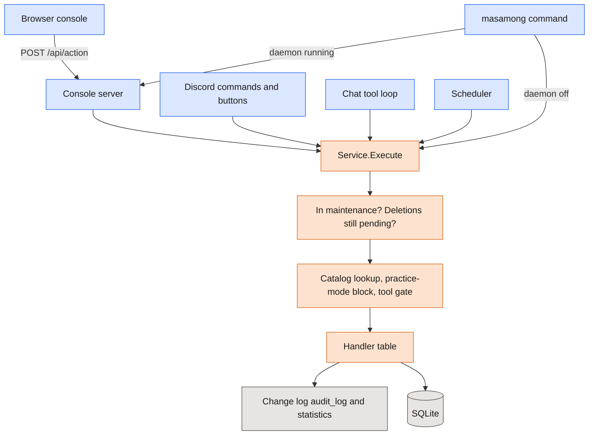
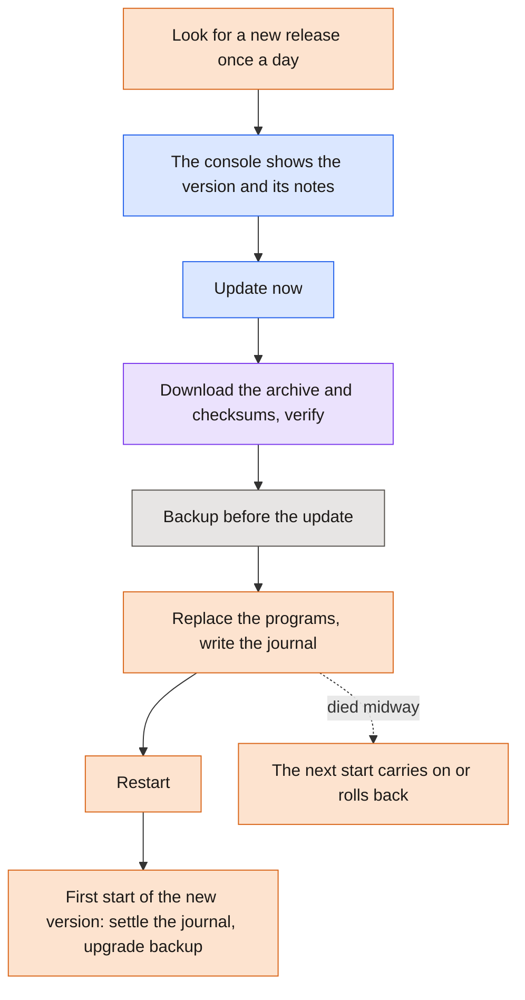
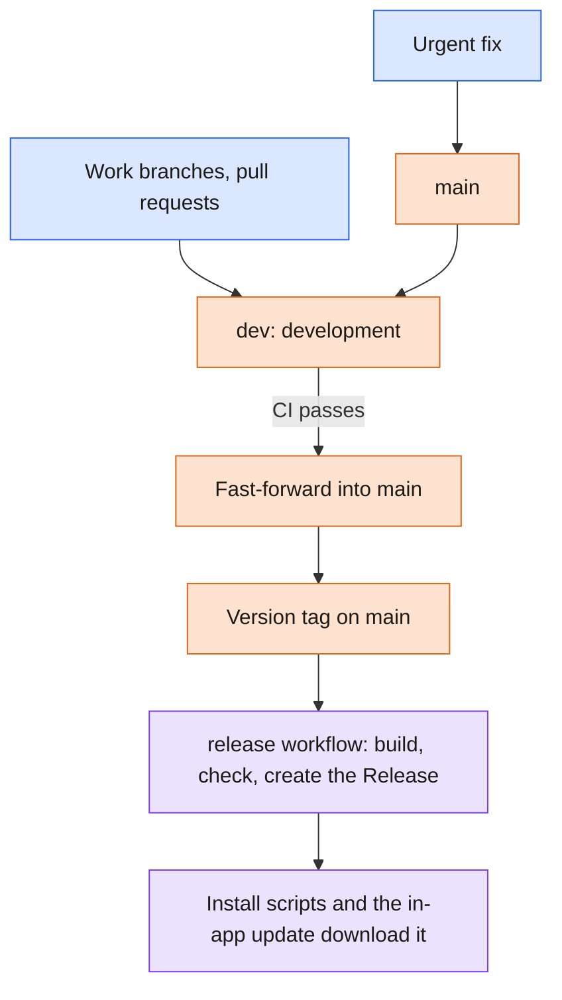

[한국어](console-and-ops.md) | **English**

# The console, the Action layer and operations

> **In one line**: administration happens in the browser console by default, and the CLI and Discord commands call the same Actions. The console opens only on your own computer; a supervisor, a journal and backups keep the bot running; releases are gathered on `dev` and tagged on `main`.

**In three minutes**

- **The Action is the contract.** One feature is one Action in `internal/catalog`; the console, the CLI, Discord commands and chat tools are only doors that call it.
- **The console** is a Svelte app built into the executable. The server draws no pages; it only sends JSON. A separate emergency page, `/lite`, works without JavaScript.
- **Access**: the console listens on loopback only. Remote access comes through SSH forwarding, and sign-in is a one-time link.
- **What keeps it running**: a supervisor restarts a daemon that died, and restore, reset and update carry on or roll back from a journal.
- **Updates**: a new release is looked for once a day, and a release build can replace itself from the console. A backup is made first.
- **Releases**: work goes to `dev`, the stable line is `main`. Tags go on `main` only, and pushing a tag runs the build, the checks and the Release.

## Doors and Actions

## In detail

<b>The Action layer</b>: the single entry point of every feature

Code: [`internal/catalog/catalog.go`](../../internal/catalog/catalog.go) (the list), [`internal/action`](../../internal/action) (the request and result envelope), [`internal/application/service.go`](../../internal/application/service.go) `Service.Execute`, [`internal/application/dispatch.go`](../../internal/application/dispatch.go) `buildActionTable`.

- **A catalog entry** holds an ID (a dotted name such as `channels.configure`), a status (executable, deferred, disabled by the operator), an effect (read, internal write, external read, external write), the CLI words and the console route. There are about 160 today.
- **What `Execute` does**, in order:
  1. Registers the call with the service's lifetime; a closing service refuses.
  2. If maintenance recovery is needed, answers only status and diagnosis.
  3. While some edits and deletes are not yet applied, briefly holds the Action groups that would read them (memory, chat, turns, backup and others).
  4. Looks the Action up in the catalog and filters what practice mode must block. An Action that is not in the catalog but is an operator-defined HTTP tool goes to the tool gate.
  5. Finds the handler in the table and runs it.
  6. Counts statistics and, for a state-changing Action, writes the path, the outcome and the configuration version to the change log (`audit_log`).
- **What tests pin**: every Action of the catalog has a handler, and every table the application names exists after opening.
- **Results in plain words**: a failure answers with a message key. Go error strings and server response bodies go to the log only.
- **The generated index**: the [Action index](../code-map/actions.md) lists every Action with its CLI command, console route and handler. A test fails when it disagrees with the source.

A new product feature is finished only when it has its Action and its console flow. A feature that exists in the CLI alone counts as unfinished.

<b>The console</b>: what it is made of and how it ships

Code: the server [`internal/transport/web`](../../internal/transport/web) (`server.go`, `api.go`, `spa.go`, `lite.go`), the pages [`internal/transport/web/ui`](../../internal/transport/web/ui).

- **Technology**: a single-page app in Svelte 5, Vite and TypeScript. The build output (`ui/dist`) is committed and embedded into the executable with `go:embed`. Running it needs no Node.
- **What the server serves**:

| Route | For |
|---|---|
| `POST /api/action` | Every feature. The body is an Action request |
| `GET /api/events` | Live updates (server-sent events) |
| `GET /api/catalog`, `GET /api/i18n` | The Action list and the strings |
| `POST /api/secret` | Saving a key. The value never passes through an Action |
| `POST /api/upload` | Uploading a file to import |
| `GET /login`, `POST /api/login` | Sign-in by one-time link |
| `GET /lite`, `POST /lite` | The emergency page without JavaScript: status, pause everything, restart, sign in |

- **The build enforces a size budget**: past the limit on the compressed size of the first load or of a page chunk, the build fails.
- **Strings**: Korean and English come from `ui/scripts/strings.py`, other languages from `locales/ui/<tag>.json`. The build checks the keys and placeholders of every bundle.
- **Pages**: the list is in `ui/src/routes.ts` and the navigation in `ui/src/lib/nav.ts`. Today's pages and their state are in [admin console structure](../admin-gui-ia.md) (Korean). The principles only:
  - Each setting has one owner page. Other screens show a pointer to it.
  - Readiness, effective values and limits are decided by the server; the console only shows them.
  - Practice mode is an isolated instance for trying the same screens without real keys or data.
- **A build without the console**: the `noweb` build tag makes a minimal executable without it. The CLI and the bot work the same.
- **After changing the console**, rebuild `ui/dist` with `make ui` and commit it with the change.

<b>The CLI</b>: the same Actions, two ways to run them

Code: [`internal/cli/run.go`](../../internal/cli/run.go) `Run`, [`internal/cli/daemon.go`](../../internal/cli/daemon.go) `daemonCommand`, [`internal/tui`](../../internal/tui), [`internal/present`](../../internal/present).

- CLI words are mapped to Action IDs from the catalog's CLI strings, so the CLI and the console speak the same vocabulary.
- **While a daemon runs**, the CLI sends the Action to the console server's API. With the lock held it never opens the data itself, even if the console is not answering for a moment; that would split configuration and privacy state in two.
- **With no daemon**, it takes the same lock, opens the data folder and calls `Service.Execute` directly.
- **Output**: tables and colour in a terminal, plain output in a pipe or with `--output json`. The JSON shape is the same whatever the terminal and the language.
- The launcher commands are separate: `masamong open` (find or start the daemon and open the browser), `masamong connect user@host` (remote), `masamong start|stop`, and the start-at-login setting.
- The command list is in the wiki's [CLI commands](../wiki/CLI-Commands.md).

<b>Sign-in and access</b>

Code: [`internal/transport/web/signin.go`](../../internal/transport/web/signin.go), [`token.go`](../../internal/transport/web/token.go), [`loopback.go`](../../internal/transport/web/loopback.go), [`internal/launcher/proof.go`](../../internal/launcher/proof.go).

- **Loopback only**: the console binds to `127.0.0.1`. There is no setting that opens it on a network interface.
- **Host check**: a request whose Host is not this computer (or a name the operator listed in `admin.web.hosts`) is refused. This stops a malicious page from pointing its own domain at 127.0.0.1 to reach the console.
- **One-time sign-in link**: `masamong open` makes the link and opens the browser. The link works once; after that it is a session cookie and a CSRF token.
- **Proof of address**: the launcher sends the token only after checking that the recorded console address really is this instance.
- **Rotating the token**: the console button or `masamong admin token rotate` issues a new one, and every old token, link and session stops at once.
- **Remote**: `masamong connect user@host` starts or reuses the remote daemon, sets up SSH forwarding and opens the local browser.
- **Sign-in attempts are rate limited.**
- **On the Discord side**, the operator list (`access.operators`) and server approval (`access.server_approval`) decide. Caller information (path, server, channel, user) is attached inside the process only.

The full security description is in the wiki's [security and privacy](../wiki/Security-and-Privacy.md) and in [SECURITY.md](../../SECURITY.md).

<b>The supervisor and start at login</b>

Code: [`cmd/masamongd/supervise.go`](../../cmd/masamongd/supervise.go) `runSupervisor`, [`internal/launcher/autostart.go`](../../internal/launcher/autostart.go), [`internal/launcher/crash.go`](../../internal/launcher/crash.go).

- The icon, `masamong open` and `masamong start` launch the service as `masamongd --supervise`. The supervisor runs the real service as its child.
- When the child ends with a non-zero code it is started again, after 1 second at first and up to 1 minute. Ten minutes of running well resets the interval.
- Five abnormal exits within ten minutes stop the restarts. The reason goes to `logs/crash.json` and reaches the uptime history and the operator alert at the next start.
- A normal stop ends the supervisor too. A restart the operator asked for comes back on the same address at once.
- Before each child is started, the program replacement journal is settled.
- On a Linux server the systemd unit runs the service directly, without the supervisor.

<b>Update, restore, reset</b>: one journal, one recovery

Code: [`internal/application/updates.go`](../../internal/application/updates.go) (the check), [`selfupdate.go`](../../internal/application/selfupdate.go) (the replacement), [`backup.go`](../../internal/application/backup.go), [`reset.go`](../../internal/application/reset.go), [`maintenance.go`](../../internal/application/maintenance.go), [`update_recovery.go`](../../internal/application/update_recovery.go).

- **The check** looks at the public GitHub Releases. A `-dev` build does not check.
- **Replacement** happens in release builds only. A build installed from source is only told about a newer Release and pointed to the install script.
- **Archive names and `SHA256SUMS`** are a contract with the in-app update. They are never renamed by hand.
- **Restore, reset and replacement** share one journal format (`maintenance-operation.json`, and `.masamong-update.json` in the install folder) and one recovery engine. They finish before the database opens; if they cannot, the bot stays down and the recovery guide is shown.
- **An update does not reprocess memory.** A test pins zero summary and embedding calls after a restart.
- **Update news**: the notes of the running version are shown by `/updates`. Rooms and people can opt in to a news card; it is off by default.

The procedures are in [STORAGE.md](../STORAGE.md) (Korean) and the wiki's [storage and backup](../wiki/Storage-and-Backup.md) and [troubleshooting](../wiki/Troubleshooting.md).

<b>Diagnosis, alerts, records</b>

- **Diagnosis** (`runtime.doctor`, [`doctor.go`](../../internal/application/doctor.go)): one run of a list of named checks reports the Discord connection, providers, the index state, tools that still hold a key written in directly, and more.
- **Operator alerts** ([`alerts.go`](../../internal/application/alerts.go)): what needs attention is sent to the operators by Discord direct message.
- **Server log channel** ([`serverlog.go`](../../internal/application/serverlog.go)): opt-in per server.
- **Logs**: a rotating file log and the console's live log. Both mask keys. Message text and IDs are not written to logs.
- **Turn records**: the console shows each turn's reasons, cost and time step by step. The operator can mark a turn right, wrong or out of date.
- **Statistics** ([`stats_rollup.go`](../../internal/application/stats_rollup.go), [`stats_export.go`](../../internal/application/stats_export.go)): daily totals only, kept in the local database. The only export is the weekly file the operator makes; nothing is sent automatically. See the wiki's [statistics](../wiki/Statistics.md).

<b>Branches, versions, releases</b>

| Branch | Role |
|---|---|
| `main` | The stable line. The install scripts, the README and the wiki are served from it, and release tags go only here. Force pushes and deletion are blocked |
| `dev` | The development line. Features, fixes and contributor pull requests land here first and are checked by CI |

- **Versions**: `vMAJOR.MINOR.PATCH`. A fix raises the third number, a new feature or a visible behaviour change the second, a large rework that needs configuration or data changes the first.
- **Release notes**: `release-notes/<tag>.md` and `.json` are committed before the tag (`make release-notes` drafts them from the commits since the previous tag, and a person edits them). They are built into the executable, where the console and `/updates` show them.
- **What a tag push does**: the `release` workflow builds the archives of every target and `SHA256SUMS`, runs the full checks (the race detector included) and creates the Release. [`scripts/release.sh`](../../scripts/release.sh) and [`scripts/verify-release.sh`](../../scripts/verify-release.sh) do the same locally.
- **CI**: quick checks on every push (Linux, macOS, Windows); the full checks weekly and on a release tag (race detector, load, cross-compiling every target, licences). A push that changes only documentation runs no CI. The long load test (`soak`) runs monthly.
- **The wiki**: its source is `docs/wiki/`, synced to the GitHub wiki when `main` is updated (the `wiki` workflow), after the same check as `make docs`.
- **Before tagging**: the release checks run race-detector shards that development CI skips, so run `go test -race` on the changed packages first.
- **A production instance takes only release tags of `main`.** Back up before, and afterwards confirm that the index counts, the recipe and the embedding space are unchanged.
- Release files are not signed yet. The wiki's [installation](../wiki/Installation.md) page explains the first-launch warning.

The whole procedure is under "Releases" in the wiki's [development guide](../wiki/Development-Guide.md) and in the [release checklist](../wiki/Release-Checklist.md); what to check when shipping a patch is in the [maintainer guide §4](../MAINTAINING.md) (Korean).

<b>Checks that keep documents and code together</b>

| Check | What it looks at | How to run |
|---|---|---|
| `tools/doccheck` | Links point at real files; translated pages changed together (`docs/translations.json`); command names match the page's language; the READMEs and the wiki state the version of the newest release notes; rendered diagrams match their sources | `make docs`; `make docs-record` after bringing translations along; `make diagrams` after editing a diagram source |
| `tools/codemap` | The generated code map equals the source | `make codemap`, `go test ./tools/codemap` |
| `tools/movecheck` and the golden files | A move commit only moves; no test name disappears; package edges, the exported surface and the schema stay as they are | [maintainer guide §5](../MAINTAINING.md) (Korean) |
| `make parity` | The sandbox and Go return the same search results | After changing retrieval, leaves, indexing or the planner's intent |

---

As of v1.7.1 (2026-11-24). Related decisions: [G-1 every surface calls the same Action](decisions.en.md#g-1), [G-2 ADR-16](decisions.en.md#g-2), [G-3 loopback and SSH](decisions.en.md#g-3), [G-6 the supervisor](decisions.en.md#g-6), [G-7 one journal](decisions.en.md#g-7), [H-2 main and dev](decisions.en.md#h-2).
