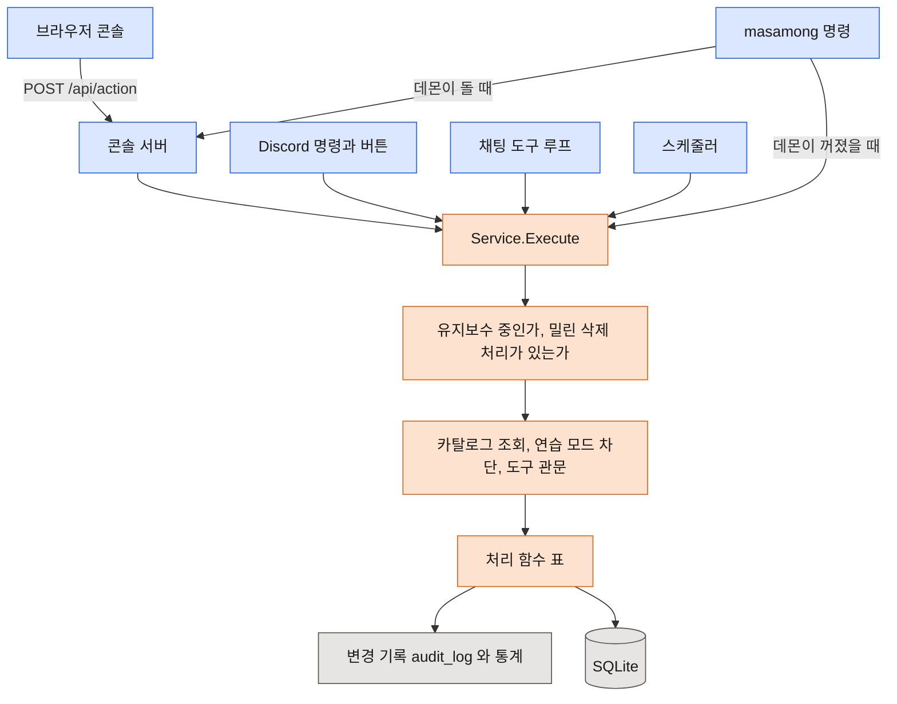
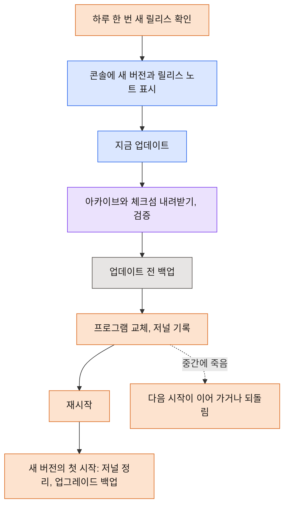
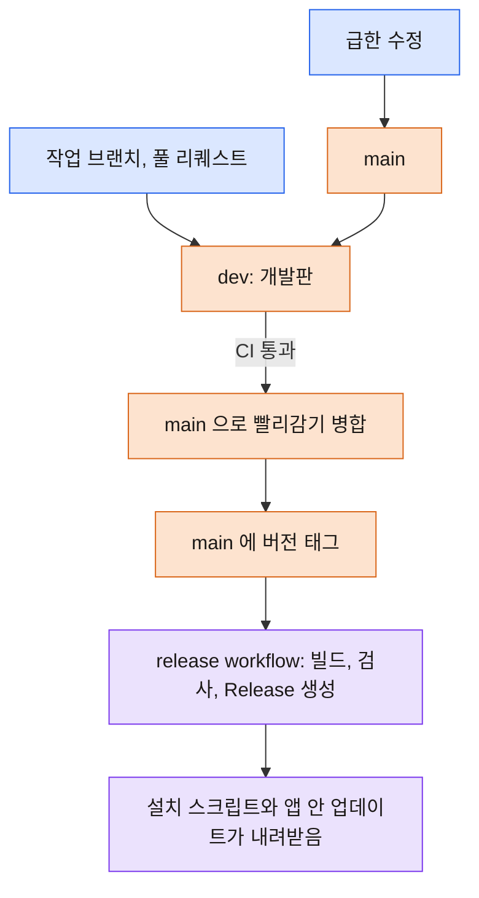

**한국어** | [English](console-and-ops.en.md)

# 콘솔, Action 계층, 운영

> **한 줄 요약**: 관리는 브라우저 콘솔이 기본이고 CLI와 Discord 명령이 같은 Action을 부른다. 콘솔은 내 컴퓨터에만 열리며, 감시 프로세스·저널·백업이 봇을 계속 돌게 하고, 릴리스는 `dev`에서 모아 `main`에 태그한다.

**3분 요약**

- **Action이 계약이다.** 기능 하나는 `internal/catalog`의 Action 하나이고, 콘솔·CLI·Discord 명령·채팅 도구는 그것을 부르는 입구일 뿐이다.
- **콘솔**: 실행 파일에 들어 있는 Svelte 앱이다. 서버는 화면을 그리지 않고 JSON만 보낸다. JavaScript 없이 쓰는 비상 화면 `/lite`가 따로 있다.
- **접근**: 콘솔은 loopback에만 열린다. 원격은 SSH 포워딩으로 들어오고, 로그인은 1회용 링크로 한다.
- **계속 돌게 하는 것**: 감시 프로세스가 죽은 데몬을 다시 켜고, 복원·초기화·업데이트는 저널로 이어 가거나 되돌린다.
- **업데이트**: 하루 한 번 새 릴리스를 확인하고, 릴리스 빌드는 콘솔에서 바로 교체할 수 있다. 교체 전에 백업을 만든다.
- **릴리스**: 작업은 `dev`, 안정판은 `main`. 태그는 `main`에만 달고, 태그 푸시가 빌드·검사·Release 생성을 돌린다.

## 입구와 Action

## 자세히

<b>Action 계층</b>: 기능의 단일 입구

코드: [`internal/catalog/catalog.go`](../../internal/catalog/catalog.go)(목록), [`internal/action`](../../internal/action)(요청·결과 봉투), [`internal/application/service.go`](../../internal/application/service.go) `Service.Execute`, [`internal/application/dispatch.go`](../../internal/application/dispatch.go) `buildActionTable`.

- **카탈로그 항목**이 담는 것: ID(`channels.configure` 같은 점 이름), 상태(실행 가능 / 미룸 / 운영자가 끔), 효과(읽기, 내부 쓰기, 외부 읽기, 외부 쓰기), CLI 문자열, 콘솔 경로. 지금 160개쯤이다.
- **`Execute`가 하는 일**(순서대로):
  1. 서비스 수명에 등록한다. 닫히는 중이면 거절한다.
  2. 유지보수 복구가 필요하면 상태와 진단만 답한다.
  3. 아직 반영하지 못한 수정·삭제가 있으면 그것을 읽는 Action 묶음(기억, 대화, 턴, 백업 등)을 잠깐 막는다.
  4. 카탈로그에서 찾고, 연습 모드에서 막아야 할 Action을 거른다. 카탈로그에 없지만 운영자가 정의한 HTTP 도구면 도구 관문으로 보낸다.
  5. 처리 함수 표에서 찾아 실행한다.
  6. 통계를 세고, 상태를 바꾼 Action이면 변경 기록(`audit_log`)에 경로·결과·설정 버전을 남긴다.
- **테스트가 고정하는 것**: 카탈로그의 모든 Action에 처리 함수가 있다. 애플리케이션 코드가 이름 붙인 모든 표가 열린 뒤에 존재한다.
- **결과는 사람의 말로**: 실패는 메시지 키로 답한다. Go 오류 문자열이나 서버 응답 본문은 로그로만 간다.
- **생성된 색인**: [Action 색인](../code-map/actions.md)이 모든 Action의 CLI 명령, 콘솔 경로, 처리 함수를 보여 준다. 소스와 어긋나면 테스트가 실패한다.

새 제품 기능은 Action과 콘솔 흐름까지 만들어야 끝난 것이다. CLI만 있는 기능은 미완성으로 본다.

<b>콘솔</b>: 무엇으로 만들었고 어떻게 실려 가나

코드: 서버 [`internal/transport/web`](../../internal/transport/web)(`server.go`, `api.go`, `spa.go`, `lite.go`), 화면 [`internal/transport/web/ui`](../../internal/transport/web/ui).

- **기술**: Svelte 5 + Vite + TypeScript로 만든 단일 페이지 앱이다. 빌드 결과(`ui/dist`)를 커밋하고 `go:embed`로 실행 파일에 넣는다. 실행에 Node가 필요 없다.
- **서버가 여는 길**:

| 길 | 용도 |
|---|---|
| `POST /api/action` | 모든 기능. 본문은 Action 요청이다 |
| `GET /api/events` | 실시간 갱신(서버가 보내는 이벤트) |
| `GET /api/catalog`, `GET /api/i18n` | Action 목록과 문구 |
| `POST /api/secret` | 키 저장. 값은 Action을 거치지 않는다 |
| `POST /api/upload` | 가져올 파일 올리기 |
| `GET /login`, `POST /api/login` | 1회용 링크 로그인 |
| `GET /lite`, `POST /lite` | JavaScript 없는 비상 화면: 상태, 전체 일시 중지, 재시작, 로그인 |

- **성능 예산을 빌드가 강제한다**: 첫 로드와 페이지별 조각의 압축 크기 상한을 넘으면 빌드가 실패한다.
- **문구**: 한국어·영어 원본은 `ui/scripts/strings.py`, 다른 언어는 `locales/ui/<태그>.json`. 빌드가 모든 언어 묶음의 키와 자리표시자를 검사한다.
- **페이지**: 목록은 `ui/src/routes.ts`, 내비게이션은 `ui/src/lib/nav.ts`에 있다. 지금의 페이지와 구현 상태는 [관리 콘솔 구성](../admin-gui-ia.md)에 있다. 원칙만 적으면:
  - 설정마다 주인 페이지가 하나다. 다른 화면에서는 그 페이지로 가는 안내를 보여 준다.
  - 준비 상태·실효값·한도 같은 판단은 서버가 하고 콘솔은 보여 주기만 한다.
  - 연습 모드는 실제 키와 데이터 없이 같은 화면을 써 보는 격리된 인스턴스다.
- **웹 없는 빌드**: `noweb` 빌드 태그로 콘솔을 뺀 최소 실행 파일을 만들 수 있다. CLI와 봇은 그대로 동작한다.
- **콘솔을 고치면** `make ui`로 `ui/dist`를 다시 빌드해 함께 커밋한다.

<b>CLI</b>: 같은 Action, 두 가지 실행 경로

코드: [`internal/cli/run.go`](../../internal/cli/run.go) `Run`, [`internal/cli/daemon.go`](../../internal/cli/daemon.go) `daemonCommand`, [`internal/tui`](../../internal/tui), [`internal/present`](../../internal/present).

- CLI 단어는 카탈로그의 CLI 문자열에서 Action ID로 옮겨진다. 콘솔과 같은 어휘를 쓴다.
- **데몬이 돌고 있으면** 콘솔 서버의 API로 Action을 보낸다. 잠금이 잡혀 있으면 콘솔이 잠깐 응답하지 않아도 직접 열지 않는다. 그렇게 하면 설정과 개인정보 상태가 둘로 갈라지기 때문이다.
- **데몬이 꺼져 있으면** 같은 잠금을 잡고 데이터 폴더를 직접 열어 `Service.Execute`를 부른다.
- **출력**: 터미널이면 보기 좋은 표와 색, 파이프나 `--output json`이면 꾸밈 없는 출력이다. JSON 모양은 터미널과 언어에 상관없이 같다.
- 런처 명령은 따로 있다: `masamong open`(데몬을 찾거나 시작하고 브라우저 열기), `masamong connect user@host`(원격), `masamong start|stop`, 자동 시작 설정.
- 명령 목록은 위키 [CLI 명령어](../wiki/CLI-명령어.md).

<b>로그인과 접근</b>

코드: [`internal/transport/web/signin.go`](../../internal/transport/web/signin.go), [`token.go`](../../internal/transport/web/token.go), [`loopback.go`](../../internal/transport/web/loopback.go), [`internal/launcher/proof.go`](../../internal/launcher/proof.go).

- **loopback 전용**: 콘솔은 `127.0.0.1`에만 묶인다. 네트워크 인터페이스에 여는 설정은 없다.
- **Host 검사**: 요청의 Host가 이 컴퓨터(또는 운영자가 `admin.web.hosts`에 적은 이름)가 아니면 거절한다. 악성 웹 페이지가 자기 도메인을 127.0.0.1로 돌려 콘솔에 닿는 것을 막는다.
- **1회용 로그인 링크**: `masamong open`이 링크를 만들어 브라우저를 연다. 링크는 한 번만 쓸 수 있다. 그 뒤는 세션 쿠키와 CSRF 토큰이다.
- **주소 증명**: 런처는 기록된 콘솔 주소가 정말 이 인스턴스인지 확인한 뒤에만 토큰을 보낸다.
- **토큰 재발급**: 콘솔 버튼이나 `masamong admin token rotate`로 다시 만들면 예전 토큰·링크·세션이 모두 그 자리에서 멈춘다.
- **원격**: `masamong connect user@host`가 원격 데몬을 켜거나 재사용하고 SSH 포워딩 뒤 로컬 브라우저를 연다.
- **로그인 시도 제한**이 있다.
- **Discord 쪽 권한**: 운영자 목록(`access.operators`)과 서버 승인(`access.server_approval`)이 정한다. 호출자 정보(경로·서버·채널·사용자)는 프로세스 안에서만 붙는다.

보안 설명 전체는 위키 [보안과 개인정보](../wiki/보안과-개인정보.md)와 [SECURITY.md](../../SECURITY.md).

<b>감시 프로세스와 자동 시작</b>

코드: [`cmd/masamongd/supervise.go`](../../cmd/masamongd/supervise.go) `runSupervisor`, [`internal/launcher/autostart.go`](../../internal/launcher/autostart.go), [`internal/launcher/crash.go`](../../internal/launcher/crash.go).

- 아이콘·`masamong open`·`masamong start`는 서비스를 `masamongd --supervise`로 띄운다. 감시 프로세스가 실제 서비스를 자식으로 돌린다.
- 0이 아닌 코드로 끝나면 1초부터 최대 1분까지 간격을 늘려 다시 켠다. 10분 넘게 잘 돌면 간격을 처음으로 돌린다.
- 10분 안에 5번 비정상 종료하면 다시 켜기를 멈춘다. 이유는 `logs/crash.json`에 남고 다음 시작 때 가동 이력과 운영자 알림으로 전달된다.
- 정상 종료는 감시 프로세스도 함께 끝낸다. 운영자가 요청한 재시작은 같은 주소로 바로 다시 띄운다.
- 다음 자식을 띄우기 전에 프로그램 교체 저널을 먼저 정리한다.
- Linux 서버의 systemd 유닛은 감시 프로세스 없이 서비스를 직접 돌린다.

<b>업데이트, 복원, 초기화</b>: 같은 저널, 같은 복구

코드: [`internal/application/updates.go`](../../internal/application/updates.go)(확인), [`selfupdate.go`](../../internal/application/selfupdate.go)(교체), [`backup.go`](../../internal/application/backup.go), [`reset.go`](../../internal/application/reset.go), [`maintenance.go`](../../internal/application/maintenance.go), [`update_recovery.go`](../../internal/application/update_recovery.go).

- **확인**: 공개 GitHub Release를 본다. `-dev` 빌드는 확인하지 않는다.
- **교체**는 릴리스 빌드에서만 한다. 소스에서 설치한 빌드는 더 높은 Release가 나오면 알리기만 하고 설치 스크립트를 안내한다.
- **아카이브 이름과 `SHA256SUMS`**는 앱 안 업데이트와 맺은 계약이다. 손으로 이름을 바꾸지 않는다.
- **복원·초기화·교체**는 같은 저널 형식(`maintenance-operation.json`, 설치 폴더의 `.masamong-update.json`)과 복구 엔진을 쓴다. DB를 열기 전에 마무리하고, 못 끝내면 봇을 띄우지 않고 복구 안내를 보여 준다.
- **업데이트는 기억을 다시 처리하지 않는다.** 재시작 뒤 요약·임베딩 호출이 0번임을 테스트가 고정한다.
- **업데이트 소식**: 새 버전의 릴리스 노트는 `/업데이트`로 볼 수 있다. 방과 사람은 소식 카드를 신청할 수 있고 기본은 꺼짐이다.

운영 절차는 [STORAGE.md](../STORAGE.md), 위키 [저장소와 백업](../wiki/저장소와-백업.md), [문제 해결](../wiki/문제-해결.md).

<b>진단, 알림, 기록</b>

- **진단**(`runtime.doctor`, [`doctor.go`](../../internal/application/doctor.go)): 이름 붙인 검사 목록을 한 번에 돌려 Discord 연결, 공급자, 색인 상태, 키가 직접 적힌 도구 등을 알려 준다.
- **운영자 알림**([`alerts.go`](../../internal/application/alerts.go)): 주의가 필요한 일을 운영자에게 Discord DM으로 보낸다.
- **서버 로그 채널**([`serverlog.go`](../../internal/application/serverlog.go)): 서버마다 선택해서 켠다.
- **로그**: 회전하는 파일 로그와 콘솔의 실시간 로그. 둘 다 키를 가린다. 본문과 ID는 로그에 쓰지 않는다.
- **턴 기록**: 콘솔에서 턴마다 단계별 이유·비용·시간을 본다. 운영자는 맞음·틀림·오래됨 표시를 남길 수 있다.
- **통계**([`stats_rollup.go`](../../internal/application/stats_rollup.go), [`stats_export.go`](../../internal/application/stats_export.go)): 하루 합계만 로컬 DB에 모은다. 내보내기는 운영자가 만드는 주간 파일뿐이고 자동으로 보내지 않는다. 위키 [통계](../wiki/통계.md).

<b>브랜치, 버전, 릴리스</b>

| 브랜치 | 역할 |
|---|---|
| `main` | 안정판. 설치 스크립트, README, 위키가 여기서 나가고 릴리스 태그도 여기에만 단다. 강제 푸시와 삭제가 막혀 있다 |
| `dev` | 개발판. 기능, 수정, 기여 PR이 먼저 들어가 CI로 확인된다 |

- **버전**: `v주.부.수`. 버그 수정은 세 번째, 새 기능이나 눈에 띄는 동작 변경은 두 번째, 설정·데이터를 손봐야 하는 큰 개편은 첫 번째 자리.
- **릴리스 노트**: `release-notes/<태그>.md`와 `.json`을 태그 전에 커밋한다(`make release-notes`가 이전 태그 이후 커밋에서 초안을 만들고 사람이 고친다). 실행 파일에도 들어가서 콘솔과 `/업데이트`가 보여 준다.
- **태그 푸시가 하는 일**: `release` workflow가 모든 배포 대상의 아카이브와 `SHA256SUMS`를 만들고, 전체 검사(경쟁 검사 포함)를 돌리고, Release를 만든다. 로컬에서는 [`scripts/release.sh`](../../scripts/release.sh)와 [`scripts/verify-release.sh`](../../scripts/verify-release.sh)로 같은 일을 할 수 있다.
- **CI**: 푸시마다 빠른 검사(Linux·macOS·Windows), 매주와 릴리스 태그에서 전체 검사(경쟁 검사, 부하, 모든 대상 크로스 컴파일, 라이선스). 문서만 바꾼 푸시는 CI를 돌리지 않는다. 장시간 부하(`soak`)는 매달 한 번.
- **위키**: 원본은 `docs/wiki/`이고 `main`에 병합되면 GitHub 위키로 동기화된다(`wiki` workflow). 그 전에 `make docs`와 같은 검사를 통과해야 한다.
- **태그 전에**: 릴리스 검사는 개발 CI가 건너뛰는 경쟁 검사 조각을 돌린다. 바뀐 패키지를 `go test -race`로 먼저 돌린다.
- **운영 인스턴스에는 `main`의 릴리스 태그만 올린다.** 올리기 전에 백업하고, 올린 뒤 색인 수·레시피·임베딩 공간이 그대로인지 본다.
- 릴리스 파일은 아직 서명되지 않았다. 첫 실행 경고는 위키 [설치](../wiki/설치.md)에 안내가 있다.

절차 전체는 위키 [개발 가이드](../wiki/개발-가이드.md)의 "릴리스 및 배포"와 [릴리스 체크리스트](../wiki/릴리스-체크리스트.md), 패치를 낼 때의 확인 사항은 [유지보수 가이드 §4](../MAINTAINING.md).

<b>문서와 코드를 맞추는 검사</b>

| 검사 | 무엇을 보나 | 실행 |
|---|---|---|
| `tools/doccheck` | 링크가 실제 파일을 가리키는가, 번역된 페이지가 함께 바뀌었는가(`docs/translations.json`), 명령 이름이 페이지 언어와 맞는가, README와 위키의 버전이 최신 릴리스 노트와 같은가, 렌더한 그림이 원본과 같은 판인가 | `make docs`, 번역을 맞춘 뒤 `make docs-record`, 그림 원본을 고친 뒤 `make diagrams` |
| `tools/codemap` | 생성된 코드 지도가 소스와 같은가 | `make codemap`, `go test ./tools/codemap` |
| `tools/movecheck`와 골든 파일 | 코드를 옮기는 커밋이 옮기기만 했는가, 테스트 이름이 사라지지 않았는가, 패키지 경계·공개 표면·스키마가 그대로인가 | [유지보수 가이드 §5](../MAINTAINING.md) |
| `make parity` | 샌드박스와 Go의 검색 결과가 같은가 | 검색·leaf·색인·플래너 의도를 바꿨을 때 |

---

기준: v1.8.0(2026-11-24). 관련 결정: [G-1 모든 표면은 같은 Action](decisions.md#g-1), [G-2 ADR-16](decisions.md#g-2), [G-3 loopback과 SSH](decisions.md#g-3), [G-6 감시 프로세스](decisions.md#g-6), [G-7 공통 저널](decisions.md#g-7), [H-2 main과 dev](decisions.md#h-2).
