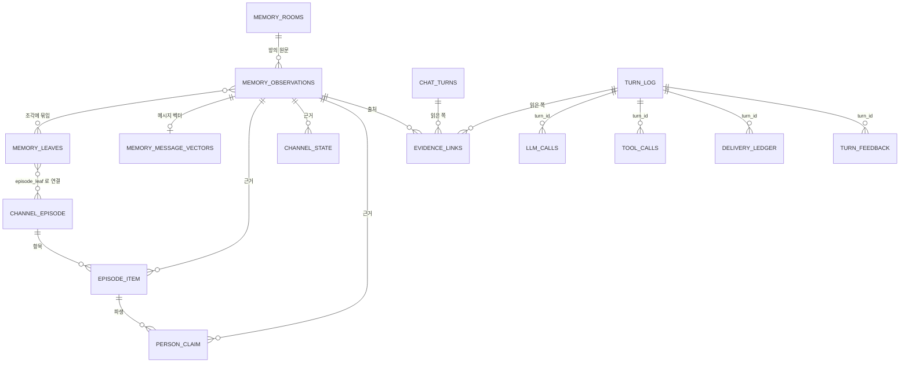

# 데이터 모델: SQLite 표와 그 수명

> **한 줄 요약**: 모든 것이 `masamong.db` 한 파일에 있다. 원문 표가 바닥이고, 색인·방 기억·사람 기억·대화 기록이 원문 ID를 가리키며, 삭제와 보관 기간이 그 참조를 따라 정리한다.

**3분 요약**

- **파일 하나**: 설정 리비전, 원문, 색인, 방 기억, 사람 기억, 대화 기록, 사용량, 개인 기능이 모두 같은 SQLite 파일에 있다. 기억 표도 별도 파일이 아니다.
- **쓰기는 한 줄로**: 쓰는 연결은 하나이고 읽기 풀은 따로 있다(WAL). 긴 쓰기는 작은 묶음으로 나눈다.
- **표는 세 곳에서 선언한다**: 핵심 스키마(`internal/storage`), 기억 표(`internal/memory/store`), 기능 표(`internal/application`의 각 기능 파일).
- **원문과 파생을 구분한다**: `memory_observations`가 원문이고 나머지 기억 표는 다시 만들 수 있는 파생이다. 파생은 근거 ID를 갖는다.
- **보관 기간**은 `retention.*` 설정이 정한다. 본문이 있는 기록은 짧게, 본문 없는 요약 행은 길게 둔다.
- **업그레이드는 덧붙이기만** 한다. 표 목록과 옛 모양에서의 업그레이드는 골든 파일이 고정한다.

## 표 사이의 관계

선은 논리적인 참조다. 대부분 외래 키 제약이 아니라 ID 열과 근거 색인으로 이어져 있고, 정리는 코드(삭제 작업자, 보관 정리)가 한다.

## 자세히

<b>표를 선언하는 곳과 여는 순서</b>

| 묶음 | 선언 위치 | 표 |
|---|---|---|
| 핵심 스키마 | [`internal/storage/schema.go`](../../internal/storage/schema.go) | `schema_migrations`, `config_revisions`, `jobs`, `polls`, `traces`, `consents`, `channel_ops_log` |
| 기억 표 | [`internal/memory/store`](../../internal/memory/store)의 `store.go`, `episodes.go`, `person_claims.go`, `person_alias.go`, `people_backfill.go`, `privacy.go`, `evidence_refs.go`, `batch_plans.go`, `message_vectors.go` | 아래 "기억" 절 |
| 기능 표 | [`internal/application`](../../internal/application)의 기능 파일(예: `threads.go`, `reminders.go`, `fortune.go`, `notices.go`, `participation.go`, `banter.go`, `cards.go`, `privacy.go`) | 아래 나머지 절 |

- 여는 순서: `storage.OpenOptions`가 파일을 열고 핵심 스키마를 맞춘다 → `store.Open`이 같은 핸들에 기억 표를 맞춘다 → 기능 파일들이 모아 둔 DDL 목록(`featureDDL`)을 `migrateFeatures`가 한 번에 맞춘다.
- **한 쓰기 연결, 따로 읽기 풀**([`internal/storage/store.go`](../../internal/storage/store.go) `WithWriterContext`): 쓰기는 한 번에 하나만 들어간다. 읽기는 읽기 전용 연결 풀에서 한다. 저널은 WAL이다.
- TiDB용 DDL 블록이 코드에 남아 있지만 `TiDBEnabled = false`라 쓰이지 않는다. 새 기능 표는 SQLite DDL만 있다([STORAGE.md](../STORAGE.md)).

<b>기억</b>: 원문, 색인, 방 기억, 사람 기억

| 표 | 내용 | 쓰는 쪽 | 원문인가 |
|---|---|---|---|
| `memory_rooms` | 방 목록(플랫폼, 모음, 라벨, 시간대 없는 시각의 기준) | 가져오기, 수집 | 원문 메타 |
| `memory_observations` | 원문 관찰: 방, 원래 메시지 ID, 작성자 라벨·계정, 본문, 시각, 종류 | `Engine.Capture`, 가져오기, 꺼진 동안 채우기 | **원문** |
| `memory_observation_aliases` | 같은 관찰의 다른 ID(카카오 재가져오기, 형식 간 가져오기) | 가져오기 | 원문 메타 |
| `message_kept_revisions`, `memory_revision_sequence` | 수정의 순서(늦게 도착한 옛 수정을 거절하기 위한 기록) | `Engine.Edit` | 원문 메타 |
| `memory_leaves` | 조각: 방, 레시피, 포함한 관찰 ID들, 본문, 요약, 임베딩 공간, leaf 벡터, 요약 벡터 | 색인(`Engine.IndexRooms`) | 파생 |
| `memory_leaf_sync` | 방별 leaf 맞추기 체크포인트 | 색인 | 파생 |
| `memory_message_vectors` | 메시지 단위 벡터 | 색인 | 파생 |
| `memory_embed_cache` | 내용 해시로 찾는 임베딩 캐시(질의 캐시 포함) | 색인, 질의 임베딩 | 캐시 |
| `memory_batch_plans` | 블록 준비 배치의 계획과 상태 | `Engine.PrepareBatch` | 작업 상태 |
| `memory_spend` | 기억 쪽 비용 장부(종류별: 색인, 에피소드, 방 상태, 방 말투, 백필 등) | 색인, 방 기억, 백필 | 장부 |
| `channel_episode`, `episode_item`, `episode_leaf` | L2 에피소드, 그 항목(근거·말한 사람·상태), leaf 연결 | `RunRoomMemory` | 파생 |
| `channel_state` | L1 방 상태(채널당 한 행 JSON과 근거) | `RunRoomMemory` | 파생 |
| `memory_explicit` | "기억해"로 남긴 사실의 색인(사람·주제 → 에피소드 항목) | 명시 기억 | 파생 |
| `person_claim` | 사람 기억 한 줄: 대상, 말한 사람, 종류, 주제, 문장, 근거, 방, 출처, 상태 | `savePersonClaims` | 파생 |
| `person_memory_suppress` | 숨김·잊기 표시(참조와 시각만) | 숨기기, `/잊어줘` | 표시 |
| `person_alias`, `person_alias_source`, `person_alias_fill` | 서버별 이름 색인과 그 근거, 채우기 진행 | 수집 뒤 색인 | 파생 |
| `person_relation` | 답장·멘션 횟수 | 관계 정리 | 파생 |
| `person_card_item` | 예전 저장형 카드. 더 읽거나 쓰지 않는다 | (없음) | 남은 표 |
| `people_backfill_run`, `people_backfill_window` | 백필 실행과 창의 상태, 제공사 묶음 번호 | 백필 | 작업 상태 |
| `memory_reviews` | 운영자의 조각 검토(제외·정정) | 콘솔 기억 검토 | 운영자 입력 |

"파생"은 원문에서 다시 만들 수 있다는 뜻이다. 다만 요약·임베딩·추출은 돈이 들어서, 릴리스가 스스로 다시 만들지 않는다([memory.md](memory.md)의 재처리 금지).

<b>삭제와 근거</b>: 지워진 것을 끝까지 따라가기 위한 표

| 표 | 내용 |
|---|---|
| `evidence_sources`, `evidence_holders`, `evidence_links` | 근거 색인. "어떤 기록(holder)이 어떤 원문(source)을 읽었나". 보기 `evidence_refs`가 셋을 이어 보여 준다 |
| `privacy_tombstones` | 지움 기록. 지운 메시지가 재가져오기나 늦은 쓰기로 되살아나지 않게 한다 |
| `privacy_settled` | 파생 기록 정리가 끝난 지움 기록의 순번. 턴은 시작할 때의 순번을 기억해 두고, 그 뒤에 지워진 것을 읽었는지 저장 직전에 확인한다 |
| `redaction_jobs` | 파생 기록을 지우는 내구성 있는 작업. 처리 중 종료되면 다음 시작 때 이어 한다 |
| `thread_tombstones` | 지워진 스레드 |
| `consents`, `consent_state`, `consent_audit` | 동의 범위별 상태와 변경 기록 |
| `memory_privacy_migration`, `memory_identity_migration`, `memory_message_vector_migration` | 한 번 도는 정리·이행 작업의 진행 표시 |

근거 색인에 등록하는 holder 종류에는 대화 문맥 행, 턴 기록의 근거, 추적 기록, 에피소드 항목, 방 상태 등이 있다. 전파 규칙은 [memory.md](memory.md)의 "삭제, 수정, 철회가 닿는 곳"에 있다.

<b>대화와 기록</b>: 턴이 남기는 것

| 표 | 내용 | 본문이 있나 | 보관 키 |
|---|---|---|---|
| `chat_turns` | 대화 문맥: 채널별 최근 말(봇과 사람) | 있음 | `context_days` |
| `turn_log` | 턴 기록: 결과, 도구, 근거 수, 비용, 지연, 상세(body) | 상세에 있음. 방의 `logging.level`을 따른다 | 행은 `turn_days`, 상세는 `turn_detail_days` |
| `llm_calls` | 모델 호출 장부: 역할, 모델, 토큰, 시간, 비용, 실패 종류 | 없음 | `ledger_days` |
| `tool_calls` | 도구 호출 장부(인자 이름만) | 없음 | `ledger_days` |
| `delivery_ledger` | Discord 전송 기록 | 없음 | `ledger_days` |
| `reply_messages` | 답 메시지 ID와 턴의 연결 | 없음 | `turn_detail_days` |
| `turn_feedback` | 답에 대한 반응과 운영자 표시 | 없음 | `turn_days` |
| `conversation_log` | 이름 부름·이어 말하기·스레드·농담 판정 기록 | 없음 | `turn_days` |
| `participation_log`, `participation_spoke_turns` | 끼어들기 후보와 판정, 말한 턴 | 문구 일부 | `turn_detail_days` |
| `banter_turns`, `banter_channel_state` | 농담 턴과 채널 상태 | 없음 | (기능 상태) |
| `channel_threads`, `thread_parents`, `thread_participants` | 봇 스레드와 부모·참여자 | 없음 | 닫힌 뒤 `turn_days` |
| `traces` | 진단 추적 | 없음 | `trace_days` |
| `lab_reviews`, `eval_runs` | 답변 실험실 검토, 평가 실행 | 있음 | 운영자 관리 |

<b>설정, 운영, 사용량</b>

| 표 | 내용 |
|---|---|
| `config_revisions` | 설정 문서의 리비전 이력. 설정 변경은 "읽은 리비전과 같을 때만 교체"다 |
| `config_snapshots` | 이름 붙인 설정 스냅샷 |
| `admin_state` | 운영 상태 키-값(스케줄 표시, 커서, 캐시된 판단 등) |
| `audit_log` | 상태를 바꾼 모든 Action의 변경 기록(경로, 결과, 설정 버전. 값은 안전한 필드만) |
| `channel_ops_log` | 채널 설정 변경 기록 |
| `jobs` | 오래 걸리는 작업의 상태 기계(가져오기, 준비, 재색인) |
| `tool_usage` | 도구 사용량 카운터(사람·채널·전체, 하루 단위) |
| `stats_daily`, `stats_days` | 사용 통계: 하루 합계만. 사람별 행이 없다 |
| `activity_counts` | 활동 순위용 메시지 수 |
| `user_prefs` | 사람별 선호(언어, 지역 등) |
| `update_news_sent` | 업데이트 소식을 어디에 보냈는지(재시작해도 두 번 보내지 않게) |
| `schema_migrations` | 스키마 이행 기록 |

<b>개인 기능과 그 밖</b>

| 표 | 기능 |
|---|---|
| `reminders`, `reminder_offers`, `reminder_context` | 리마인더와 예약 작업, 제안, 그때의 문맥 |
| `polls`, `poll_messages` | 투표 |
| `fortune_profiles`, `fortune_cache`, `fortune_usage` | 운세 등록 정보, 캐시, 사용량 |
| `notice_subs`, `notice_items`, `notice_state`, `notice_delivered`, `notice_delivery_outcomes` | 학교·편입 공지 구독과 전송 |
| `channel_summary` | `!요약` 전용 채널 요약 |
| `channel_style` | 방 말투 메모와 승인 상태 |

<b>보관 기간</b>: 무엇이 언제 지워지나

코드: [`internal/application/retention.go`](../../internal/application/retention.go). 규칙 목록은 `internal/application/testdata/schema.golden`의 `pruneRules` 절이 고정한다.

| 설정 키(`retention.`) | 기본 | 지우는 것 |
|---|---|---|
| `turn_days` | 400 | 턴 기록의 요약 행, 판정 기록, 피드백, 활동 수, 닫힌 스레드 |
| `turn_detail_days` | 30 | 턴 기록의 상세(메시지·답·근거), 답 메시지 연결, 참여 기록의 문구 |
| `context_days` | (`turn_detail_days`) | 조용해졌거나 봇이 나간 방의 대화 문맥, 끝난 리마인더 |
| `pending_days` | (`usage_days`) | 아무도 확정하지 않은 리마인더 초안과 제안 |
| `trace_days` | 30 | 진단 추적 |
| `audit_days` | 400 | 변경 기록, 채널 설정 기록 |
| `usage_days` | 14 | 사람·채널별 도구 사용량(도구별 일일 합계는 `turn_days`) |
| `ledger_days` | 90 | 모델 호출·도구 호출·전송 장부 |
| `query_cache_days` | 7 | 질문 임베딩 캐시 |

- 기록 키를 `-1`로 두면 그 기록은 나이로 지워지지 않는다. 그때는 `pending_days`와 `context_days`를 함께 정한다.
- 방마다 `logging.retain_days`로 그 방의 본문을 더 일찍 지울 수 있다.
- **원문과 기억은 보관 기간으로 지우지 않는다.** 삭제, 철회, 블록 삭제로만 지운다.
- 통계가 켜져 있으면 정리 작업은 지난날의 통계를 먼저 마치고, 통계가 읽는 행은 그날의 통계를 마친 뒤에만 지운다.

정책 원문은 [원문 데이터 정책](../RAW_DATA_POLICY.md)의 "보관 기간", 키 설명은 위키 [설정 레퍼런스](../wiki/설정-레퍼런스.md).

<b>백업, 복원, 초기화</b>

코드: [`internal/application/backup.go`](../../internal/application/backup.go), [`reset.go`](../../internal/application/reset.go), 공통 저널과 복구 엔진 [`maintenance.go`](../../internal/application/maintenance.go).

- **백업**은 한 시점의 DB 스냅샷과, 그 스냅샷 안에서 가장 최근에 커밋된 설정을 함께 담는다. 숨김 폴더에서 완성하고 검증(체크섬, SQLite 무결성, 제품 스키마, 설정 파싱)한 뒤 한 번에 공개한다.
- **자동 백업**은 스케줄러가 한다(`backup.keep` 기본 4개). 새 버전의 첫 시작과 앱 안 업데이트·초기화 직전에도 만든다.
- **복원·초기화·프로그램 교체**는 같은 저널 형식을 쓴다. 단계마다 기록하므로 중간에 죽어도 다음 시작이 이어 가거나 되돌린다. DB를 열기 전에 마무리하고, 못 끝내면 봇을 띄우지 않는다.
- **초기화**는 DB와 가져온 파일·캐시를 지우고 `backups/`, `logs/`, 콘솔 로그인은 남긴다. 키는 별도 옵션을 켰을 때만 지운다.
- 지운 메시지는 그 전에 만든 백업에 남아 있다. 백업을 복원한 뒤에는 삭제 요청을 다시 처리한다.

운영 절차는 [STORAGE.md](../STORAGE.md)와 위키 [저장소와 백업](../wiki/저장소와-백업.md)에 있다.

<b>업그레이드</b>: 스키마를 바꿀 때의 규칙

- **덧붙이기만 한다.** 새 표, 새 열, 새 색인. 기존 행을 다시 쓰는 이행은 피한다.
- **이전 버전으로 되돌려도 안전해야 한다.** 저사양 기기에서 시작을 막거나 디스크를 크게 쓰는 이행은 피한다.
- **기본값을 바꾸면 기존 설치에서 무엇이 일어나는지 적는다.** 임베딩 폭이나 레시피를 바꾸면 다시 임베딩해야 하므로 비용과 시간을 릴리스 노트에 적는다.
- **무거운 채우기는 백그라운드에서** 구간 단위로 하고, 중단되면 이어 한다(예: 이름 색인 채우기).
- 고정하는 테스트: `go test ./internal/application -run 'TestExportedSurface|TestSchema'`. 표 목록 순서, `sqlite_master`, 옛 모양에서의 업그레이드를 골든 파일과 비교한다. 의도한 변경이면 diff를 읽고 `-update`로 다시 쓴다.
- 기본 스키마의 SQLite 판과 TiDB 판이 같은 표와 열을 갖는지도 테스트가 확인한다(TiDB는 꺼져 있지만 어긋나지 않게).
- 특정 버전 사이를 되돌릴 때의 주의는 [유지보수 가이드 §4](../MAINTAINING.md)에 있다.

---

기준: v1.7.1(2026-11-24). 관련 결정: [B-2 SQLite 하나](decisions.md#b-2), [D-3 삭제 전파](decisions.md#d-3), [G-7 공통 저널](decisions.md#g-7), [G-10 통계는 로컬에만](decisions.md#g-10).
