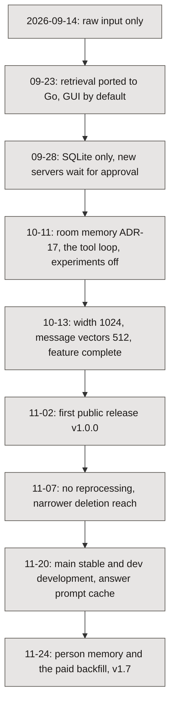

[한국어](decisions.md) | **English**

# Decision log: why it was built this way

> **In one line**: Masamong's structure follows from five things: it is a friend bot, memory comes first, one person maintains it, raw messages are the only evidence, and work that costs money is started by the operator. This page gives the reason for each decision and the alternatives that were dropped.

**In three minutes**

- **Product**: a friend bot for a room of friends. Memory matters most, and the strict privacy features exist but are off by default.
- **Platform**: a Go executable and one SQLite file. No second database, no separate vector database, no sidecar runtime.
- **Retrieval**: the method proven in the Python sandbox was ported to Go as it was and tied to it by parity tests. Rules, not a model, pick the strategy after seeing the candidates.
- **Memory layers**: on top of the raw messages sit the leaf index, room memory (ADR-17) and person memory. Every derived row has evidence IDs and follows deletions.
- **Conversation**: code decides what the model sees. Tools are picked in a loop, while the memory planner stays separate. Features that speak without being called are experiments and off by default.
- **Operations**: every surface calls the same Actions. The browser console is the default way to administer (ADR-16), and releases are gathered on `dev` and tagged on `main`.

Where a decision has no public source, it says only "operator's decision (date)".

## The main decisions in order

## Summary table

Status: **kept** still true, **replaced** another decision took over, **on hold** waiting for a decision, **experiment** off by default.

| # | Decision | When | Reason in one line | Status |
|---|---|---|---|---|
| [A-1](#a-1) | A friend bot, and memory matters most | 2026-09-23, 10-11 | A friend remembers. It is not a fact-checking bot | kept |
| [A-2](#a-2) | Raw input only; old processed data is excluded | 09-14 | To follow provenance and deletion to the end | kept |
| [A-3](#a-3) | Multilingual from the start: structure → small classifier → word lists | 09-23, 10-11 | Word lists break silently in other languages | kept |
| [A-4](#a-4) | Strict privacy off by default, memory on by default | 10-11, v1.6.0, v1.7.0 | Leading with privacy in a room of friends kills the fun | kept |
| [A-5](#a-5) | No voice, presence or join greetings | 10-11 | No demand, and taken out of scope | kept |
| [A-6](#a-6) | Feature complete; improvements ship as patches | 10-13 | No capacity to maintain two repositories | kept |
| [B-1](#b-1) | Rewrite the first bot in Go | 2026-09 | It must run from executables alone | kept |
| [B-2](#b-2) | SQLite only; TiDB switched off | 09-28 | Two databases double what must be looked after | kept |
| [B-3](#b-3) | Store raw messages first, index afterwards | 2026-09 | A provider outage must not become a capture outage | kept |
| [B-4](#b-4) | Exact vector search in memory | 2026-09 | Enough at this size, and simple to run | kept |
| [C-1](#c-1) | Port the sandbox retrieval to Go whole, tied by parity | 09-23 | To use the proven method as it is | kept |
| [C-2](#c-2) | Hand-made aliases and keyword regexes out of the default | 09-23 | Zero effect on the holdout | kept |
| [C-3](#c-3) | The planner states intent; rules choose the strategy after seeing candidates | 2026-09 | A model choosing strategy wobbles and cannot be budgeted | kept |
| [C-4](#c-4) | A structured decision model pilot | 09-21 | Not good enough in Korean | on hold |
| [C-5](#c-5) | No relevance floor without a reranker | 10-12 | The boundary moves with the room and the model | kept |
| [C-6](#c-6) | Per-message vectors as a helper candidate source | 10-12, 10-13 | Eight lines in one vector dilute a single fact | kept |
| [C-7](#c-7) | Leaf embeddings 1024 wide by default | 10-13 | Quality within noise, 21–27% less heap | kept |
| [C-8](#c-8) | Nothing in the time range → search once more without it | 10-11 | The planner often narrows time wrongly | kept |
| [C-9](#c-9) | A release never reprocesses the history on its own | 11-07 | Full reprocessing costs money | kept |
| [C-10](#c-10) | Large imports can use batch APIs | v1.1.0 | The first preparation makes many calls | kept |
| [C-11](#c-11) | Host tiers and an automatic memory limit | 10-12 | So a small machine does not stall | kept |
| [C-12](#c-12) | ADR-18: unloading idle rooms | 10-13 | Resident memory grows with the message count | on hold |
| [D-1](#d-1) | ADR-17: room memory is short derived lines with evidence | 10-11 | Without a room-level record the flow is lost | kept |
| [D-2](#d-2) | Derived work has its own monthly budget | 10-11 | Background work must not block replies | kept |
| [D-3](#d-3) | A delete takes the replies that read it; a withdrawal follows the whole chain | v1.1.1 | Copied source lists grew with the square | kept |
| [D-4](#d-4) | Person memory is one line each (`person_claim`) | v1.7.0 | Each line needs its speaker and evidence to be hidden or erased | kept |
| [D-5](#d-5) | First-hand is used server-wide, hearsay only in its channel group | v1.7.0 | The context of what others said stays where it was said | kept |
| [D-6](#d-6) | The subject comes from a mention, a reply or an exact name only | v1.5.1 | A wrong pick puts unasked memory into the answer | kept |
| [D-7](#d-7) | The paid backfill: estimate → pilot → run | v1.7.0, v1.7.1 | Reading old history with a model is for the operator to start | kept |
| [E-1](#e-1) | Keeping other talk out: code picks the context | 10-11 | "Ignore this" is a bet on probability | kept |
| [E-2](#e-2) | Tools in a loop; the memory planner apart | 10-11 | Structure improves tool choice; parity is kept | kept |
| [E-3](#e-3) | Never fill in a default silently | 10-11 | The first bot lost trust that way | kept |
| [E-4](#e-4) | Threads are offered, not forced | 10-11 | Automatic threads annoy a room of friends | kept |
| [E-5](#e-5) | Chime-in, follow-up and banter are experiments, off by default | 10-11 | Gather data first | experiment |
| [E-6](#e-6) | Direct messages, never mixed with server memory | 10-13 | Cost and privacy are the admin's call | kept |
| [E-7](#e-7) | A scheduled task runs its stored request as a real turn | 10-15 | Posting the wording does not do the job | kept |
| [E-8](#e-8) | The front of the answer prompt stays the same every turn | v1.4.0 | So the provider's prompt cache hits | kept |
| [E-9](#e-9) | Search depth follows the question | v1.2.0 | Snippets alone make shallow answers | kept |
| [E-10](#e-10) | One turn per room at a time; a burst becomes one turn | 2026-10 | Replies must not interleave | kept |
| [E-11](#e-11) | A failure is told in the person's language | v1.6.0 | Raw error text is never shown | kept |
| [F-1](#f-1) | Models per role, providers per host family | 09-30, v1.1.0 | Hosts accept different fields | kept |
| [F-2](#f-2) | Fallbacks per role, with a breaker | 10-15, v1.7.0 | A provider outage must not become a failed reply | kept |
| [F-3](#f-3) | One tool registry; the gate inside Execute | 09-23 | Declare once, the same limits on every path | kept |
| [F-4](#f-4) | Language packs and locales are separate | 09-23 | A new language should be new files | kept |
| [F-5](#f-5) | Fortunes: the calendar gives the facts, the model writes the reading | v1.1.0 | Grounded data, no paid API | kept |
| [F-6](#f-6) | Disaster alerts by area and level per room | v1.5.1 | A room gets only what it needs | kept |
| [G-1](#g-1) | Every surface calls the same Actions | 2026-09 | Permissions, validation and records in one place | kept |
| [G-2](#g-2) | ADR-16: GUI by default, an embedded Svelte console | 09-24 | Tangled settings need a screen | kept |
| [G-3](#g-3) | The console is loopback only; remote goes through SSH | 09-24 | A public port is attack surface | kept |
| [G-4](#g-4) | One owner page per setting | 10-01 | So the effective value is never in doubt | kept |
| [G-5](#g-5) | Secrets travel as references only | 09-24 | Values stay out of responses and logs | kept |
| [G-6](#g-6) | A supervisor on every OS | 09-30 | A different method per OS is hard to maintain | kept |
| [G-7](#g-7) | Restore, reset and replacement share one journal | 10-02 | A crash midway carries on or rolls back | kept |
| [G-8](#g-8) | A new server waits for approval | 09-28 | An invite alone must not start storing and answering | kept |
| [G-9](#g-9) | Messages from downtime are filled in, 7 days back | 09-28 | Talk during downtime would be missing from memory | kept |
| [G-10](#g-10) | Statistics stay local; sharing is a file | v1.6.0 | Nothing is sent automatically | kept |
| [G-11](#g-11) | Update news only where it was asked for | v1.6.0 | Automatic announcements annoy | kept |
| [G-12](#g-12) | Operator alerts by DM; the server log is opt-in | 09-30, 10-22 | No default leans on a channel name | kept |
| [H-1](#h-1) | The public repository's history starts at the first public release | 11-02 | Operator's decision | kept |
| [H-2](#h-2) | `main` is stable, `dev` is development | 11-20 | A steady install channel | kept |
| [H-3](#h-3) | A tag push makes the release | 11-02 | Build, checks and artifacts in one go | kept |
| [H-4](#h-4) | Code signing and notarization | 09-30 | Cost and accounts | on hold |
| [H-5](#h-5) | Guards before splitting the Action layer | v1.6.0 | A single big split cannot be checked for regressions | kept |
| [H-6](#h-6) | A check fails when documents and code disagree | 10-02, v1.4.0 | Documents kept right by hand go stale | kept |

## A. Product direction

<b>A-1. It is a friend bot, and memory is its most important feature</b>

- **Why**: it chats in a private Discord room of friends, and finds things and sums things up when asked. A friend remembers what happened. The memory need not be perfect, only not terrible. Bluffing and guessing are fine; harmful false rumours about love, health, money or crime are not.
- **Alternatives considered and why they were dropped**: a fact-checking or assistant-style bot. The first bot's data showed long, formal replies (a median of 227–294 characters, while 47% of people's messages were 10 characters or fewer) that could not take a joke.
- **Now**: the first line of the product principles. The persona, the reply shape and the tool policy follow it.
- **Sources**: [maintainer guide §2](../MAINTAINING.md), [memory, conversation and tools design §1, §4.1](../plan-memory-conversation.md) (Korean).

<b>A-2. The input is raw messages only. Everything processed earlier is excluded</b>

- **Why**: only by processing raw messages through the new pipeline can provenance and deletion be followed to the end. Most of the first bot's memory was useless (67% keyword lists, 2–3% lasting facts).
- **Alternatives considered and why they were dropped**:
  - Reusing old embeddings, summaries and claims as a seed or a fallback → copies remain that a deletion or a withdrawal cannot reach.
  - Moving the old database's tables across as they were → the new tables are a different contract.
- **Now**: the [raw data policy](../RAW_DATA_POLICY.md) is the rule that outranks the others. Its one scoped exception is room memory ([D-1](#d-1)). From the first bot only personal feature settings are imported, read-only.
- **Sources**: [raw data policy](../RAW_DATA_POLICY.md), [STORAGE.md](../STORAGE.md), [maintainer guide §3](../MAINTAINING.md) (Korean).

<b>A-3. Multilingual from the start: structural signals → a small classifier → word lists as a helper</b>

- **Why**: a reply, a mention, the author and a time gap mean the same in every language, cost nothing and are deterministic, so they can be tested. Telling "said to the bot" from "said about the bot" needs understanding of the language. A hard-coded Korean word list breaks the feature in another language.
- **Alternatives considered and why they were dropped**: deciding by per-language regexes and keyword lists alone → silently broken wherever no list exists.
- **Now**: prompts, rules and word lists are in five language packs; screen and command strings are in locales. Korea-only features are off by default outside Korea.
- **Sources**: [maintainer guide §2](../MAINTAINING.md), [design §2, §5.8](../plan-memory-conversation.md), [tools and languages §6](../tools-and-languages.md) (Korean).

<b>A-4. Strict privacy features exist but are off by default. Memory is on by default</b>

- **Why**: this is a bot for friends, and leading with privacy takes the fun out of it. A server that needs the strict options turns them on.
- **Alternatives considered and why they were dropped**: strict options on by default → the bot could not answer questions about other people, and memory would lose its value.
- **Now**: the four per-server switches (`own_card_only`, `no_hearsay`, `no_sensitive`, `card_channel_only`) are all off by default. Withdrawing consent, forgetting and blocking always work, whatever the options. Memory is on by default since v1.6.0, person memory since v1.7.0.
- **Sources**: [memory operations §14](../memory-operations.md), [design §1.3, §5.4.8](../plan-memory-conversation.md) (Korean), release notes [v1.6.0](../../release-notes/v1.6.0.md) and [v1.7.0](../../release-notes/v1.7.0.md).

<b>A-5. No voice, presence, join greetings or video understanding</b>

- **Why**: the first bot's data showed no demand, and they were taken out of scope.
- **Now**: not planned.
- **Sources**: [design §8](../plan-memory-conversation.md), [maintainer guide §2](../MAINTAINING.md) (Korean).

<b>A-6. Features were declared complete on 2026-10-13; improvements ship as update patches</b>

- **Why**: there was no capacity to maintain the first bot and the new one together, and whoever starts a patch needed one document to read first.
- **Now**: support for the first bot has ended. The [maintainer guide](../MAINTAINING.md) is the first document of patch work. After the first public release v1.0.0 (2026-11-02), releases went up to v1.7.1.
- **Sources**: the [maintainer guide](../MAINTAINING.md), its opening and §3 (Korean).

## B. Platform and storage

<b>B-1. The first bot (Python) was rewritten in Go</b>

- **Why**: the product must run from executables alone, with no Python, Node or browser engine installed on the server. Go suits I/O work such as Discord, HTTP and SQL and ships as a single executable. SQLite comes from an implementation without cgo, which keeps cross-compiling easy.
- **Alternatives considered and why they were dropped**:
  - Attaching the proven Python retrieval to the product as it was → on 2026-09-23 the choice was to port everything to Go and keep the two in step by parity ([C-1](#c-1)).
  - Splitting features into services → more to operate. It became one modular daemon.
  - Other set-ups considered in the early design → operator's decision (2026-09).
- **Now**: two programs, `masamongd` (the daemon) and `masamong` (CLI and launcher).
- **Sources**: [system.en.md](system.en.md), [`go.mod`](../../go.mod), [maintainer guide §3](../MAINTAINING.md) (Korean).

<b>B-2. Storage is SQLite only. The TiDB code stays, switched off</b>

- **Why**: supporting two databases doubles the per-engine DDL and upserts, the storage migration wizard, the dedicated locking and backup paths and the live-server CI. A personal bot runs well on one file.
- **Alternatives considered and why they were dropped**:
  - SQLite by default with optional TiDB (what existed before) → the cost above.
  - Deleting the TiDB code → kept, in case it is ever switched back on.
  - Translating SQL to another dialect at run time → not done.
- **Now**: `TiDBEnabled = false` in `internal/storage/settings.go`. No path can open TiDB. New feature tables have SQLite DDL only. Multiple backends are not to be proposed again.
- **Sources**: [STORAGE.md](../STORAGE.md), [maintainer guide §2, §3](../MAINTAINING.md) (Korean), the wiki's [pending decisions #4](../wiki/Pending-Decisions.md).

<b>B-3. Raw messages are stored first; indexing and embedding are later work</b>

- **Why**: when the embedding provider is down, capturing messages must not fail.
- **Alternatives considered and why they were dropped**: storing after extraction and embedding → a provider outage becomes a capture outage.
- **Now**: capture does not depend on any model. Without one, raw messages and lexical search still work. Indexing is done by a background worker within a budget.
- **Sources**: invariant 5 in [retrieval and RAG](../rag/README.md), the [source lifecycle](../rag/source-lifecycle.md) (Korean).

<b>B-4. Vector search is exact search in memory</b>

- **Why**: only the rows in scope are scored, directly. At this size a local search takes about 20 ms, most of it lexical search and fusion. With no separate service there is less to run.
- **Alternatives considered and why they were dropped**: a separate vector database or approximate search → nothing gained at this size, and more to look after.
- **Now**: float16 on disk, int8 in the loaded index. Whether to store int8 on disk too is undecided.
- **Sources**: [embedding width measurements](../rag/embedding-width-2026-10.md), [ADR-18 §1](../adr/ADR-18-idle-room-unloading.md) (Korean), the wiki's [pending decisions #1](../wiki/Pending-Decisions.md).

## C. Retrieval

<b>C-1. The retrieval proven in the sandbox was ported to Go whole and tied to it by parity tests</b>

- **Why**: to use the proven method as it is instead of designing it again. The Python sandbox stays as the place to experiment and compare, and the parity tests keep the two from drifting.
- **Alternatives considered and why they were dropped**: a new design in Go → validation would start over. Each side computing lexical scores its own way → they drift. Both use SQLite FTS5, so scores and order match.
- **Now**: `make parity` (a made-up corpus, run in CI) and a real-data parity run. Passing means zero differences. The Korean planner, context, memory, security and index-summary prompts must be byte-identical to the sandbox's.
- **Sources**: [memory operations](../memory-operations.md), opening and §2; [maintainer guide §1, §3, §5](../MAINTAINING.md) (Korean).

<b>C-2. After an overfitting audit, hand-made aliases and keyword regexes left the default</b>

- **Why**: to see whether the method was fitted to the sample, it was measured again on a holdout. Hand-made aliases and keyword intent guessing had zero effect. Generality comes first.
- **Now**: the default leaf is "8 messages or a 30-minute gap". Without a planner a neutral intent is used.
- **Sources**: [maintainer guide §3](../MAINTAINING.md), [memory operations §1](../memory-operations.md) (Korean).

<b>C-3. The planner states the intent only; the strategy is chosen by rules after seeing the candidates</b>

- **Why**: when a model picks the ranking method, the pool size and the weights, results wobble and cost cannot be controlled. People, aliases and time are handled as scope and candidate sources, not as score bonuses.
- **Alternatives considered and why they were dropped**:
  - The rule-bonus reranker (R1) → retired, kept for ablation only.
  - Claims, soft events, keyword intent → not part of the default search.
  - Learned fusion, more than one recovery, several rerank models → no evidence that they pay for themselves.
- **Now**: several candidate sources → weighted RRF → rule-based confidence → as is / rerank / one recovery then rerank → floor → expand to raw text → check the scope again.
- **Sources**: [retrieval](../rag/retrieval-v2.md) (Korean).

<b>C-4. The pilot of a structured decision model was put on hold</b>

- **Why**: tried as the judge for chiming in, it fell short, with a recall of 0.571 on sensitive Korean cases among other figures.
- **Now**: not used. Classification is done by a small chat model with prompts from the language packs.
- **Sources**: [maintainer guide §3](../MAINTAINING.md) (Korean).

<b>C-5. Without a reranker there is no relevance floor</b>

- **Why**: the boundary that separates "not in the records" moves with the size of the room and with the embedding model. A safe value does little, and a value that does something empties questions that have an answer. The answer model already says it does not know for most questions that are not in the records.
- **Now**: the floor is not turned on.
- **Sources**: "R0 floor and candidate generation" in [memory operations §2](../memory-operations.md), [maintainer guide §3](../MAINTAINING.md) (Korean).

<b>C-6. Per-message vectors are on by default as a helper for finding candidates. The result unit is still the leaf</b>

- **Why**: eight lines in one vector dilute a single-line fact, and it was missed. Adding the message-vector ranking to the fusion raised recall clearly within the same pool.
- **Alternatives considered and why they were dropped**:
  - Tuning the pool size, the fusion weights or the per-source guarantee → all within noise.
  - Cutting leaves finer → the recipe changes, which costs parity and a reindex.
  - Making the message the result unit → the context is lost.
- **Now**: `memory.message_vectors` is on by default with a fusion weight of 0.1. Matryoshka models store 512 dimensions; other models are not truncated.
- **Sources**: [memory operations §2, §15](../memory-operations.md), [embedding width measurements §7](../rag/embedding-width-2026-10.md), [maintainer guide §3](../MAINTAINING.md) (Korean).

<b>C-7. Leaf embeddings are 1024 wide by default</b>

- **Why**: with a reranker, 1024 and 4096 differ within noise, and the Go heap shrinks by 21–27%. Width decides memory and disk, not speed or the embedding price.
- **Alternatives considered and why they were dropped**:
  - Staying at 4096 → memory.
  - 512 or 256 → flow-type questions drop when there is no reranker.
  - Keeping 4096 on disk and truncating only when loading → there was no production data to preserve, and embedding again was cheap.
- **Now**: 1024 by default. Only a set-up that cannot use a reranker is recommended the full width.
- **Sources**: [embedding width measurements](../rag/embedding-width-2026-10.md) (Korean).

<b>C-8. When nothing is found inside the planner's time range, one more search runs without it</b>

- **Why**: the planner often read a date without a year as this year, or a question about months ago as "recently". In a measurement, 7 of 11 answerable questions with a time range missed their evidence.
- **Now**: recorded in the turn as `time_relaxed`. A result emptied by the floor is not searched again.
- **Sources**: [memory operations §2](../memory-operations.md) (Korean).

<b>C-9. A release, a restart or a deploy never re-summarizes or re-embeds the history on its own</b>

- **Why**: full reprocessing costs money, and the larger the history, the more one mistake costs.
- **Alternatives considered and why they were dropped**: reindexing automatically when the recipe label differs → forbidden. The recipe and the embedding space are pinned and the schema is only added to.
- **Now**: a test pins "zero calls after a restart, existing rows unchanged". A release that changes a default states the effect and the cost in its notes.
- **Sources**: [maintainer guide §4](../MAINTAINING.md) (Korean), release notes [v1.1.1](../../release-notes/v1.1.1.md) and [v1.7.0](../../release-notes/v1.7.0.md).

<b>C-10. Large imports can be prepared with a provider's batch API</b>

- **Why**: the first preparation of a history makes many summary calls, and a batch is cheaper.
- **Now**: `memory.blocks.prepare` with `mode=batch`. A host without batches is processed live.
- **Sources**: [memory operations §5](../memory-operations.md) (Korean), release notes [v1.1.0](../../release-notes/v1.1.0.md).

<b>C-11. Small machines: host tiers, an automatic memory limit, incremental sync for large rooms</b>

- **Why**: so a 1-core, 512 MB machine does not stall. Low-spec support is for the extreme case, though, and quality is not traded for memory.
- **Now**: `internal/hostprofile`, `internal/memlimit`. New messages arriving in order re-cut only the room's tail.
- **Sources**: [memory operations §16](../memory-operations.md), [maintainer guide §2, §3](../MAINTAINING.md) (Korean), the wiki's [pending decisions #6](../wiki/Pending-Decisions.md).

<b>C-12. (On hold) ADR-18: unloading idle rooms from memory</b>

- **Why**: resident memory grows with the number of messages, and a room nobody asks about is in memory all the same.
- **Recommended design**: keep one index and rebuild it for the "set of resident rooms". The table of people's names stays global.
- **Alternatives considered and why they were dropped**:
  - An index per room → retrieval, parity and the goldens would have to be redefined.
  - Computing bm25 from a global frequency table → dropping FTS5 loses parity.
  - Unloading vectors only → half the saving.
  - Vectors in a file, memory-mapped → random reads, and residency cannot be predicted.
  - Searching old rooms straight from disk → two retrieval paths.
  - A per-room "always resident" setting → against the principle of adding no new settings.
- **Now**: the contract and the measurements are done. The service behaves as before (everything resident). Whether lexical ranking may change under partial residency, among other points, waits for the operator. The limit: with only active rooms, nothing is saved.
- **Sources**: [ADR-18](../adr/ADR-18-idle-room-unloading.md), [backlog §0](../BACKLOG.md) (Korean).

## D. Room memory and person memory

<b>D-1. ADR-17: room memory stores short derived lines with evidence</b>

- **Why**: answering "what did we decide last week" needs a short record kept per room. Reading all the raw text every turn is too expensive, and memory per person alone cannot follow the room's flow.
- **Alternatives considered and why they were dropped**:
  - Copying raw text into memory → against the raw data policy.
  - An outside memory service → the data leaves the machine.
  - Changing the leaf recipe to cut by event → costs parity and a reindex. Episodes were added as a separate layer above the leaves.
  - Composing a user model every turn → little gain for the cost.
- **Now**: an item is at most 120 characters, must have evidence IDs, and names people only by one-way references. Deletes, edits and withdrawals reach it through the evidence index.
- **Sources**: [ADR-17](../adr/ADR-17-derived-room-memory.md), [design §5.4, §8, §9](../plan-memory-conversation.md) (Korean).

<b>D-2. Background derived work spends its own monthly budget</b>

- **Why**: the operator pays out of pocket. Mixed with the chat budget, background work would block replies.
- **Now**: `memory.derived_budget_usd`, 3 dollars by default, 0 turns it off. Near the cap the room state refresh stops first.
- **Sources**: decision 3 of [ADR-17](../adr/ADR-17-derived-room-memory.md) (Korean).

<b>D-3. A deletion takes only the replies that read the words directly; a consent withdrawal follows the whole chain</b>

- **Why**: an incident showed a deletion missing derived copies. After that every reply copied the list of sources it had read, and the index grew with the square of a room's history.
- **Alternatives considered and why they were dropped**:
  - Copying the source list into every reply → the size explosion.
  - Following the whole chain on a deletion too → deleting one line would erase replies only remotely related to it.
- **Now**: a reply points at the turns it read by a link. A delete or an edit follows one step of the link, a withdrawal the whole chain. The intent to clean up and the tombstone are committed before the raw message changes.
- **Sources**: release notes [v1.1.1](../../release-notes/v1.1.1.md); postmortems [0003](../postmortems/0003-deletion-missed-derived-copies.md) and [0006](../postmortems/0006-edited-message-and-looked-up-evidence.md), the [raw data policy](../RAW_DATA_POLICY.md) (Korean).

<b>D-4. Person memory is not a summary card but one line per "what one person said about one person"</b>

- **Why**: when someone asks about a person, the answer should come from that person's memory. Only when each line has its speaker and its evidence can one line be hidden or erased, and only then does a line vanish when its evidence does.
- **Alternatives considered and why they were dropped**:
  - Stored person cards (the earlier approach) → replaced.
  - Embedding the lines and finding them by vector → not done. Reading uses SQL and word overlap only, which is why an upgrade causes no embedding calls and no reindex.
  - Computing the order and "newer replaces older" when writing → computed when reading, by the time of the evidence message.
  - A free-text field in the console → not added. Only hide and forget.
- **Now**: the five ways to make a line all pass one write gate. `memory.people` is on by default.
- **Sources**: [memory operations §13](../memory-operations.md) (Korean), release notes [v1.7.0](../../release-notes/v1.7.0.md).

<b>D-5. What people say about themselves is used server-wide; hearsay only in the channel group it came from</b>

- **Why**: what someone said about themselves in a public channel may be used anywhere in the server. What others said has its context where it was said. Words from a private thread must not leave it.
- **Alternatives considered and why they were dropped**:
  - Everything server-wide → other people's remarks leak into other channels.
  - Everything per channel → even a person's own statements are unknown elsewhere. This remains as the strict option `card_channel_only`.
- **Now**: a different server is a different person. Hearsay carries the speaker's name. Drawings use only what people said about themselves. The memory of someone who left the server stays as long as they did not withdraw consent (operator's decision, 2026-11-20).
- **Sources**: [memory operations §13, §14](../memory-operations.md) (Korean), release notes [v1.7.0](../../release-notes/v1.7.0.md).

<b>D-6. "Who is this question about" is settled only by a mention, a reply or an exact name. When in doubt, nobody is picked</b>

- **Why**: a missed request only leaves memory out of one answer, but a wrong pick puts the memory of someone nobody asked about into it.
- **Alternatives considered and why they were dropped**:
  - Adding a subject on the planner's guess → not done.
  - Partial name matches → mistaken identity.
  - Picking one of two people with the same name → nobody is picked.
- **Now**: the caller is a subject only when the last sentence of the message is, word for word, a self request from the language packs. A message that quotes something never makes its speaker the subject.
- **Sources**: "who is the question about" in [memory operations §13](../memory-operations.md) (Korean), release notes [v1.5.1](../../release-notes/v1.5.1.md).

<b>D-7. The paid backfill that fills person memory from old history: estimate → pilot → run, never started automatically</b>

- **Why**: an upgrade alone leaves person memory thin. Reading the whole stored history with a model costs money, so the operator must see the scope and the price and start it by hand.
- **Alternatives considered and why they were dropped**:
  - Running it at upgrade → against [C-9](#c-9).
  - Sending everything through the standard API → twice the price of a batch.
  - Running without a pilot → spending before knowing whether the small model is good enough. Sixty windows go to two models for comparison.
  - The prompt cache → the lines differ in every window, so it would rarely hit; it is not used.
  - Counting it in the monthly chat budget → the backfill would block conversation. It has its own total per server.
  - Sending with another provider's key instead → refused (operator's decision, 2026-11-23).
- **Now**: the native Anthropic provider only. The cap is a total per server, 3 dollars by default and 6 at most. Summaries, embeddings and episodes are untouched. v1.7.1 raised the answer limit of one window to 4096 tokens, because a small model's answer was cut every time and the pilot could not pass.
- **Sources**: [memory operations §14-1](../memory-operations.md) (Korean), release notes [v1.7.0](../../release-notes/v1.7.0.md) and [v1.7.1](../../release-notes/v1.7.1.md).

## E. One turn of conversation

<b>E-1. Keeping other talk out: code decides what the model sees</b>

- **Why**: in the first bot's data, 51% of the stretches where people talked with the bot had other people's chatter in between. Showing the model everything and telling it to "ignore" some of it is a bet on probability; a model reacts to what is in front of it.
- **Alternatives considered and why they were dropped**: the last N lines plus an instruction → dropped. A thread for every call → annoying in a room of friends.
- **Now**: `internal/conversation` picks the caller's conversation by reply, mention, author and time. The length of the history is set in characters (`chat.transcript_chars`).
- **Sources**: [design §2, §5.1](../plan-memory-conversation.md), [memory operations §10](../memory-operations.md) (Korean), release notes [v1.2.2](../../release-notes/v1.2.2.md) and [v1.4.0](../../release-notes/v1.4.0.md).

<b>E-2. Tools are picked in a loop, and the memory planner stays apart</b>

- **Why**: the first bot used no tool in 73% of its turns. The two projects studied (Hermes Agent, OpenClaw) choose tools well because of structure, not descriptions: native tool calling, a loop that sees the result and calls again, a few short rules of conduct, showing only usable tools, and a guard against going in circles.
- **Alternatives considered and why they were dropped**:
  - A JSON planner that replans once after seeing results → kept only as the fallback for models without tool calling.
  - One native loop that includes memory → breaks sandbox parity and the boundary "code sets the memory scope".
  - Wording such as "you must use a tool" → the first bot failed in the opposite direction (wrong picks, silent defaults), so it was not borrowed.
- **Now**: `loop` is the default of `chat.tool_mode`. On regression sets run with real keys the loop scored higher than the planner method (Korean 57/59 against 45/59, English 59/59 against 49/59). Only the place search ends the loop in one round; widening that to weather and exchange rates cost accuracy and was undone.
- **Sources**: [design §4.2, §5.5, §9](../plan-memory-conversation.md), [memory operations §12](../memory-operations.md) (Korean), release notes [v1.1.1](../../release-notes/v1.1.1.md).

<b>E-3. A default is never filled in silently</b>

- **Why**: the first bot filled in the weather region silently and lost people's trust.
- **Now**: a step with a missing value is left as `needs_input`. An assumption is stated in the reply.
- **Sources**: [design §2, §4.1](../plan-memory-conversation.md) (Korean).

<b>E-4. A thread is offered, not forced. Inside a thread the bot opened, it talks without a tag</b>

- **Alternatives considered and why they were dropped**: turning every call into a thread → annoying in a room of friends.
- **Now**: a long conversation gets the offer as a button. Offers that are ignored in a row put the channel to rest.
- **Sources**: [design §5.3, §8](../plan-memory-conversation.md) (Korean), release notes [v1.1.1](../../release-notes/v1.1.1.md).

<b>E-5. Chime-in, follow-up, banter and room style are experiments, off by default in every channel</b>

- **Why**: a chat bot's failures are seen at once. In the first bot, a channel where it was always on drew annoyed reactions. Shadow records gather data first, and the defaults will be set from that data.
- **Now**: even when off, the decision that would have been made is recorded without text. People who withdrew or are blocked are never chimed in on.
- **Sources**: [design §2, §4.1, §5.7, §9](../plan-memory-conversation.md), [memory operations §10, §11](../memory-operations.md) (Korean).

<b>E-6. Direct messages are supported and never mixed with server memory</b>

- **Why**: so the supported features work in a direct message too, with cost and privacy left to the admin.
- **Now**: `dm.allow` and daily limits per person and in total. In a direct message other people's person memory is not read.
- **Sources**: [maintainer guide §3](../MAINTAINING.md) (Korean).

<b>E-7. A scheduled task runs its stored request as a real turn at its time</b>

- **Why**: "recommend lunch every day at 12" was stored as wording only and fired once, while the reply sounded as if it would repeat.
- **Alternatives considered and why they were dropped**: posting the stored wording at the time → the thing that was asked for is not done.
- **Now**: a kind of reminder (`kind=task`). When the subject is missing the bot asks and stores nothing.
- **Sources**: [Discord experience plan §2](../plan-discord-experience.md) (Korean).

<b>E-8. The front of the answer prompt stays the same from turn to turn</b>

- **Why**: most of the input of an answer call repeats every turn. A provider's prompt cache hits only when the front is byte-identical.
- **Alternatives considered and why they were dropped**:
  - Cutting at a line-count boundary → the cut moved every turn; undone.
  - Storing the reply itself and serving it again → not done. The same question has a different context each time.
- **Now**: everything that changes goes into the last message. The mark is sent only to hosts that take a cache point. In a room with a long running conversation the start of the history keeps moving; that limit remains.
- **Sources**: release notes [v1.4.0](../../release-notes/v1.4.0.md), "The answer prompt" in [message-flow.en.md](message-flow.en.md).

<b>E-9. The depth of a web search follows the question</b>

- **Why**: an answer built on snippets alone is shallow. A deep search reads the pages behind its top results.
- **Alternatives considered and why they were dropped**: always deep → slow and costly. One fixed search service → it must work with whichever service the operator chose, so each service uses its own depth mode.
- **Now**: quick, standard, deep. The lookups of one round run together, and a search holds its maximum cost first. When it takes long, a one-line notice is posted and removed.
- **Sources**: release notes [v1.2.0](../../release-notes/v1.2.0.md) and [v1.2.1](../../release-notes/v1.2.1.md), [tools and languages](../tools-and-languages.md) (Korean).

<b>E-10. One turn per room at a time. Messages sent in quick succession become one turn</b>

- **Why**: people split one thought over several messages, and replies in one room must not interleave. Limits are checked once the turn has its place, so a burst cannot overrun the budget together.
- **Now**: a queue per room, a cap on turns running at once, a message merger. A failed turn sends a short notice.
- **Sources**: the wiki's [concurrency and performance](../wiki/Concurrency-and-Performance.md), release notes [v1.1.1](../../release-notes/v1.1.1.md).

<b>E-11. A failure is told as a sentence in the person's language</b>

- **Now**: the bot, the CLI and the console use message keys, and the cause goes to the log.
- **Sources**: release notes [v1.6.0](../../release-notes/v1.6.0.md).

## F. Providers, tools, languages

<b>F-1. Models are chosen per role, and providers are handled by host family</b>

- **Why**: hosts that call themselves OpenAI-compatible still accept different fields. Prices, models and cache details change often.
- **Alternatives considered and why they were dropped**:
  - Treating everything as OpenAI-compatible → images, thinking blocks, caching and token counts come out wrong. Anthropic uses its native Messages API.
  - Fixing models and prices in code → stale in no time. They come from the API first; the operator's input is optional; the built-in table is last.
- **Now**: presets, prices and recommendation rules are in `hosts.json`. A refused optional field is dropped, the request sent again, and the refusal remembered for an hour.
- **Sources**: [maintainer guide §1, §2, §7](../MAINTAINING.md) (Korean), release notes [v1.1.0](../../release-notes/v1.1.0.md).

<b>F-2. Fallback models per role, with a breaker. A "once" request is not passed on</b>

- **Why**: so a provider outage does not become a failed reply; and, the other way round, so a paid one-off request never goes out twice unnoticed.
- **Now**: up to three fallbacks for each chat role (answer, planner, summary, vision). Embeddings have none, because vectors from another model do not match the stored ones. Failures worth passing on are told apart from those that are not.
- **Sources**: "Fallbacks and the breaker" in [providers-and-tools.en.md](providers-and-tools.en.md), the header comment of [`internal/providers/openai/failover.go`](../../internal/providers/openai/failover.go).

<b>F-3. Tools are declared in one registry, and the gate inside Execute applies to every surface alike</b>

- **Why**: a new tool should be a change in one place. With a separate limit check per path, one of them leaks.
- **Alternatives considered and why they were dropped**:
  - The tool list and the readiness check in console code → out of step with the server. The server decides and the console shows.
  - Hiding a tool without a key from the model → left visible on purpose. Its "not configured" result is what stops a made-up answer.
- **Now**: `Builtins()` in `internal/tools`, the `tools:` setting, the usage table. Reading links must be turned on by the operator.
- **Sources**: [tools and languages §1–§5](../tools-and-languages.md), [maintainer guide §1](../MAINTAINING.md) (Korean).

<b>F-4. Language packs (what the bot says) and locales (screen and command strings) are separate</b>

- **Why**: so a new language or a new tool ends with new files. Prompts and screen strings are different translation jobs.
- **Now**: five language packs, operating strings, console strings. The Korean prompts are pinned by goldens.
- **Sources**: [tools and languages §6](../tools-and-languages.md) (Korean).

<b>F-5. In fortunes the calendar computes the facts and the model only writes the reading</b>

- **Why**: to write on grounded data, with no paid API and no licence trouble.
- **Now**: an MIT-licensed calendar engine. A fortune posted in a public channel never includes birth data.
- **Sources**: [fortune plan](../plan-fortune.md), [licence audit](../license-audit.md) (Korean), release notes [v1.1.0](../../release-notes/v1.1.0.md).

<b>F-6. Disaster alerts are chosen per room, by area and level</b>

- **Now**: levels 1 to 5. A room without an area gets earthquakes only. The first check after an upgrade only records and sends no card.
- **Sources**: release notes [v1.5.1](../../release-notes/v1.5.1.md), "disaster alerts" in [tools and languages](../tools-and-languages.md) (Korean).

## G. Admin surfaces and operations

<b>G-1. Every surface calls the same Actions and nothing else</b>

- **Why**: it rules out, from the start, a feature that works in the GUI and not in the CLI. Permissions, validation, the change log and limits happen in one place.
- **Alternatives considered and why they were dropped**: screens and Discord each writing the database → forbidden.
- **Now**: the catalog → `Service.Execute` → the handler table. A test checks that every Action has a handler.
- **Sources**: the opening of [ADR-16](../adr/ADR-16-gui-default-svelte-console.md) (Korean), [console-and-ops.en.md](console-and-ops.en.md), the [code map](../code-map/README.md).

<b>G-2. ADR-16: the GUI is the default way in, and the console is a Svelte app built into the executable</b>

- **Why**: with settings as tangled as rooms, memory, tools and budgets, command arguments do not show the effective value or the consequences. Screens with much interaction get more complicated as server-rendered pages. Svelte has a small runtime, and with the build output inside the executable, shipping is still one file.
- **Alternatives considered and why they were dropped**: server-rendered pages with htmx (the earlier decision) → replaced. The server no longer draws pages; it sends JSON.
- **Now**: `ui/dist` is committed. The build enforces a size budget. The emergency page `/lite`, without JavaScript, was kept.
- **Sources**: [ADR-16](../adr/ADR-16-gui-default-svelte-console.md), [admin console structure](../admin-gui-ia.md) (Korean).

<b>G-3. The admin console listens on loopback only; remote access is SSH forwarding and a one-time sign-in link</b>

- **Alternatives considered and why they were dropped**: a public port with accounts → too much attack surface and set-up for a single operator.
- **Now**: the console refuses a Host that is not this computer. Rotating the token stops every old link and session.
- **Sources**: [ADR-16](../adr/ADR-16-gui-default-svelte-console.md) (Korean), the wiki's [security and privacy](../wiki/Security-and-Privacy.md), release notes [v1.6.0](../../release-notes/v1.6.0.md).

<b>G-4. Each setting has one owner page</b>

- **Why**: when the same setting sits on several screens, nobody knows which value is in effect.
- **Now**: a UX problem is taken as an example of its kind. Found on one screen, it is looked for and fixed across the console.
- **Sources**: [maintainer guide §1, §3](../MAINTAINING.md) (Korean).

<b>G-5. Secrets are never an Action input; only references are passed</b>

- **Now**: `keychain:`, `file:` and `env:` references. Values do not appear in responses, logs or the change log.
- **Sources**: "Consequences" in [ADR-16](../adr/ADR-16-gui-default-svelte-console.md) (Korean).

<b>G-6. On every OS a supervisor restarts a service that died</b>

- **Why**: some exits cannot be caught, such as running out of memory or a fatal runtime error.
- **Alternatives considered and why they were dropped**:
  - The tray app notices and restarts → no help when the tray is not used.
  - OS features such as the task scheduler → a different method per OS.
- **Now**: `masamongd --supervise`. Five deaths within ten minutes stop the restarts and leave the reason behind.
- **Sources**: the wiki's [pending decisions #3](../wiki/Pending-Decisions.md).

<b>G-7. Restore, reset and program replacement share one journal and one recovery engine</b>

- **Why**: after a crash midway, the next start has to carry on or roll back.
- **Now**: this finishes before the database opens. If it cannot, the bot stays down and only the recovery guide is shown.
- **Sources**: [STORAGE.md](../STORAGE.md), [maintainer guide §4](../MAINTAINING.md) (Korean).

<b>G-8. A new server waits for approval</b>

- **Why**: being invited is not a reason to store a server's messages or answer in it.
- **Now**: `access.server_approval` is on by default. Before approval nothing is stored and nothing is answered.
- **Sources**: [maintainer guide §3](../MAINTAINING.md) (Korean), the wiki's [security and privacy](../wiki/Security-and-Privacy.md).

<b>G-9. Discord messages from downtime are filled in automatically, 7 days back</b>

- **Now**: messages filled in this way are not answered. A channel that stored nothing since capture was turned on is skipped, so the past before that is not pulled in.
- **Sources**: the wiki's [pending decisions #7](../wiki/Pending-Decisions.md).

<b>G-10. Usage statistics are gathered locally by each install, and shared only as a file the operator makes</b>

- **Alternatives considered and why they were dropped**: sending them automatically → not done.
- **Now**: daily totals only, with no row per person and no message text. `stats.enabled` turns them off.
- **Sources**: release notes [v1.6.0](../../release-notes/v1.6.0.md), the wiki's [statistics](../wiki/Statistics.md), the [raw data policy](../RAW_DATA_POLICY.md) (Korean).

<b>G-11. Update news goes only to the rooms and people that asked for it</b>

- **Alternatives considered and why they were dropped**: announcing every update in every room → annoying.
- **Now**: release notes are files in the repository and built into the executable. `/updates`, news per room and personal subscriptions are all off by default.
- **Sources**: release notes [v1.6.0](../../release-notes/v1.6.0.md).

<b>G-12. Operator alerts go by Discord direct message, and the server log channel is opt-in</b>

- **Why**: no default may lean on the name of a particular server or channel. Where needed, it is an option the admin turns on.
- **Sources**: [maintainer guide §1](../MAINTAINING.md) (Korean).

## H. Repository and releases

<b>H-1. The public repository's history starts at the first public release</b>

- **Why**: operator's decision (2026-11-02).
- **Now**: the first public release is v1.0.0. Decisions dated before it survive only in documents (the maintainer guide, the ADRs, the plan documents).
- **Sources**: [maintainer guide §4](../MAINTAINING.md) (Korean).

<b>H-2. <code>main</code> is the stable line and <code>dev</code> the development line</b>

- **Why**: to keep the channel that the install scripts and the in-app update read steady.
- **Alternatives considered and why they were dropped**: a single branch → commits in progress mix into the install channel.
- **Now**: work and pull requests go to `dev`. A release fast-forwards `dev` into `main` and tags `main`. A production instance takes only release tags of `main`.
- **Sources**: "Branches" in the wiki's [development guide](../wiki/Development-Guide.md), the [contributing guide](../../CONTRIBUTING.md) (Korean).

<b>H-3. Pushing a tag makes the release</b>

- **Now**: the `release` workflow builds, runs the full checks and creates the Release. The release checks run race-detector shards that development CI skips, so the changed packages are run with `-race` before tagging. The v1.5.0 tag stopped in the checks and has no Release; the same content shipped as v1.5.1.
- **Sources**: [maintainer guide §4](../MAINTAINING.md) (Korean), the wiki's [development guide](../wiki/Development-Guide.md), release notes [v1.5.1](../../release-notes/v1.5.1.md).

<b>H-4. (On hold) Code signing and notarization</b>

- **Why**: cost and accounts.
- **Now**: release files are not signed. The wiki's installation page explains the first-launch warning.
- **Sources**: [maintainer guide §2](../MAINTAINING.md), [backlog §1](../BACKLOG.md) (Korean).

<b>H-5. The Action layer is large. The guards came before any split</b>

- **Why**: most features live in `internal/application`. Split in one go, regressions could not be caught.
- **Now**: global state moved into `Service`, and the turn and the tool loop were cut into stages. The guards for a split exist (the move check, the test-name golden, the goldens of package edges, exported surface and schema). Moving code into subpackages is still to do.
- **Sources**: "guards for splitting the application package" in the [maintainer guide §5](../MAINTAINING.md) (Korean).

<b>H-6. A check fails when documents and code disagree</b>

- **Now**: `make docs` looks at links, the translation record, command names, versions and rendered diagrams. The code map is generated, and `go test` fails when it is out of date.
- **Sources**: [maintainer guide §1, §5](../MAINTAINING.md) (Korean), the [code map](../code-map/README.md).

## Not decided yet

| Item | State | Where |
|---|---|---|
| The next steps of ADR-18 (lexical ranking under partial residency, the budget share, waiting on the first question, protection periods) | Waiting for the operator | [ADR-18 §9](../adr/ADR-18-idle-room-unloading.md) (Korean) |
| A lower SQLite sync level | Waiting for the operator | [pending decisions #2](../wiki/Pending-Decisions.md) |
| int8 vectors on disk | Waiting for the operator | [pending decisions #1](../wiki/Pending-Decisions.md) |
| How many backups to keep, and compression | Waiting for the operator | [pending decisions #5](../wiki/Pending-Decisions.md) |
| Code signing and notarization | On hold | [backlog](../BACKLOG.md) (Korean) |
| Human-reviewed evaluation questions | None. Today's figures are synthetic and unreviewed | [maintainer guide §5](../MAINTAINING.md) (Korean) |
| Splitting `internal/application` into subpackages | Guards only | [H-5](#h-5) |
| Defaults of the experimental features | Data is being gathered | [E-5](#e-5) |

## What we decided not to do

Read the decision behind an item before proposing it again.

- Voice (transcription, TTS, sitting in a voice channel), presence, join greetings, video understanding — [A-5](#a-5)
- Using old embeddings, summaries or claims as input or as a fallback — [A-2](#a-2)
- Several database backends at once; translating SQL dialects at run time — [B-2](#b-2)
- A separate vector database; approximate search — [B-4](#b-4)
- A release that re-summarizes or re-embeds everything on its own — [C-9](#c-9)
- An index per room — [C-12](#c-12)
- Copying raw text into memory, an outside memory service, composing a user model every turn — [D-1](#d-1)
- Merging people automatically (by linked accounts or display names), or merging Discord accounts with KakaoTalk speakers — the [raw data policy](../RAW_DATA_POLICY.md) (Korean)
- Embedding person memory; writing person memory by hand in the console — [D-4](#d-4)
- Starting the people backfill automatically; sending it with another provider's key — [D-7](#d-7)
- Folding the memory planner into one tool loop — [E-2](#e-2)
- Turning every call into a thread — [E-4](#e-4)
- An automatic "remembered that" notice in chat — [design §8](../plan-memory-conversation.md) (Korean)
- Deciding by per-language regexes or word lists alone — [A-3](#a-3)
- Opening the admin console on a public port — [G-3](#g-3)
- A server-rendered console — [G-2](#g-2)
- Sending statistics automatically — [G-10](#g-10)
- Announcing every update in every room — [G-11](#g-11)

---

As of v1.7.1 (2026-11-24). A new decision gets one row in the summary table and one folded entry in its section. When a decision changes, it is not deleted: its status becomes "replaced" and it points to the new entry. A decision that changes the structure is written as an ADR under `docs/adr/` and linked from here.
