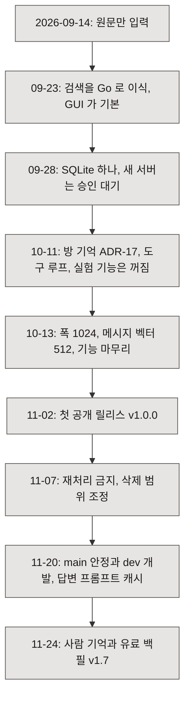

**한국어** | [English](decisions.en.md)

# 결정 기록: 왜 이렇게 만들었나

> **한 줄 요약**: 마사몽의 구조는 "친구 봇, 기억이 먼저, 1인이 유지, 원문만 근거, 돈이 드는 일은 운영자가 시작" 다섯 가지에서 나왔다. 이 페이지는 결정마다 이유와 버린 방법을 적는다.

**3분 요약**

- **제품**: 친구들 방의 친구 봇이다. 기억이 가장 중요하고, 엄격한 개인정보 기능은 있지만 기본은 꺼짐이다.
- **플랫폼**: Go 실행 파일과 SQLite 파일 하나. 여러 DB, 별도 벡터 DB, 사이드카 런타임은 두지 않는다.
- **검색**: Python 샌드박스에서 검증한 방식을 Go로 그대로 옮기고 parity 테스트로 묶었다. 전략은 모델이 아니라 규칙이 후보를 보고 정한다.
- **기억 층**: 원문 위에 leaf 색인, 방 기억(ADR-17), 사람 기억을 쌓는다. 모든 파생은 근거 ID를 갖고 삭제를 따라간다.
- **대화**: 무엇을 보여 줄지는 코드가 정한다. 도구는 반복 루프로 고르되 기억 플래너는 따로 둔다. 부르지 않았는데 말하는 기능은 실험이고 기본 꺼짐이다.
- **운영**: 모든 표면은 같은 Action을 부른다. 관리는 브라우저 콘솔이 기본이고(ADR-16), 릴리스는 `dev`에서 모아 `main`에 태그한다.

근거가 공개 문서에 없는 결정은 "운영자 결정(날짜)"로만 적었다.

## 큰 결정의 흐름

## 요약 표

상태: **유지** 지금도 그대로, **대체** 다른 결정이 대신함, **보류** 결정 대기, **실험** 기본 꺼짐.

| # | 결정 | 시기 | 이유 한 줄 | 상태 |
|---|---|---|---|---|
| [A-1](#a-1) | 친구 봇이고 기억이 가장 중요하다 | 2026-09-23, 10-11 | 친구는 지난 일을 기억한다. 팩트체크 봇이 아니다 | 유지 |
| [A-2](#a-2) | 입력은 원문만, 옛 가공물은 제외 | 09-14 | 출처와 삭제를 끝까지 따라가려고 | 유지 |
| [A-3](#a-3) | 처음부터 다국어: 구조 신호 → 작은 분류기 → 단어 목록 | 09-23, 10-11 | 단어 목록은 다른 언어에서 조용히 고장 난다 | 유지 |
| [A-4](#a-4) | 엄격한 개인정보는 기본 꺼짐, 기억은 기본 켜짐 | 10-11, v1.6.0, v1.7.0 | 친구 방에서 개인정보를 앞세우면 재미가 없다 | 유지 |
| [A-5](#a-5) | 음성·presence·입장 인사는 하지 않는다 | 10-11 | 수요가 없고 범위에서 뺐다 | 유지 |
| [A-6](#a-6) | 기능을 마무리하고 이후는 패치로 | 10-13 | 두 저장소를 함께 유지할 여력이 없다 | 유지 |
| [B-1](#b-1) | 이전 봇을 Go로 다시 만든다 | 2026-09 | 실행 파일만으로 돌아야 한다 | 유지 |
| [B-2](#b-2) | 저장소는 SQLite 하나, TiDB는 꺼 둠 | 09-28 | 두 DB는 돌볼 것이 두 배다 | 유지 |
| [B-3](#b-3) | 원문 저장이 먼저, 색인은 그 뒤 | 2026-09 | 공급자 장애가 수집 장애가 되면 안 된다 | 유지 |
| [B-4](#b-4) | 벡터는 메모리에서 정확 검색 | 2026-09 | 이 규모에서는 충분하고 운영이 단순하다 | 유지 |
| [C-1](#c-1) | 샌드박스 검색을 Go로 전부 옮기고 parity로 묶는다 | 09-23 | 검증된 방식을 그대로 쓰려고 | 유지 |
| [C-2](#c-2) | 수동 별칭·키워드 정규식을 기본에서 뺀다 | 09-23 | holdout에서 효과 0 | 유지 |
| [C-3](#c-3) | 플래너는 의도만, 전략은 후보를 본 뒤 규칙으로 | 2026-09 | 모델이 전략을 고르면 흔들리고 비용을 못 잡는다 | 유지 |
| [C-4](#c-4) | 구조화 판단 모델 시범 | 09-21 | 한국어 품질 부족 | 보류 |
| [C-5](#c-5) | 재순위 없는 구성의 관련성 하한은 0 | 10-12 | 경계값이 방과 모델마다 달라진다 | 유지 |
| [C-6](#c-6) | 메시지 단위 벡터를 보조 후보원으로 켠다 | 10-12, 10-13 | 8줄을 벡터 하나로 묶으면 희석된다 | 유지 |
| [C-7](#c-7) | leaf 임베딩 기본 폭 1024 | 10-13 | 품질 차이는 잡음, 힙은 21~27% 준다 | 유지 |
| [C-8](#c-8) | 시간 범위에서 못 찾으면 범위 없이 한 번 더 | 10-11 | 플래너가 시간을 자주 잘못 좁힌다 | 유지 |
| [C-9](#c-9) | 릴리스는 기록을 스스로 다시 처리하지 않는다 | 11-07 | 전체 재처리는 돈이 든다 | 유지 |
| [C-10](#c-10) | 큰 가져오기는 배치 API로 | v1.1.0 | 처음 준비할 때 호출이 많다 | 유지 |
| [C-11](#c-11) | 저사양 단계와 자동 메모리 한도 | 10-12 | 작은 기기에서도 멈추지 않게 | 유지 |
| [C-12](#c-12) | ADR-18: 안 쓰는 방 내려놓기 | 10-13 | 상주 메모리가 메시지 수에 비례한다 | 보류 |
| [D-1](#d-1) | ADR-17: 방 기억은 근거 붙은 짧은 파생 문장 | 10-11 | 방 단위 정리가 없으면 흐름을 못 따라간다 | 유지 |
| [D-2](#d-2) | 파생 작업은 전용 월 예산 | 10-11 | 배경 작업이 답을 막으면 안 된다 | 유지 |
| [D-3](#d-3) | 삭제는 직접 읽은 답만, 철회는 사슬 전체 | v1.1.1 | 출처 목록 복사는 제곱으로 커졌다 | 유지 |
| [D-4](#d-4) | 사람 기억은 한 줄씩(`person_claim`) | v1.7.0 | 줄마다 말한 사람과 근거가 있어야 숨기고 지울 수 있다 | 유지 |
| [D-5](#d-5) | 본인 말은 서버 전체, 전해 들은 말은 그 채널 묶음 | v1.7.0 | 남이 한 말의 맥락은 그 자리에 있다 | 유지 |
| [D-6](#d-6) | 대상은 멘션·답장·정확한 이름으로만 | v1.5.1 | 잘못 고르면 묻지 않은 기억이 답에 들어간다 | 유지 |
| [D-7](#d-7) | 유료 백필: 비용 계산 → 시범 → 본 실행 | v1.7.0, v1.7.1 | 과거 기록을 모델로 읽는 일은 운영자가 보고 시작해야 한다 | 유지 |
| [E-1](#e-1) | 딴 얘기 격리: 문맥은 코드가 고른다 | 10-11 | "무시하라"는 지시는 확률에 기대는 것이다 | 유지 |
| [E-2](#e-2) | 도구는 반복 루프, 기억 플래너는 따로 | 10-11 | 구조가 도구 판단을 좋게 한다. parity는 지킨다 | 유지 |
| [E-3](#e-3) | 기본값을 몰래 채우지 않는다 | 10-11 | 이전 봇이 그래서 신뢰를 잃었다 | 유지 |
| [E-4](#e-4) | 스레드는 제안형 | 10-11 | 자동 스레드는 친구 방에서 거슬린다 | 유지 |
| [E-5](#e-5) | 끼어들기·이어 말하기·농담은 실험, 기본 꺼짐 | 10-11 | 데이터를 먼저 모은다 | 실험 |
| [E-6](#e-6) | DM 대화, 서버 기억과 섞지 않는다 | 10-13 | 비용과 사생활은 관리자가 정한다 | 유지 |
| [E-7](#e-7) | 예약 작업은 저장한 요청을 실제 턴으로 실행 | 10-15 | 문구만 올리면 요청이 실행되지 않는다 | 유지 |
| [E-8](#e-8) | 답변 프롬프트의 앞부분을 턴마다 같게 | v1.4.0 | 공급자 프롬프트 캐시가 맞게 | 유지 |
| [E-9](#e-9) | 검색 깊이를 질문에 맞춘다 | v1.2.0 | 요약문만으로는 답이 얕다 | 유지 |
| [E-10](#e-10) | 방마다 한 번에 한 턴, 이어진 메시지는 묶는다 | 2026-10 | 답이 뒤섞이면 안 된다 | 유지 |
| [E-11](#e-11) | 실패는 사용자의 언어로 된 문장으로 | v1.6.0 | 오류 원문을 보여 주지 않는다 | 유지 |
| [F-1](#f-1) | 모델은 역할별, 공급자는 호스트 계열별 | 09-30, v1.1.0 | 호스트마다 받는 필드가 다르다 | 유지 |
| [F-2](#f-2) | 역할별 대체 모델과 차단기 | 10-15, v1.7.0 | 공급자 장애가 답 실패가 되지 않게 | 유지 |
| [F-3](#f-3) | 도구는 등록부 한 곳, 관문은 Execute 안 | 09-23 | 한 곳에서 선언하고 모든 경로에 같은 한도 | 유지 |
| [F-4](#f-4) | 언어팩과 로케일을 나눈다 | 09-23 | 새 언어가 파일 추가로 끝나게 | 유지 |
| [F-5](#f-5) | 운세는 달력 계산이 사실, 모델은 풀이만 | v1.1.0 | 근거 있는 데이터, 유료 API 없음 | 유지 |
| [F-6](#f-6) | 재난 알림은 방마다 지역과 단계 | v1.5.1 | 방이 필요한 만큼만 받게 | 유지 |
| [G-1](#g-1) | 모든 표면은 같은 Action만 부른다 | 2026-09 | 권한·검증·기록을 한 곳에서 | 유지 |
| [G-2](#g-2) | ADR-16: GUI가 기본, 콘솔은 내장 Svelte 앱 | 09-24 | 얽힌 설정은 화면에서 봐야 한다 | 유지 |
| [G-3](#g-3) | 콘솔은 loopback 전용, 원격은 SSH | 09-24 | 공개 포트는 공격 면이다 | 유지 |
| [G-4](#g-4) | 설정마다 주인 페이지 하나 | 10-01 | 실효값이 헷갈리지 않게 | 유지 |
| [G-5](#g-5) | 비밀값은 참조만 넘긴다 | 09-24 | 값이 응답·로그에 남지 않게 | 유지 |
| [G-6](#g-6) | 모든 OS에서 감시 프로세스 | 09-30 | OS마다 다른 방식은 유지가 어렵다 | 유지 |
| [G-7](#g-7) | 복원·초기화·교체는 같은 저널 | 10-02 | 중간에 죽어도 이어 가거나 되돌린다 | 유지 |
| [G-8](#g-8) | 새 서버는 승인을 기다린다 | 09-28 | 초대만으로 저장·답하면 안 된다 | 유지 |
| [G-9](#g-9) | 꺼진 동안의 메시지는 자동으로 7일 | 09-28 | 꺼진 사이 대화가 기억에서 빠진다 | 유지 |
| [G-10](#g-10) | 통계는 로컬에만, 공유는 파일로 | v1.6.0 | 자동 전송은 하지 않는다 | 유지 |
| [G-11](#g-11) | 업데이트 소식은 신청한 곳에만 | v1.6.0 | 자동 공지는 거슬린다 | 유지 |
| [G-12](#g-12) | 운영자 알림은 DM, 서버 로그는 선택 | 09-30, 10-22 | 특정 채널 이름에 기대지 않는다 | 유지 |
| [H-1](#h-1) | 공개 저장소의 이력은 첫 공개 릴리스에서 시작 | 11-02 | 운영자 결정 | 유지 |
| [H-2](#h-2) | `main`은 안정, `dev`는 개발 | 11-20 | 설치 채널을 안정적으로 | 유지 |
| [H-3](#h-3) | 태그 푸시가 릴리스를 만든다 | 11-02 | 빌드·검사·배포물이 한 번에 | 유지 |
| [H-4](#h-4) | 코드 서명·공증 | 09-30 | 비용과 계정 | 보류 |
| [H-5](#h-5) | Action 계층을 나누기 전에 가드부터 | v1.6.0 | 한 번에 나누면 회귀를 못 잡는다 | 유지 |
| [H-6](#h-6) | 문서와 코드가 어긋나면 검사가 실패한다 | 10-02, v1.4.0 | 문서는 손으로만 맞추면 낡는다 | 유지 |

## A. 제품 방향

<b>A-1. 친구 봇이고, 기억이 가장 중요한 기능이다</b>

- **이유**: 친구들만 모인 Discord 방에서 같이 떠들고, 필요하면 찾아 주고 정리해 주는 봇이다. 친구는 지난 일을 기억한다. 기억력이 완벽할 필요는 없고 처참하지만 않으면 된다. 허세와 추측은 괜찮지만 연애·건강·돈·범죄에 관한 해로운 거짓 소문은 안 된다.
- **검토한 다른 방법과 버린 이유**: 팩트체크·비서형 봇. 이전 봇의 데이터를 보면 답이 길고 형식적이었고(답 중앙값 227~294자, 사람 메시지의 47%가 10자 이하) 장난을 받아치지 못했다.
- **지금 상태**: 제품 원칙의 첫 줄이다. 페르소나, 답 모양, 도구 정책이 이 기준을 따른다.
- **근거**: [유지보수 가이드 §2](../MAINTAINING.md), [기억·대화·도구 설계 §1·§4.1](../plan-memory-conversation.md).

<b>A-2. 입력은 원문만. 옛 가공물은 모두 제외한다</b>

- **이유**: 원문부터 새 파이프라인으로 처리해야 출처와 삭제를 끝까지 따라갈 수 있다. 이전 봇의 기억은 대부분 쓸모가 없었다(키워드 나열 67%, 오래 쓸 사실은 2~3%).
- **검토한 다른 방법과 버린 이유**:
  - 옛 임베딩·요약·주장을 초기값이나 대체 경로로 재사용 → 삭제·철회가 닿지 않는 사본이 남는다.
  - 이전 DB의 표를 그대로 이관 → 새 표는 계약이 다르다.
- **지금 상태**: [원문 데이터 정책](../RAW_DATA_POLICY.md)이 가장 우선하는 규칙이다. 범위를 정한 예외는 방 기억 하나다([D-1](#d-1)). 이전 봇에서는 개인 기능 설정만 읽기 전용으로 가져온다.
- **근거**: [원문 데이터 정책](../RAW_DATA_POLICY.md), [STORAGE.md](../STORAGE.md), [유지보수 가이드 §3](../MAINTAINING.md).

<b>A-3. 처음부터 다국어. 구조 신호 → 작은 분류 모델 → 단어 목록(보조)</b>

- **이유**: 답장, 멘션, 작성자, 시간 간격은 언어와 상관없고 비용이 0이며 결정적이라 테스트할 수 있다. "봇에게 하는 말인가, 봇에 대한 말인가" 같은 의미 판단은 언어를 이해해야 한다. 하드코딩한 한국어 목록은 다른 언어에서 기능을 망가뜨린다.
- **검토한 다른 방법과 버린 이유**: 언어별 정규식과 키워드 목록만으로 판단 → 목록이 없는 언어에서 조용히 고장 난다.
- **지금 상태**: 프롬프트·규칙·낱말은 언어팩 다섯 개에, 화면과 명령 문구는 로케일에 있다. 한국 전용 기능은 한국 밖에서 기본 꺼짐이다.
- **근거**: [유지보수 가이드 §2](../MAINTAINING.md), [기억·대화·도구 설계 §2·§5.8](../plan-memory-conversation.md), [도구 설정과 언어 §6](../tools-and-languages.md).

<b>A-4. 엄격한 개인정보 기능은 만들되 기본 꺼짐. 기억은 기본 켜짐</b>

- **이유**: 친구끼리 쓰는 봇이라 개인정보를 너무 앞세우면 재미가 없다. 필요한 서버는 관리자가 켠다.
- **검토한 다른 방법과 버린 이유**: 엄격 옵션을 기본으로 켜기 → 남에 대한 질문에 답하지 못해 기억 기능의 값이 사라진다.
- **지금 상태**: 서버별 네 스위치(`own_card_only`, `no_hearsay`, `no_sensitive`, `card_channel_only`)는 모두 기본 꺼짐이다. 동의 철회, 잊기, 차단은 옵션과 상관없이 항상 동작한다. 기억은 v1.6.0부터, 사람 기억은 v1.7.0부터 기본 켜짐이다.
- **근거**: [기억 운영 §14](../memory-operations.md), [기억·대화·도구 설계 §1.3·§5.4.8](../plan-memory-conversation.md), 릴리스 노트 [v1.6.0](../../release-notes/v1.6.0.md)·[v1.7.0](../../release-notes/v1.7.0.md).

<b>A-5. 음성, presence, 입장 인사, 영상 이해는 하지 않는다</b>

- **이유**: 이전 봇의 데이터에 수요가 없었고 범위에서 뺐다.
- **지금 상태**: 계획 없음.
- **근거**: [기억·대화·도구 설계 §8](../plan-memory-conversation.md), [유지보수 가이드 §2](../MAINTAINING.md).

<b>A-6. 2026-10-13에 기능을 마무리하고 이후는 업데이트 패치로 낸다</b>

- **이유**: 이전 봇과 새 봇을 함께 유지할 여력이 없다. 패치 작업을 시작하는 사람이 처음 읽을 문서 하나가 필요했다.
- **지금 상태**: 이전 봇은 지원을 끝냈다. [유지보수 가이드](../MAINTAINING.md)가 패치 작업의 첫 문서다. 첫 공개 릴리스 v1.0.0(2026-11-02) 이후 v1.7.1까지 나왔다.
- **근거**: [유지보수 가이드](../MAINTAINING.md) 머리말과 §3.

## B. 플랫폼과 저장

<b>B-1. 이전 봇(Python)을 Go로 다시 만든다</b>

- **이유**: 제품은 실행 파일만으로 돌아야 한다. 서버에 Python, Node, 브라우저 엔진을 깔지 않는다. Go는 Discord·HTTP·SQL 같은 I/O 중심 작업에 맞고 실행 파일 하나로 배포된다. SQLite도 cgo 없는 구현을 써서 크로스 컴파일이 쉽다.
- **검토한 다른 방법과 버린 이유**:
  - 검증한 Python 검색 구현을 제품에 그대로 붙이기 → 2026-09-23에 Go로 전부 옮기고 parity로 맞추는 쪽으로 정했다([C-1](#c-1)).
  - 기능별로 서비스를 나누기 → 운영이 복잡해진다. 모듈형 단일 데몬으로 했다.
  - 그 밖에 초기 설계에서 검토한 구성 → 운영자 결정(2026-09).
- **지금 상태**: 프로그램은 `masamongd`(데몬)와 `masamong`(CLI·런처) 둘이다.
- **근거**: [system.md](system.md), [`go.mod`](../../go.mod), [유지보수 가이드 §3](../MAINTAINING.md).

<b>B-2. 저장소는 SQLite 하나. TiDB 코드는 남기고 꺼 둔다</b>

- **이유**: 두 DB를 지원하면 엔진별 DDL과 upsert, 저장소 이전 마법사, 전용 잠금·백업 경로, 실서버 CI가 모두 두 배다. 파일 하나로 충분히 도는 개인용 봇이다.
- **검토한 다른 방법과 버린 이유**:
  - SQLite 기본 + TiDB 선택(그전 구현) → 위 비용.
  - TiDB 코드 삭제 → 다시 켤 가능성을 남기려고 지우지 않았다.
  - 런타임에 SQL을 다른 문법으로 치환 → 하지 않는다.
- **지금 상태**: `internal/storage/settings.go`의 `TiDBEnabled = false`. 어느 경로로도 TiDB를 열 수 없다. 새 기능 표는 SQLite DDL만 있다. 여러 백엔드를 다시 제안하지 않는다.
- **근거**: [STORAGE.md](../STORAGE.md), [유지보수 가이드 §2·§3](../MAINTAINING.md), 위키 [보류 중인 결정 #4](../wiki/보류-중인-결정.md).

<b>B-3. 원문 저장을 먼저 하고, 색인과 임베딩은 그 뒤의 작업으로 둔다</b>

- **이유**: 임베딩 공급자가 죽어도 메시지 수집이 실패하면 안 된다.
- **검토한 다른 방법과 버린 이유**: 추출·임베딩이 끝난 뒤 저장 → 공급자 장애가 수집 장애가 된다.
- **지금 상태**: 수집은 모델 상태와 무관하다. 모델이 없어도 원문과 어휘 검색은 동작한다. 색인은 백그라운드 워커가 예산 안에서 한다.
- **근거**: [검색과 RAG](../rag/README.md)의 불변 원칙 5, [수명주기](../rag/source-lifecycle.md).

<b>B-4. 벡터 검색은 메모리에서 하는 정확 검색이다</b>

- **이유**: 범위 안의 행만 직접 점수 낸다. 이 규모에서 로컬 검색은 약 20ms이고 대부분은 어휘 검색과 결합이다. 별도 서비스가 없어 운영이 단순하다.
- **검토한 다른 방법과 버린 이유**: 별도 벡터 DB나 근사 검색 → 지금 규모에서 얻는 것이 없고 돌볼 것이 늘어난다.
- **지금 상태**: 디스크에는 float16, 메모리 색인에는 int8. 디스크도 int8로 줄일지는 정하지 않았다.
- **근거**: [임베딩 폭 측정](../rag/embedding-width-2026-10.md), 위키 [보류 중인 결정 #1](../wiki/보류-중인-결정.md), [ADR-18 §1](../adr/ADR-18-idle-room-unloading.md).

## C. 검색

<b>C-1. 샌드박스에서 검증한 검색 방식을 Go로 전부 옮기고 parity 테스트로 묶는다</b>

- **이유**: 검증된 방식을 다시 설계하지 않고 그대로 쓰려고. 샌드박스(Python)는 실험·비교 환경으로 남기고, parity 테스트가 둘이 어긋나지 않게 한다.
- **검토한 다른 방법과 버린 이유**: Go에서 새로 설계 → 검증을 처음부터 다시 해야 한다. 어휘 점수를 두 쪽이 각자 계산 → 어긋난다. 양쪽 모두 SQLite FTS5를 써서 점수와 순서까지 맞췄다.
- **지금 상태**: `make parity`(지어낸 말뭉치, CI에서 실행)와 실데이터 parity. 통과 조건은 차이 0이다. 한국어 플래너·문맥·기억·보안·색인 요약 프롬프트는 샌드박스와 바이트 단위로 같아야 한다.
- **근거**: [기억 운영](../memory-operations.md) 머리말과 §2, [유지보수 가이드 §1·§3·§5](../MAINTAINING.md).

<b>C-2. 과적합 감사 뒤 수동 별칭과 키워드 정규식을 기본에서 뺐다</b>

- **이유**: 표본에 맞춘 것이 아닌지 holdout으로 다시 쟀다. 수동 별칭과 키워드 의도 추정은 효과가 0이었다. 범용성이 먼저다.
- **지금 상태**: 기본 leaf는 "8개 또는 30분 공백"이다. 플래너가 없으면 중립 의도를 쓴다.
- **근거**: [유지보수 가이드 §3](../MAINTAINING.md), [기억 운영 §1](../memory-operations.md).

<b>C-3. 플래너는 의도만 말하고, 검색 전략은 후보를 본 뒤 규칙으로 정한다</b>

- **이유**: 모델이 순위 방식·풀 크기·가중치를 고르면 결과가 흔들리고 비용을 통제할 수 없다. 사람·별칭·시간은 점수 보너스가 아니라 범위와 후보원으로 다룬다.
- **검토한 다른 방법과 버린 이유**:
  - 규칙 가산 재순위(R1) → 퇴역. 제거 실험용으로만 남겼다.
  - 주장·soft event·키워드 의도 → 기본 검색에서 쓰지 않는다.
  - 학습형 결합, 복구 2회 이상, 재순위 모델 여럿 → 비용 대비 근거가 없다.
- **지금 상태**: 후보원 여럿 → 가중 RRF → 규칙 기반 신뢰도 → 그대로 / 재순위 / 복구 1회 뒤 재순위 → 하한 → 원문 확장 → 범위 재확인.
- **근거**: [검색 구조](../rag/retrieval-v2.md).

<b>C-4. 구조화 판단 모델 시범은 보류했다</b>

- **이유**: 끼어들기 판정 후보로 시험했으나 한국어 민감 재현율 0.571 등 품질이 모자랐다.
- **지금 상태**: 쓰지 않는다. 분류는 언어팩 프롬프트를 쓰는 작은 채팅 모델이 한다.
- **근거**: [유지보수 가이드 §3](../MAINTAINING.md).

<b>C-5. 재순위가 없는 구성의 관련성 하한은 0으로 둔다</b>

- **이유**: "기록에 없음"을 가르는 경계값이 방 크기와 임베딩 모델마다 움직인다. 안전한 값은 효과가 작고, 효과가 있는 값은 답이 있는 질문을 비운다. 답변 모델이 이미 기록에 없는 질문 대부분에 모른다고 답한다.
- **지금 상태**: 하한은 켜지 않았다.
- **근거**: [기억 운영 §2](../memory-operations.md)의 "R0 하한·후보 생성 진단", [유지보수 가이드 §3](../MAINTAINING.md).

<b>C-6. 메시지 단위 벡터를 후보 찾기 보조로 기본 켠다. 결과 단위는 leaf 그대로</b>

- **이유**: 8줄을 벡터 하나로 묶으면 희석돼 한 줄짜리 사실을 놓쳤다. 메시지 벡터 순위를 결합에 더하니 같은 풀에서 회수율이 눈에 띄게 올랐다.
- **검토한 다른 방법과 버린 이유**:
  - 풀 크기, 결합 가중, 출처별 보장 수 조정 → 모두 잡음 수준이었다.
  - leaf를 더 잘게 자르기 → 레시피가 바뀌어 parity와 재색인 비용이 든다.
  - 메시지를 결과 단위로 → 문맥이 사라진다.
- **지금 상태**: `memory.message_vectors` 기본 켜짐, 결합 가중 0.1. MRL 모델은 512차원으로 저장한다. 그 밖의 모델은 자르지 않는다.
- **근거**: [기억 운영 §2·§15](../memory-operations.md), [임베딩 폭 측정 §7](../rag/embedding-width-2026-10.md), [유지보수 가이드 §3](../MAINTAINING.md).

<b>C-7. leaf 임베딩의 기본 폭은 1024다</b>

- **이유**: 재순위가 있으면 1024와 4096의 품질 차이가 잡음 범위이고 Go 힙이 21~27% 준다. 폭은 속도나 임베딩 값이 아니라 메모리와 디스크를 정한다.
- **검토한 다른 방법과 버린 이유**:
  - 4096 유지 → 메모리.
  - 512·256 → 재순위 없는 구성의 흐름형 질문이 떨어진다.
  - 디스크에는 4096을 두고 메모리에 올릴 때만 자르기 → 보존할 운영 데이터가 없었고 다시 임베딩하는 값이 쌌다.
- **지금 상태**: 기본 1024. 재순위를 쓸 수 없는 구성에서만 모델 추천이 전체 폭을 제안한다.
- **근거**: [임베딩 폭 측정](../rag/embedding-width-2026-10.md).

<b>C-8. 플래너가 붙인 시간 범위에서 못 찾으면 범위 없이 한 번 더 찾는다</b>

- **이유**: 플래너가 연도 없는 날짜를 올해로 읽거나 몇 달 전 일을 "요즘"으로 묻는 경우가 흔했다. 측정에서 범위가 걸린 답 있는 문항 11개 중 7개가 근거를 놓쳤다.
- **지금 상태**: 턴 기록에 `time_relaxed`로 남는다. 하한이 비운 결과에는 다시 찾지 않는다.
- **근거**: [기억 운영 §2](../memory-operations.md).

<b>C-9. 릴리스, 재시작, 배포는 기록을 스스로 다시 요약하거나 다시 임베딩하지 않는다</b>

- **이유**: 전체 재처리는 돈이 든다. 기록이 클수록 실수 한 번의 값이 크다.
- **검토한 다른 방법과 버린 이유**: 레시피 표시가 달라지면 자동 재색인 → 금지. 레시피와 임베딩 공간을 고정하고 스키마는 덧붙이기만 한다.
- **지금 상태**: 테스트가 "재시작 뒤 호출 0번, 기존 행 그대로"를 고정한다. 기본값을 바꾸는 릴리스는 영향과 비용을 릴리스 노트에 적는다.
- **근거**: [유지보수 가이드 §4](../MAINTAINING.md), 릴리스 노트 [v1.1.1](../../release-notes/v1.1.1.md)·[v1.7.0](../../release-notes/v1.7.0.md).

<b>C-10. 큰 가져오기는 공급자의 배치 API로 준비할 수 있다</b>

- **이유**: 기록을 처음 준비할 때는 요약 호출이 많고, 배치가 더 싸다.
- **지금 상태**: `memory.blocks.prepare`의 `mode=batch`. 배치가 없는 호스트는 즉시 처리로 간다.
- **근거**: [기억 운영 §5](../memory-operations.md), 릴리스 노트 [v1.1.0](../../release-notes/v1.1.0.md).

<b>C-11. 저사양 기기: 성능 단계, 자동 메모리 한도, 큰 방의 증분 동기화</b>

- **이유**: 1코어·512MB급에서도 멈추지 않게 하려고. 다만 저사양 대응은 극단적인 경우이고, 메모리를 아끼려고 품질을 깎지 않는다.
- **지금 상태**: `internal/hostprofile`, `internal/memlimit`. 순서대로 들어온 새 메시지는 방의 꼬리만 다시 자른다.
- **근거**: [기억 운영 §16](../memory-operations.md), [유지보수 가이드 §2·§3](../MAINTAINING.md), 위키 [보류 중인 결정 #6](../wiki/보류-중인-결정.md).

<b>C-12. (보류) ADR-18: 안 쓰는 방을 메모리에서 내려놓기</b>

- **이유**: 상주 메모리는 메시지 수에 비례하고, 질문이 없는 방도 늘 메모리에 있다.
- **권고안**: 색인은 하나로 두고 "상주 방 집합"으로 다시 만든다. 사람 이름 표는 전체 기준으로 유지한다.
- **검토한 다른 방법과 버린 이유**:
  - 방별 색인 → 검색·parity·골든을 다시 정의해야 한다.
  - 전체 빈도표로 bm25를 직접 계산 → FTS5를 버리면 parity가 사라진다.
  - 벡터만 내려놓기 → 절감이 절반뿐이다.
  - 벡터를 파일로 두고 mmap → 무작위 읽기가 되고 상주를 예측할 수 없다.
  - 오래된 방을 디스크에서 바로 검색 → 검색 경로가 둘로 갈린다.
  - 방마다 "항상 상주" 설정 → 새 설정을 만들지 않는다는 원칙에 어긋난다.
- **지금 상태**: 계약과 측정까지 했다. 서비스 동작은 그대로다(전체 상주). 부분 상주에서 어휘 순위가 바뀌는 것을 받아들일지 등은 운영자 결정을 기다린다. 한계: 활발한 방만 있으면 절감이 0이다.
- **근거**: [ADR-18](../adr/ADR-18-idle-room-unloading.md), [남은 일 §0](../BACKLOG.md).

## D. 방 기억과 사람 기억

<b>D-1. ADR-17: 방 기억은 근거가 붙은 짧은 파생 문장을 저장한다</b>

- **이유**: "지난주에 뭘 정했나"에 답하려면 방 단위로 정리한 짧은 기록이 있어야 한다. 매 턴 원문 전체를 읽으면 비싸고, 사람별 기억만으로는 방의 흐름을 따라가지 못한다.
- **검토한 다른 방법과 버린 이유**:
  - 원문을 기억으로 복사 → 원문 정책 위반.
  - 외부 기억 서비스 → 데이터가 밖으로 나간다.
  - leaf 레시피를 바꿔 사건 단위로 자르기 → parity와 재색인 비용. 에피소드를 leaf 위의 별도 층으로 얹었다.
  - 매 턴 사용자 모델 합성 → 비용 대비 효과가 낮다.
- **지금 상태**: 항목은 120자 이하, 근거 ID 필수, 사람은 단방향 참조로만. 삭제·수정·철회는 근거 색인을 거쳐 닿는다.
- **근거**: [ADR-17](../adr/ADR-17-derived-room-memory.md), [기억·대화·도구 설계 §5.4·§8·§9](../plan-memory-conversation.md).

<b>D-2. 백그라운드 파생 작업은 전용 월 예산을 쓴다</b>

- **이유**: 운영자가 자기 돈으로 운영한다. 대화 예산과 섞이면 배경 작업이 답을 막는다.
- **지금 상태**: `memory.derived_budget_usd` 기본 3달러, 0이면 끔. 한도에 가까우면 방 상태 갱신부터 멈춘다.
- **근거**: [ADR-17](../adr/ADR-17-derived-room-memory.md) 결정 3.

<b>D-3. 삭제는 그 말을 직접 읽은 답만, 동의 철회는 사슬 전체를 따라간다</b>

- **이유**: 삭제가 파생 사본을 놓친 사고가 있었다. 그 뒤 모든 답이 읽은 출처 목록을 복사하게 했더니 색인이 방 기록의 제곱으로 커졌다.
- **검토한 다른 방법과 버린 이유**:
  - 답마다 출처 목록 복사 → 크기 폭증.
  - 삭제도 사슬 전체를 따라가기 → 한 줄을 지우면 관계가 먼 답까지 사라진다.
- **지금 상태**: 답은 읽은 턴을 링크로 가리킨다. 삭제와 수정은 링크 한 단계만, 철회는 링크 사슬 전체를 따라간다. 정리 의도와 tombstone을 원문 변경 전에 커밋한다.
- **근거**: 릴리스 노트 [v1.1.1](../../release-notes/v1.1.1.md), 사고 회고 [0003](../postmortems/0003-deletion-missed-derived-copies.md)·[0006](../postmortems/0006-edited-message-and-looked-up-evidence.md), [원문 데이터 정책](../RAW_DATA_POLICY.md).

<b>D-4. 사람 기억은 요약 카드가 아니라 "한 사람이 한 사람에 대해 한 말" 한 줄이다</b>

- **이유**: 누가 누구에 대해 물으면 그 사람의 기억으로 답해야 한다. 줄마다 말한 사람과 근거가 있어야 한 줄을 숨기거나 지울 수 있고, 근거가 지워지면 그 줄만 사라진다.
- **검토한 다른 방법과 버린 이유**:
  - 저장형 사람 카드(이전 방식) → 대체했다.
  - 줄을 임베딩해 벡터로 찾기 → 하지 않는다. 읽을 때 SQL과 단어 겹침만 쓴다. 그래서 업그레이드가 임베딩 호출이나 재색인을 만들지 않는다.
  - 순위와 "새 말이 옛 말을 대신함"을 저장할 때 계산 → 읽을 때 근거 메시지 시각 순으로 계산한다.
  - 콘솔에 자유 입력 칸 → 넣지 않았다. 숨기기와 잊기뿐이다.
- **지금 상태**: 만드는 길 다섯 가지가 모두 저장 관문 하나를 지난다. `memory.people` 기본 켜짐.
- **근거**: [기억 운영 §13](../memory-operations.md), 릴리스 노트 [v1.7.0](../../release-notes/v1.7.0.md).

<b>D-5. 본인이 한 말은 서버 전체에서, 전해 들은 말은 그 말이 나온 채널 묶음에서만 쓴다</b>

- **이유**: 본인이 공개 채널에서 한 자기 얘기는 서버 어디서든 써도 된다. 남이 한 말은 맥락이 그 자리에 있다. 비공개 스레드의 말은 그 밖으로 나가면 안 된다.
- **검토한 다른 방법과 버린 이유**:
  - 전부 서버 전체 → 남의 말이 다른 채널로 샌다.
  - 전부 채널 한정 → 본인이 말한 사실도 다른 채널에서 모른다. 엄격 옵션(`card_channel_only`)으로 남겼다.
- **지금 상태**: 서버가 다르면 다른 사람이다. 전해 들은 말에는 말한 사람 이름이 붙는다. 그림은 본인이 한 말만 쓴다. 서버를 떠난 사람의 기억은 동의를 철회하지 않았다면 남는다(운영자 결정 2026-11-20).
- **근거**: [기억 운영 §13·§14](../memory-operations.md), 릴리스 노트 [v1.7.0](../../release-notes/v1.7.0.md).

<b>D-6. "누구에 대한 질문인가"는 멘션, 답장, 정확한 이름으로만 정한다. 애매하면 고르지 않는다</b>

- **이유**: 놓친 요청은 답에 기억이 빠질 뿐이지만, 잘못 고르면 묻지 않은 사람의 기억이 답에 들어간다.
- **검토한 다른 방법과 버린 이유**:
  - 플래너의 추측으로 대상 추가 → 하지 않는다.
  - 이름 부분 일치 → 오인한다.
  - 동명이인 중 하나를 고르기 → 아무도 고르지 않는다.
- **지금 상태**: 부른 사람 본인은 메시지의 마지막 문장이 언어팩의 자기 요청 문장 그대로일 때만 대상이다. 인용이 든 메시지는 말한 사람을 대상으로 삼지 않는다.
- **근거**: [기억 운영 §13](../memory-operations.md)의 "누구에 대한 질문인가", 릴리스 노트 [v1.5.1](../../release-notes/v1.5.1.md).

<b>D-7. 과거 기록에서 사람 기억을 채우는 유료 백필: 비용 계산 → 시범 → 본 실행, 자동 시작 없음</b>

- **이유**: 업그레이드만으로는 사람 기억이 적다. 과거 기록 전체를 모델로 읽는 일은 돈이 들어서 운영자가 범위와 값을 보고 직접 시작해야 한다.
- **검토한 다른 방법과 버린 이유**:
  - 업그레이드 때 자동 실행 → [C-9](#c-9)에 어긋난다.
  - 표준 API로 전부 → 배치의 두 배 값이다.
  - 시범 없이 바로 본 실행 → 작은 모델로 충분한지 모른 채 돈을 쓴다. 창 60개를 두 모델에 보내 비교한다.
  - 프롬프트 캐시 → 창마다 줄이 달라 거의 맞지 않아 쓰지 않는다.
  - 월 대화 예산에 합산 → 백필이 대화를 막는다. 서버별 합계 한도를 따로 둔다.
  - 다른 공급자 키로 대신 보내기 → 거절한다(운영자 결정 2026-11-23).
- **지금 상태**: 네이티브 Anthropic 공급자만 쓴다. 한도는 서버별 합계 기본 3달러, 최대 6달러. 요약·임베딩·에피소드는 건드리지 않는다. v1.7.1에서 창 하나의 답 상한을 4096토큰으로 올렸다(작은 모델의 답이 매번 잘려 시범이 통과하지 못했다).
- **근거**: [기억 운영 §14-1](../memory-operations.md), 릴리스 노트 [v1.7.0](../../release-notes/v1.7.0.md)·[v1.7.1](../../release-notes/v1.7.1.md).

## E. 대화 한 턴

<b>E-1. 딴 얘기 격리: 무엇을 보여 줄지는 코드가 정한다</b>

- **이유**: 이전 봇의 데이터에서 봇 대화 구간의 51%에 제3자 잡담이 끼어 있었다. 모델에게 다 보여 주고 "무시하라"고 하면 확률에 기대는 것이다. 모델은 눈앞에 있는 내용에 반응한다.
- **검토한 다른 방법과 버린 이유**: 최근 N줄 전체와 지시문 → 기각. 호출마다 스레드로 분리 → 친구 방에서 거슬린다.
- **지금 상태**: `internal/conversation`이 답장·멘션·작성자·시간으로 부른 사람의 대화를 고른다. 대화 기록 길이는 글자 수로 정한다(`chat.transcript_chars`).
- **근거**: [기억·대화·도구 설계 §2·§5.1](../plan-memory-conversation.md), [기억 운영 §10](../memory-operations.md), 릴리스 노트 [v1.2.2](../../release-notes/v1.2.2.md)·[v1.4.0](../../release-notes/v1.4.0.md).

<b>E-2. 도구는 반복 루프로 고르고, 기억 플래너는 따로 둔다</b>

- **이유**: 이전 봇은 73% 턴에서 도구를 쓰지 않았다. 참고한 두 프로젝트(Hermes Agent, OpenClaw)가 도구를 잘 고르는 이유는 설명문이 아니라 구조였다: 네이티브 tool calling, 결과를 보고 다시 부르는 루프, 짧은 행동 원칙, 쓸 수 있는 도구만 노출, 정체 가드.
- **검토한 다른 방법과 버린 이유**:
  - JSON 플래너가 결과를 보고 한 번 재계획 → tool calling이 안 되는 모델의 대체 경로로만 쓴다.
  - 기억까지 하나의 네이티브 루프 → 샌드박스 parity와 "기억 범위는 코드가 정한다"는 경계가 깨진다.
  - "반드시 도구를 써라" 문구 → 이전 봇의 실패는 반대 방향(잘못 고르고 몰래 채움)이라 가져오지 않았다.
- **지금 상태**: `chat.tool_mode`의 기본이 `loop`다. 실제 키로 잰 회귀 세트에서 루프가 플래너 방식보다 높았다(한국어 57/59 대 45/59, 영어 59/59 대 49/59). 한 라운드로 끝내는 도구는 장소 검색뿐이다. 날씨와 환율에도 넓혔다가 정확도가 떨어져 되돌렸다.
- **근거**: [기억·대화·도구 설계 §4.2·§5.5·§9](../plan-memory-conversation.md), [기억 운영 §12](../memory-operations.md), 릴리스 노트 [v1.1.1](../../release-notes/v1.1.1.md).

<b>E-3. 기본값을 몰래 채우지 않는다</b>

- **이유**: 이전 봇이 날씨 지역을 몰래 채워 신뢰를 잃었다.
- **지금 상태**: 값이 빠진 단계는 `needs_input`으로 남긴다. 가정했으면 답에서 밝힌다.
- **근거**: [기억·대화·도구 설계 §2·§4.1](../plan-memory-conversation.md).

<b>E-4. 스레드는 제안형이다. 봇이 만든 스레드 안에서는 태그 없이 대화한다</b>

- **검토한 다른 방법과 버린 이유**: 모든 호출을 자동으로 스레드로 → 친구 방에서 거슬린다.
- **지금 상태**: 길게 이어지는 대화에 버튼으로 제안한다. 연달아 무시되면 그 채널은 쉰다.
- **근거**: [기억·대화·도구 설계 §5.3·§8](../plan-memory-conversation.md), 릴리스 노트 [v1.1.1](../../release-notes/v1.1.1.md).

<b>E-5. 끼어들기, 이어 말하기, 농담, 방 말투는 실험 기능이고 채널마다 기본 꺼짐이다</b>

- **이유**: 대화 봇의 실패는 사용자에게 곧바로 보인다. 이전 봇에서 항상 켜 둔 채널은 짜증 반응을 받았다. 그림자 기록으로 데이터를 먼저 모으고 그 데이터로 기본값을 정한다.
- **지금 상태**: 꺼져 있어도 "했을 판단"은 본문 없이 기록된다. 철회·차단한 사람에게는 끼어들지 않는다.
- **근거**: [기억·대화·도구 설계 §2·§4.1·§5.7·§9](../plan-memory-conversation.md), [기억 운영 §10·§11](../memory-operations.md).

<b>E-6. DM 대화를 지원하되 서버 기억과 섞지 않는다</b>

- **이유**: DM에서도 지원 기능을 쓰게 하고, 비용과 사생활은 관리자가 정하게 하려고.
- **지금 상태**: `dm.allow`와 1인·전체 하루 한도. DM에서는 다른 사람의 사람 기억을 읽지 않는다.
- **근거**: [유지보수 가이드 §3](../MAINTAINING.md).

<b>E-7. 예약 작업은 저장한 요청을 시간에 실제 한 턴으로 실행한다</b>

- **이유**: "매일 12시에 점심 메뉴 추천해줘"가 문구만 저장돼 한 번만 울렸는데, 답은 반복되는 것처럼 말했다.
- **검토한 다른 방법과 버린 이유**: 저장한 문구를 시간에 그대로 올리기 → 요청한 일이 실행되지 않는다.
- **지금 상태**: 리마인더의 한 종류(`kind=task`)다. 주제가 빠지면 되묻고 저장하지 않는다.
- **근거**: [Discord 사용 경험 계획 §2](../plan-discord-experience.md).

<b>E-8. 답변 프롬프트의 앞부분을 턴마다 같게 유지한다</b>

- **이유**: 답변 호출의 입력 대부분이 매 턴 반복된다. 앞부분이 바이트 단위로 같아야 공급자의 프롬프트 캐시가 맞는다.
- **검토한 다른 방법과 버린 이유**:
  - 줄 수 경계에 맞춰 자르기 → 자르는 곳이 매 턴 바뀌어 되돌렸다.
  - 답 자체를 저장해 다시 쓰기 → 하지 않는다. 같은 질문이라도 문맥이 다르다.
- **지금 상태**: 바뀌는 것은 모두 마지막 메시지에 넣는다. 캐시 지점을 받는 호스트에만 표시를 보낸다. 긴 대화가 이어지는 방에서는 기록의 시작이 계속 움직이는 한계가 있다.
- **근거**: 릴리스 노트 [v1.4.0](../../release-notes/v1.4.0.md), [message-flow.md](message-flow.md)의 "답변 프롬프트".

<b>E-9. 웹 검색의 깊이를 질문에 맞춘다</b>

- **이유**: 요약문만 읽고 답하면 얕다. 깊은 검색은 상위 결과의 본문을 읽는다.
- **검토한 다른 방법과 버린 이유**: 항상 깊게 → 느리고 비싸다. 검색 서비스 하나로 고정 → 운영자가 고른 서비스로 되어야 한다. 서비스마다 자기 깊이 모드를 쓴다.
- **지금 상태**: 빠름·보통·깊게. 한 라운드의 조회는 동시에 돌고, 검색은 최대 비용을 미리 잡아 둔다. 오래 걸리면 한 줄 안내를 올렸다가 지운다.
- **근거**: 릴리스 노트 [v1.2.0](../../release-notes/v1.2.0.md)·[v1.2.1](../../release-notes/v1.2.1.md), [도구 설정과 언어](../tools-and-languages.md).

<b>E-10. 방마다 한 번에 한 턴. 빠르게 이어진 메시지는 한 턴으로 묶는다</b>

- **이유**: 사람들은 한 생각을 여러 메시지로 나눠 보낸다. 같은 방의 답이 뒤섞이면 안 된다. 한도는 차례가 온 뒤에 확인해야 몰려와도 예산을 함께 넘지 못한다.
- **지금 상태**: 방별 대기열, 전체 동시 턴 상한, 메시지 병합기. 실패한 턴은 짧은 안내를 보낸다.
- **근거**: 위키 [동시 처리와 성능](../wiki/동시-처리와-성능.md), 릴리스 노트 [v1.1.1](../../release-notes/v1.1.1.md).

<b>E-11. 실패는 사용자의 언어로 된 문장으로 알린다</b>

- **지금 상태**: 봇, CLI, 콘솔이 메시지 키를 쓰고 원인은 로그로 간다.
- **근거**: 릴리스 노트 [v1.6.0](../../release-notes/v1.6.0.md).

## F. 공급자, 도구, 언어

<b>F-1. 모델은 역할별로 고르고, 공급자는 호스트 계열로 다룬다</b>

- **이유**: OpenAI 호환이라고 해도 호스트마다 받는 필드가 다르다. 가격·모델·캐시 정보는 자주 바뀐다.
- **검토한 다른 방법과 버린 이유**:
  - 전부 OpenAI 호환으로 가정 → 그림, 사고 블록, 캐시, 토큰 집계가 어긋난다. Anthropic은 네이티브 Messages API를 쓴다.
  - 모델과 가격을 코드에 고정 → 금방 낡는다. API에서 먼저 가져오고, 운영자 입력은 선택, 내장 표는 마지막이다.
- **지금 상태**: 프리셋·가격·추천 규칙은 `hosts.json`에 있다. 거절된 선택 필드는 빼고 다시 보낸 뒤 한 시간 기억한다.
- **근거**: [유지보수 가이드 §1·§2·§7](../MAINTAINING.md), 릴리스 노트 [v1.1.0](../../release-notes/v1.1.0.md).

<b>F-2. 역할별 대체 모델과 차단기. "한 번만" 요청은 넘기지 않는다</b>

- **이유**: 공급자 장애가 답 실패가 되지 않게. 반대로 돈이 드는 일회성 요청이 조용히 두 번 나가면 안 된다.
- **지금 상태**: 대화하는 역할(답변, 플래너, 요약, 사진 이해)마다 대체 모델 최대 3개. 임베딩에는 두지 않는다(다른 모델의 벡터는 저장된 벡터와 맞지 않는다). 넘길 만한 실패와 아닌 실패를 가른다.
- **근거**: [providers-and-tools.md](providers-and-tools.md)의 "대체 모델과 차단기", [`internal/providers/openai/failover.go`](../../internal/providers/openai/failover.go)의 머리말 주석.

<b>F-3. 도구는 등록부 한 곳에 선언하고, 관문은 Execute 안에서 모든 표면에 똑같이 적용한다</b>

- **이유**: 새 도구가 한 곳의 변경이어야 한다. 경로마다 한도 검사가 따로 있으면 한 곳이 샌다.
- **검토한 다른 방법과 버린 이유**:
  - 콘솔 코드에 도구 목록과 준비 판단 → 서버와 어긋난다. 서버가 판단하고 콘솔은 보여 주기만 한다.
  - 키 없는 도구를 모델에게 숨기기 → 일부러 보이게 뒀다. "설정 안 됨" 결과가 지어낸 답을 막는다.
- **지금 상태**: `internal/tools`의 `Builtins()`, 설정 `tools:`, 사용량 표. 링크 읽기는 운영자가 켜야 한다.
- **근거**: [도구 설정과 언어 §1~§5](../tools-and-languages.md), [유지보수 가이드 §1](../MAINTAINING.md).

<b>F-4. 언어팩(봇의 말)과 로케일(화면·명령 문구)을 나눈다</b>

- **이유**: 새 언어나 새 도구가 파일 추가로 끝나게 하려고. 프롬프트와 화면 문구는 번역 대상이 다르다.
- **지금 상태**: 언어팩 다섯 개, 운영 문구, 콘솔 문구. 한국어 프롬프트는 골든으로 고정한다.
- **근거**: [도구 설정과 언어 §6](../tools-and-languages.md).

<b>F-5. 운세는 달력 계산이 사실을 만들고 모델은 풀이만 쓴다</b>

- **이유**: 근거 있는 데이터 위에서 쓰게 하려고. 유료 API와 라이선스 문제가 없어야 한다.
- **지금 상태**: MIT 라이선스 달력 엔진. 공개 채널에 올라가는 운세에는 출생 정보가 들어가지 않는다.
- **근거**: [운세 개선 계획](../plan-fortune.md), 릴리스 노트 [v1.1.0](../../release-notes/v1.1.0.md), [라이선스 점검](../license-audit.md).

<b>F-6. 재난 알림은 방마다 지역과 단계를 고른다</b>

- **지금 상태**: 단계 1~5. 지역을 정하지 않은 방은 지진만 받는다. 업그레이드 뒤 첫 확인은 기록만 하고 카드를 보내지 않는다.
- **근거**: 릴리스 노트 [v1.5.1](../../release-notes/v1.5.1.md), [도구 설정과 언어](../tools-and-languages.md)의 "재난 알림".

## G. 관리 표면과 운영

<b>G-1. 모든 표면은 같은 Action만 부른다</b>

- **이유**: GUI에서는 되는데 CLI에서는 안 되는 기능을 처음부터 막는다. 권한, 검증, 변경 기록, 한도를 한 곳에서 한다.
- **검토한 다른 방법과 버린 이유**: 화면과 Discord가 각자 DB를 고치기 → 금지.
- **지금 상태**: 카탈로그 → `Service.Execute` → 처리 함수 표. 테스트가 "모든 Action에 처리 함수가 있다"를 확인한다.
- **근거**: [ADR-16](../adr/ADR-16-gui-default-svelte-console.md) 머리말, [console-and-ops.md](console-and-ops.md), [코드 지도](../code-map/README.md).

<b>G-2. ADR-16: GUI가 기본 관리 입구이고, 콘솔은 실행 파일에 넣은 Svelte 앱이다</b>

- **이유**: 방·기억·도구·예산처럼 얽힌 설정은 명령 인자로는 실효값과 영향이 보이지 않는다. 상호작용이 많은 화면은 서버 렌더로 만들면 더 복잡해진다. Svelte는 런타임이 작고, 빌드 결과를 실행 파일에 넣으면 배포는 여전히 파일 하나다.
- **검토한 다른 방법과 버린 이유**: 서버 렌더 화면과 htmx(이전 결정) → 대체했다. 서버는 이제 화면을 그리지 않고 JSON만 보낸다.
- **지금 상태**: `ui/dist`를 커밋한다. 성능 예산을 빌드가 강제한다. JavaScript 없는 비상 화면 `/lite`를 남겼다.
- **근거**: [ADR-16](../adr/ADR-16-gui-default-svelte-console.md), [관리 콘솔 구성](../admin-gui-ia.md).

<b>G-3. 관리 화면은 loopback에만 열고, 원격은 SSH 포워딩과 1회용 로그인 링크로 들어온다</b>

- **검토한 다른 방법과 버린 이유**: 공개 포트와 계정 → 개인 운영자에게 공격 면과 설정 부담이 크다.
- **지금 상태**: 콘솔은 이 컴퓨터가 아닌 Host를 거절한다. 토큰을 다시 만들면 예전 링크와 세션이 모두 멈춘다.
- **근거**: [ADR-16](../adr/ADR-16-gui-default-svelte-console.md), 위키 [보안과 개인정보](../wiki/보안과-개인정보.md), 릴리스 노트 [v1.6.0](../../release-notes/v1.6.0.md).

<b>G-4. 설정마다 주인 페이지는 하나다</b>

- **이유**: 같은 설정이 여러 화면에 있으면 무엇이 실효값인지 헷갈린다.
- **지금 상태**: UX 문제 하나는 같은 종류 전체의 예시로 받는다. 한 화면에서 찾으면 콘솔 전체에서 같은 문제를 찾아 고친다.
- **근거**: [유지보수 가이드 §1·§3](../MAINTAINING.md).

<b>G-5. 비밀값은 Action 입력으로 받지 않고 참조만 넘긴다</b>

- **지금 상태**: `keychain:`, `file:`, `env:` 참조. 값은 응답, 로그, 변경 기록에 남지 않는다.
- **근거**: [ADR-16](../adr/ADR-16-gui-default-svelte-console.md)의 "결과".

<b>G-6. 모든 OS에서 감시 프로세스가 죽은 서비스를 다시 켠다</b>

- **이유**: 메모리 부족이나 런타임 치명 오류처럼 잡을 수 없는 종료가 있다.
- **검토한 다른 방법과 버린 이유**:
  - 트레이 앱이 감지해 다시 켜기 → 트레이 없이 쓰면 해결되지 않는다.
  - OS별 기능(작업 스케줄러 등) → OS마다 방식이 달라진다.
- **지금 상태**: `masamongd --supervise`. 10분 안에 5번 죽으면 멈추고 이유를 남긴다.
- **근거**: 위키 [보류 중인 결정 #3](../wiki/보류-중인-결정.md).

<b>G-7. 복원, 초기화, 프로그램 교체는 같은 저널과 복구 엔진을 쓴다</b>

- **이유**: 중간에 죽어도 다음 시작이 이어 가거나 되돌려야 한다.
- **지금 상태**: DB를 열기 전에 마무리한다. 못 끝내면 봇을 띄우지 않고 복구 안내만 낸다.
- **근거**: [STORAGE.md](../STORAGE.md), [유지보수 가이드 §4](../MAINTAINING.md).

<b>G-8. 새 서버는 승인을 기다린다</b>

- **이유**: 봇을 초대했다는 사실만으로 그 서버의 메시지를 저장하거나 답하면 안 된다.
- **지금 상태**: `access.server_approval` 기본 켜짐. 승인 전에는 저장도 답도 하지 않는다.
- **근거**: [유지보수 가이드 §3](../MAINTAINING.md), 위키 [보안과 개인정보](../wiki/보안과-개인정보.md).

<b>G-9. 꺼져 있던 동안의 Discord 메시지는 자동으로 채운다(최근 7일)</b>

- **지금 상태**: 채운 메시지에는 답하지 않는다. 수집을 켠 뒤 아무것도 저장하지 않은 채널은 건너뛴다. 켜기 전의 과거를 퍼 오지 않기 위해서다.
- **근거**: 위키 [보류 중인 결정 #7](../wiki/보류-중인-결정.md).

<b>G-10. 사용 통계는 각 설치가 로컬에만 모으고, 공유는 운영자가 만든 파일로만 한다</b>

- **검토한 다른 방법과 버린 이유**: 자동 전송 → 하지 않는다.
- **지금 상태**: 하루 합계만 담는다. 사람별 행과 원문이 없다. `stats.enabled`로 끈다.
- **근거**: 릴리스 노트 [v1.6.0](../../release-notes/v1.6.0.md), 위키 [통계](../wiki/통계.md), [원문 데이터 정책](../RAW_DATA_POLICY.md).

<b>G-11. 업데이트 소식은 신청한 방과 사람에게만 보낸다</b>

- **검토한 다른 방법과 버린 이유**: 업데이트마다 모든 방에 자동 공지 → 거슬린다.
- **지금 상태**: 릴리스 노트는 저장소 파일이고 실행 파일에 들어간다. `/업데이트`, 방별 소식, 개인 구독 모두 기본 꺼짐이다.
- **근거**: 릴리스 노트 [v1.6.0](../../release-notes/v1.6.0.md).

<b>G-12. 운영자 알림은 Discord DM으로, 서버 로그 채널은 선택으로 둔다</b>

- **이유**: 특정 서버·채널 이름에 기대는 기본값을 만들지 않는다. 필요하면 관리자가 켜는 선택지로 둔다.
- **근거**: [유지보수 가이드 §1](../MAINTAINING.md).

## H. 저장소와 릴리스

<b>H-1. 공개 저장소의 이력은 첫 공개 릴리스에서 시작한다</b>

- **이유**: 운영자 결정(2026-11-02).
- **지금 상태**: 첫 공개 릴리스는 v1.0.0이다. 그 전 날짜의 결정은 문서(유지보수 가이드, ADR, 계획 문서)에만 남아 있다.
- **근거**: [유지보수 가이드 §4](../MAINTAINING.md).

<b>H-2. <code>main</code>은 안정판, <code>dev</code>는 개발판이다</b>

- **이유**: 설치 스크립트와 앱 안 업데이트가 보는 채널을 안정적으로 두려고.
- **검토한 다른 방법과 버린 이유**: 브랜치 하나만 쓰기 → 개발 중 커밋이 설치 채널에 섞인다.
- **지금 상태**: 작업과 PR은 `dev`로. 릴리스는 `dev`를 `main`에 빨리감기로 병합하고 `main`에 태그한다. 운영 인스턴스에는 `main`의 릴리스 태그만 올린다.
- **근거**: 위키 [개발 가이드](../wiki/개발-가이드.md)의 "브랜치", [기여 안내](../../CONTRIBUTING.md).

<b>H-3. 태그 푸시가 릴리스를 만든다</b>

- **지금 상태**: `release` workflow가 빌드, 전체 검사, Release 생성을 한다. 릴리스 검사는 개발 CI가 건너뛰는 경쟁 검사 조각을 돌리므로 태그 전에 바뀐 패키지를 `-race`로 돌린다. v1.5.0 태그는 검사에서 멈춰 Release가 없고, 같은 내용이 v1.5.1로 나갔다.
- **근거**: [유지보수 가이드 §4](../MAINTAINING.md), 위키 [개발 가이드](../wiki/개발-가이드.md), 릴리스 노트 [v1.5.1](../../release-notes/v1.5.1.md).

<b>H-4. (보류) 코드 서명과 공증</b>

- **이유**: 비용과 계정 문제.
- **지금 상태**: 릴리스 파일은 서명되지 않았다. 첫 실행 경고는 위키 설치 문서에 안내가 있다.
- **근거**: [유지보수 가이드 §2](../MAINTAINING.md), [남은 일 §1](../BACKLOG.md).

<b>H-5. Action 계층은 크다. 나누기 전에 가드를 먼저 세웠다</b>

- **이유**: `internal/application`에 기능 대부분이 모여 있다. 한 번에 나누면 회귀를 잡을 수 없다.
- **지금 상태**: 전역 상태를 `Service` 안으로 옮겼고, 턴과 도구 루프를 단계로 나눴다. 분할용 가드(이동 검사, 테스트 이름 골든, 패키지 경계·공개 표면·스키마 골든)가 있다. 실제 하위 패키지 분리는 남은 일이다.
- **근거**: [유지보수 가이드 §5](../MAINTAINING.md)의 "application 패키지를 나누는 작업의 가드".

<b>H-6. 문서와 코드가 어긋나면 검사가 실패한다</b>

- **지금 상태**: `make docs`가 링크, 번역 기록, 명령 이름, 버전을 본다. 코드 지도는 생성물이고 어긋나면 `go test`가 실패한다.
- **근거**: [유지보수 가이드 §1·§5](../MAINTAINING.md), [코드 지도](../code-map/README.md).

## 아직 정하지 않은 것

| 항목 | 상태 | 어디에 |
|---|---|---|
| ADR-18의 다음 단계(부분 상주의 어휘 순위, 예산 비율, 첫 질문 대기, 보호 기간) | 운영자 결정 대기 | [ADR-18 §9](../adr/ADR-18-idle-room-unloading.md) |
| SQLite 동기화 한 단계 낮추기 | 운영자 결정 대기 | [보류 중인 결정 #2](../wiki/보류-중인-결정.md) |
| 디스크 벡터 int8 저장 | 운영자 결정 대기 | [보류 중인 결정 #1](../wiki/보류-중인-결정.md) |
| 백업 보관 개수와 압축 | 운영자 결정 대기 | [보류 중인 결정 #5](../wiki/보류-중인-결정.md) |
| 코드 서명·공증 | 보류 | [남은 일](../BACKLOG.md) |
| 사람이 검수한 평가 문항 | 없음. 지금 수치는 합성·미검수 | [유지보수 가이드 §5](../MAINTAINING.md) |
| `internal/application` 하위 패키지 분리 | 가드만 있음 | [H-5](#h-5) |
| 실험 기능의 기본값 | 데이터 수집 중 | [E-5](#e-5) |

## 하지 않기로 한 것

다시 제안하기 전에 위의 해당 결정을 읽는다.

- 음성(받아쓰기, TTS, 음성 채널 상주), presence, 입장 인사, 영상 이해 — [A-5](#a-5)
- 옛 임베딩·요약·주장을 입력이나 대체 경로로 쓰기 — [A-2](#a-2)
- 여러 DB 백엔드 동시 지원, 런타임 SQL 문법 치환 — [B-2](#b-2)
- 별도 벡터 DB, 근사 검색 — [B-4](#b-4)
- 릴리스가 스스로 하는 전체 재요약·재임베딩 — [C-9](#c-9)
- 방별 색인 분리 — [C-12](#c-12)
- 원문을 기억으로 복사, 외부 기억 서비스, 매 턴 사용자 모델 합성 — [D-1](#d-1)
- 사람 자동 병합(계정 연결·표시 이름 기준), Discord 계정과 카카오 화자 합치기 — [원문 데이터 정책](../RAW_DATA_POLICY.md)
- 사람 기억을 임베딩하기, 콘솔에서 사람 기억을 직접 써 넣기 — [D-4](#d-4)
- 사람 기억 백필의 자동 시작, 다른 공급자 키로 대신 보내기 — [D-7](#d-7)
- 기억 플래너를 하나의 도구 루프로 합치기 — [E-2](#e-2)
- 모든 호출을 자동으로 스레드로 — [E-4](#e-4)
- 채팅에 "기억함" 자동 알림 — [기억·대화·도구 설계 §8](../plan-memory-conversation.md)
- 언어별 정규식이나 단어 목록만으로 내리는 판단 — [A-3](#a-3)
- 관리 화면을 공개 포트로 열기 — [G-3](#g-3)
- 서버 렌더 콘솔 — [G-2](#g-2)
- 통계 자동 전송 — [G-10](#g-10)
- 업데이트 때마다 모든 방에 자동 공지 — [G-11](#g-11)

---

기준: v1.7.1(2026-11-24). 새 결정은 요약 표에 한 줄, 해당 절에 접힌 항목 하나를 더한다. 결정이 바뀌면 지우지 말고 상태를 "대체"로 바꾸고 새 항목을 가리킨다. 구조를 바꾸는 큰 결정은 `docs/adr/`에 ADR로 쓰고 여기서 링크한다.
