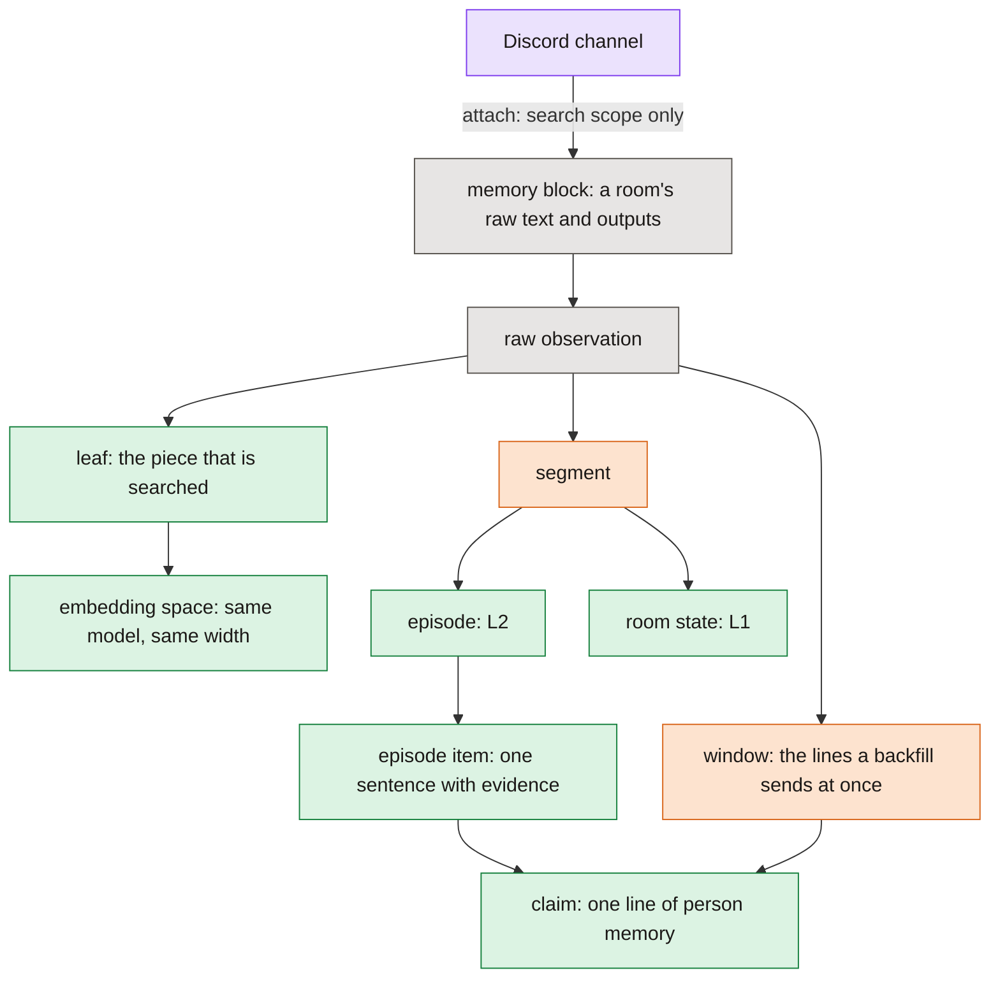

[한국어](glossary.md) | **English**

# Glossary

> **In one line**: The words that keep coming back in the code and the documents, one line each. The Korean name used in the Korean documents stands next to the English one.

**In three minutes**

- An **Action** is one feature. A **turn** is one answer to one message.
- **Raw observations** are the floor, and the **leaf** is the unit of retrieval. An **embedding space** is a set of vectors from the same model at the same width.
- **L1** is the room state and **L2** the episodes. A **claim** is one line of person memory.
- The **planner** settles the memory intent, and the **tool loop** picks tools.
- **Window** and **pilot** are words of the people backfill.
- "Backfill" means two things: filling in messages from downtime (free, automatic) and the people backfill (paid, started by the operator).

## How the memory words relate

## The words

<b>The frame</b>: Action, turn, daemon

| Word | Meaning |
|---|---|
| **Action** | The name and contract of one product feature (for example `channels.configure`). The console, the CLI, Discord commands and chat tools all call the same Action |
| **catalog** (카탈로그) | The list of every Action, with its ID, status, effect, CLI string and console path |
| **effect** (효과) | The kind of thing an Action does: read, internal write, external read, external write |
| **Execute** | `application.Service.Execute`, the single entrance every Action goes through |
| **handler table** (처리 함수 표) | The table from Action ID to handler function |
| **turn** (턴) | One pass that produces an answer to one message, or to messages that were merged |
| **daemon** (데몬) | The `masamongd` process that is always running |
| **supervisor** (감시 프로세스) | `masamongd --supervise`, which starts the daemon as a child and restarts it when it dies |
| **data root** (데이터 폴더) | The folder with the database, settings, backups, logs and key files. One daemon per folder |
| **journal** (저널) | The step record of a restore, a reset or a program replacement. It lets a crash midway carry on or roll back |
| **maintenance mode** (유지보수 모드) | The state where interrupted work could not be finished, so the database stays closed and only the recovery guide is shown |
| **practice mode** (연습 모드) | An isolated instance for trying the console without real keys or data |
| **`/lite`** | The emergency page that works without JavaScript |
| **revision** (리비전) | The version number of the settings document. Settings are replaced only "if still at the version that was read". Also used for the edit versions of a raw message |
| **ADR** | The record of a large decision that changes the structure. They are in `docs/adr/` |

<b>Raw text and retrieval</b>: leaf, recipe, embedding space, R0 and R2

| Word | Meaning |
|---|---|
| **raw observation** (원문 관찰) | One stored message, with its room, original message ID, author, text and time. The evidence under all memory |
| **capture** (수집) | Storing a Discord message as raw text. It is separate from embedding |
| **tombstone** (지움 기록) | A record that stops a deleted message from coming back through a re-import or a late write |
| **room** (방) | The conversation space that is the unit of memory: one Discord channel or one KakaoTalk room. Rooms are never mixed |
| **memory block** (기억 블록) | The unit that manages the raw text imported from one room and its retrieval outputs |
| **attach, view** (연결) | The setting that says which blocks a Discord channel may search. It only widens the search scope and merges neither raw text nor people |
| **scope** (범위) | The set of rooms one search may look at. Code sets it and the model cannot change it |
| **leaf** (조각) | The unit of retrieval. Cut inside a room every 8 messages or at a 30-minute gap |
| **recipe** (레시피) | The name and version of the rules that cut leaves and build their text. A change means rebuilding the index, so it is pinned |
| **embedding space** (임베딩 공간) | A set of vectors from the same model at the same width. Vectors from different spaces are never compared |
| **width, dimensions** (폭) | The number of dimensions of a vector. 1024 by default |
| **MRL** | The property of an embedding model trained so that the front part of a vector can be used alone. Narrowing needs no new embedding |
| **message vector** (메시지 벡터) | A vector made for one message. A helper signal for finding candidates; the result unit is the leaf |
| **lexical search** (어휘 검색) | Finding by word overlap, with SQLite FTS5 (bm25) in memory |
| **candidate source** (후보원) | One independent way of producing candidates (leaf lexical, leaf vector, summary, speaker, alias, message vector and so on) |
| **RRF** | The method that merges the rankings of several candidate sources. It uses ranks only, not scores |
| **R0** | The result in fused order, without reranking |
| **R2** | R0's candidate pool sorted again by a rerank model |
| **R1** | The rule-bonus reranker. Retired, and kept for ablation only |
| **auto** | Deciding by rule, after seeing the candidates, whether to stop at R0, go to R2, or recover and then go to R2 |
| **recovery** (복구) | Searching once more with a wider pool and time window when the candidates are weak |
| **abstain** | Emptying the evidence because the rerank score is under the floor. The answer becomes "not in the records" |
| **parent expand** (원문 확장) | Attaching the messages before and after a found leaf to make the evidence |
| **residency** (상주) | A room's index being loaded in memory. Today every room is resident |

<b>Room memory and person memory</b>: L1, L2, episode, claim

| Word | Meaning |
|---|---|
| **L0** | The conversation going on now. Not stored; assembled every turn |
| **L1 room state** (방 상태, channel state) | The few topics in progress in this room. One row per channel |
| **L2 episode** (에피소드) | One plan, decision, event or joke that happened in a room. It has a status (open, decided, done, cancelled, expired) |
| **episode item** (에피소드 항목) | One sentence inside an episode (120 characters at most), with one or more evidence message IDs |
| **segment** (구간) | A stretch of conversation cut out for extracting episodes. It breaks at a long gap or at the end of a day |
| **derived** (파생) | A result a model made from raw text. It has evidence IDs and goes away with its raw text |
| **evidence** (근거) | The raw observation IDs a derived result points at. A reference, not a copy |
| **person memory** (사람 기억) | The lines remembered about a person within a server |
| **claim** | One line of person memory: what one person said about one person. Table `person_claim` |
| **first-hand** (직접) | What a person said about themselves, or left with "remember this". Used anywhere in the server |
| **hearsay** (전해 들음) | What someone else said. Used only in the channel group it came from, with the speaker's name |
| **channel group** (채널 묶음) | A channel and its threads |
| **write gate** (저장 관문) | The one place every person memory write passes (`savePersonClaims`): evidence, blocks, consent, tombstones, suppress marks |
| **suppress mark** (숨김·잊기 표시) | The mark that keeps a hidden or forgotten line from being made again. It holds a reference and a time, never the sentence |
| **alias index** (이름 색인) | The display names actually used in a server and the accounts they belong to. Used to find the subject when reading |
| **explicit memory** (명시 기억) | Memory changes a person asked for directly, such as "remember this", "that's wrong" and "forget me" |
| **derived budget** (파생 예산) | The monthly budget for extracting room memory and refreshing the room state (`memory.derived_budget_usd`) |

<b>Deletion and consent</b>

| Word | Meaning |
|---|---|
| **consent scope** (동의 범위) | A use a person can withdraw from: `memory` (conversation memory), `profile` (the summary about me), `participation` (chime-in) and others |
| **withdrawal** (철회) | Taking a consent scope back. The person's words and the records that lean on them are followed and erased |
| **evidence index** (근거 색인) | The table of "which record read which raw text". It is how a deletion reaches derived records |
| **holder** | The side that read the raw text in the evidence index (a context row, a turn record, an episode item and so on) |
| **redaction job** (삭제 작업) | A durable background job that erases derived records |
| **reconciliation queue** (조정 큐) | The queue that applies Discord's edit and delete events in order, without losing them during shutdown |
| **strict privacy options** (엄격 개인정보 옵션) | Four switches per server. All off by default |
| **block** (차단) | Not reacting to a person. It does not stop storing |

<b>Conversation</b>: planner, tool loop, chime-in

| Word | Meaning |
|---|---|
| **planner** (플래너) | The model call that settles whether memory is needed, for when, and about whom. It does not choose the retrieval strategy |
| **tool loop** (도구 루프) | A small model picks tools by native tool calling, sees the results and picks again (three rounds at most) |
| **tool** (도구) | An Action the model may call |
| **gate** (관문) | The checks a tool call passes: enabled, feature switch, channel, path, limits |
| **Guard** (가드) | What counts a turn's budget and its outside calls. Over the limit, the remaining steps are skipped |
| **addressed** (부른 말) | A message meant for the bot: a mention, a reply to the bot, a name call to the bot, a command, anything inside the bot's thread |
| **name call** (이름 부름) | A message with the bot's name and no mention. A classifier tells whether it was said to the bot |
| **merger** (병합기) | What joins messages sent in quick succession into one turn |
| **attribution** (대화 귀속) | Picking, in a busy room, only the lines that belong to the caller's conversation |
| **follow-up** (이어 말하기) | The experimental feature that answers when the person the bot just answered goes on without a tag |
| **chime-in, participation** (끼어들기) | The experimental feature that says something in a conversation the bot was not called into. Its stages are `collect`, `shadow` and `conservative` |
| **shadow** (그림자) | Not acting, and recording only the decision that would have been made |
| **banter** (농담) | The experimental feature that answers a playful remark about the bot with one line or an emoji |
| **thread offer** (스레드 제안) | Asking with a button whether a long conversation should move to a thread |
| **bubbles** (말풍선) | The reply shape that sends short paragraphs as several messages |
| **persona** (페르소나) | A room's manner of speaking and rules of conduct |
| **room style** (방 말투) | A short note made by analysing how a room talks. Used only after an admin approves it (experimental) |
| **prompt cache** (프롬프트 캐시) | A provider's cheaper handling of the repeated front of a prompt. Not a cache that stores answers and serves them again |
| **cache point** (캐시 지점) | The mark in a prompt that says "up to here it is the same every turn" |
| **scheduled task** (예약 작업) | A reminder that runs its stored request as a real turn at a set time |

<b>Providers and languages</b>

| Word | Meaning |
|---|---|
| **role** (역할) | The job a model does: answer, planner, summary, embedding, rerank, drawing, vision |
| **provider** (공급자) | One model or tool service registered in the settings (a key and an address) |
| **host family, API family** (호스트 계열) | Hosts whose requests have the same shape: OpenRouter, OpenAI, Gemini, Anthropic and other compatible hosts |
| **fallback** (대체 모델) | Another model asked in order when a role's model fails |
| **breaker** (차단기) | What skips a model that keeps failing, for a while |
| **effort** (추론 정도) | How much a model is made to think before it answers |
| **batch** (배치) | A provider API that takes requests together and returns them later. Cheaper and slower |
| **Once** ("한 번만" 요청) | A one-off paid request that is never sent again to a fallback |
| **OptIn** (운영자가 켜는 도구) | A tool that is off by default and works only after the operator turns it on |
| **language pack** (언어팩) | A per-language file of what the bot says to the model (prompts, rules, word lists) |
| **locale** (로케일) | A per-language file of screen, command and card strings |
| **credential reference** (참조) | The location passed in place of a key's value: `keychain:`, `file:`, `env:` |

<b>The people backfill</b>: window, pilot, run

| Word | Meaning |
|---|---|
| **people backfill** (사람 기억 백필) | The paid job that extracts person memory from stored past conversation. The operator starts it by hand |
| **window** (창) | The lines a backfill sends to the model at once: segments of one room joined, 120 lines at most |
| **dry run** (비용 계산) | The first stage. It shows the number of windows, the tokens and the cost range without calling a model |
| **plan token** (계획 토큰) | A fingerprint of the scope, the windows and the cap. It confirms that what was shown is what runs |
| **pilot** (시범) | The stage that sends 60 evenly drawn windows to two models for comparison. Its results are not applied |
| **run** (본 실행) | The stage that sends the remaining windows as a batch to the chosen model and applies the results |
| **total cap** (합계 한도) | All the money a server may spend on backfills. Cumulative, not per run |
| **Discord backfill** (꺼진 동안 채우기) | Reading and storing the Discord messages from the time the daemon was down. It calls no model, and it is not the people backfill |

<b>Verification</b>: sandbox, parity, goldens

| Word | Meaning |
|---|---|
| **sandbox** (샌드박스) | The Python development tool for comparing retrieval methods (`experimental/rag-leaf-parent`). It does not use the product database |
| **parity** | The test that the sandbox and the Go implementation give the same result for the same input. Passing means zero differences |
| **golden** (골든) | A test that pins the expected output in a file and compares byte for byte |
| **holdout** | Evaluation questions set aside and not used for tuning |
| **gold** | Evaluation questions with answers. What exists today is synthetic and unreviewed |
| **code map** (코드 지도) | The index of Actions, commands, tools and locales generated from the source. A test fails when it is out of date |
| **no-reprocess test** | The test that pins a restart or an upgrade to zero new summary and embedding calls |

---

As of v1.8.0 (2026-11-24). The words appear in context in [system.en.md](system.en.md), [message-flow.en.md](message-flow.en.md), [memory.en.md](memory.en.md) and [providers-and-tools.en.md](providers-and-tools.en.md).
