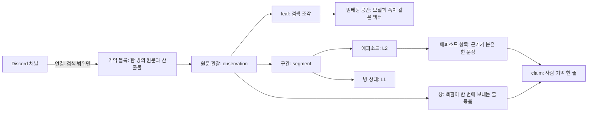

# 용어집

> **한 줄 요약**: 코드와 문서에서 되풀이되는 낱말을 한 줄씩 풀었다. 같은 것을 가리키는 한국어·영어 이름을 나란히 적는다.

**3분 요약**

- **Action**은 기능 하나, **턴**은 메시지 하나에 대한 답 한 번이다.
- **원문 관찰**이 바닥이고 **leaf**가 검색 단위다. **임베딩 공간**은 모델과 폭이 같은 벡터의 묶음이다.
- **L1**은 방 상태, **L2**는 에피소드다. **claim**은 사람 기억 한 줄이다.
- **플래너**는 기억 의도를 정하고, **도구 루프**는 도구를 고른다.
- **창**과 **시범**은 사람 기억 백필의 낱말이다.
- "백필"은 두 가지를 가리킨다: 꺼진 동안의 메시지 채우기(무료, 자동)와 사람 기억 백필(유료, 운영자가 시작).

## 기억 낱말의 관계

## 낱말

<b>뼈대</b>: Action, 턴, 데몬

| 낱말 | 뜻 |
|---|---|
| **Action** | 제품 기능 하나의 이름과 계약(예: `channels.configure`). 콘솔·CLI·Discord 명령·채팅 도구가 모두 같은 Action을 부른다 |
| **카탈로그**(catalog) | 모든 Action의 목록. ID, 상태, 효과, CLI 문자열, 콘솔 경로를 담는다 |
| **효과**(effect) | Action이 하는 일의 종류: 읽기, 내부 쓰기, 외부 읽기, 외부 쓰기 |
| **Execute** | `application.Service.Execute`. 모든 Action이 지나는 단일 입구 |
| **처리 함수 표** | Action ID에서 처리 함수로 가는 표 |
| **턴**(turn) | 메시지 하나(또는 묶인 메시지들)에 대해 답을 만드는 한 번의 처리 |
| **데몬** | 늘 켜져 있는 `masamongd` 프로세스 |
| **감시 프로세스**(supervisor) | 데몬을 자식으로 띄우고 죽으면 다시 켜는 `masamongd --supervise` |
| **데이터 폴더**(data root) | DB, 설정, 백업, 로그, 키 파일이 있는 폴더. 폴더당 데몬은 하나 |
| **저널** | 복원·초기화·프로그램 교체의 단계 기록. 중간에 죽어도 이어 가거나 되돌리게 한다 |
| **유지보수 모드** | 끊긴 작업을 마무리하지 못해 DB를 열지 않고 복구 안내만 보여 주는 상태 |
| **연습 모드**(practice) | 실제 키와 데이터 없이 콘솔을 써 보는 격리된 인스턴스 |
| **`/lite`** | JavaScript 없이 쓰는 비상 화면 |
| **리비전**(revision) | 설정 문서의 판 번호. 설정은 "읽은 판과 같을 때만 교체"한다. 원문 메시지의 수정 판을 가리킬 때도 쓴다 |
| **ADR** | 구조를 바꾸는 큰 결정의 기록. `docs/adr/`에 있다 |

<b>원문과 검색</b>: leaf, 레시피, 임베딩 공간, R0과 R2

| 낱말 | 뜻 |
|---|---|
| **원문 관찰**(observation) | 저장된 메시지 한 건. 방, 원래 메시지 ID, 작성자, 본문, 시각을 가진다. 모든 기억의 근거 |
| **수집**(capture) | Discord 메시지를 원문으로 저장하는 일. 임베딩과 분리돼 있다 |
| **tombstone**(지움 기록) | 지운 메시지가 재가져오기나 늦은 쓰기로 되살아나지 않게 하는 기록 |
| **방**(room) | 기억의 단위가 되는 대화 공간. Discord 채널 하나 또는 카카오톡 방 하나. 방끼리는 섞지 않는다 |
| **기억 블록**(block) | 한 방에서 가져온 원문과 그 검색 산출물을 관리하는 단위 |
| **연결**(view, attach) | Discord 채널이 어떤 블록을 검색할 수 있는지 정하는 설정. 검색 범위만 넓히고 원문이나 사람을 합치지 않는다 |
| **범위**(scope) | 한 번의 검색이 볼 수 있는 방의 집합. 코드가 정하고 모델이 바꿀 수 없다 |
| **leaf**(조각) | 검색 단위. 방 안에서 메시지 8개 또는 30분 공백마다 자른다 |
| **레시피**(recipe) | leaf를 자르고 본문을 만드는 규칙의 이름과 판. 바뀌면 색인을 다시 만들어야 해서 고정해 둔다 |
| **임베딩 공간**(embed space) | 모델과 폭이 같은 벡터의 묶음. 공간이 다른 벡터끼리는 비교하지 않는다 |
| **폭**(dimensions) | 벡터의 차원 수. 기본 1024 |
| **MRL** | 벡터의 앞부분만 잘라 써도 되게 학습된 임베딩 모델의 성질. 폭을 줄일 때 다시 임베딩하지 않아도 된다 |
| **메시지 벡터** | 메시지 하나씩 따로 만든 벡터. 후보 찾기를 돕는 보조 신호이고 결과 단위는 leaf다 |
| **어휘 검색**(lexical) | 낱말 겹침으로 찾기. 메모리 안의 SQLite FTS5(bm25)를 쓴다 |
| **후보원**(candidate source) | 후보를 내는 독립된 길 하나(leaf 어휘, leaf 벡터, 요약, 화자, 별칭, 메시지 벡터 등) |
| **RRF** | 여러 후보원의 순위를 합치는 방법. 점수가 아니라 순위만 쓴다 |
| **R0** | 재순위 없이 결합한 순서 그대로의 결과 |
| **R2** | R0의 후보 풀을 재순위 모델로 다시 정렬한 결과 |
| **R1** | 규칙 가산 재순위. 퇴역했고 제거 실험용으로만 남아 있다 |
| **auto** | 후보를 보고 R0로 끝낼지, R2로 갈지, 복구 뒤 R2로 갈지 규칙으로 정하는 방식 |
| **복구**(recovery) | 후보가 약할 때 풀과 시간 창을 넓혀 한 번 더 찾는 일 |
| **abstain** | 재순위 점수가 하한보다 낮아 근거를 비우는 것. "기록에 없다"고 답하게 된다 |
| **원문 확장**(parent expand) | 찾은 leaf의 앞뒤 메시지를 붙여 근거로 만드는 일 |
| **상주**(residency) | 방의 색인이 메모리에 올라와 있는 상태. 지금은 모든 방이 상주한다 |

<b>방 기억과 사람 기억</b>: L1, L2, 에피소드, claim

| 낱말 | 뜻 |
|---|---|
| **L0** | 지금 대화. 저장하지 않고 턴마다 조립한다 |
| **L1 방 상태**(channel state) | 지금 이 방에서 진행 중인 화제 몇 개. 채널당 한 행 |
| **L2 에피소드**(episode) | 방에서 있었던 계획·결정·사건·농담 하나. 상태(열림, 결정됨, 끝남, 취소됨, 만료됨)를 가진다 |
| **에피소드 항목**(episode item) | 에피소드 안의 한 문장(120자 이하). 근거 메시지 ID가 하나 이상 붙는다 |
| **구간**(segment) | 에피소드를 뽑기 위해 나눈 대화 덩어리. 긴 공백이나 하루 경계에서 끊는다 |
| **파생**(derived) | 원문에서 모델이 만든 결과. 근거 ID를 갖고, 원문이 지워지면 함께 사라진다 |
| **근거**(evidence) | 파생 결과가 가리키는 원문 관찰 ID. 복사본이 아니라 참조다 |
| **사람 기억**(person memory) | 서버 안에서 사람에 대해 기억하는 줄들 |
| **claim** | 사람 기억 한 줄: 한 사람이 한 사람에 대해 한 말. 표 `person_claim` |
| **직접** | 본인이 한 자기 얘기, 또는 본인이 "기억해"로 남긴 것. 서버 어디서든 쓴다 |
| **전해 들음**(hearsay) | 남이 한 말. 그 말이 나온 채널 묶음 안에서만 쓰고 말한 사람 이름이 붙는다 |
| **채널 묶음** | 채널과 그 채널의 스레드 |
| **저장 관문**(write gate) | 모든 사람 기억 쓰기가 지나는 확인 한 곳(`savePersonClaims`): 근거, 차단, 동의, 지움 기록, 숨김 표시 |
| **숨김·잊기 표시**(suppress) | 숨기거나 잊은 줄이 다시 만들어지지 않게 하는 표시. 문장이 아니라 참조와 시각만 담는다 |
| **이름 색인**(alias) | 서버에서 실제로 쓰인 표시 이름과 계정의 대응. 읽을 때 대상을 찾는 데 쓴다 |
| **명시 기억** | "기억해", "틀려", "잊어줘"처럼 사람이 직접 요청한 기억 조작 |
| **파생 예산** | 방 기억 추출과 방 상태 갱신에 쓰는 월 예산(`memory.derived_budget_usd`) |

<b>삭제와 동의</b>

| 낱말 | 뜻 |
|---|---|
| **동의 범위** | 사람이 철회할 수 있는 용도의 단위. `memory`(대화 기억), `profile`(나에 대한 정리), `participation`(끼어들기) 등 |
| **철회** | 동의 범위를 거두는 일. 그 사람의 말과 그 말에 기댄 기록을 따라가 지운다 |
| **근거 색인**(evidence index) | "어떤 기록이 어떤 원문을 읽었나"의 표. 삭제가 파생 기록까지 닿게 한다 |
| **holder** | 근거 색인에서 원문을 읽은 쪽(대화 문맥 행, 턴 기록, 에피소드 항목 등) |
| **삭제 작업**(redaction job) | 파생 기록을 지우는 내구성 있는 백그라운드 작업 |
| **조정 큐**(reconciliation) | Discord의 수정·삭제 이벤트를 순서대로, 종료 중에도 잃지 않고 적용하는 큐 |
| **엄격 개인정보 옵션** | 서버마다 켜는 네 스위치. 기본은 모두 꺼짐 |
| **차단** | 그 사람에게 반응하지 않는 것. 저장은 막지 않는다 |

<b>대화</b>: 플래너, 도구 루프, 끼어들기

| 낱말 | 뜻 |
|---|---|
| **플래너**(planner) | 기억이 필요한지, 언제, 누구 얘기인지를 정하는 모델 호출. 검색 전략은 고르지 않는다 |
| **도구 루프**(tool loop) | 작은 모델이 네이티브 tool calling으로 도구를 고르고, 결과를 보고 다시 고르는 반복(최대 3회) |
| **도구**(tool) | 모델이 부를 수 있는 Action |
| **관문**(gate) | 도구 호출이 지나는 확인: 켜짐, 기능 스위치, 채널, 경로, 한도 |
| **가드**(Guard) | 한 턴의 예산과 외부 호출 수를 세는 것. 넘으면 남은 단계를 건너뛴다 |
| **부른 말**(addressed) | 봇을 향한 메시지: 멘션, 봇에 대한 답장, 봇에게 한 이름 부름, 명령, 봇 스레드 안의 말 |
| **이름 부름**(name call) | 멘션 없이 이름만 나온 메시지. 분류기가 "봇에게 한 말"인지 가른다 |
| **병합기**(merger) | 빠르게 이어진 메시지를 한 턴으로 묶는 것 |
| **대화 귀속**(attribution) | 바쁜 방에서 부른 사람의 대화에 속하는 줄만 고르는 일 |
| **이어 말하기**(follow) | 봇이 방금 답한 사람이 태그 없이 이어 말할 때 답하는 실험 기능 |
| **끼어들기**(chime-in, participation) | 부르지 않은 대화에 한마디 하는 실험 기능. `collect`, `shadow`, `conservative` 단계가 있다 |
| **그림자**(shadow) | 실제로 하지 않고 "했을 판단"만 기록하는 방식 |
| **농담**(banter) | 누가 봇을 두고 장난스럽게 말할 때 한 줄이나 이모지로 받아치는 실험 기능 |
| **스레드 제안** | 길게 이어지는 대화에 "스레드로 옮길까"를 버튼으로 묻는 것 |
| **말풍선**(bubbles) | 짧은 문단을 메시지 여러 개로 나눠 보내는 답 모양 |
| **페르소나** | 방의 말투와 행동 규칙 |
| **방 말투**(room style) | 방의 말버릇을 분석해 만든 짧은 메모. 관리자가 승인해야 쓴다(실험) |
| **프롬프트 캐시** | 공급자가 반복되는 프롬프트 앞부분을 싸게 처리하는 기능. 답을 저장해 다시 쓰는 캐시가 아니다 |
| **캐시 지점**(cache point) | 프롬프트에서 "여기까지는 턴마다 같다"고 알리는 표시 |
| **예약 작업**(scheduled task) | 정한 시각에 저장해 둔 요청을 실제 한 턴으로 실행하는 리마인더 |

<b>공급자와 언어</b>

| 낱말 | 뜻 |
|---|---|
| **역할**(role) | 모델이 맡는 일: 답변, 플래너, 요약, 임베딩, 재순위, 그림, 사진 이해 |
| **공급자**(provider) | 설정에 등록한 모델·도구 서비스 하나(키와 주소) |
| **호스트 계열**(API family) | 요청 모양이 같은 호스트의 묶음: OpenRouter, OpenAI, Gemini, Anthropic, 그 밖의 호환 |
| **대체 모델**(fallback) | 역할의 모델이 실패했을 때 순서대로 묻는 다른 모델 |
| **차단기**(breaker) | 계속 실패하는 모델을 한동안 건너뛰는 장치 |
| **추론 정도**(effort) | 모델이 답하기 전에 얼마나 생각하게 할지의 단계 |
| **배치**(batch) | 요청을 묶어 나중에 받는 공급자 API. 더 싸고 느리다 |
| **"한 번만" 요청**(Once) | 대체 모델로 다시 보내지 않는 일회성 유료 요청 |
| **운영자가 켜는 도구**(OptIn) | 기본 꺼짐이고 운영자가 켜야 동작하는 도구 |
| **언어팩**(pack) | 봇이 모델에게 하는 말(프롬프트, 규칙, 낱말)을 언어별로 담은 파일 |
| **로케일**(locale) | 화면·명령·카드 문구를 언어별로 담은 파일 |
| **참조**(credential reference) | 키의 값 대신 넘기는 위치 표시: `keychain:`, `file:`, `env:` |

<b>사람 기억 백필</b>: 창, 시범, 본 실행

| 낱말 | 뜻 |
|---|---|
| **사람 기억 백필**(people backfill) | 저장된 과거 대화에서 사람 기억을 뽑는 유료 작업. 운영자가 직접 시작한다 |
| **창**(window) | 백필이 모델에 한 번에 보내는 줄 묶음. 같은 방의 구간을 이어 최대 120줄 |
| **비용 계산**(dry run) | 모델을 부르지 않고 창 수, 토큰, 비용 범위를 보여 주는 첫 단계 |
| **계획 토큰** | 범위·창·한도를 묶은 지문. 본 것과 실행하는 것이 같음을 확인한다 |
| **시범**(pilot) | 고르게 뽑은 창 60개를 두 모델에 보내 비교하는 단계. 결과는 적용하지 않는다 |
| **본 실행**(run) | 고른 모델로 나머지 창을 배치로 보내고 결과를 적용하는 단계 |
| **합계 한도** | 서버마다 백필에 쓸 수 있는 돈의 총합. 실행마다가 아니라 누적이다 |
| **꺼진 동안 채우기**(Discord backfill) | 데몬이 꺼져 있던 동안의 Discord 메시지를 다시 읽어 저장하는 일. 모델을 부르지 않는다. 사람 기억 백필과 다른 것이다 |

<b>검증</b>: 샌드박스, parity, 골든

| 낱말 | 뜻 |
|---|---|
| **샌드박스** | 검색 방식을 비교하는 Python 개발 도구(`experimental/rag-leaf-parent`). 제품 DB를 쓰지 않는다 |
| **parity** | 샌드박스와 Go 구현이 같은 입력에 같은 결과를 내는지 보는 테스트. 통과 조건은 차이 0 |
| **골든**(golden) | 기대 출력을 파일로 고정해 두고 바이트 단위로 비교하는 테스트 |
| **holdout** | 조정에 쓰지 않고 남겨 둔 평가 문항 |
| **gold** | 정답이 붙은 평가 문항. 지금 있는 것은 합성·미검수다 |
| **코드 지도**(code map) | 소스에서 생성한 Action·명령·도구·로케일 색인. 어긋나면 테스트가 실패한다 |
| **no-reprocess 테스트** | 재시작이나 업그레이드가 요약·임베딩을 다시 부르지 않음을 고정하는 테스트 |

---

기준: v1.7.1(2026-11-24). 낱말이 쓰이는 맥락은 [system.md](system.md), [message-flow.md](message-flow.md), [memory.md](memory.md), [providers-and-tools.md](providers-and-tools.md)에 있다.
