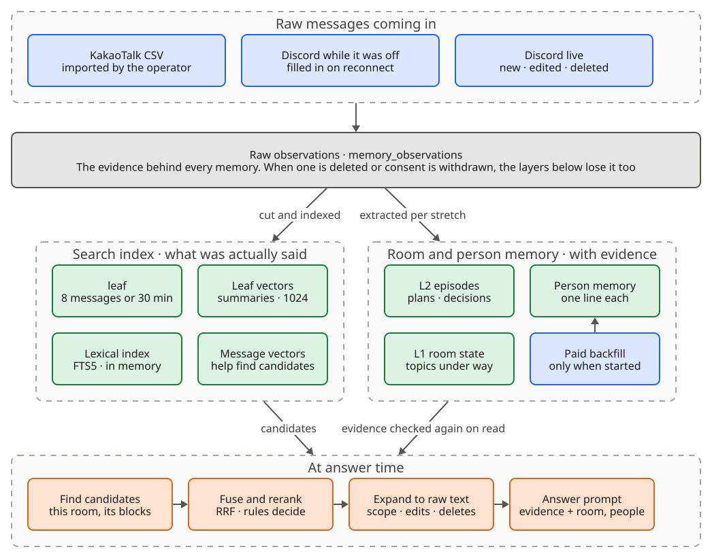
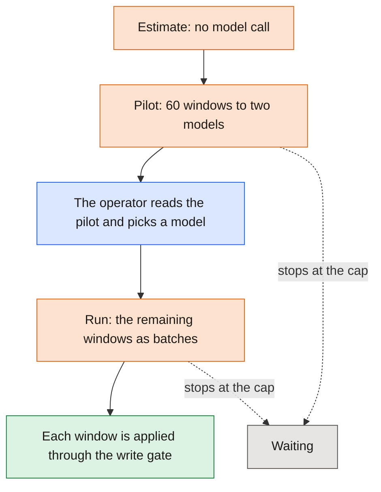

[한국어](memory.md) | **English**

# Memory: how it is built, read and erased

> **In one line**: raw messages are stored first, and the search index, room memory and person memory are built on top in that order. Every upper layer cites raw message IDs as evidence and disappears with them when a message is deleted or consent is withdrawn.

**In three minutes**

- **Raw messages are the only evidence.** The input is Discord messages and the KakaoTalk CSV files the operator chose. Old embeddings and summaries are not used.
- **Search index**: a room's messages are cut into leaves, every 8 messages or at a 30-minute gap, and found through a lexical index (FTS5) and vectors. Per-message vectors help find candidates.
- **Room memory**: L1 room state (the topics under way) and L2 episodes (plans, decisions, events) are short lines with evidence attached.
- **Person memory**: one line per "what one person said about one person". It is not embedded; lines are picked at read time with SQL and word overlap.
- **Code sets the scope.** Only this room and the blocks attached to it are searched, and scope, edits and deletions are checked again just before a result enters the answer.
- **Where money goes is fixed.** Indexing (embeddings and summaries), room memory extraction, query embeddings and reranking, and the people backfill that only the operator starts. Each has its own limit, and no update or restart reprocesses the history on its own.

## Layers and flow

<picture><source media="(prefers-color-scheme: dark)" srcset="diagrams/memory.en-dark.svg"></picture>

Diagram source: [diagrams/memory.en.d2](diagrams/memory.en.d2)

## In detail

<b>The layers at a glance</b>: each answers a different question

| Layer | The question it answers | Stored in | Built when | Model cost |
|---|---|---|---|---|
| L0 the conversation now | What was just said | Not stored (assembled each turn) | At answer time | None |
| Raw-text retrieval | What was actually said back then | `memory_observations`, `memory_leaves`, vectors | Background indexing | Embeddings, summaries |
| L1 room state | What is this room talking about right now | `channel_state` | When the room goes quiet | Summary model |
| L2 episodes | What did we decide last week, how did that turn out | `channel_episode`, `episode_item`, `episode_leaf` | When a stretch of conversation closes | Summary model |
| Person memory | What is this person like, who said what | `person_claim`, `person_alias`, `person_relation` | With episode extraction, on "remember this", by the backfill | Mostly no extra call |

L0 is covered under "Reading the context" in [message-flow.en.md](message-flow.en.md). The tables are described in [data-model.en.md](data-model.en.md).

<b>1. How raw messages come in</b>

Code: [`internal/memory/corpus`](../../internal/memory/corpus), [`internal/memory/engine/messages.go`](../../internal/memory/engine/messages.go) `Engine.Capture`, `Edit`, `Delete`, `ImportKakaoCSV`, `ImportRaw`; the catch-up after downtime is in [`internal/application/backfill.go`](../../internal/application/backfill.go).

| Path | How | Note |
|---|---|---|
| Discord, live | The Gateway's create, edit, delete and bulk-delete events | The raw revision or tombstone is stored first, then the room's incremental work is scheduled |
| Discord, while the bot was off | On reconnect each capturing channel is read from its last stored message (7 days by default, 30 at most) | Messages filled in this way are not answered. A channel that never stored anything since capture was turned on is skipped |
| KakaoTalk CSV | Imported from a memory block in the console | There are no account IDs, so people are not merged by display name. A time without a zone is not given a made-up UTC offset |
| Offline raw files | `imports.start` reads a file in the raw observation format | The same observation ID is never stored twice |

- **Storing is separate from embedding.** Without a model, or with a provider down, raw messages and lexical search still work.
- **An edit does not overwrite.** A changed text is kept as a revision.
- **Only what people wrote becomes memory.** The bot's own words, system markers and lines without a time are not indexed.
- **Consent**: messages of someone who withdrew memory consent are not stored. A block stops reactions, not storage.
- **Memory blocks**: a block is the unit that manages the raw messages of one room and what was built from them. Attaching a block to a channel only widens what that channel may search; no message moves and no people are merged ([memory block contract](../rag/memory-blocks.md), Korean).

<b>2. Leaves and the index</b>: making messages searchable

Code: [`internal/memory/leaves/leaves.go`](../../internal/memory/leaves/leaves.go) `DefaultRecipe`, `SlicePerRoom`; [`internal/memory/lexical`](../../internal/memory/lexical); [`internal/memory/engine/indexing.go`](../../internal/memory/engine/indexing.go) `Engine.IndexRooms`; [`internal/memory/engine/engine.go`](../../internal/memory/engine/engine.go) `Engine.Reload`.

- **Leaf**: a piece cut inside one room, every 8 messages or at a 30-minute gap. A leaf never crosses rooms. Its text format is byte-identical to the sandbox's.
- **Lexical index**: tokens are per-language n-grams (bigrams for Hangul) in an **in-memory SQLite FTS5** table scored with bm25. No copy is kept on disk; it is rebuilt each time the index loads.
- **Leaf vectors**: made by the embedding model, 1024 wide by default. They are float16 on disk and int8 in the loaded index. Search scores the rows in scope exactly; there is no approximate index.
- **Leaf summaries**: a short summary by the summary model is another lexical and vector source. Most of the indexing cost comes from here (`memory.summaries`).
- **Message vectors**: each message of a closed leaf with at least six meaningful characters is embedded on its own. The result unit is still the leaf; the message vector only lifts "the leaf that holds the line closest to the question" into the candidates. Models with Matryoshka vectors store them 512 wide.
- **Embedding space**: the set of vectors that share a model and a width. A new model means a new space, and it is not switched in before it is prepared and verified. Narrowing the width truncates the stored vectors without any call.
- **Background indexing**: the memory worker runs every `memory.index_interval_min` (10 minutes by default), only for rooms with new messages, within the budget of one pass (`memory.index_budget_usd`). A room it could not finish waits for the next pass.
- **Incremental**: new messages that arrive in order re-cut only the room's tail. A whole room is re-cut only for late messages from the past, edits and deletes, or a rule change.
- **Swapping the index**: the new index is built completely, then the pointer changes. Vector rows that did not change are shared with the previous index, which closes after running searches have had time to finish.
- **Large imports**: the first preparation can use a provider's batch API (`memory.blocks.prepare` with `mode=batch`, [`batch_prepare.go`](../../internal/memory/engine/batch_prepare.go) `Engine.PrepareBatch`).

The table of what is rebuilt on a new message, an edit, a delete or a model change is in [source-lifecycle.md](../rag/source-lifecycle.md) (Korean).

<b>3. Search</b>: the strategy is chosen after seeing the candidates

Code: [`internal/memory/engine/engine.go`](../../internal/memory/engine/engine.go) `Engine.Search` → [`internal/memory/search/retrieve.go`](../../internal/memory/search/retrieve.go) `Index.Retrieve`; fusion in [`fusion.go`](../../internal/memory/search/fusion.go), people in [`person.go`](../../internal/memory/search/person.go), time in [`timescope.go`](../../internal/memory/search/timescope.go), expansion in [`evidence.go`](../../internal/memory/search/evidence.go).

1. **Scope first**: the rooms of the channel and its attached blocks, then the planner's time window. The scope is narrowed before anything is ranked.
2. **Several candidate sources**, independent of each other (one may fail and the rest still run): leaf lexical and vector, summary lexical and vector, lexical and vector within a speaker's leaves, alias lexical, the planner's semantic query vector, key-term lexical, message vectors.
3. **Fusion**: weighted RRF. Only ranks are used; raw scores stay in the trace. This order is R0, the result without reranking.
4. **Candidate pool**: the head of the fused list plus a guaranteed share per source becomes the pool to rerank.
5. **Confidence** (rules, no model): number of candidates, agreement between sources, lexical and vector overlap, the margin at the top, whether the target is covered.
   - High → the R0 order as it is (no rerank call).
   - Medium → the rerank model (R2).
   - Low → one recovery (a wider pool and time window), then rerank.
   - With no rerank model, not enough budget or a failed call, the answer uses R0.
6. **Floor**: when the rerank score is under the model's floor, the evidence is left empty (abstain).
7. **Finish**: overlapping leaves are merged, the raw text is expanded with the messages around it, and every piece of evidence gets a date.
8. **Check again**: scope, revision, exclusions and tombstones are looked at once more just before the result enters the answer. A single hit outside the scope is recorded as a defect.

- **The planner stops at intent.** Whether memory is needed, when, who, the search words. It does not choose a ranking method.
- **People, aliases and time are scope and candidate sources, not score bonuses.**
- **Nothing in the time range** means one more search without it.
- The whole retrieval contract is in [retrieval-v2.md](../rag/retrieval-v2.md) and the evaluation method in [evaluation.md](../rag/evaluation.md) (both Korean).

<b>4. Room memory</b>: L1 room state and L2 episodes

Code: [`internal/application/episodes.go`](../../internal/application/episodes.go) `RunRoomMemory`, `extractRoom`, `updateRoomState`; [`internal/memory/episodes`](../../internal/memory/episodes) `Split` (segments), `Build` (the extraction prompt), `Next` and `Expire` (the state machine); reading in [`internal/application/roommemory_read.go`](../../internal/application/roommemory_read.go).

**How it is built**

1. **Segment** (code, deterministic): the conversation is cut at a gap of 45 minutes or more and at the day boundary (05:00 by default). A segment counts as closed when enough time has passed since its last line or enough has piled up.
2. **Extract** (once, when a segment closes): the raw lines and the channel's open plans go to the summary model. The default answer is "nothing to keep". Greetings, plain reactions, the bot's own words and failures, and gossip about health, love or money are not kept.
3. **Validate** (code, the model is not trusted): the evidence IDs must be in the input, a line "said by X" must cite a message X really wrote, and the bot's words cannot be evidence. A wrong item is dropped.
4. **State machine**: a plan goes `open → decided → done`, or to `dropped` (an explicit cancellation) or `expired`. The model never infers a cancellation.
5. **Room state**: when the room goes quiet, the few topics under way are refreshed together with their evidence lines.

**Rules it keeps** ([ADR-17](../adr/ADR-17-derived-room-memory.md), Korean)

- An item is at most 120 characters. A longer one is dropped, not cut.
- Every item has at least one evidence observation ID.
- People appear only as one-way references. The same display name on two accounts is two people.
- Derived results are never an input of the raw index (leaves, embeddings). Episodes are a separate layer above the leaves, only linked through `episode_leaf`.

**How it is read**: at answer time the bot adds the episodes whose words overlap with the message (three at most) and the topics connected to the caller's conversation. The evidence lines of an episode are **read again from the raw messages as they are now**. A line that was deleted, edited or withdrawn is left out, and an episode with no line left is not shown. Leaves linked to a shown episode are taken out of the search results, so the same content does not go in twice.

<b>5. Person memory</b>: what one person said about one person

Code: the write gate [`internal/application/person_claims.go`](../../internal/application/person_claims.go) `savePersonClaims`; derivation [`person_claims_derive.go`](../../internal/application/person_claims_derive.go); reading [`person_claims_read.go`](../../internal/application/person_claims_read.go); targets [`person_targets.go`](../../internal/application/person_targets.go); hide and forget [`person_claims_forget.go`](../../internal/application/person_claims_forget.go); storage [`internal/memory/store/person_claims.go`](../../internal/memory/store/person_claims.go).

**What one line holds**: the server, the speaker, the subject, a kind (nickname, like, dislike, trait, current status, appearance, relationship, other), a statement of at most 120 characters, and the evidence message ID with its room.

**First-hand and hearsay**

| | Where it comes from | Where it is used |
|---|---|---|
| First-hand | What a person said about themselves (`self`), or asked to have remembered about themselves (`explicit`) | In any channel of the same server |
| Hearsay | What someone else said (`said`), or asked to have remembered about another person (`told`) | Only in the channel group it came from (the channel and its threads), with the speaker's name attached |

Anything said inside a private thread is used only inside that thread. A different server is a different person. A KakaoTalk speaker can be neither subject nor speaker.

**Five ways a line is made**, all through the same write gate:

1. Derived from room episode items, without a model.
2. A people output added to the episode extraction call (no extra call).
3. A one-line statement about oneself made to the bot (one call that extracts person memory only).
4. "Remember this".
5. The paid backfill (only when the operator starts it).

**What the write gate checks**, in one transaction: the evidence line still exists and its text is unchanged; neither the subject nor the speaker is blocked; consent has not been withdrawn; no tombstone and no hide or forget marker (`person_memory_suppress`) applies; the source episode item is still valid. Only the lines that fail are skipped.

**Whose memory is read**: the caller, people mentioned, the author of the message replied to, and a person whose name matches exactly. With two people of the same name nobody is picked. The caller is a subject only when the last sentence of the message is, word for word, one of the self requests in the language packs. A missed request only leaves memory out of one answer; a wrong pick puts memory nobody asked for into it.

**Computed at read time**: the order (word overlap with the message, first-hand first, newest first) and "a newer statement replaces an older one" are not stored. They are worked out when read, by the time of the evidence message. No embeddings are involved.

**Hide and forget**: a member can hide a line about themselves. `/forgetme` deletes the lines where that person is the subject or the speaker and leaves a marker so they are not made again. The marker holds references and a time, never the sentence. The console has no field to write person memory by hand.

The detailed rules are in [memory operations §13 and §14](../memory-operations.md) (Korean).

<b>6. How far a delete, an edit or a withdrawal reaches</b>

Code: [`internal/memory/store/privacy.go`](../../internal/memory/store/privacy.go), [`internal/memory/store/evidence_refs.go`](../../internal/memory/store/evidence_refs.go), [`internal/application/evidence_index.go`](../../internal/application/evidence_index.go) `kickRedaction`, [`internal/application/pending_events.go`](../../internal/application/pending_events.go) `startEventWorker`; the Discord-side reconciliation queue is in [`internal/connectors/discord/reconciliation.go`](../../internal/connectors/discord/reconciliation.go).

Three principles:

1. **Evidence is a reference, not a copy.** A derived record registers the raw IDs it read in the evidence index (`evidence_sources`, `evidence_holders`, `evidence_links`, the view `evidence_refs`). The text is read from the current raw message when it is shown.
2. **The intent to clean up and the tombstone are committed before the raw message changes.** A reply or an extraction that finishes late cannot bring back what was deleted.
3. **It is checked again on read.**

| Change to the raw message | Conversation context and search index | L2 episode items | L1 room state | Person memory | Turn records and review copies |
|---|---|---|---|---|---|
| Message deleted | Applied at once. Only the replies that **read it directly** leave the context | Only the items that cite it are hidden | The state rows that cite it are deleted | Lines that cite it are gone | Erased by a background job |
| Message edited | Replaced by the new words; the leaf that holds it is rebuilt | Hidden and marked to be rebuilt | The state rows are deleted | Caught at the write gate and on read | Erased by a background job |
| Memory consent withdrawn | The person's words and **every** reply built on them are followed | Items that cite the person's messages or name the person are deleted | The state rows are deleted | Lines the person said or is the subject of are not read | Erased; the activity counts too |
| "Notes about me" withdrawn | Conversation memory stays | Stays | Stays | Lines about the person and the relation counts are deleted | Room style versions are marked stale |
| Room (block) deleted | The block and what was built from it are removed | The room's episodes are deleted | Deleted | Filtered out because the evidence is gone | The imported source file is untouched |

- When 40% or more of an episode's items are hidden, or a decision item is, the episode is rebuilt from the raw messages. An episode with no item left is deleted.
- A reply points at the turns it read by a link (`chat:<id>`). A delete follows one step of the link; a withdrawal follows the whole chain.
- The background erasing is durable (`redaction_jobs`). If the service stops midway, the next start carries on. An edit or delete that arrives while the service is closing is applied at the next start.
- Usage statistics (`stats_daily`) hold only daily totals, so they are not rewritten on a delete or a withdrawal.
- The bot's own replies, uploaded source files and backups made earlier are not rewritten by this process.

The incidents behind this: [0003 a deletion missed derived copies](../postmortems/0003-deletion-missed-derived-copies.md), [0006 an edited message and looked-up evidence](../postmortems/0006-edited-message-and-looked-up-evidence.md). The policy itself is under "deletion and withdrawal" in the [raw data policy](../RAW_DATA_POLICY.md) (all Korean).

<b>7. The paid people backfill</b>: filling person memory from the past

Code: [`internal/application/people_backfill.go`](../../internal/application/people_backfill.go), [`people_backfill_run.go`](../../internal/application/people_backfill_run.go); windows and cost in [`internal/memory/peoplebackfill`](../../internal/memory/peoplebackfill) `BuildWindows`, `SelectPilot`, `EstimateCost`, `Settle`, `CanSubmit`; state in [`internal/memory/store/people_backfill.go`](../../internal/memory/store/people_backfill.go).

Right after an upgrade, person memory holds only the few lines derived from episode items without a model. To extract from the whole stored history the operator starts the backfill by hand. **Nothing starts it automatically.**

- **Window**: stretches of one room joined up to 120 lines. A window with no meaningful line is not sent. KakaoTalk rooms are not covered.
- **Provider**: only the native Anthropic provider already present in the configuration. Without one the request is refused; it is never sent with another key instead.
- **Pilot**: 60 windows spread evenly over rooms and time go once to a small model and once to a large one. The results are stored, not applied. The operator decides from the share that was filtered out and from where the two models differ.
- **Run**: the remaining windows go to the chosen model as Message Batches, at half the standard price. Pilot windows are not sent again.
- **Cap**: a **total** per server (3 dollars by default, 6 at most). Before each send, "spent so far + the most the requests in flight may cost + the most the next batch may cost" is compared with the cap. It is counted apart from the monthly chat budget.
- **Restart**: runs, windows and batches are kept in the database. After a restart only batches already sent are collected. A new batch goes out only when the operator presses run again. A batch whose acceptance is unknown stops and waits for the operator to check.
- **What it never touches**: summaries, embeddings, leaves, message vectors, episodes, the embedding space.

Cost examples and the procedure are in [memory operations §14-1](../memory-operations.md) (Korean).

<b>8. Where money goes, and the limits</b>

| What | When | Limit | Ledger |
|---|---|---|---|
| Embeddings and summaries (indexing) | Background indexing, block preparation | `memory.index_budget_usd` per pass; the budget set for a block preparation | `memory_spend`, `llm_calls` |
| Room memory extraction, room state, room style | The memory worker's pass | `memory.derived_budget_usd` (3 dollars a month by default, 0 turns it off). Near the cap, room state stops first | `memory_spend` |
| Query embeddings and reranking | At answer time | The budget and call count of one reply, the monthly budget | `llm_calls`, the turn record |
| The people backfill | Only when the operator starts it | The total cap per server | `memory_spend` (kind `people_backfill`) |

Rough sums (the figures depend on the provider and the model):

- **Indexing**: cost ≈ (message tokens × embedding price) + (leaves × the price of one summary). Summaries are most of it. The expected calls, cost and time are shown before it runs.
- **Backfill**: requests ≈ lines ÷ 100 or so. Take one window as about 4,600 input and 550 output tokens and multiply by the model's price; a batch is half. The estimate step counts the real numbers.
- **Memory (RAM)**: proportional to the number of messages. With leaves 1024 wide and message vectors on, a large set takes a little over 1 KB per message. Width changes RAM, not speed and not the embedding price ([embedding width measurements](../rag/embedding-width-2026-10.md), Korean).

**No reprocessing**: a release, a restart or a deploy never re-summarizes or re-embeds the history on its own. The recipe and the embedding space are pinned and the schema is only added to. A test pins "zero calls after a restart, existing rows unchanged" (the no-reprocess test in [`internal/memory/engine`](../../internal/memory/engine)). A release that changes a default states the effect and the cost in its notes.

<b>9. The sandbox and parity</b>

- The retrieval method was first compared in the Python sandbox (`experimental/rag-leaf-parent`) and then ported to Go. The sandbox remains as the place to experiment and compare.
- **Parity tests** tie the two together: leaf cutting must match byte for byte, lexical search by document, order and score, and the whole retrieval by final evidence, packing and the auto decision. The passing condition is zero differences.
- `make parity` runs on a made-up corpus, so it needs no stored chat, no keys and no network. It runs in CI.
- The Korean planner, context, memory, security and index-summary prompts must be byte-identical to the sandbox's. A prompt change is made in the sandbox too, and the goldens are regenerated.
- Sandbox results alone never declare product quality or readiness. The figures so far come from synthetic questions nobody reviewed.

More: [memory operations §2](../memory-operations.md), [maintainer guide §5](../MAINTAINING.md), [TEST_SANDBOX.md](../TEST_SANDBOX.md) (all Korean).

<b>10. Not done yet</b>

- **Unloading idle rooms** ([ADR-18](../adr/ADR-18-idle-room-unloading.md), a draft): today every room is in memory. The contract and the measurements exist; the unloading itself waits for the operator's decision.
- **int8 vectors on disk** and **a lower SQLite sync level**: see [pending decisions](../wiki/Pending-Decisions.md).
- **A human-reviewed gold set**: there is none.
- **Claim-based retrieval and the rule-bonus reranker (R1)** are not part of the default search. The `person_claim` table of person memory is a separate table, not a search index.

---

As of v1.8.0 (2026-11-24). Related decisions: [A-2 raw input only](decisions.en.md#a-2), [C-1 the sandbox recipe in Go](decisions.en.md#c-1), [C-6 message vectors](decisions.en.md#c-6), [C-7 width 1024](decisions.en.md#c-7), [C-9 no reprocessing](decisions.en.md#c-9), [D-1 ADR-17](decisions.en.md#d-1), [D-4 person memory is one line each](decisions.en.md#d-4), [D-7 the paid backfill](decisions.en.md#d-7).
