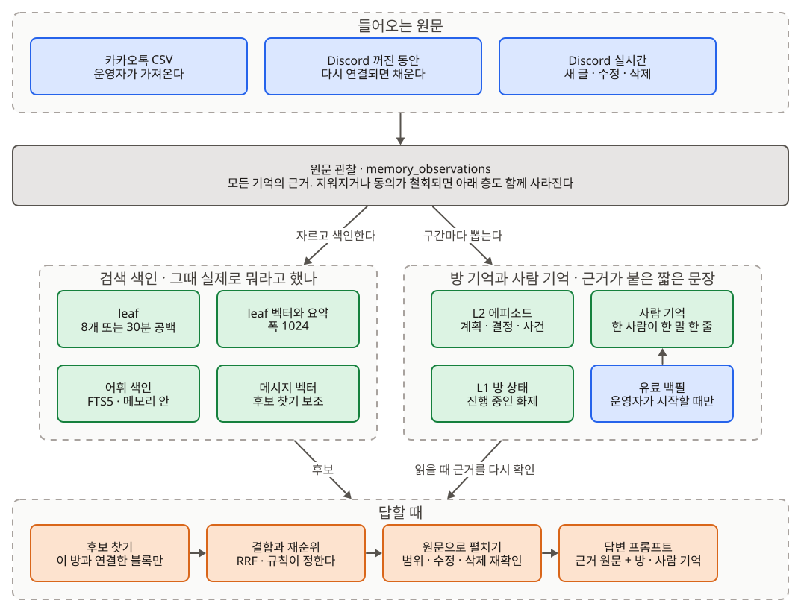
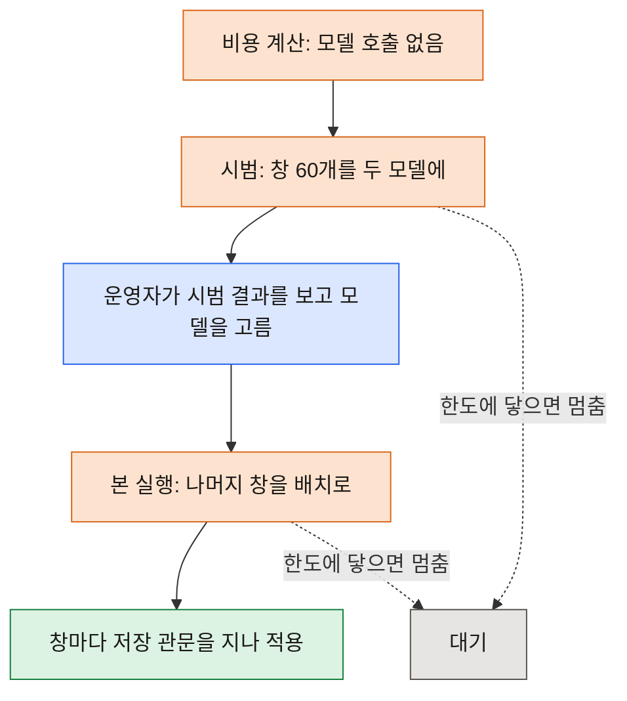

**한국어** | [English](memory.en.md)

# 기억: 쌓이고, 꺼내지고, 지워지는 길

> **한 줄 요약**: 원문을 먼저 저장하고 그 위에 검색 색인, 방 기억, 사람 기억을 차례로 쌓는다. 위층은 모두 원문 ID를 근거로 갖고, 원문이 지워지거나 동의가 철회되면 함께 사라진다.

**3분 요약**

- **원문이 유일한 근거다.** Discord 메시지와 사용자가 고른 카카오톡 CSV만 입력이다. 옛 임베딩·요약은 쓰지 않는다.
- **검색 색인**: 방 안에서 8개 또는 30분 공백마다 자른 조각(leaf)을 어휘 색인(FTS5)과 벡터로 찾는다. 메시지 단위 벡터가 후보 찾기를 돕는다.
- **방 기억**: L1 방 상태(지금 진행 중인 화제)와 L2 에피소드(계획·결정·사건)는 근거가 붙은 짧은 문장이다.
- **사람 기억**: "한 사람이 한 사람에 대해 한 말" 한 줄씩이다. 임베딩하지 않고, 읽을 때 SQL과 단어 겹침으로 고른다.
- **범위는 코드가 정한다.** 이 방과 연결한 블록만 찾고, 답에 넣기 직전에 범위·수정·삭제를 다시 확인한다.
- **돈이 드는 곳은 정해져 있다.** 색인(임베딩·요약), 방 기억 추출, 질의 임베딩과 재순위, 그리고 운영자가 직접 시작하는 사람 기억 백필. 각각 한도가 따로 있고, 업데이트나 재시작이 기록을 스스로 다시 처리하지 않는다.

## 층과 흐름

<picture><source media="(prefers-color-scheme: dark)" srcset="diagrams/memory-dark.svg"></picture>

그림 원본: [diagrams/memory.d2](diagrams/memory.d2)

## 자세히

<b>층 한눈에</b>: 각 층은 다른 질문에 답한다

| 층 | 답하는 질문 | 저장 | 만드는 때 | 모델 비용 |
|---|---|---|---|---|
| L0 지금 대화 | 방금 무슨 말이 오갔나 | 저장하지 않음(턴마다 조립) | 답할 때 | 없음 |
| 원문 RAG | 그때 실제로 뭐라고 했나 | `memory_observations`, `memory_leaves`, 벡터 | 백그라운드 색인 | 임베딩, 요약 |
| L1 방 상태 | 지금 이 방에서 무슨 얘기가 진행 중인가 | `channel_state` | 방이 조용해졌을 때 | 요약 모델 |
| L2 에피소드 | 지난주에 뭘 정했나, 그 일은 어떻게 됐나 | `channel_episode`, `episode_item`, `episode_leaf` | 대화 구간이 닫힐 때 | 요약 모델 |
| 사람 기억 | 이 사람은 어떤 사람인가, 누가 뭐라고 했나 | `person_claim`, `person_alias`, `person_relation` | 에피소드 추출 때 함께, "기억해", 백필 | 대부분 추가 호출 없음 |

L0은 [message-flow.md](message-flow.md)의 "문맥 읽기"에서 다룬다. 표의 자세한 열은 [data-model.md](data-model.md)에 있다.

<b>1. 원문이 들어오는 길</b>

코드: [`internal/memory/corpus`](../../internal/memory/corpus), [`internal/memory/engine/messages.go`](../../internal/memory/engine/messages.go) `Engine.Capture`, `Edit`, `Delete`, `ImportKakaoCSV`, `ImportRaw`; 꺼진 동안 채우기는 [`internal/application/backfill.go`](../../internal/application/backfill.go).

| 길 | 어떻게 | 주의 |
|---|---|---|
| Discord 실시간 | Gateway의 새 글·수정·삭제·일괄 삭제 이벤트 | 먼저 원문 revision이나 tombstone을 저장하고, 그다음 방의 증분 작업을 예약한다 |
| Discord 꺼진 동안 | 다시 연결되면 수집을 켠 채널마다 마지막 저장 이후를 읽는다(기본 7일, 최대 30일) | 채운 메시지에는 답하지 않는다. 수집을 켠 뒤 저장한 적 없는 채널은 건너뛴다 |
| 카카오톡 CSV | 콘솔의 기억 블록에서 가져온다 | 계정 ID가 없어 표시 이름으로 사람을 합치지 않는다. 시간대가 없는 시각에 UTC offset을 지어내지 않는다 |
| 오프라인 원문 | `imports.start`로 원문 형식 파일을 가져온다 | 같은 관찰 ID는 중복 저장하지 않는다 |

- **저장은 임베딩과 분리돼 있다.** 모델이 없거나 공급자가 죽어도 원문과 어휘 검색은 동작한다.
- **수정은 덮어쓰지 않는다.** 내용이 달라지면 revision으로 다룬다.
- **사람 글만 기억에 들어간다.** 봇의 말, 시스템 표지, 시각 없는 글은 색인하지 않는다.
- **동의**: 기억 동의를 철회한 사람의 메시지는 저장하지 않는다. 차단은 반응만 막고 저장은 막지 않는다.
- **기억 블록**: 한 방에서 가져온 원문과 그 검색 산출물을 관리하는 단위다. 채널에 블록을 연결하면 검색 범위만 넓어지고 원문이 옮겨지거나 사람이 합쳐지지는 않는다([기억 블록 계약](../rag/memory-blocks.md)).

<b>2. leaf와 색인</b>: 검색할 수 있는 모양으로 만들기

코드: [`internal/memory/leaves/leaves.go`](../../internal/memory/leaves/leaves.go) `DefaultRecipe`, `SlicePerRoom`; [`internal/memory/lexical`](../../internal/memory/lexical); [`internal/memory/engine/indexing.go`](../../internal/memory/engine/indexing.go) `Engine.IndexRooms`; [`internal/memory/engine/engine.go`](../../internal/memory/engine/engine.go) `Engine.Reload`.

- **leaf**: 방 안에서 메시지 8개 또는 30분 공백마다 자른 조각이다. 방을 넘어 자르지 않는다. 본문 형식은 샌드박스와 바이트 단위로 같다.
- **어휘 색인**: 언어별 n-gram(한글은 bigram)으로 토큰을 만들고, **메모리 안의 SQLite FTS5**(bm25)에 넣는다. 디스크에 영구 사본을 두지 않고 색인을 올릴 때마다 다시 만든다.
- **leaf 벡터**: 임베딩 모델로 만든다. 기본 폭은 1024다. 디스크에는 float16으로, 메모리의 검색 색인에는 int8로 들고 있다. 검색은 범위 안 행만 점수 내는 정확 검색이다(ANN 없음).
- **leaf 요약**: 요약 모델이 만든 짧은 요약도 어휘·벡터 후보원이 된다. 색인 비용의 대부분이 여기서 나온다(`memory.summaries`).
- **메시지 벡터**: 닫힌 leaf 안의 메시지(의미 있는 글자 6자 이상)를 하나씩 따로 임베딩한다. 결과 단위는 여전히 leaf이고, 메시지 벡터는 "질문과 가까운 한 줄이 든 leaf"를 후보에 올리는 보조 신호다. MRL 모델은 512차원으로 저장한다.
- **임베딩 공간(embed space)**: 모델과 폭이 같은 벡터의 묶음이다. 모델을 바꾸면 새 공간을 만들고, 준비와 검증이 끝나기 전에는 바꿔 끼우지 않는다. 폭을 줄일 때는 저장된 벡터를 잘라 옮긴다(호출 없음).
- **백그라운드 색인**: 기억 워커가 `memory.index_interval_min`(기본 10분)마다, 새 메시지가 생긴 방만, 한 번의 예산(`memory.index_budget_usd`) 안에서 한다. 못 끝낸 방은 다음 회차로 넘어간다.
- **증분**: 순서대로 들어온 새 메시지는 방의 꼬리만 다시 자른다. 늦게 들어온 과거 메시지, 수정·삭제, 규칙 변경이 있을 때만 방 전체를 다시 맞춘다.
- **색인 교체**: 새 색인을 다 만든 뒤 포인터를 바꾼다. 변하지 않은 벡터 행은 이전 색인과 공유한다. 옛 색인은 진행 중인 검색이 끝날 시간을 준 뒤 닫는다.
- **큰 가져오기**: 처음 준비할 때는 공급자의 배치 API를 쓸 수 있다(`memory.blocks.prepare`의 `mode=batch`, [`batch_prepare.go`](../../internal/memory/engine/batch_prepare.go) `Engine.PrepareBatch`).

소스별 수명주기 표(새 글·수정·삭제·모델 변경 때 무엇을 다시 만드나)는 [source-lifecycle.md](../rag/source-lifecycle.md)에 있다.

<b>3. 검색</b>: 후보를 본 뒤 전략을 정한다

코드: [`internal/memory/engine/engine.go`](../../internal/memory/engine/engine.go) `Engine.Search` → [`internal/memory/search/retrieve.go`](../../internal/memory/search/retrieve.go) `Index.Retrieve`; 결합은 [`fusion.go`](../../internal/memory/search/fusion.go), 사람은 [`person.go`](../../internal/memory/search/person.go), 시간은 [`timescope.go`](../../internal/memory/search/timescope.go), 원문 확장은 [`evidence.go`](../../internal/memory/search/evidence.go).

1. **범위 먼저**: 채널과 연결된 블록의 방 → 플래너가 준 시간 창. 순위를 매기기 전에 범위를 좁힌다.
2. **후보원 여럿**(서로 독립, 하나가 실패해도 나머지는 돈다): leaf 어휘·벡터, 요약 어휘·벡터, 화자 범위 안의 어휘·벡터, 별칭 어휘, 플래너의 의미 질의 벡터, 핵심어 어휘, 메시지 벡터.
3. **결합**: 가중 RRF. 순위만 쓰고 원점수는 추적에만 남긴다. 이 순서가 R0(재순위 없는 결과)다.
4. **후보 풀**: 결합 상위와 후보원별 보장 몫으로 재순위 대상 풀을 만든다.
5. **신뢰도 평가**(규칙, 모델 없음): 후보 수, 후보원 간 일치, 어휘·벡터 겹침, 상위 격차, 대상 포함 여부.
   - 높음 → R0 순서 그대로(재순위 0회).
   - 중간 → 재순위 모델(R2).
   - 낮음 → 복구 1회(풀과 시간 창을 넓힘) 뒤 재순위.
   - 재순위 모델이 없거나 예산이 모자라거나 실패하면 R0로 답한다.
6. **하한**: 재순위 점수가 모델별 하한 아래면 근거를 비운다(abstain).
7. **마무리**: 겹치는 조각을 합치고, 앞뒤 문맥으로 원문을 펼치고, 근거마다 날짜를 붙인다.
8. **재확인**: 답에 넣기 직전에 범위, revision, 제외, tombstone을 다시 본다. 범위 밖 결과가 하나라도 있으면 결함으로 기록한다.

- **플래너가 하는 일은 의도까지다.** 기억이 필요한지, 언제, 누구, 검색어. 어떤 순위 방식을 쓸지는 고르지 않는다.
- **사람·별칭·시간은 점수 보너스가 아니라 범위와 후보원이다.**
- **시간 범위에서 못 찾으면** 범위 없이 한 번 더 찾는다.
- 검색 계약 전체는 [retrieval-v2.md](../rag/retrieval-v2.md), 평가 방법은 [evaluation.md](../rag/evaluation.md)에 있다.

<b>4. 방 기억</b>: L1 방 상태와 L2 에피소드

코드: [`internal/application/episodes.go`](../../internal/application/episodes.go) `RunRoomMemory`, `extractRoom`, `updateRoomState`; [`internal/memory/episodes`](../../internal/memory/episodes) `Split`(구간), `Build`(추출 프롬프트), `Next`·`Expire`(상태 기계); 읽기는 [`internal/application/roommemory_read.go`](../../internal/application/roommemory_read.go).

**만드는 법**

1. **구간 나누기**(코드, 결정적): 45분 이상의 공백이나 하루 경계(기본 05:00)에서 끊는다. 마지막 말에서 시간이 지났거나 충분히 쌓이면 구간이 닫힌 것으로 본다.
2. **추출**(구간이 닫힐 때 한 번): 원문 줄과 같은 채널의 열린 계획 후보를 요약 모델에 보낸다. 기본 답은 "저장할 것 없음"이다. 인사, 단순 반응, 봇의 말과 실패, 건강·연애·돈 소문은 남기지 않는다.
3. **검증**(코드, 모델을 믿지 않음): 근거 ID가 입력에 있는지, "누가 말했다"는 줄의 근거를 정말 그 사람이 썼는지, 봇의 말을 근거로 대지 않았는지 본다. 틀린 항목은 버린다.
4. **상태 기계**: 계획은 `open → decided → done`, 또는 `dropped`(명시적 취소), `expired`로 간다. 취소는 모델이 추론하지 않는다.
5. **방 상태**: 방이 조용해지면 진행 중인 화제 몇 개를 근거 줄과 함께 갱신한다.

**지키는 규칙**([ADR-17](../adr/ADR-17-derived-room-memory.md))

- 항목 문장은 120자 이하다. 길면 자르지 않고 버린다.
- 모든 항목에 근거 observation ID가 하나 이상 있다.
- 사람은 단방향 참조로만 적는다. 같은 표시 이름이라도 계정이 다르면 다른 사람이다.
- 파생 결과를 원문 색인(leaf, 임베딩)의 입력으로 쓰지 않는다. 에피소드는 leaf 위의 별도 층이고 `episode_leaf`로 연결만 한다.

**읽는 법**: 답할 때 메시지와 단어가 겹치는 사건(최대 3개)과, 부른 사람의 대화와 이어진 화제를 넣는다. 사건의 근거 줄은 **지금 원문에서 다시 읽는다.** 지워졌거나 고쳐졌거나 철회된 줄은 빠지고, 남은 줄이 없으면 사건도 보이지 않는다. 보여 준 사건에 연결된 leaf는 검색 결과에서 빼서 같은 내용이 두 번 들어가지 않게 한다.

<b>5. 사람 기억</b>: 한 사람이 한 사람에 대해 한 말

코드: 저장 관문 [`internal/application/person_claims.go`](../../internal/application/person_claims.go) `savePersonClaims`; 파생 [`person_claims_derive.go`](../../internal/application/person_claims_derive.go); 읽기 [`person_claims_read.go`](../../internal/application/person_claims_read.go); 대상 해석 [`person_targets.go`](../../internal/application/person_targets.go); 숨기기·잊기 [`person_claims_forget.go`](../../internal/application/person_claims_forget.go); 저장소 [`internal/memory/store/person_claims.go`](../../internal/memory/store/person_claims.go).

**한 줄에 담기는 것**: 서버, 말한 사람, 대상, 종류(별명·좋아함·싫어함·특징·현재 상태·외모·관계·기타), 120자 이하 문장, 근거 메시지 ID와 그 방.

**직접과 전해 들음**

| 구분 | 출처 | 어디서 쓰나 |
|---|---|---|
| 직접 | 본인이 한 자기 얘기(`self`), 본인이 "기억해"로 남긴 것(`explicit`) | 같은 서버 어느 채널에서든 |
| 전해 들음 | 남이 한 말(`said`), 남을 두고 "기억해"로 남긴 말(`told`) | 그 말이 나온 채널 묶음(채널과 그 스레드) 안에서만. 말한 사람 이름이 붙는다 |

비공개 스레드에서 나온 말은 그 스레드 안에서만 쓴다. 서버가 다르면 다른 사람이다. 카카오 화자는 대상도 말한 사람도 될 수 없다.

**만드는 길 다섯 가지**. 모두 같은 저장 관문을 지난다.

1. 방 사건 항목에서 모델 없이 파생.
2. 에피소드 추출 호출에 얹은 사람 출력(추가 호출 없음).
3. 봇을 부른 한 줄짜리 자기 얘기(사람 기억만 뽑는 호출 한 번).
4. "기억해".
5. 유료 백필(운영자가 시작할 때만).

**저장 관문이 확인하는 것**(한 트랜잭션에서): 근거 줄이 지금도 있고 본문이 그대로인가, 대상과 말한 사람이 차단되지 않았나, 동의를 철회하지 않았나, 지움 기록과 숨김·잊기 표시(`person_memory_suppress`)에 걸리지 않나, 출처 사건 항목이 아직 유효한가. 걸린 줄만 건너뛴다.

**누구의 기억을 읽나**: 부른 사람, 멘션, 답장 작성자, 이름이 정확히 맞는 사람. 동명이인이면 아무도 고르지 않는다. 부른 사람 본인은 메시지의 마지막 문장이 언어팩의 자기 요청 문장 그대로일 때만 대상이다. 놓친 요청은 답에 기억이 빠질 뿐이지만, 잘못 고르면 묻지 않은 기억이 답에 들어가기 때문이다.

**읽을 때 계산한다**: 순위(메시지와 단어 겹침, 직접 우선, 새것 우선)와 "새 말이 옛 말을 대신함"은 저장하지 않고 읽을 때 근거 메시지 시각 순으로 정한다. 임베딩은 쓰지 않는다.

**숨기기와 잊기**: 멤버는 자기에 대한 줄을 숨길 수 있다. `/잊어줘`는 그 사람이 대상이거나 말한 사람인 줄을 지우고, 이후 다시 만들지 않는 표시를 남긴다. 표시에는 문장이 아니라 참조와 시각만 있다. 콘솔에는 사람 기억을 직접 써 넣는 칸이 없다.

세부 규칙은 [기억 운영 §13·§14](../memory-operations.md)에 있다.

<b>6. 삭제, 수정, 철회가 닿는 곳</b>

코드: [`internal/memory/store/privacy.go`](../../internal/memory/store/privacy.go), [`internal/memory/store/evidence_refs.go`](../../internal/memory/store/evidence_refs.go), [`internal/application/evidence_index.go`](../../internal/application/evidence_index.go) `kickRedaction`, [`internal/application/pending_events.go`](../../internal/application/pending_events.go) `startEventWorker`, Discord 쪽 조정 큐는 [`internal/connectors/discord/reconciliation.go`](../../internal/connectors/discord/reconciliation.go).

원칙 세 가지:

1. **근거는 복사본이 아니라 참조다.** 파생 기록은 원문 ID를 근거 색인(`evidence_sources`, `evidence_holders`, `evidence_links`, 보기 `evidence_refs`)에 등록한다. 본문은 보여 줄 때 현재 원문에서 읽는다.
2. **정리 의도와 tombstone을 원문 변경 전에 커밋한다.** 늦게 끝난 답이나 추출이 지운 내용을 되살리지 못한다.
3. **읽을 때도 다시 확인한다.**

| 원문 변화 | 대화 문맥·검색 색인 | L2 에피소드 항목 | L1 방 상태 | 사람 기억 | 턴 기록·검토 사본 |
|---|---|---|---|---|---|
| 메시지 삭제 | 바로 반영. 그 말을 **직접 읽은** 답만 문맥에서 뺀다 | 그 메시지를 근거로 댄 항목만 숨김 | 그 근거의 상태 행 삭제 | 그 근거의 줄이 사라짐 | 백그라운드 작업이 지움 |
| 메시지 수정 | 새 말로 바꿈. 포함한 leaf를 다시 만든다 | 숨기고 다시 만들 대상으로 표시 | 상태 행 삭제 | 저장 관문과 읽기에서 걸러짐 | 백그라운드 작업이 지움 |
| 기억 동의 철회 | 그 사람의 말과, 그 말에 기댄 **모든** 답을 따라간다 | 그 사람의 메시지를 근거로 대거나 그 사람을 가리키는 항목 삭제 | 상태 행 삭제 | 그 사람이 말했거나 대상인 줄을 읽지 않음 | 지움. 활동 수도 지움 |
| "나에 대한 정리" 철회 | 대화 기억은 그대로 | 그대로 | 그대로 | 그 사람에 대한 줄과 관계 수 삭제 | 방 말투 버전을 낡은 것으로 표시 |
| 방(블록) 삭제 | 블록과 파생 산출물 제거 | 그 방의 에피소드 삭제 | 삭제 | 근거가 사라져 걸러짐 | 가져온 원본 파일은 건드리지 않음 |

- 에피소드의 숨긴 항목이 40% 이상이거나 결정 항목이 숨겨지면 원문에서 다시 만든다. 항목이 하나도 남지 않으면 에피소드를 지운다.
- 답은 읽은 턴을 링크(`chat:<id>`)로 가리킨다. 삭제는 링크 한 단계만, 철회는 링크 사슬 전체를 따라간다.
- 백그라운드 삭제 작업은 내구성이 있다(`redaction_jobs`). 처리 중 종료되면 다음 시작 때 이어서 끝낸다. 종료 중에 도착한 수정·삭제는 다음 시작 때 적용한다.
- 사용 통계(`stats_daily`)는 하루 합계만 담아 삭제·철회 때 고치지 않는다.
- 봇 자신의 답, 올려 둔 원본 파일, 이전에 만든 백업은 이 처리에서 다시 쓰지 않는다.

배경이 된 사고: [0003 삭제가 파생 사본을 놓침](../postmortems/0003-deletion-missed-derived-copies.md), [0006 수정된 메시지와 찾아본 근거](../postmortems/0006-edited-message-and-looked-up-evidence.md). 정책 원문은 [원문 데이터 정책](../RAW_DATA_POLICY.md)의 "삭제와 철회".

<b>7. 사람 기억 유료 백필</b>: 과거 기록에서 채우기

코드: [`internal/application/people_backfill.go`](../../internal/application/people_backfill.go), [`people_backfill_run.go`](../../internal/application/people_backfill_run.go); 창과 비용은 [`internal/memory/peoplebackfill`](../../internal/memory/peoplebackfill) `BuildWindows`, `SelectPilot`, `EstimateCost`, `Settle`, `CanSubmit`; 상태는 [`internal/memory/store/people_backfill.go`](../../internal/memory/store/people_backfill.go).

업그레이드 직후의 사람 기억은 방 사건 항목에서 모델 없이 뽑은 소량뿐이다. 이미 있는 기록 전체에서 뽑으려면 운영자가 백필을 직접 시작한다. **자동으로 시작되는 일은 없다.**

- **창(window)**: 같은 방의 대화 구간을 이어 붙인 최대 120줄. 의미 있는 줄이 없는 창은 보내지 않는다. 카톡 방은 대상이 아니다.
- **공급자**: 운영 설정에 이미 있는 네이티브 Anthropic 공급자만 쓴다. 없으면 거절하고, 다른 키로 대신 보내지 않는다.
- **시범(pilot)**: 방과 시간에 고르게 퍼진 창 60개를 작은 모델과 큰 모델에 한 번씩 보낸다. 결과는 저장만 하고 적용하지 않는다. 운영자가 거른 비율과 두 모델의 차이를 보고 정한다.
- **본 실행**: 고른 모델로 나머지 창을 Message Batches로 보낸다(표준 값의 절반). 시범 창은 다시 보내지 않는다.
- **한도**: 서버마다 **합계** 한도다(기본 3달러, 최대 6달러). 보내기 전에 "지금까지 쓴 돈 + 아직 오지 않은 요청의 최대 + 다음 묶음의 최대"를 한도와 비교한다. 월 대화 예산과는 따로 센다.
- **재시작**: 실행·창·묶음 상태를 DB에 둔다. 재시작하면 이미 보낸 묶음만 이어서 받는다. 새 묶음은 운영자가 다시 눌러야 나간다. 접수 여부를 모르는 묶음은 멈추고 운영자의 확인을 기다린다.
- **건드리지 않는 것**: 요약, 임베딩, leaf, 메시지 벡터, 에피소드, 임베딩 공간.

비용 예시와 운영 절차는 [기억 운영 §14-1](../memory-operations.md)에 있다.

<b>8. 돈이 드는 곳과 한도</b>

| 무엇 | 언제 | 한도 | 장부 |
|---|---|---|---|
| 임베딩·요약(색인) | 백그라운드 색인, 블록 준비 | `memory.index_budget_usd`(회차당), 블록 준비 때 정한 예산 | `memory_spend`, `llm_calls` |
| 방 기억 추출·방 상태·방 말투 | 기억 워커 회차 | `memory.derived_budget_usd`(월 3달러 기본, 0이면 끔). 한도에 가까우면 방 상태부터 멈춘다 | `memory_spend` |
| 질의 임베딩·재순위 | 답할 때 | 답 하나의 예산과 외부 호출 수, 월 예산 | `llm_calls`, 턴 기록 |
| 사람 기억 백필 | 운영자가 시작할 때만 | 서버별 합계 한도 | `memory_spend`(종류 `people_backfill`) |

어림 계산(값은 공급자와 모델에 따라 다르다):

- **색인**: 비용 ≈ (메시지 토큰 수 × 임베딩 단가) + (leaf 수 × 요약 한 번의 값). 요약이 대부분을 차지한다. 실행 전에 예상 호출 수·비용·시간을 보여 준다.
- **백필**: 요청 수는 창 수다. 창 하나에 줄이 최대 120개라서 줄 수 ÷ 120보다 조금 많다. 창 하나가 입력 약 4,600토큰, 출력 약 550토큰이라고 보고 모델 단가를 곱한다. 배치는 절반 값이다. 실제 수는 비용 계산 단계가 센다.
- **메모리**: 메시지 수에 비례한다. leaf 폭 1024와 메시지 벡터를 켠 큰 세트에서 메시지당 1KB 남짓이다. 폭은 속도나 임베딩 값이 아니라 RAM을 정한다([임베딩 폭 측정](../rag/embedding-width-2026-10.md)).

**재처리 금지**: 릴리스·재시작·배포는 기록을 스스로 다시 요약하거나 다시 임베딩하지 않는다. 레시피와 임베딩 공간을 고정하고 스키마는 덧붙이기만 한다. 테스트가 "재시작 뒤 호출 0번, 기존 행 그대로"를 고정한다([`internal/memory/engine`](../../internal/memory/engine)의 no-reprocess 테스트). 기본값을 바꾸는 릴리스는 영향과 비용을 릴리스 노트에 적는다.

<b>9. 샌드박스와 parity</b>

- 검색 방식은 Python 샌드박스(`experimental/rag-leaf-parent`)에서 먼저 비교하고 Go로 옮겼다. 샌드박스는 실험·비교 환경으로 남아 있다.
- **parity 테스트**가 두 구현을 묶는다. leaf 분할은 바이트 일치, 어휘 검색은 문서·순서·점수 일치, 검색 전체는 최종 근거·포장·auto 판정 일치를 본다. 통과 조건은 차이 0이다.
- `make parity`는 지어낸 말뭉치로 돌아서 저장된 대화도 키도 네트워크도 필요 없다. CI에서 돈다.
- 한국어 플래너·문맥·기억·보안·색인 요약 프롬프트는 샌드박스와 바이트 단위로 같아야 한다. 프롬프트를 고치면 샌드박스도 고치고 골든을 다시 만든다.
- 샌드박스 결과만으로 제품 품질이나 운영 준비를 선언하지 않는다. 지금까지의 수치는 합성·미검수 문항이다.

자세한 근거: [기억 운영 §2](../memory-operations.md), [유지보수 가이드 §5](../MAINTAINING.md), [TEST_SANDBOX.md](../TEST_SANDBOX.md).

<b>10. 아직 하지 않은 것</b>

- **안 쓰는 방 내려놓기**([ADR-18](../adr/ADR-18-idle-room-unloading.md), 초안): 지금은 모든 방이 메모리에 올라 있다. 계약과 측정까지만 했고, 실제 내려놓기는 운영자 결정을 기다린다.
- **디스크 벡터 int8 저장**, **SQLite 동기화 낮추기**: [보류 중인 결정](../wiki/보류-중인-결정.md).
- **사람 검수 gold**: 없다.
- **주장(claim) 기반 검색, 규칙 가산 재순위(R1)**: 기본 검색에서 쓰지 않는다. 사람 기억의 `person_claim`은 검색 색인이 아니라 별도 표다.

---

기준: v1.8.0(2026-11-24). 관련 결정: [A-2 원문만 입력](decisions.md#a-2), [C-1 샌드박스 레시피를 Go로](decisions.md#c-1), [C-6 메시지 벡터](decisions.md#c-6), [C-7 폭 1024](decisions.md#c-7), [C-9 재처리 금지](decisions.md#c-9), [D-1 ADR-17](decisions.md#d-1), [D-4 사람 기억은 한 줄](decisions.md#d-4), [D-7 유료 백필](decisions.md#d-7).
