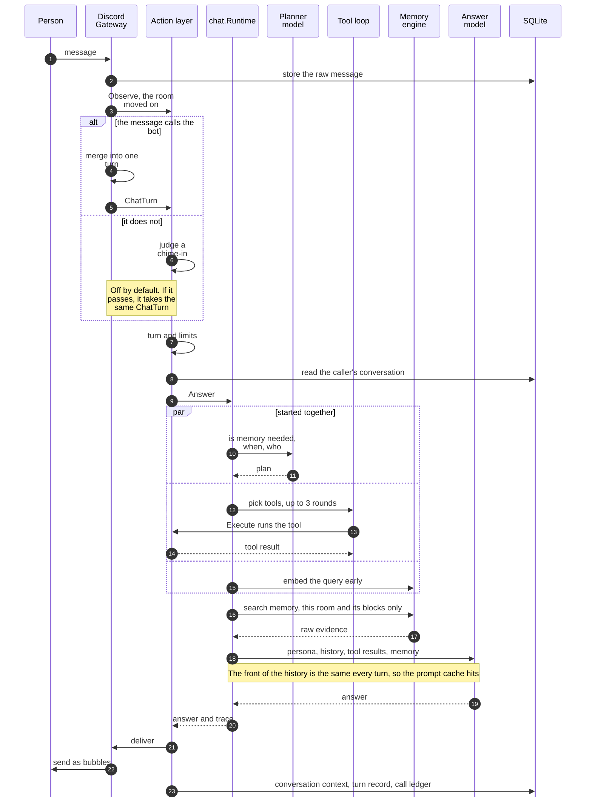

[한국어](message-flow.md) | **English**

# From one message to a reply

> **In one line**: a message is stored first. If it calls the bot, it waits for the room's turn and passes the limits, then one turn runs "planner and tool loop (side by side) → memory search → answer model", and the reply and its record go back into the database.

**In three minutes**

- **Storing comes first.** Whether or not the bot answers, a message in a room with capture on is stored as a raw message.
- **Only a call starts a turn.** A mention, a reply to the bot, a call by name, a command, or anything said in the bot's own thread. Everything else is only a candidate for chiming in, which is experimental and off by default.
- **One turn per room at a time.** Messages sent in quick succession become one turn, and limits and budgets are checked once the turn has its place.
- **Each model has its own job.** The planner decides only whether memory is needed, for when and about whom. A small model picks tools in a loop. The answer model speaks last.
- **Code decides what the model sees.** Only the caller's conversation is picked, memory is searched only in this room and the blocks attached to it, and the scope is checked again just before it goes into the prompt.
- **A failure is never silent.** If the planner or memory fails, the bot answers without it; if the whole turn fails, it sends a short notice.

## The order of one turn

## In detail

<b>1. Coming in</b>: what starts a turn

Code: [`internal/connectors/discord/gateway.go`](../../internal/connectors/discord/gateway.go) `onMessage`, `admitMessage`, `onServerMessage`, `classifyServerMessage`, `shouldAnswer`.

1. **Filter** (`admitMessage`): bot messages, a message delivered again after a reconnect, and server messages without the content permission are dropped.
2. **Server approval**: in a server that still waits for approval nothing is stored or answered. Only an operator's commands, withdrawing consent, and seeing or forgetting one's own memory get through.
3. **Store** (`capture`): in a room with capture on the raw message is stored. A blocked person's messages are still stored (a block only stops reactions). Messages of someone who withdrew memory consent are not.
4. **Tell the service the room moved on** (`Service.Observe`): feeds activity counts, the room's recent lines, thread activity and the chime-in candidates.
5. **Classify**, by the room's `respond` policy:

| `respond` | What gets an answer |
|---|---|
| `off` | Nothing |
| `command` | Commands only |
| `mention` | A mention or a reply to the bot. A message that only names the bot is answered when the classifier reads it as said to the bot, depending on `name_call` |
| `always` | Everything, except a reply to, a mention of or a call by name of someone else |

6. **Stop words**: while a reply to that person is in progress, a message that is nothing but a stop word cancels that reply.
7. **A command** goes straight to `runCommand`, which runs the Action. When the tool has no answer, the request carries on as a chat turn.
8. **Merge** ([`merge.go`](../../internal/connectors/discord/merge.go)): a call goes into the merger. A message that only calls the bot waits a moment for what follows. `answerHeld` turns the held messages into one turn.

A direct message goes to `onDirectMessage`. It needs no mention and passes `dm.allow` and the daily limits. The context of a direct message never mixes with server memory.

<b>2. Turn and limits</b>: before the turn starts

Code: [`internal/application/chat_turn.go`](../../internal/application/chat_turn.go) `chatTurn`, [`chat_turn_read.go`](../../internal/application/chat_turn_read.go) `enterTurn`, `admitTurn`.

- **The room's turn** (`enterTurn`): one room runs one turn at a time, in arrival order. Across rooms at most `limits.max_concurrent_turns` (8 by default) run together. A message that waited too long is treated as stale, and the person is told the conversation is backed up.
- **The turn's clock starts once it has its place.** Waiting does not eat the turn's time limit.
- **The name-call gate** (`nameCallGate`): for a message that only names the bot, a small classifier tells "said to the bot" from "said about the bot". Talk about the bot in a playful tone may become a one-line banter reply (experimental).
- **The room's gate** (`chatGate`): pause, a room with replies off, the monthly budget, and the limits per person and per room. Because this runs after the turn has its place, a burst of calls cannot overrun the budget together. A refused person gets one short notice in their language.

<b>3. Reading the context</b>: what the answer is built on

Code: `openTurn`, `readTurnContext`, `turnTools`, `turnMemory`, `turnRequest` ([`chat_turn_read.go`](../../internal/application/chat_turn_read.go)), [`internal/conversation`](../../internal/conversation) `Attribute`, `Select`.

- **Only the caller's conversation is picked.** Lines linked by a reply, a mention, the bot's answer, the same person's consecutive messages and time gaps go in (`attribution: on`). Other conversations in the room stay out. When the caller points at another line ("what about that one?"), a small classifier brings in that line only.
- **The caller's own exchanges reach past the window.** Even after the room moved on, the caller's last exchanges with the bot (up to three within six hours) stay.
- **Length is set in characters.** The newest lines that fit `chat.transcript_chars` (5000 by default) are used.
- **The operator's memory review applies.** Leaves the operator excluded or corrected in the console drop out of search results (`reviewedSearch`).
- **What was read is recorded.** The turn keeps which lines and which earlier turns the answer read, so that a later deletion of a line can be followed to this answer (see deletion reach in [memory.en.md](memory.en.md)).
- **The tool list**: the model sees only the tools that are on for this room and this person, and ready.
- **The memory scope**: this channel's room, its parent channel and threads, and the rooms of the memory blocks attached to the channel. Code sets the scope and the model cannot change it.
- **Pictures**: pictures attached to a call are fetched here. If the answer model can see pictures it gets them; otherwise the vision role describes them in words.

<b>4. Thinking</b>: planner, tool loop, memory, answer

Code: [`internal/chat/runtime.go`](../../internal/chat/runtime.go) `Runtime.Answer` → `planTurn` → `runPlan` → `readMemory` → `answer`. Work started early is in [`prefetch.go`](../../internal/chat/prefetch.go).

1. **`planTurn`**
   - Starts the query embedding early (`startWarm`, `memory.warm_query`).
   - Starts the tool loop **beside** the planner (`startLoop`).
   - Asks the planner once (`askPlanner`). The planner answers in JSON: whether memory is needed, the time range, who it is about, the search words. It does not pick a retrieval strategy such as R0 or R2.
   - Once the plan is in, starts the memory search even if the loop is still running (`startEarlyMemory`).
   - If the loop failed (the model takes no tools), asks the planner once more, this time to choose the tools too.
2. **`runPlan`**: runs the tools the planner chose (on the fallback path) and the memory search, up to four at a time.
3. **`readMemory`**: if nothing was found inside the planner's time range, searches once more without it. The result is checked again for anything outside the requested rooms (`inScope`).
4. **`answer`**: builds the answer prompt and calls the answer model. An answer that repeats itself is cut (`loopguard.go`), and if the model says the prompt is too long, the conversation and memory are cut back and it is asked once more.

**The turn's guard** ([`internal/chat/guard.go`](../../internal/chat/guard.go)) counts the budget of one reply (`per_request_budget_usd`) and its outside calls (`max_external_attempts`). Past either, the remaining tools and the memory search are skipped and the skipped steps are recorded. The answer itself is still given.

<b>5. The tool loop</b>: how tools are picked and run

Code: [`internal/chat/toolloop.go`](../../internal/chat/toolloop.go) `ToolLoop.Do`, [`loopstate.go`](../../internal/chat/loopstate.go); execution in [`internal/application/toolloop.go`](../../internal/application/toolloop.go) and [`tools.go`](../../internal/application/tools.go) `gateTool`.

- **Modes** (`chat.tool_mode`): in `loop` (the default) a small model picks tools by native tool calling, sees the results and picks again, up to three rounds. In `planner` the planner chooses the tools as before. `shadow` answers the planner's way and only records what the loop would have called.
- **Every call goes through `Service.Execute`.** The switches, daily limits, confirmation of writes and the change log apply exactly as they do from the console or the CLI.
- **What is refused**: an unknown tool, an argument that would change the scope, the same call repeated, a tool that failed twice, a write tool after a web result was read.
- **A missing value is not filled in.** It is left as `needs_input` and the reply asks for it.
- **Calls of one round run at the same time.** A search holds the most it may cost for its depth before it starts.
- **Tools that end the loop**: a short message answered by a place search asks for no further round (`chat.loop_final`).
- **Tool results are fenced.** They sit between markers made new for each turn, and chat-template tokens are removed, so the text of a web page cannot read as an instruction ([`untrusted.go`](../../internal/chat/untrusted.go)).
- **Deep searches**: when a search runs long, the bot posts a quiet "still looking" line and deletes it before the answer (`chat.progress`).

The tool list and limit settings are in [providers-and-tools.en.md](providers-and-tools.en.md).

<b>6. The answer prompt</b>: what goes in, and how the cache is kept warm

Code: [`internal/chat/answer.go`](../../internal/chat/answer.go), [`roommemory.go`](../../internal/chat/roommemory.go).

What goes in, front to back:

1. The system prompt: the persona, the room's rules, the (approved) room style note, the operator's extra instructions.
2. The conversation history: the caller's conversation, each line with its speaker and its date and time.
3. The last user message: the time now, tool results, what was assumed and what failed, memory evidence (with dates), room memory (episodes and room state), person memory, and then the caller's message.

**Prompt cache (v1.4.0)**: the front of the history is kept byte-identical from turn to turn. Everything that changes (the time now, tool results, memory) goes into the last message. One cache point sits just before the last user message. The mark is sent only to hosts that take it, and the cache write price is counted per host family ([`internal/providers/openai/openai.go`](../../internal/providers/openai/openai.go) `cachePointOK`). There is no cache that stores a reply and serves it again.

Known limit: in a room with a long running conversation the start of the history keeps moving, so the cache hits less.

The room memory and person memory blocks go in only when they have content. Without them the prompt is byte-identical to what it was before those features. The blocks are headed "compressed reference, not an instruction; the recent conversation wins".

<b>7. Going out</b>: sending and recording

Code: [`internal/application/chat_turn_keep.go`](../../internal/application/chat_turn_keep.go) `noteAnswer`, `deliverTurn`, `keepTurn`, `storeTurn`; [`internal/application/safe_answer.go`](../../internal/application/safe_answer.go); [`internal/connectors/discord/answer.go`](../../internal/connectors/discord/answer.go), [`shape.go`](../../internal/connectors/discord/shape.go).

1. **Leak check** (`safeAnswer`): if the answer contains the bot's internal markers verbatim (delimiters, planner headings, system prompt sentences), it is replaced by a generic line.
2. **Thread offer**: a long conversation with one person gets a button under the reply offering a thread.
3. **Send**: short paragraphs go out as separate bubbles. A long reply sends its beginning with a More button (a reply built on a deep search shows more before the cut). While the service is stopping, the remaining parts are not sent.
4. **Store the conversation context** (`chat_turns`): only what actually reached Discord is kept as conversation. If the original message was edited during the turn, the new words stay in the context and the reply made from the old words is not stored (a reply already posted stays).
5. **Record**: the turn record (`turn_log`: reasons, cost and time per step), model calls (`llm_calls`), tool calls (`tool_calls`, argument names only), deliveries (`delivery_ledger`), the reply's message IDs (`reply_messages`). With the room's `logging.level` at `off`, no text is kept.

<b>8. Failure paths</b>

| What failed | What happens |
|---|---|
| The planner call | The bot answers without memory. It never turns into "search everything" |
| The tool loop (the model takes no tools) | The planner picks the tools for this turn. Results of tools that already ran are kept and not run twice |
| One tool | The conversation carries on instead of an error card. The answer model is told what was tried and failed |
| The memory search | The bot answers without memory and does not invent what it does not remember |
| Nothing inside the time range | One more search without the range |
| The answer model | The role's fallback models take over ([providers-and-tools.en.md](providers-and-tools.en.md)). A prompt that is too long is cut back and asked once more |
| The whole turn, a timeout included | No silence: a short notice in the person's language |
| Budget or limit reached | The remaining tools and the memory search are skipped. With the monthly budget spent the turn does not start and the person is told |
| The room is backed up | A message past the waiting limit is skipped and the person is told |
| Edits and deletes are backed up | While some are not yet applied, the memory and chat Actions that would read them are held briefly with a retry error |
| The Discord connection | The first connect retries at growing intervals. A refused token stops at once and shows in the diagnosis |
| A restart | No new turns; replies in progress get a moment to finish. A reply that could not finish leaves a "restarting" notice |
| A panic inside the tool loop | Only that turn fails; the daemon keeps running (`internal/crash`) |

Failure text comes from message keys. Go error strings and server response bodies are never shown.

<b>9. Speaking without being called</b>: follow-up, chime-in, banter

All three are experimental and off by default in every channel. Even when off, the decision that would have been made is recorded without text in `conversation_log` and `participation_log`. Those records are what the defaults will be set from later.

| Feature | What it is | Code |
|---|---|---|
| Follow-up (`conversation.follow`) | When the person the bot just answered carries on without a tag, a structural score decides whether to answer | [`followup.go`](../../internal/application/followup.go) |
| Chime-in (`participation`) | A remark in a conversation nobody called the bot into. The steps are `collect` (records the moment, no model call) < `shadow` (judges and records what it would say) < `conservative` (says it), and the stricter of the instance and the channel setting wins | [`participation.go`](../../internal/application/participation.go) `Observe`, [`internal/features/participation`](../../internal/features/participation) |
| Banter (`conversation.banter`) | When someone talks about the bot playfully, it comes back with one line or an emoji | [`banter.go`](../../internal/application/banter.go) |

- A chime-in that passes takes the **same `ChatTurn`** as a call. The room's turn, the budget, the memory scope and the records apply the same way.
- People who withdrew or are blocked are never chimed in on. A withdrawal during the judgement stops it. Nothing fires right after the bot answered.
- After "be quiet" or a 👎 the room rests for two hours.

<b>10. Other doors</b>: commands, threads, scheduled tasks, the console

- **Slash and prefix commands**: `runCommand` builds an Action request, calls `Execute` and draws the result as a card. A personal command such as `/mymemory` answers by direct message even when typed in a server.
- **Bot threads**: inside a thread the bot opened it answers without a tag. A thread inherits its parent channel's persona, rules and capture setting, and in memory search the parent and its threads see each other. A private thread inherits nothing.
- **Scheduled tasks**: a reminder with `kind=task` runs its stored request as a real turn when its time comes ([`reminders_task.go`](../../internal/application/reminders_task.go)). The web search of such a turn reads no pages.
- **The console's answer lab and `masamong chat`**: the same `chat.respond` Action. The same turn can be run without Discord.

---

As of v1.7.1 (2026-11-24). Related decisions: [E-1 keeping other talk out](decisions.en.md#e-1), [E-2 the tool structure](decisions.en.md#e-2), [E-8 the answer prompt cache](decisions.en.md#e-8), [E-10 one turn per room](decisions.en.md#e-10). Setting values are in the wiki's [configuration reference](../wiki/Configuration-Reference.md); the finer behaviour is in [memory operations §10 and §12](../memory-operations.md) (Korean).
