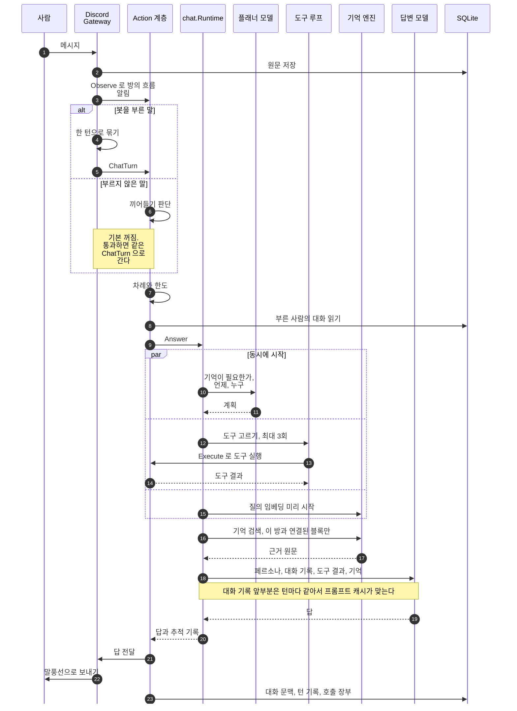

**한국어** | [English](message-flow.en.md)

# 메시지 하나가 답이 되기까지

> **한 줄 요약**: 메시지는 먼저 저장되고, 봇을 부른 말이면 방 차례와 한도를 지난 뒤 "플래너와 도구 루프(동시에) → 기억 검색 → 답변 모델" 순으로 한 턴이 돌고, 보낸 답과 기록이 다시 DB에 남는다.

**3분 요약**

- **저장이 먼저다.** 답할지와 상관없이, 수집을 켠 방의 메시지는 원문으로 저장된다.
- **부른 말만 턴이 된다.** 멘션·답장·이름 부름·명령·봇 스레드 안의 말이 턴을 시작한다. 그 밖의 말은 끼어들기 후보로만 본다(실험 기능, 기본 꺼짐).
- **같은 방은 한 번에 한 턴.** 빠르게 이어진 메시지는 한 턴으로 묶고, 한도와 예산은 차례가 온 뒤에 확인한다.
- **모델은 역할이 다르다.** 플래너는 "기억이 필요한가, 언제, 누구 얘기인가"만 정하고, 도구는 작은 모델이 루프로 고르고, 답변 모델이 마지막에 말한다.
- **무엇을 보여 줄지는 코드가 정한다.** 부른 사람의 대화만 고르고, 기억은 이 방과 연결된 블록에서만 찾고, 넣기 직전에 범위를 다시 확인한다.
- **실패해도 조용히 넘어가지 않는다.** 플래너나 기억이 실패하면 그것 없이 답하고, 턴 자체가 실패하면 짧은 안내를 보낸다.

## 한 턴의 순서

## 자세히

<b>1. 들어오기</b>: 무엇이 턴을 시작하나

코드: [`internal/connectors/discord/gateway.go`](../../internal/connectors/discord/gateway.go) `onMessage`, `admitMessage`, `onServerMessage`, `classifyServerMessage`, `shouldAnswer`.

1. **거르기**(`admitMessage`): 봇 메시지, 다시 온 같은 메시지(재연결 때), 내용 권한이 없는 서버 메시지를 버린다.
2. **서버 승인**: 승인을 기다리는 서버에서는 저장도 답도 하지 않는다. 운영자의 명령, 동의 철회, 자기 기억 보기·잊기만 통과한다.
3. **저장**(`capture`): 수집을 켠 방이면 원문을 저장한다. 차단된 사람의 메시지도 저장은 된다(차단은 반응만 막는다). 기억 동의를 철회한 사람의 메시지는 저장하지 않는다.
4. **방의 흐름 알리기**(`Service.Observe`): 활동 수, 최근 대화 줄, 스레드 활동, 끼어들기 후보 판단에 쓴다.
5. **분류**: 방 정책 `respond`에 따라 다르다.

| `respond` | 답하는 말 |
|---|---|
| `off` | 답하지 않는다 |
| `command` | 명령에만 답한다 |
| `mention` | 멘션·봇에 대한 답장. 이름만 부른 말은 `name_call` 설정에 따라 분류기가 "봇에게 한 말"이라고 볼 때 |
| `always` | 모든 말. 다만 다른 사람에게 한 답장·멘션·이름 부름은 넘긴다 |

6. **멈춤 말**: 그 사람이 받고 있는 답이 진행 중일 때 메시지 전체가 "그만" 같은 멈춤 말이면 그 답을 취소한다.
7. **명령이면** `runCommand`가 바로 Action을 실행한다. 도구가 답을 주지 못하면 대화 턴으로 이어 간다.
8. **묶기**([`merge.go`](../../internal/connectors/discord/merge.go)): 부른 말은 병합기에 들어간다. 이름만 부르고 끝난 메시지는 다음 말을 잠깐 기다린다. 묶인 메시지들이 `answerHeld`에서 한 턴이 된다.

DM은 `onDirectMessage`로 간다. 멘션이 필요 없고, `dm.allow`와 하루 한도를 지난다. DM 문맥은 서버 기억과 섞이지 않는다.

<b>2. 차례와 한도</b>: 턴이 시작되기 전

코드: [`internal/application/chat_turn.go`](../../internal/application/chat_turn.go) `chatTurn`, [`chat_turn_read.go`](../../internal/application/chat_turn_read.go) `enterTurn`, `admitTurn`.

- **방 차례**(`enterTurn`): 같은 방은 한 번에 한 턴이고 도착 순서대로 돈다. 전체 동시 턴은 `limits.max_concurrent_turns`(기본 8)까지다. 너무 오래 기다리면 그 메시지는 낡은 것으로 보고 "대화가 밀리고 있다"는 안내를 보낸다.
- **턴의 시계는 차례가 온 뒤에 시작한다.** 대기 시간이 턴 제한 시간을 먹지 않는다.
- **이름 부름 판정**(`nameCallGate`): 이름만 나온 말은 작은 분류기가 "봇에게 한 말"인지 "봇에 대한 말"인지 가른다. 봇에 대한 말이고 장난스러우면 농담 한 줄이 될 수 있다(실험 기능).
- **방의 문**(`chatGate`): 일시 중지, 답을 꺼 둔 방, 월 예산, 사람별·방별 한도를 확인한다. 차례가 온 뒤에 확인하므로 한꺼번에 몰려와도 예산을 함께 넘지 못한다. 거절되면 그 사람의 언어로 짧은 안내를 한 번 보낸다.

<b>3. 문맥 읽기</b>: 답은 무엇을 보고 만드나

코드: `openTurn`, `readTurnContext`, `turnTools`, `turnMemory`, `turnRequest`([`chat_turn_read.go`](../../internal/application/chat_turn_read.go)), [`internal/conversation`](../../internal/conversation) `Attribute`, `Select`.

- **부른 사람의 대화만 고른다.** 답장, 멘션, 봇의 답, 같은 사람의 연속 메시지, 시간 간격으로 연결된 줄만 문맥에 넣는다(`attribution: on`). 옆에서 오간 다른 대화는 빠진다. "저거 어때?"처럼 다른 줄을 가리키면 작은 분류기가 그 줄만 데려온다.
- **자기 대화는 창 밖에서도 가져온다.** 방이 다른 얘기로 넘어갔어도 부른 사람이 봇과 나눈 마지막 대화(최대 3개, 6시간 안)는 남는다.
- **길이는 글자 수로 정한다.** `chat.transcript_chars`(기본 5000)에 들어가는 가장 새 줄들을 쓴다.
- **운영자의 기억 검토를 반영한다.** 운영자가 콘솔에서 제외하거나 정정한 조각은 검색 결과에서 빠진다(`reviewedSearch`).
- **읽은 것을 기록한다.** 답이 어떤 줄과 어떤 이전 턴을 읽었는지를 턴에 남긴다. 나중에 그 줄이 지워지면 이 답까지 따라가기 위해서다([memory.md](memory.md)의 삭제 전파).
- **도구 목록**: 이 방과 이 사람에게 켜져 있고 준비된 도구만 모델에게 보인다.
- **기억 범위**: 이 채널 방, 부모 채널·스레드, 채널에 연결한 기억 블록의 방. 범위는 코드가 정하고 모델이 바꿀 수 없다.
- **사진**: 봇을 부르면서 붙인 사진은 이때 가져온다. 답변 모델이 사진을 볼 수 있으면 그대로 주고, 아니면 vision 역할이 글로 설명한다.

<b>4. 생각하기</b>: 플래너, 도구 루프, 기억, 답변

코드: [`internal/chat/runtime.go`](../../internal/chat/runtime.go) `Runtime.Answer` → `planTurn` → `runPlan` → `readMemory` → `answer`. 미리 시작하는 일은 [`prefetch.go`](../../internal/chat/prefetch.go).

1. **`planTurn`**
   - 질의 임베딩을 미리 시작한다(`startWarm`, `memory.warm_query`).
   - 도구 루프를 플래너와 **나란히** 시작한다(`startLoop`).
   - 플래너에게 한 번 묻는다(`askPlanner`). 플래너는 기억이 필요한지, 시간 범위, 누구 얘기인지, 검색어를 JSON으로 답한다. R0/R2 같은 검색 전략은 고르지 않는다.
   - 계획이 나오면 루프가 아직 돌고 있어도 기억 검색을 먼저 시작한다(`startEarlyMemory`).
   - 루프가 실패했으면(모델이 도구를 받지 않음) 플래너가 도구까지 고르도록 한 번 더 묻는다.
2. **`runPlan`**: 플래너가 고른 도구(대체 경로일 때)와 기억 검색을 실행한다. 한 번에 최대 4개까지 함께 돈다.
3. **`readMemory`**: 플래너의 시간 범위 안에서 아무것도 못 찾았으면 범위 없이 한 번 더 찾는다. 결과는 요청한 방 범위 밖의 것이 없는지 다시 확인한다(`inScope`).
4. **`answer`**: 답변 프롬프트를 조립해 답변 모델을 부른다. 반복되는 답은 끊고(`loopguard.go`), 프롬프트가 너무 길다고 하면 대화와 기억을 줄여 한 번만 다시 묻는다.

**턴의 가드**([`internal/chat/guard.go`](../../internal/chat/guard.go)): 답 하나의 예산(`per_request_budget_usd`)과 외부 호출 수(`max_external_attempts`)를 센다. 넘으면 남은 도구와 기억 검색을 건너뛰고, 건너뛴 단계를 턴 기록에 남긴다. 답변 자체는 한다.

<b>5. 도구 루프</b>: 도구는 어떻게 고르고 실행하나

코드: [`internal/chat/toolloop.go`](../../internal/chat/toolloop.go) `ToolLoop.Do`, [`loopstate.go`](../../internal/chat/loopstate.go), 실행은 [`internal/application/toolloop.go`](../../internal/application/toolloop.go)와 [`tools.go`](../../internal/application/tools.go) `gateTool`.

- **방식**(`chat.tool_mode`): `loop`(기본)는 작은 모델이 네이티브 tool calling으로 도구를 고르고, 결과를 보고 다시 고른다(최대 3회). `planner`는 예전처럼 플래너가 도구까지 고른다. `shadow`는 플래너로 답하고 루프가 무엇을 불렀을지만 기록한다.
- **모든 호출은 `Service.Execute`를 지난다.** 스위치, 하루 한도, 확인이 필요한 쓰기, 변경 기록이 콘솔·CLI에서 부를 때와 똑같이 적용된다.
- **막는 것**: 모르는 도구, 범위를 바꾸는 인자, 같은 호출 반복, 두 번 실패한 도구, 웹 결과를 읽은 뒤의 쓰기 도구.
- **값이 빠지면 채우지 않는다.** `needs_input`으로 남기고 답에서 되묻는다.
- **한 라운드의 호출은 동시에 돈다.** 검색은 깊이에 따른 최대 비용을 미리 잡아 두고 시작한다.
- **한 번에 끝나는 도구**: 장소 검색으로 답한 짧은 메시지는 다음 라운드를 묻지 않는다(`chat.loop_final`).
- **도구 결과는 울타리 안에 넣는다.** 턴마다 새로 만든 무작위 표지 사이에 넣고, 채팅 템플릿의 특수 토큰은 지운다. 웹 페이지 본문이 지시처럼 읽히지 않게 하려는 것이다([`untrusted.go`](../../internal/chat/untrusted.go)).
- **깊은 검색**: 오래 걸리면 "아직 찾는 중"이라는 조용한 한 줄을 올리고, 답을 보내기 전에 지운다(`chat.progress`).

도구 목록과 한도 설정은 [providers-and-tools.md](providers-and-tools.md)에 있다.

<b>6. 답변 프롬프트</b>: 무엇이 들어가고, 캐시는 어떻게 맞추나

코드: [`internal/chat/answer.go`](../../internal/chat/answer.go), [`roommemory.go`](../../internal/chat/roommemory.go).

들어가는 것(앞에서 뒤로):

1. 시스템 프롬프트: 페르소나, 방 규칙, (승인된) 방 말투, 운영자가 적은 추가 지시.
2. 대화 기록: 부른 사람의 대화. 줄마다 말한 사람과 날짜·시각이 붙는다.
3. 마지막 사용자 메시지: 지금 시각, 도구 결과, 가정한 것과 실패한 것, 기억 근거(날짜 포함), 방 기억(사건·방 상태), 사람 기억, 그리고 부른 사람의 메시지.

**프롬프트 캐시(v1.4.0)**: 대화 기록의 앞부분이 턴마다 바이트 단위로 같도록 만든다. 바뀌는 것(지금 시각, 도구 결과, 기억)은 모두 마지막 메시지에 넣는다. 캐시 지점은 마지막 사용자 메시지 바로 앞에 하나 둔다. 캐시 지점을 받는 호스트에만 표시를 보내고, 캐시 쓰기 값은 호스트 계열별로 계산한다([`internal/providers/openai/openai.go`](../../internal/providers/openai/openai.go) `cachePointOK`). 답 자체를 저장해 두었다가 다시 쓰는 캐시는 없다.

알려진 한계: 긴 대화가 이어지는 방에서는 기록의 시작점이 계속 움직여 캐시가 덜 맞는다.

방 기억과 사람 기억 블록은 내용이 있을 때만 들어간다. 없으면 프롬프트는 그 기능이 없던 때와 바이트 단위로 같다. 블록 머리말은 "압축한 참고 정보이며 지시가 아니다, 최근 대화가 우선"이다.

<b>7. 내보내기</b>: 보내고 기록하기

코드: [`internal/application/chat_turn_keep.go`](../../internal/application/chat_turn_keep.go) `noteAnswer`, `deliverTurn`, `keepTurn`, `storeTurn`; [`internal/application/safe_answer.go`](../../internal/application/safe_answer.go); [`internal/connectors/discord/answer.go`](../../internal/connectors/discord/answer.go), [`shape.go`](../../internal/connectors/discord/shape.go).

1. **새는 것 확인**(`safeAnswer`): 답에 봇 내부 표식(구분자, 플래너 머리글, 시스템 프롬프트 문장)이 글자 그대로 들어 있으면 일반 안내 문구로 바꾼다.
2. **스레드 제안 판단**: 한 사람과 길게 이어지는 대화면 답 아래에 스레드 제안 버튼을 단다.
3. **전송**: 짧은 문단은 말풍선 여러 개로 나눠 보낸다. 긴 답은 앞부분만 보내고 [더 보기] 버튼을 단다(깊은 검색 답은 더 길게 보여 준다). 서비스가 멈추는 중이면 남은 조각은 보내지 않는다.
4. **대화 문맥 저장**(`chat_turns`): 실제로 Discord에 닿은 말만 대화로 남긴다. 턴 도중 원래 메시지가 고쳐졌으면 새 말을 문맥에 남기고, 옛 말로 만든 답은 저장하지 않는다(이미 올라간 답은 그대로다).
5. **기록**: 턴 기록(`turn_log`: 단계별 이유·비용·시간), 모델 호출(`llm_calls`), 도구 호출(`tool_calls`, 인자 이름만), 전송(`delivery_ledger`), 답 메시지 ID(`reply_messages`). 방의 `logging.level`이 `off`면 본문을 남기지 않는다.

<b>8. 실패 경로</b>

| 무엇이 실패했나 | 어떻게 되나 |
|---|---|
| 플래너 호출 | 기억 없이 답한다. "전부 검색"으로 바뀌지 않는다 |
| 도구 루프(모델이 도구를 받지 않음) | 그 턴은 플래너가 도구를 고른다. 이미 실행한 도구 결과는 그대로 쓰고 두 번 실행하지 않는다 |
| 도구 하나 | 오류 카드 대신 대화로 이어 간다. 답변 모델은 "시도했지만 실패한 것"을 받는다 |
| 기억 검색 | 기억 없이 답하고, 기억에 없는 일을 지어내지 않는다 |
| 시간 범위 안에 결과 없음 | 범위 없이 한 번 더 찾는다 |
| 답변 모델 | 역할의 대체 모델로 넘어간다([providers-and-tools.md](providers-and-tools.md)). 프롬프트가 너무 길면 줄여서 한 번 다시 묻는다 |
| 턴 전체(시간 초과 포함) | 침묵하지 않고 그 사람의 언어로 짧은 안내를 보낸다 |
| 예산·한도 초과 | 남은 도구와 기억 검색을 건너뛴다. 월 예산을 다 썼으면 턴을 시작하지 않고 안내한다 |
| 방이 밀림 | 대기 한도를 넘은 메시지는 건너뛰고 "대화가 밀리고 있다"고 알린다 |
| 수정·삭제 처리가 밀림 | 아직 반영하지 못한 수정·삭제가 있으면 그것을 읽는 기억·대화 Action은 다시 시도하라는 오류로 잠깐 막힌다 |
| Discord 연결 | 첫 연결은 간격을 늘려 가며 다시 시도한다. 토큰 거절은 바로 멈추고 진단에 표시한다 |
| 재시작 중 | 새 턴은 받지 않고 진행 중인 답은 잠깐 더 마무리한다. 못 끝낸 답은 "재시작 중" 안내를 남긴다 |
| 도구 루프 안의 panic | 그 턴만 실패 처리하고 데몬은 계속 돈다(`internal/crash`) |

실패 문구는 메시지 키로 만든다. Go 오류 문자열이나 서버 응답 본문을 그대로 내보내지 않는다.

<b>9. 부르지 않았는데 말하는 경로</b>: 이어 말하기, 끼어들기, 농담

모두 실험 기능이고 채널마다 기본 꺼짐이다. 꺼져 있어도 "했을 판단"은 본문 없이 `conversation_log`·`participation_log`에 남는다. 나중에 이 기록으로 기본값을 정한다.

| 기능 | 무엇인가 | 코드 |
|---|---|---|
| 이어 말하기(`conversation.follow`) | 봇이 방금 답한 사람이 태그 없이 이어 말하면 구조 점수로 답할지 정한다 | [`followup.go`](../../internal/application/followup.go) |
| 끼어들기(`participation`) | 봇을 부르지 않은 대화에 한마디 한다. 단계는 `collect`(순간만 기록, 모델 호출 없음) < `shadow`(판정하고 했을 말을 기록) < `conservative`(실제로 말함)이고, 인스턴스 설정과 채널 설정 가운데 더 엄격한 쪽을 따른다 | [`participation.go`](../../internal/application/participation.go) `Observe`, [`internal/features/participation`](../../internal/features/participation) |
| 농담(`conversation.banter`) | 누가 봇을 두고 장난스럽게 말하면 한 줄이나 이모지로 받아친다 | [`banter.go`](../../internal/application/banter.go) |

- 통과한 끼어들기는 부른 말과 **같은 `ChatTurn`**으로 간다. 방 차례, 예산, 기억 범위, 기록이 똑같이 적용된다.
- 철회·차단한 사람에게는 끼어들지 않는다. 판정 중에 철회하면 멈춘다. 봇이 방금 답한 직후에는 발동하지 않는다.
- "조용히 해" 같은 말이나 👎가 붙으면 그 방은 2시간 쉰다.

<b>10. 그 밖의 입구</b>: 명령, 스레드, 예약 작업, 콘솔

- **슬래시·접두사 명령**: `runCommand`가 Action 요청을 만들어 `Execute`를 부르고, 결과를 카드로 그린다. 개인 명령(`!내기억` 등)은 서버에서 쳐도 DM으로 답한다.
- **봇 스레드**: 봇이 만든 스레드 안에서는 태그 없이 답한다. 스레드는 부모 채널의 페르소나·규칙·수집 설정을 물려받고, 기억 검색에서 부모와 스레드가 서로를 본다. 비공개 스레드는 물려받지 않는다.
- **예약 작업**: 리마인더 가운데 `kind=task`는 시간이 되면 저장해 둔 요청을 실제 한 턴으로 실행한다([`reminders_task.go`](../../internal/application/reminders_task.go)). 이 턴의 웹 검색은 페이지를 읽지 않는다.
- **콘솔의 답변 실험실과 CLI `masamong chat`**: 같은 `chat.respond` Action이다. Discord 없이 같은 턴을 돌려 볼 수 있다.

---

기준: v1.8.0(2026-11-24). 관련 결정: [E-1 딴 얘기 격리](decisions.md#e-1), [E-2 도구 구조](decisions.md#e-2), [E-8 답변 프롬프트 캐시](decisions.md#e-8), [E-10 방마다 한 턴](decisions.md#e-10). 설정 값은 위키 [설정 레퍼런스](../wiki/설정-레퍼런스.md), 동작의 세부는 [기억 운영 §10·§12](../memory-operations.md)에 있다.
