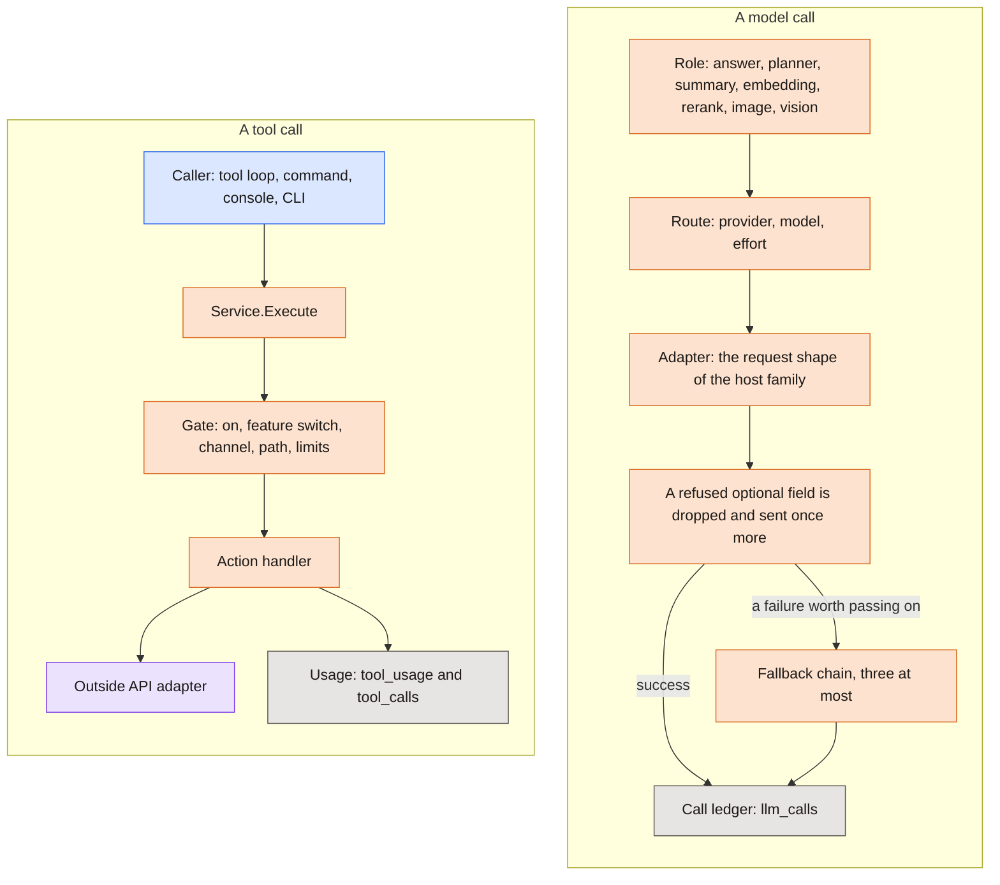

[한국어](providers-and-tools.md) | **English**

# Providers, tools and languages

> **In one line**: models are chosen per role and sent by an adapter for each host family. Tools are declared in one registry and every call passes the same gate. What the bot says lives in language packs; screen and command strings live in locales.

**In three minutes**

- **Roles**: answer, planner, summary, embedding and rerank are the required vocabulary; image and vision are optional. Each role sets its own provider, model and reasoning effort.
- **Host families**: OpenRouter, OpenAI, Gemini, Anthropic and other OpenAI-compatible hosts. Each family accepts different fields and counts prices differently. Anthropic uses its native Messages API.
- **On failure**: a chat role moves on to its fallback models (three at most). A model that keeps failing is skipped for a while. Budget problems and malformed requests are not passed on.
- **Budgets**: a monthly budget, a budget and call count per reply, a daily limit per provider, limits per tool, and separate budgets on the memory side.
- **Tools**: declared in `Builtins()` of `internal/tools`. Called from chat, a command, the console or the CLI, they pass the same gate (`gateTool`) inside `Service.Execute`.
- **Languages**: prompts, rules and word lists are in `internal/lang/packs`, Discord and console strings in `locales/`. Five languages are built in, and the Korean prompts are pinned by golden files.

## The path of a model call and of a tool call

## In detail

<b>Model roles</b>

Code: [`internal/config/document.go`](../../internal/config/document.go) `ModelRoles`, `ProductModelRoles`; wired into a turn in [`internal/application/chat_input.go`](../../internal/application/chat_input.go) `chatRoutes`, `chatLLM`.

| Role | What it does | Note |
|---|---|---|
| `response` | The answer that is spoken last | It wears the persona |
| `planner` | Decides whether memory is needed, for when and about whom. The tool loop and the small classifiers (name call, pointing at a line, explicit memory) use this model by default too | `chat.tool_model: response` runs the tool loop on the answer model |
| `summary` | Leaf summaries, episode extraction, room state, room style | Background |
| `embed` | Leaf, message and query vectors | The width is `models.embed.dimensions` |
| `rerank` | Reranks search candidates (R2) | Without it the answer uses R0 |
| `image` | The picture model of `images.generate` | Optional. Without it the tool answers "not configured" |
| `vision` | Describes attached pictures in words | Optional. Without it the planner, then the answer model, reads the picture |

- The role names are the same vocabulary as the sandbox's (`contracts/sandbox/tool-parity.json`).
- **Reasoning effort** can be set on every chat role and every fallback entry (from none to max). A level the model does not take is changed to the nearest one it does before the request is sent. Quick judgements such as the name call run without reasoning.
- **Recommendations**: `models.recommend` proposes candidates per role from the host's model list, prices and recommendation rules. Changing the embedding model while an index exists asks for confirmation separately.

<b>Host families and adapters</b>

Code: [`internal/providers/openai/api.go`](../../internal/providers/openai/api.go) (families), [`openai.go`](../../internal/providers/openai/openai.go) (`Adapter`), [`anthropic.go`](../../internal/providers/openai/anthropic.go), [`shape.go`](../../internal/providers/openai/shape.go), [`hosts.json`](../../internal/providers/openai/hosts.json), [`hosts.go`](../../internal/providers/openai/hosts.go).

| Family | Built-in presets | What differs |
|---|---|---|
| `openrouter` | OpenRouter | Relays many upstreams. A cache point is sent only for some model families |
| `openai` | OpenAI | The standard shape |
| `gemini` | Gemini | Images only through the native `generateContent` |
| `anthropic` | Anthropic | The native Messages API: adaptive thinking, signed thinking blocks, token counts that include cache and thinking tokens |
| `compatible` | Other OpenAI-compatible hosts | May lack batches or reranking |

- The family comes from the configuration (`providers.<id>.api`) or is detected from the host address. A host that speaks the Anthropic format can be added as a custom provider.
- **`hosts.json` is data.** It holds the presets (address, where to get a key, cache points and write factor, batch support), published prices, reference prices, the role recommendation rules and, per embedding model, the widths it can be cut to. A new provider goes there, not into console code.
- **Learning refused fields**: when a host refuses an optional field (temperature, parallel tool calls, effort and so on), the request is sent once more without it. The refusal is remembered per provider and model for an hour, and forgotten when the provider is edited, its key changes or it is tested.
- **Prices come from the API first.** The host's model list, then a price the operator entered, then the built-in table. A fallback model with no known price is named in an alert.
- **Batches**: the OpenAI, OpenRouter, Anthropic, Gemini and NanoGPT formats are supported ([`batch.go`](../../internal/providers/openai/batch.go)). Memory block preparation and the people backfill use them.
- **Practice mode**: [`internal/providers/practice`](../../internal/providers/practice) is an offline mock model, so the console's practice instance runs without real keys.

<b>Fallbacks and the breaker</b>

Code: [`internal/providers/openai/failover.go`](../../internal/providers/openai/failover.go) `Failover`, `Fallback`, `failoverWorthy`; failure classes in [`internal/errclass`](../../internal/errclass).

The model of a chat role (answer, planner, summary, vision) may have up to three fallbacks (`models.<role>.fallbacks`). Each can be another key, another host or another model, with its own effort. Embeddings are left out on purpose: vectors from another model do not match the stored ones. Reranking and images have no fallback path.

| Failures that move on to the next model | Failures that do not |
|---|---|
| No answer in time, a network error | A request the host calls malformed (ours to fix, and every host would refuse it) |
| 429, 5xx | A prompt that is too long (the caller cuts it and asks again) |
| A refused key, no credit left, an unknown model | A feature the model lacks (pictures and tools have their own paths in the callers) |
| An empty answer, an answer that cannot be read | Our own cancel |

- **Breaker**: a model that keeps failing is skipped for a while, so turns do not each wait out its time limit. The last model of the list is always asked.
- **"Once" requests**: for a paid one-off request (the one-line person extraction, for example), an empty answer cut at the output limit is its answer. It is not sent again to a fallback. A host error still fails over.
- A call that failed over is still in the ledger (`llm_calls`) and the turn record.
- **Retries**: the HTTP layer backs off exponentially with jitter and honours `Retry-After` ([`internal/providers/client.go`](../../internal/providers/client.go)). Budget problems (402, 403) are not retried.

<b>Budgets and limits</b>: where a call is stopped

| Limit | Setting | When reached | Code |
|---|---|---|---|
| Monthly budget | `limits.monthly_budget_usd` | No reply; the person is told | [`chat_input.go`](../../internal/application/chat_input.go) `chatGate` |
| Budget of one reply | `limits.per_request_budget_usd` | The remaining tools and the memory search are skipped. The reply is still given | [`internal/chat/guard.go`](../../internal/chat/guard.go) |
| Outside calls of one reply | `limits.max_external_attempts` | Same as above | Same place |
| Turns running at once | `limits.max_concurrent_turns` | The turn waits | [`turns.go`](../../internal/application/turns.go) |
| Daily limit of a provider | `providers.<id>.daily_limit` | The provider is not called again that day | [`internal/providers/quota.go`](../../internal/providers/quota.go) |
| Tool limits | `tools.<id>.limits` (per person, per channel, total; per day) | That call is refused | [`internal/tools/usage.go`](../../internal/tools/usage.go) |
| Direct message limits | `dm.per_user_per_day`, `dm.per_day` | One notice in the direct message | [`dm.go`](../../internal/application/dm.go) |
| Index budget | `memory.index_budget_usd` (per pass) | No new paid call is started | [`internal/memory/engine/indexing.go`](../../internal/memory/engine/indexing.go) |
| Room memory budget | `memory.derived_budget_usd` (per month) | Room state stops first; when it is spent, extraction stops too | [`episodes.go`](../../internal/application/episodes.go) `derivedAllows` |
| Backfill cap | A total per server | The next batch is not sent | [`internal/memory/peoplebackfill/cost.go`](../../internal/memory/peoplebackfill/cost.go) `CanSubmit` |

- **A tool that costs money holds its maximum first.** A web search holds the highest fee its depth and service order may charge, and settles at the real value afterwards. A request that was never sent (it timed out waiting for a slot) is not charged; a request whose answer was lost counts as charged.
- The monthly budget is a loose cap. Calls in flight at the same moment can take it slightly over.
- Usage and cost are shown on the console's cost and limits page and by the `usage.period` Action.

<b>The tool registry</b>

Code: [`internal/tools/tools.go`](../../internal/tools/tools.go) `Builtins`, `Builtin`; the gate [`internal/application/tools.go`](../../internal/application/tools.go) `gateTool`; the rules [`tools_rules.go`](../../internal/application/tools_rules.go).

A tool is an Action the model may call. Built-in tools are declared one line each in `Builtins()`.

| Group | Tools |
|---|---|
| Memory | `memory.search` |
| Lookups | `weather.query`, `disasters.query`, `finance.quote`, `finance.fx`, `search.web`, `places.search`, `web.read` |
| Making things | `images.generate`, `polls.create`, `reminders.propose`, `reminders.update` |
| The room | `activity.ranking`, `summaries.channel`, `help.version` |
| Personal features | `fortune.query`, `fortune.subscribe`, `notices.status`, `notices.subscribe`, `transfer.recent` |
| Internal | `polls.vote`, `polls.close`, `polls.result`, `chat.respond` (the reply itself; a limit here limits the number of replies) |

A declaration says whether the tool is on by default in chat and as a command, the inputs it needs, the providers it uses, whether it writes, whether it may be called only once, whether it may run beside others, whether it ends the loop in one round, whether the operator must turn it on (`OptIn`), whether it reads web content, and its highest fee.

**The gate's order**: on → feature switch → channel switch → call path (chat or command) → who is asking → usage limits → default inputs. The order is the same whoever calls. Caller information is attached inside the process only and cannot arrive in an HTTP request.

- **The server decides readiness.** `tools.list` works out whether the key and the role model are there; the console only shows it.
- **A tool without a key is still shown to the planner.** Its "not configured" result is what stops a made-up answer.
- **Tools the operator must turn on**: `web.read` sends links from messages to an outside service, so it is off by default.
- **After web content was read, write tools are refused.** The text of a web page cannot make the bot create something.
- **Operator-defined HTTP tools**: the setting `tools.<id>.http` adds a tool without code. It runs as an Action outside the catalog and passes the same gate. A key written directly into a header or URL is refused (only references are accepted). Any https address is accepted, and plain http only for localhost, 127.x.x.x and [::1]. Internal-network addresses are not blocked, because the operator sets the address (the page reader is the tool that refuses them).
- **To add a tool**: one line in `Builtins()`, the description in the language packs, an Action in the catalog, and the console flow. A test checks that the generated [tool index](../code-map/tools.md) matches.

How to operate tools (switching them, limits, per-channel settings, HTTP tool examples) is in [tools and languages](../tools-and-languages.md) (Korean) and the wiki's [tools and limits](../wiki/Tools-and-Limits.md).

<b>Web search and page reading</b>

Code: [`internal/providers/websearch`](../../internal/providers/websearch) — a file per service, plus [`websearch.go`](../../internal/providers/websearch/websearch.go) (the common shape and the depth and topic table), [`fees.go`](../../internal/providers/websearch/fees.go) (prices), [`merge.go`](../../internal/providers/websearch/merge.go) (merging results), [`reader.go`](../../internal/providers/websearch/reader.go) and [`fetch.go`](../../internal/providers/websearch/fetch.go) (page reading).

- **Service order**: the services that have a key are used in the order of `web_search.order`. When one fails, the next is tried.
- **Depth** (quick, standard, deep) and **topic** (news, research) are translated into each service's own options. The product is not tied to one service.
- **The model picks the depth.** A light question gets a quick search; a request for a roundup or a comparison gets a deep one.
- **Page reading**: a deep search reads the pages behind its top results, so the answer rests on the pages and not only on snippets. The search of a scheduled task reads no pages.
- **Time limits**: each service has a limit per depth, so one hung service cannot hold a whole turn.
- **Cleaning the query**: the bot's names and call words are left out of the search words. Copies of one page on the same site are shown once.
- **What may be read**: public addresses only. Internal network addresses and short numeric hosts are refused.

<b>The other outside APIs</b>

| Adapter | Service | Tools | Note |
|---|---|---|---|
| [`providers/kma`](../../internal/providers/kma) | Korea Meteorological Administration | Weather, warnings, earthquakes, disaster alerts | Korean weather comes from here; without a key or on failure, Open-Meteo |
| [`providers/openmeteo`](../../internal/providers/openmeteo) | Open-Meteo | Weather | Works without a key |
| [`providers/finnhub`](../../internal/providers/finnhub) | Finnhub | Quotes | A symbol outside the plan is answered by web search, and the source is shown |
| [`providers/fx`](../../internal/providers/fx) | ExchangeRate-API | Exchange rates | The home currency follows the region of the request's language |
| [`providers/kakao`](../../internal/providers/kakao) | Kakao | Place search, web search | Going over quota comes back as HTTP 400 |

- [`providers/decode`](../../internal/providers/decode) classifies response shapes for all of them.
- Call limits and the recommended parallelism per service are in the [maintainer guide §7](../MAINTAINING.md), a summary of the terms of use in the [licence audit](../license-audit.md) (both Korean).
- Korea-only features (weather service warnings, school notices and so on) are off by default outside Korea and labelled so in every language.

<b>Language packs and locales</b>

Code: [`internal/lang/lang.go`](../../internal/lang/lang.go) `For`, `MergeSearch`; the packs in [`internal/lang/packs`](../../internal/lang/packs); screen strings in [`locales`](../../locales) and [`internal/i18n`](../../internal/i18n); the console's source strings in [`internal/transport/web/ui/scripts/strings.py`](../../internal/transport/web/ui/scripts/strings.py).

| What | Where | Holds |
|---|---|---|
| Language pack | `internal/lang/packs/<tag>.json` | Everything the bot says to a model: the planner, answer and tool policy prompts, memory rules, the summary and extraction prompts, particles, pronouns and stop words, stop cues, memory cues, self-request sentences |
| Operating and Discord strings | `locales/<tag>.json` | Command names and descriptions, result cards, refusal and failure messages |
| Console strings | `locales/ui/<tag>.json` | The admin console. Korean and English are generated from `strings.py`; other languages are kept as JSON |

- Built-in languages: Korean, English, Japanese, Simplified Chinese, Spanish.
- **The language of a reply**: the language of the room's voice is the base (channel persona → server → instance default), and each turn first looks at the language detected in the message and the request's locale (`lang.For`).
- **The memory language**: `memory.languages` sets the tokenizer, the particles and the summary prompt. Several are merged. The lexical index is rebuilt on every load, so changing it needs no re-embedding.
- **The order of judgement**: structural signals (reply, mention, author, time) → a small classifier model whose prompt is in the language pack → the pack's word lists, as a helper only. No words of any one language are written into code.
- **Korean goldens**: the Korean planner, context, memory, security and index-summary prompts are compared byte for byte ([`internal/chat/testdata`](../../internal/chat/testdata), [`internal/memory/search/testdata`](../../internal/memory/search/testdata)). Changing one means changing the sandbox too and regenerating the goldens.
- **Documents are checked as well**: `make docs` refuses a command name that is not the one Discord shows in the page's language (an English page says `/weather`).
- **Adding a language**: the three files (language pack, operating strings, console strings) are three different translation jobs. The steps are in [tools and languages §6](../tools-and-languages.md) (Korean) and the wiki's [languages](../wiki/Languages.md).

<b>Secrets</b>

- A key is handled as a **reference**, not a value: `keychain:` (the macOS Keychain, the Windows Credential Manager), `file:` (an owner-only file in the data folder), `env:` ([`internal/secrets`](../../internal/secrets)).
- No Action takes a secret as input. A key typed into the console is saved through its own route (`/api/secret`), and Actions receive only the reference.
- Values do not appear in responses, logs, the change log or a configuration export. They are masked in the live log and in provider errors too ([`internal/observability`](../../internal/observability)).

---

As of v1.8.0 (2026-11-24). Related decisions: [F-1 roles and host families](decisions.en.md#f-1), [F-2 fallbacks](decisions.en.md#f-2), [F-3 the tool registry](decisions.en.md#f-3), [F-4 language packs and locales](decisions.en.md#f-4), [E-9 search depth](decisions.en.md#e-9). The setting keys are in the wiki's [configuration reference](../wiki/Configuration-Reference.md) and [tools and limits](../wiki/Tools-and-Limits.md).
