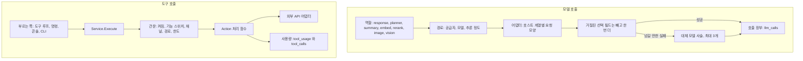

# 공급자, 도구, 언어

> **한 줄 요약**: 모델은 역할별로 고르고 호스트 계열별 어댑터가 보낸다. 도구는 등록부 한 곳에 선언하고 모든 호출이 같은 관문을 지난다. 봇의 말은 언어팩에, 화면과 명령 문구는 로케일에 있다.

**3분 요약**

- **역할**: 답변, 플래너, 요약, 임베딩, 재순위는 필수 어휘이고 그림과 사진 이해는 선택이다. 역할마다 공급자·모델·추론 정도를 따로 정한다.
- **호스트 계열**: OpenRouter, OpenAI, Gemini, Anthropic, 그 밖의 OpenAI 호환. 계열마다 받는 필드와 가격 계산이 다르다. Anthropic은 네이티브 Messages API를 쓴다.
- **실패하면**: 대화하는 역할은 대체 모델(최대 3개)로 넘어간다. 계속 실패하는 모델은 잠깐 건너뛴다. 예산 문제나 잘못 만든 요청은 넘기지 않는다.
- **예산**: 월 예산, 답 하나의 예산과 외부 호출 수, 공급자별 일일 한도, 도구별 한도, 기억 쪽 전용 예산이 각각 있다.
- **도구**: `internal/tools`의 `Builtins()`에 선언한다. 대화·명령·콘솔·CLI 어디서 부르든 `Service.Execute` 안의 같은 관문(`gateTool`)을 지난다.
- **언어**: 프롬프트·규칙·낱말은 `internal/lang/packs`, Discord와 콘솔 문구는 `locales/`. 다섯 언어가 들어 있고 한국어 프롬프트는 골든으로 고정한다.

## 모델 호출과 도구 호출의 길

## 자세히

<b>모델 역할</b>

코드: [`internal/config/document.go`](../../internal/config/document.go) `ModelRoles`, `ProductModelRoles`; 턴에서의 연결은 [`internal/application/chat_input.go`](../../internal/application/chat_input.go) `chatRoutes`, `chatLLM`.

| 역할 | 하는 일 | 비고 |
|---|---|---|
| `response` | 마지막에 말하는 답변 | 페르소나를 입는다 |
| `planner` | 기억이 필요한지·시간·사람을 정한다. 도구 루프와 작은 분류기(이름 부름, 가리킴, 명시 기억)도 기본으로 이 모델을 쓴다 | `chat.tool_model: response`면 도구 루프를 답변 모델로 돌린다 |
| `summary` | leaf 요약, 에피소드 추출, 방 상태, 방 말투 | 백그라운드 |
| `embed` | leaf·메시지·질의 벡터 | 폭은 `models.embed.dimensions` |
| `rerank` | 검색 후보 재순위(R2) | 없으면 R0로 답한다 |
| `image` | `images.generate`의 그림 모델 | 선택. 없으면 "설정 안 됨"으로 안내 |
| `vision` | 붙인 사진을 글로 설명 | 선택. 없으면 플래너, 그다음 답변 모델이 사진을 읽는다 |

- 역할 이름은 샌드박스와 같은 어휘다(`contracts/sandbox/tool-parity.json`).
- **추론 정도**는 대화 역할과 대체 모델 항목마다 정할 수 있다(none부터 max). 모델이 받지 않는 단계는 보내기 전에 가장 가까운 단계로 바꾼다. 빠른 판정(이름 부름 등)은 추론 없이 부른다.
- **추천**: `models.recommend`가 호스트의 모델 목록·가격·추천 규칙으로 역할별 후보를 제안한다. 이미 색인이 있을 때 임베딩 모델을 바꾸는 추천은 따로 확인을 받는다.

<b>호스트 계열과 어댑터</b>

코드: [`internal/providers/openai/api.go`](../../internal/providers/openai/api.go)(계열), [`openai.go`](../../internal/providers/openai/openai.go)(`Adapter`), [`anthropic.go`](../../internal/providers/openai/anthropic.go), [`shape.go`](../../internal/providers/openai/shape.go), [`hosts.json`](../../internal/providers/openai/hosts.json), [`hosts.go`](../../internal/providers/openai/hosts.go).

| 계열 | 내장 프리셋 | 다른 점 |
|---|---|---|
| `openrouter` | OpenRouter | 여러 업스트림을 중계한다. 캐시 지점은 일부 모델 계열에만 보낸다 |
| `openai` | OpenAI | 표준 형식 |
| `gemini` | Gemini | 그림은 네이티브 `generateContent`로만 |
| `anthropic` | Anthropic | 네이티브 Messages API: 적응형 사고, 서명된 사고 블록, 캐시·사고 토큰을 포함한 집계 |
| `compatible` | 그 밖의 OpenAI 호환 호스트 | 배치·재순위가 없을 수 있다 |

- 계열은 설정(`providers.<id>.api`)으로 정하거나 호스트 주소로 알아낸다. Anthropic 형식을 쓰는 호스트는 사용자 지정 공급자로 추가할 수 있다.
- **`hosts.json`이 데이터다.** 프리셋(주소, 키 발급 주소, 캐시 지점·쓰기 배수, 배치 지원), 공개 가격, 참조 가격, 역할 추천 규칙, 임베딩 모델별 줄일 수 있는 폭(MRL 목록)이 들어 있다. 새 공급자는 콘솔 코드가 아니라 여기에 넣는다.
- **거절된 필드 배우기**: 호스트가 선택 필드(온도, 병렬 도구 호출, 추론 정도 등)를 거절하면 그 필드를 빼고 한 번 다시 보낸다. 거절은 공급자·모델별로 한 시간 기억하고, 공급자를 고치거나 키를 바꾸거나 테스트하면 잊는다.
- **가격은 API가 먼저다.** 호스트의 모델 목록 → 운영자가 넣은 가격 → 내장 표 순으로 쓴다. 가격을 모르는 대체 모델은 알림에 이름이 나온다.
- **배치**: OpenAI, OpenRouter, Anthropic, Gemini, NanoGPT 형식을 지원한다([`batch.go`](../../internal/providers/openai/batch.go)). 기억 블록 준비와 사람 기억 백필이 쓴다.
- **연습 모드**: [`internal/providers/practice`](../../internal/providers/practice)는 오프라인 모의 모델이다. 콘솔의 연습 인스턴스가 실제 키 없이 돈다.

<b>대체 모델과 차단기</b>

코드: [`internal/providers/openai/failover.go`](../../internal/providers/openai/failover.go) `Failover`, `Fallback`, `failoverWorthy`; 실패 분류는 [`internal/errclass`](../../internal/errclass).

대화하는 역할(답변, 플래너, 요약, 사진 이해)의 모델은 대체 모델을 최대 3개 가질 수 있다(`models.<역할>.fallbacks`). 각 항목은 다른 키, 다른 호스트, 다른 모델일 수 있고 추론 정도를 따로 정할 수 있다. 임베딩은 일부러 뺐다. 다른 모델의 벡터는 저장된 벡터와 맞지 않기 때문이다. 재순위와 그림에는 대체 경로가 없다.

| 다음 모델로 넘어가는 실패 | 넘어가지 않는 실패 |
|---|---|
| 제한 시간 안에 답 없음, 네트워크 오류 | 호스트가 잘못됐다고 한 요청(우리가 고칠 것이고 어디서나 거절된다) |
| 429, 5xx | 프롬프트가 너무 김(호출하는 쪽이 줄여서 다시 묻는다) |
| 키 거절, 잔액 없음, 모르는 모델 | 모델에 없는 기능(사진·도구는 호출하는 쪽에 자기 경로가 있다) |
| 빈 답, 읽히지 않는 답 | 우리 쪽 취소 |

- **차단기**: 계속 실패하는 모델은 한동안 건너뛴다. 턴마다 그 모델의 제한 시간을 다 기다리지 않게 하려는 것이다. 목록의 마지막 모델은 항상 묻는다.
- **"한 번만" 요청**: 돈이 드는 일회성 요청(예: 한 줄짜리 사람 기억 추출)은 출력 한도에서 잘린 빈 답도 그 요청의 답으로 본다. 대체 모델로 다시 보내지 않는다. 호스트 오류는 넘긴다.
- 넘어간 호출도 장부(`llm_calls`)와 턴 기록에 남는다.
- **재시도**: HTTP 계층은 지수 간격에 무작위 흔들림을 쓰고 `Retry-After`를 따른다([`internal/providers/client.go`](../../internal/providers/client.go)). 예산 문제(402·403)는 재시도하지 않는다.

<b>예산과 한도</b>: 어디서 막나

| 한도 | 설정 | 넘으면 | 코드 |
|---|---|---|---|
| 월 예산 | `limits.monthly_budget_usd` | 답하지 않고 안내한다 | [`chat_input.go`](../../internal/application/chat_input.go) `chatGate` |
| 답 하나의 예산 | `limits.per_request_budget_usd` | 남은 도구와 기억 검색을 건너뛴다. 답은 한다 | [`internal/chat/guard.go`](../../internal/chat/guard.go) |
| 답 하나의 외부 호출 수 | `limits.max_external_attempts` | 위와 같다 | 같은 곳 |
| 동시에 도는 턴 | `limits.max_concurrent_turns` | 차례를 기다린다 | [`turns.go`](../../internal/application/turns.go) |
| 공급자 일일 한도 | `providers.<id>.daily_limit` | 그 공급자를 그날 부르지 않는다 | [`internal/providers/quota.go`](../../internal/providers/quota.go) |
| 도구 한도 | `tools.<id>.limits`(사람·채널·전체, 하루) | 그 호출을 거절한다 | [`internal/tools/usage.go`](../../internal/tools/usage.go) |
| DM 한도 | `dm.per_user_per_day`, `dm.per_day` | DM에 안내 한 번 | [`dm.go`](../../internal/application/dm.go) |
| 색인 예산 | `memory.index_budget_usd`(회차당) | 새 유료 호출을 시작하지 않는다 | [`internal/memory/engine/indexing.go`](../../internal/memory/engine/indexing.go) |
| 방 기억 예산 | `memory.derived_budget_usd`(월) | 방 상태부터 멈추고, 다 쓰면 추출도 멈춘다 | [`episodes.go`](../../internal/application/episodes.go) `derivedAllows` |
| 백필 한도 | 서버별 합계 | 다음 묶음을 보내지 않는다 | [`internal/memory/peoplebackfill/cost.go`](../../internal/memory/peoplebackfill/cost.go) `CanSubmit` |

- **돈이 드는 도구는 최대 비용을 미리 잡아 둔다.** 웹 검색은 깊이와 서비스 순서에 따른 최대 수수료를 잡고 시작하고, 끝난 뒤 실제 값으로 정산한다. 보내지지 않은 요청(자리를 기다리다 시간 초과)은 청구하지 않고, 답을 잃은 요청은 청구된 것으로 센다.
- 월 예산은 느슨한 상한이다. 동시에 진행 중인 호출 때문에 조금 넘을 수 있다.
- 사용량과 비용은 콘솔의 비용·한도 화면과 `usage.period` Action에서 본다.

<b>도구 등록부</b>

코드: [`internal/tools/tools.go`](../../internal/tools/tools.go) `Builtins`, `Builtin`; 관문 [`internal/application/tools.go`](../../internal/application/tools.go) `gateTool`; 규칙 [`tools_rules.go`](../../internal/application/tools_rules.go).

도구는 "모델이 부를 수 있는 Action"이다. 내장 도구는 `Builtins()`에 한 줄씩 선언한다.

| 묶음 | 도구 |
|---|---|
| 기억 | `memory.search` |
| 조회 | `weather.query`, `disasters.query`, `finance.quote`, `finance.fx`, `search.web`, `places.search`, `web.read` |
| 만들기 | `images.generate`, `polls.create`, `reminders.propose`, `reminders.update` |
| 방 | `activity.ranking`, `summaries.channel`, `help.version` |
| 개인 기능 | `fortune.query`, `fortune.subscribe`, `notices.status`, `notices.subscribe`, `transfer.recent` |
| 내부 | `polls.vote`, `polls.close`, `polls.result`, `chat.respond`(답변 자체. 여기에 한도를 걸면 답 횟수가 제한된다) |

선언에 들어가는 것: 대화·명령에서 기본으로 쓰는지, 필요한 입력, 쓰는 공급자, 쓰기 도구인지, 한 번만 부르는지, 함께 돌 수 있는지, 한 라운드로 끝나는지, 운영자가 켜야 하는지(`OptIn`), 웹 내용을 읽는지, 최대 수수료.

**관문의 순서**: 켜짐 → 기능 스위치 → 채널 스위치 → 호출 경로(대화인가 명령인가) → 누가 묻는지 → 사용량 한도 → 기본 입력 채우기. 누가 부르든 같은 순서다. 호출자 정보는 프로세스 안에서만 붙고 HTTP 요청으로는 들어올 수 없다.

- **준비 상태는 서버가 정한다.** 키가 있는지, 역할 모델이 있는지를 `tools.list`가 판단해 돌려주고 콘솔은 보여 주기만 한다.
- **키 없는 도구도 플래너에게 보인다.** "설정 안 됨"이라는 결과가 지어낸 답을 막기 때문이다.
- **운영자가 켜야 하는 도구**: `web.read`는 메시지 속 링크가 외부 서비스로 나가므로 기본 꺼짐이다.
- **웹 내용을 읽은 뒤에는 쓰기 도구를 막는다.** 웹 페이지의 글이 봇에게 무언가를 만들게 하지 못한다.
- **HTTP 사용자 도구**: 설정 `tools.<id>.http`로 코드 없이 도구를 붙인다. 카탈로그에 없는 Action으로 실행되고, 같은 관문을 지난다. 헤더나 URL에 키를 직접 쓰면 거절한다(참조만 받는다). 내부망 주소는 거부한다.
- **새 도구를 더할 때**: `Builtins()`에 한 줄, 언어팩에 설명, 카탈로그에 Action, 그리고 콘솔 흐름. 생성된 [도구 색인](../code-map/tools.md)이 맞는지는 테스트가 확인한다.

운영 방법(켜고 끄기, 한도, 채널별 설정, HTTP 도구 예시)은 [도구 설정과 언어](../tools-and-languages.md)에 있다.

<b>웹 검색과 페이지 읽기</b>

코드: [`internal/providers/websearch`](../../internal/providers/websearch) — 서비스별 파일과 [`websearch.go`](../../internal/providers/websearch/websearch.go)(공통 모양, 깊이·주제 표), [`fees.go`](../../internal/providers/websearch/fees.go)(가격), [`merge.go`](../../internal/providers/websearch/merge.go)(결과 합치기), [`reader.go`](../../internal/providers/websearch/reader.go)·[`fetch.go`](../../internal/providers/websearch/fetch.go)(페이지 읽기).

- **서비스 순서**: 키가 있는 서비스를 `web_search.order` 순서대로 쓴다. 실패하면 다음 서비스로 간다.
- **깊이**(quick·standard·deep)와 **주제**(news·research)를 서비스마다 그 서비스의 옵션으로 옮긴다. 서비스 하나로 고정하지 않는다.
- **깊이는 모델이 정한다.** 가벼운 질문은 빠르게, 모아 보기나 비교를 청하면 깊게.
- **페이지 읽기**: 깊은 검색은 상위 결과의 본문을 읽어 요약문만이 아니라 본문으로 답한다. 예약 작업의 검색은 페이지를 읽지 않는다.
- **시간 제한**: 서비스마다 깊이별 제한이 있다. 멈춘 서비스 하나가 턴 전체를 붙잡지 않는다.
- **검색어 정리**: 봇 이름과 호출말은 검색어에서 뺀다. 같은 사이트의 같은 글은 하나로 합친다.
- **읽을 수 있는 주소**: 공개 주소만 읽는다. 내부망·짧은 숫자 호스트는 거부한다.

<b>그 밖의 외부 API</b>

| 어댑터 | 서비스 | 도구 | 주의 |
|---|---|---|---|
| [`providers/kma`](../../internal/providers/kma) | 기상청 | 날씨, 특보, 지진, 재난 알림 | 한국 날씨는 기상청, 키가 없거나 실패하면 Open-Meteo |
| [`providers/openmeteo`](../../internal/providers/openmeteo) | Open-Meteo | 날씨 | 키 없이 동작 |
| [`providers/finnhub`](../../internal/providers/finnhub) | Finnhub | 시세 | 요금제에 없는 종목은 웹 검색으로 답하고 출처를 표시 |
| [`providers/fx`](../../internal/providers/fx) | ExchangeRate-API | 환율 | 집 통화는 요청 언어의 지역에서 정한다 |
| [`providers/kakao`](../../internal/providers/kakao) | 카카오 | 장소 검색, 웹 검색 | 초과는 HTTP 400으로 온다 |

- 응답 모양 분류는 [`providers/decode`](../../internal/providers/decode)가 공통으로 한다.
- 서비스별 호출 제한과 권장 병렬 수는 [유지보수 가이드 §7](../MAINTAINING.md), 약관 요약은 [라이선스 점검](../license-audit.md)에 있다.
- 한국 전용 기능(기상청 특보, 학교 공지 등)은 한국 밖에서는 기본 꺼짐이고 모든 언어에서 그렇게 표시한다.

<b>언어팩과 로케일</b>

코드: [`internal/lang/lang.go`](../../internal/lang/lang.go) `For`, `MergeSearch`; 팩은 [`internal/lang/packs`](../../internal/lang/packs); 화면 문구는 [`locales`](../../locales)와 [`internal/i18n`](../../internal/i18n); 콘솔 원본은 [`internal/transport/web/ui/scripts/strings.py`](../../internal/transport/web/ui/scripts/strings.py).

| 무엇 | 어디 | 담는 것 |
|---|---|---|
| 언어팩 | `internal/lang/packs/<태그>.json` | 봇이 모델에게 하는 모든 말: 플래너·답변·도구 정책 프롬프트, 기억 규칙, 요약·추출 프롬프트, 조사·대명사·불용어, 멈춤 말·기억 단서·자기 요청 문장 |
| 운영·Discord 문구 | `locales/<태그>.json` | 명령 이름과 설명, 결과 카드, 거절·실패 메시지 |
| 콘솔 문구 | `locales/ui/<태그>.json` | 관리 콘솔. 한국어·영어는 `strings.py`에서 생성하고 다른 언어는 JSON으로 유지 |

- 들어 있는 언어: 한국어, 영어, 일본어, 중국어(간체), 스페인어.
- **답하는 언어**: 방 말투의 언어가 기본이고(채널 페르소나 → 서버 → 인스턴스 기본), 턴마다 메시지에서 감지한 언어와 요청의 로케일을 먼저 본다(`lang.For`).
- **기억 언어**: `memory.languages`가 토크나이저·조사·요약 프롬프트를 정한다. 여러 개면 합친다. 어휘 색인은 올릴 때마다 다시 만들므로 바꿔도 재임베딩이 필요 없다.
- **판단의 순서**: 구조 신호(답장, 멘션, 작성자, 시간) → 언어팩 프롬프트를 쓰는 작은 분류 모델 → 언어팩의 단어 목록(보조). 코드에 언어별 낱말을 쓰지 않는다.
- **한국어 골든**: 한국어 플래너·문맥·기억·보안·색인 요약 프롬프트는 바이트 단위로 비교한다([`internal/chat/testdata`](../../internal/chat/testdata), [`internal/memory/search/testdata`](../../internal/memory/search/testdata)). 고치면 샌드박스도 고치고 골든을 다시 만든다.
- **문서도 검사한다**: `make docs`는 그 페이지의 언어로 Discord가 보여 주는 명령 이름이 아니면 거절한다(한국어 페이지는 `/날씨`).
- **새 언어 추가**: 세 파일(언어팩, 운영 문구, 콘솔 문구)이 서로 다른 번역 대상이다. 절차는 [도구 설정과 언어 §6](../tools-and-languages.md)과 위키 [언어 설정](../wiki/언어-설정.md)에 있다.

<b>비밀값</b>

- 키는 값이 아니라 **참조**로 다룬다: `keychain:`(macOS 키체인, Windows 자격 증명 관리자), `file:`(데이터 폴더의 소유자 전용 파일), `env:`([`internal/secrets`](../../internal/secrets)).
- Action 입력으로 비밀값을 받지 않는다. 콘솔이 입력받은 키는 별도 경로(`/api/secret`)로 저장하고 Action에는 참조만 넘긴다.
- 값은 응답, 로그, 변경 기록, 설정 내보내기에 남지 않는다. 실시간 로그와 공급자 오류에서도 가린다([`internal/observability`](../../internal/observability)).

---

기준: v1.7.1(2026-11-24). 관련 결정: [F-1 역할과 호스트 계열](decisions.md#f-1), [F-2 대체 모델](decisions.md#f-2), [F-3 도구 등록부](decisions.md#f-3), [F-4 언어팩과 로케일](decisions.md#f-4), [E-9 검색 깊이](decisions.md#e-9). 설정 키는 위키 [설정 레퍼런스](../wiki/설정-레퍼런스.md)와 [도구와 한도](../wiki/도구와-한도.md).
