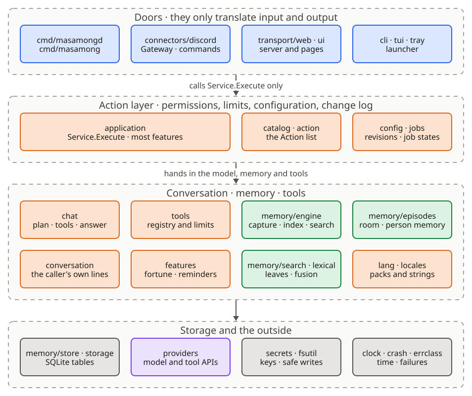

[한국어](system.md) | **English**

# Components and boundaries

> **In one line**: one daemon runs Discord, the console and the background work, and inside it the code only looks down: doors → Action layer → conversation, memory and tools → storage and providers.

**In three minutes**

- **Processes**: `masamongd` (the daemon) stays on, a supervisor restarts it when it dies, and `masamong` (CLI, launcher, tray) runs when you need it.
- **Doors**: the Discord Gateway (`internal/connectors/discord`), the console server (`internal/transport/web`) and the CLI (`internal/cli`). All three call `application.Service.Execute`.
- **The middle**: `internal/application` owns permissions, limits, configuration and the change log. Below it sit one turn of conversation (`internal/chat`), memory (`internal/memory`) and tools (`internal/tools`).
- **The floor**: SQLite (`internal/storage`), adapters for outside APIs (`internal/providers`) and key references (`internal/secrets`).
- **The direction rule**: a lower layer never imports a higher one. Tests pin which packages import `application` and which packages it imports.
- **Data**: one data folder holds the database, the configuration, backups, logs and key files. One data folder has one daemon.

## Package layers

<picture><source media="(prefers-color-scheme: dark)" srcset="diagrams/layers.en-dark.svg"></picture>

Diagram source: [diagrams/layers.en.d2](diagrams/layers.en.d2)

An arrow means "imports", and only the arrows between layers are drawn. `application` also uses the bottom layer (storage, providers) directly. `chat` does not know `application`: `application` hands it the model calls, memory and tool execution as interfaces (`chat.LLM`, `chat.Memory`, `chat.ToolRunner`).

## In detail

<b>Processes</b>: what is running

| Process | Executable | What it does | Code |
|---|---|---|---|
| Daemon | `masamongd` | Runs the Discord Gateway, the console server, the scheduler, the memory worker and SQLite in one process | [`cmd/masamongd/main.go`](../../cmd/masamongd/main.go) `run` |
| Supervisor | `masamongd --supervise` | Starts the daemon as a child and starts it again, at growing intervals, when it ends with a non-zero code | [`cmd/masamongd/supervise.go`](../../cmd/masamongd/supervise.go) `runSupervisor` |
| CLI and launcher | `masamong` | Finds a running daemon or starts one, opens the browser, runs Action commands | [`internal/cli/run.go`](../../internal/cli/run.go) `Run`, [`internal/launcher/launcher.go`](../../internal/launcher/launcher.go) |
| Tray | the tray mode of `masamong` | The menu bar or notification area icon: shows the state, opens the console, stops the service | [`internal/tray`](../../internal/tray) |
| Browser | (the operator's browser) | Loads the Svelte console built into the executable from `127.0.0.1` | [`internal/transport/web/spa.go`](../../internal/transport/web/spa.go) |

- **One daemon per data folder.** `daemon.lock` enforces it, and the console's address is written to `daemon.json`.
- **Two paths for the CLI**: while a daemon runs (the lock is held), the CLI sends the Action to the console server's API (`daemonCommand`). When no daemon runs, it takes the same lock, opens the data folder itself and runs the Action. Two processes never open the same database at once.
- **Maintenance mode**: when an interrupted restore, reset or update cannot be finished at start, the database stays closed and a small loopback page shows only the recovery guide (`runMaintenance`). The offline recovery commands are `masamongd --maintenance status|doctor|retry|rollback|cancel|abandon-update`.
- On a Linux server the systemd unit runs the daemon directly, without the supervisor (`Restart=on-failure`).

<b>Start and stop order</b>

Start ([`cmd/masamongd/main.go`](../../cmd/masamongd/main.go) `main`, `run`):

1. Pick the host performance tier and the automatic memory limit (`internal/hostprofile`, `internal/memlimit`). This comes before the database opens, because the read pool and the page cache are sized from it.
2. Take the data folder lock.
3. Finish what a program update left behind and any interrupted restore or reset (`application.CleanUpdateLeftovers`, `application.RecoverMaintenance`). If that fails, enter maintenance mode.
4. Open the service with `application.OpenLogged`. On the first start of a new version, make a backup (`BackupOnUpgrade`).
5. Resume stopped jobs (`ResumeJobs`) and start the memory worker and the scheduler (`RunMemoryWorker`, `RunScheduler`).
6. If Discord is enabled, start the Gateway. Without a token the console and the CLI still work.
7. Once the console server listens, write `daemon.json`.

Stop: no new requests are taken, and replies in progress get 12 more seconds to finish. Then jobs and indexing stop and the database closes. Tests pin the closing order (`TestCloseOrder…`). A restart the operator asked for is brought back on the same address by the supervisor.

<b>Package table</b>: where to make a change

**Doors**

| Path | Role |
|---|---|
| [`cmd/masamongd`](../../cmd/masamongd) | Daemon entry point, the supervisor, maintenance mode |
| [`cmd/masamong`](../../cmd/masamong) | CLI and launcher entry point |
| [`internal/connectors/discord`](../../internal/connectors/discord) | Gateway, receiving and merging messages, commands, sending and rendering replies, threads, the edit and delete reconciliation queue, a local simulator |
| [`internal/transport/web`](../../internal/transport/web) | Loopback HTTP server, sessions and tokens, `/api/action`, `/lite`, the embedded console |
| [`internal/transport/web/ui`](../../internal/transport/web/ui) | The Svelte console's source and its committed build output (`dist`) |
| [`internal/cli`](../../internal/cli), [`internal/tui`](../../internal/tui), [`internal/tray`](../../internal/tray), [`internal/launcher`](../../internal/launcher) | Command parsing, terminal output, the tray icon, finding and starting the daemon, start at login |

**Action layer**

| Path | Role |
|---|---|
| [`internal/application`](../../internal/application) | Most features live here: `Service.Execute`, the Action handler table ([`dispatch.go`](../../internal/application/dispatch.go)), assembling a chat turn, wiring memory, the scheduler, backup, restore, reset and update, alerts, statistics |
| [`internal/catalog`](../../internal/catalog), [`internal/action`](../../internal/action) | The list of Actions (ID, status, effect, CLI words, console route) and the request and result envelope |
| [`internal/config`](../../internal/config) | The configuration document (`config.yaml`), parsing and validation, compare-and-swap by revision |
| [`internal/jobs`](../../internal/jobs) | The state machine of long jobs (imports, preparation, reindexing) |

**Conversation, memory, tools**

| Path | Role |
|---|---|
| [`internal/chat`](../../internal/chat) | One turn: planner, tool loop, budget guard, room memory block, answer prompt |
| [`internal/conversation`](../../internal/conversation) | Picks the lines of a busy room that belong to the caller's conversation |
| [`internal/memory/corpus`](../../internal/memory/corpus) | The raw observation contract; reading KakaoTalk CSV and Discord messages |
| [`internal/memory/leaves`](../../internal/memory/leaves) | Cuts a room's messages into leaves by count and time gap |
| [`internal/memory/lexical`](../../internal/memory/lexical) | Per-language n-grams and an in-memory SQLite FTS5 index |
| [`internal/memory/search`](../../internal/memory/search) | Candidate sources, weighted RRF, scope checks, reranking, expanding to raw text |
| [`internal/memory/store`](../../internal/memory/store) | Storage of raw messages, leaves, vectors, summaries, episodes, person memory and the evidence index |
| [`internal/memory/engine`](../../internal/memory/engine) | Loading and swapping the index, capture, edits and deletes, query embeddings, batch preparation |
| [`internal/memory/episodes`](../../internal/memory/episodes) | Room memory (L1 room state, L2 episodes): segmenting, extracting, validating |
| [`internal/memory/peoplebackfill`](../../internal/memory/peoplebackfill) | The paid people backfill: building windows, picking the pilot, counting cost |
| [`internal/memory/blocks`](../../internal/memory/blocks), [`internal/memory/retrieval`](../../internal/memory/retrieval) | The memory block and attachment contract; the retrieval contract shared with the sandbox |
| [`internal/tools`](../../internal/tools) | The tool registry, switches, daily limits, operator-defined HTTP tools |
| [`internal/features`](../../internal/features) | Fortune calendar maths, notice collection, reading reminder times, poll rules, consent scopes, chime-in rules |
| [`internal/vision`](../../internal/vision) | Fetching and preparing pictures attached to a call |
| [`internal/lang`](../../internal/lang), [`locales`](../../locales), [`internal/i18n`](../../internal/i18n) | Language packs (prompts, rules, word lists), screen and command strings, message key lookup |

**Storage and the outside**

| Path | Role |
|---|---|
| [`internal/storage`](../../internal/storage) | Opening SQLite, the schema, events, the dump used by backups. The TiDB code is switched off by `TiDBEnabled = false` |
| [`internal/providers`](../../internal/providers) | The shared HTTP layer and call quotas. Below it: models (`openai`), web search (`websearch`), weather (`kma`, `openmeteo`), finance (`finnhub`, `fx`), places (`kakao`), the mock model of practice mode (`practice`) |
| [`internal/secrets`](../../internal/secrets) | Resolves `env:`, `file:` and `keychain:` references |
| [`internal/fsutil`](../../internal/fsutil) | Owner-only files; atomic, durable writes |
| [`internal/observability`](../../internal/observability), [`internal/logfile`](../../internal/logfile), [`internal/crash`](../../internal/crash) | Masking secrets, the rotating log, keeping one failed request from ending the daemon |
| [`internal/errclass`](../../internal/errclass), [`internal/errcode`](../../internal/errcode) | Failure classes and machine codes |
| [`internal/relnotes`](../../internal/relnotes) | The release notes built into the executable |
| [`internal/clock`](../../internal/clock), [`internal/hostprofile`](../../internal/hostprofile), [`internal/memlimit`](../../internal/memlimit) | The injected clock, the host performance tier, the automatic memory limit |

**Outside the product**

| Path | Role |
|---|---|
| [`experimental/rag-leaf-parent`](../../experimental/rag-leaf-parent) | The Python retrieval sandbox. It does not use the product database |
| [`contracts`](../../contracts) | The tool and block contracts the sandbox and Go both keep |
| [`tools`](../../tools) | The docs check (`doccheck`), the code map generator (`codemap`), the move check (`movecheck`), evaluation, load testing |
| [`release-notes`](../../release-notes) | Release notes per version (Markdown and JSON) |
| [`fixtures`](../../fixtures) | Synthetic test material |

<b>Layer rules</b>: who may import whom

- Only `cmd/masamongd`, `internal/cli`, `internal/connectors/discord`, `internal/transport/web`, `internal/tui` and two measuring tools import `internal/application`.
- The list of packages `internal/application` imports is fixed too. A new import is a design decision: it is added to the list in the same change, with the reason.
- If `application` ever gets subpackages, they may not reach back up into `application`, a connector or the web layer.
- `TestApplicationPackageEdgesArePinned` and `TestLayerRulesHoldInTheModule` in [`internal/application/layers_test.go`](../../internal/application/layers_test.go) check this. `testdata/exported_surface.golden` pins the exported names.
- `internal/application` is large (more than 140 Go files without tests). The guards for splitting it exist; the split itself is still to do ([decision H-5](decisions.en.md#h-5)).

<b>The data folder</b>: what is on disk

| Item | Contents |
|---|---|
| `masamong.db` (with `-wal`, `-shm`) | The product store: configuration revisions, raw messages, the index, turn records, usage and personal features ([data-model.en.md](data-model.en.md)) |
| `config.yaml` | The configuration document. Every change records a revision in the database |
| `storage.yaml` | Storage settings (for example another SQLite file location) |
| `daemon.lock`, `daemon.json` | The daemon lock and the console's address |
| `backups/` | Backups (a database snapshot and the configuration of that moment) |
| `logs/` | Rotating logs, `crash.json` |
| `secrets/` | Key files saved from the console (when no keychain is available) |
| `admin/`, `sessions.json` | The console sign-in token and sessions |
| `imports/`, `rag_staging/`, `images/`, `notices/`, `practice/` | Imported files, staging, pictures, the notice cache, practice mode |

The folder is owner-only (Unix 0700 with 0600 files, a protected ACL on Windows). What a reset deletes and keeps is in [STORAGE.md](../STORAGE.md) (Korean).

<b>Outside services</b>: what leaves the machine

| Caller | Service | For |
|---|---|---|
| `connectors/discord` | Discord | Receiving and sending messages, commands, buttons |
| `providers/openai` | Model hosts (OpenRouter, OpenAI, Gemini, Anthropic, other OpenAI-compatible hosts) | Planner, answer, summary, embedding, rerank, images, picture understanding |
| `providers/websearch` | Web search and page reading services | `search.web`, `web.read` |
| `providers/kma`, `providers/openmeteo` | Korea Meteorological Administration, Open-Meteo | Weather, warnings, earthquakes |
| `providers/finnhub`, `providers/fx` | Finnhub, ExchangeRate-API | Quotes, exchange rates |
| `providers/kakao` | Kakao | Place search |
| `application/updates.go` | GitHub Releases | Update check and download |

Holding a raw message does not mean consent to send it to an outside model. Room settings and consent scopes decide what is sent ([raw data policy](../RAW_DATA_POLICY.md), Korean). Statistics are never sent anywhere.

<b>Background work</b>: when nobody is talking

The daemon starts two goroutines. A failed pass is logged and the next one runs on schedule.

**Scheduler, every minute** ([`internal/application/schedule.go`](../../internal/application/schedule.go) `RunScheduler`)

- Automatic backups and pruning old ones
- Sending reminders and scheduled tasks
- Morning fortune briefings
- Checking earthquakes and weather warnings, school and transfer notices
- Closing bot threads that went quiet, refreshing room style notes
- Pruning records past their retention (after statistics are finished)
- The update check, sending update news
- Operator alerts

**Memory worker, every `memory.index_interval_min`** ([`internal/application/memory_engine.go`](../../internal/application/memory_engine.go) `RunMemoryWorker`, `memoryPass`)

- At start, loads the index into memory.
- Re-cuts leaves only in rooms with new messages and embeds within the index budget.
- Then runs the room memory pass (`RunRoomMemory`): episode extraction, room state, person memory upkeep.

**Event worker**: durable work that carries deletions, edits and withdrawals down to derived records (see deletion reach in [memory.en.md](memory.en.md)).

Everything the service runs is registered with its lifetime (`beginWork`, `ownedGo`). On stop it takes no new work, waits for what it already took, then closes.

<b>Finding a feature</b>

| Feature | Start here |
|---|---|
| Taking one message to a reply | [`internal/connectors/discord/gateway.go`](../../internal/connectors/discord/gateway.go) `onMessage` → [`internal/application/chat_turn.go`](../../internal/application/chat_turn.go) `chatTurn` → [`internal/chat/runtime.go`](../../internal/chat/runtime.go) `Runtime.Answer` |
| The tool loop | [`internal/chat/toolloop.go`](../../internal/chat/toolloop.go), wired in [`internal/application/toolloop.go`](../../internal/application/toolloop.go) |
| The tool gate and limits | [`internal/application/tools.go`](../../internal/application/tools.go) `gateTool`, [`internal/tools/tools.go`](../../internal/tools/tools.go) `Builtins` |
| Memory search | [`internal/memory/engine/engine.go`](../../internal/memory/engine/engine.go) `Engine.Search` → [`internal/memory/search/retrieve.go`](../../internal/memory/search/retrieve.go) `Index.Retrieve` |
| Room memory | [`internal/application/episodes.go`](../../internal/application/episodes.go) `RunRoomMemory`, read in [`internal/application/roommemory_read.go`](../../internal/application/roommemory_read.go) |
| Person memory | [`internal/application/person_claims.go`](../../internal/application/person_claims.go) `savePersonClaims`, read in [`person_claims_read.go`](../../internal/application/person_claims_read.go), targets in [`person_targets.go`](../../internal/application/person_targets.go) |
| The people backfill | [`internal/application/people_backfill.go`](../../internal/application/people_backfill.go), [`people_backfill_run.go`](../../internal/application/people_backfill_run.go) |
| Deletes, edits, withdrawals | [`internal/application/privacy.go`](../../internal/application/privacy.go), [`evidence_index.go`](../../internal/application/evidence_index.go), [`internal/memory/store/privacy.go`](../../internal/memory/store/privacy.go) |
| Threads | [`internal/application/threads.go`](../../internal/application/threads.go), [`internal/connectors/discord/threads.go`](../../internal/connectors/discord/threads.go) |
| Chime-in and banter | [`internal/application/participation.go`](../../internal/application/participation.go) `Observe`, [`banter.go`](../../internal/application/banter.go) |
| Direct messages | [`internal/application/dm.go`](../../internal/application/dm.go), [`internal/connectors/discord/dm.go`](../../internal/connectors/discord/dm.go) |
| Reminders and scheduled tasks | [`internal/application/reminders.go`](../../internal/application/reminders.go), [`reminders_task.go`](../../internal/application/reminders_task.go) |
| Model calls and fallbacks | [`internal/application/chat_input.go`](../../internal/application/chat_input.go) `chatLLM`, [`internal/providers/openai/failover.go`](../../internal/providers/openai/failover.go) |
| Backup, restore, reset, update | [`internal/application/backup.go`](../../internal/application/backup.go), [`reset.go`](../../internal/application/reset.go), [`selfupdate.go`](../../internal/application/selfupdate.go), [`maintenance.go`](../../internal/application/maintenance.go) |
| Diagnosis | [`internal/application/doctor.go`](../../internal/application/doctor.go) |

The full index of Actions, Discord commands, chat tools and locale keys is the [generated code map](../code-map/README.md). A map that disagrees with the source fails `go test`, so it is always right.

---

As of v1.8.0 (2026-11-24). Related decisions: [B-1 rewriting in Go](decisions.en.md#b-1), [B-2 SQLite only](decisions.en.md#b-2), [G-1 every surface calls the same Action](decisions.en.md#g-1).
