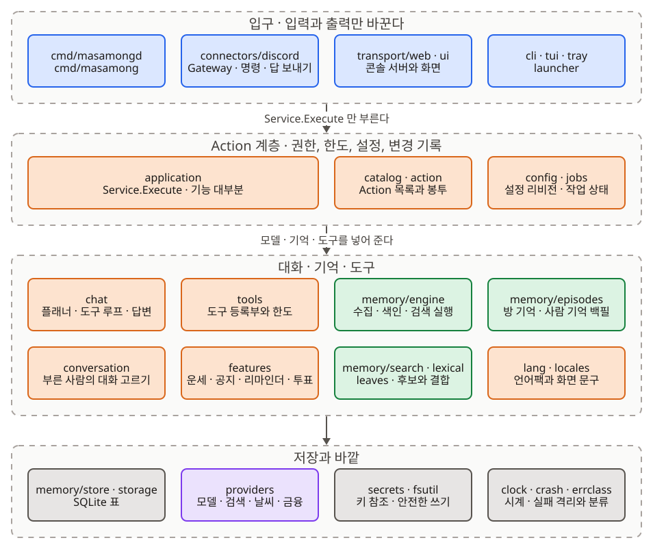

**한국어** | [English](system.en.md)

# 시스템 구성과 경계

> **한 줄 요약**: 데몬 하나가 Discord·콘솔·백그라운드 작업을 모두 맡고, 그 안에서는 "전송 → Action 계층 → 대화·기억·도구 → 저장·공급자" 순으로 아래만 본다.

**3분 요약**

- **프로세스**: 늘 켜진 `masamongd`(데몬) 하나와, 그것을 다시 켜 주는 감시 프로세스, 필요할 때 실행하는 `masamong`(CLI·런처·트레이)이 있다.
- **입구**: Discord Gateway(`internal/connectors/discord`), 콘솔 서버(`internal/transport/web`), CLI(`internal/cli`). 셋 다 `application.Service.Execute`를 부른다.
- **가운데**: `internal/application`이 권한·한도·설정·변경 기록을 맡는다. 그 아래에 대화 한 턴(`internal/chat`), 기억(`internal/memory`), 도구(`internal/tools`)가 있다.
- **바닥**: SQLite(`internal/storage`), 외부 API 어댑터(`internal/providers`), 비밀값 참조(`internal/secrets`).
- **방향 규칙**: 아래층은 위층을 가져오지 않는다. 어느 패키지가 `application`을 가져오고 `application`이 무엇을 가져오는지는 테스트가 고정한다.
- **데이터**: 데이터 폴더 하나에 DB, 설정, 백업, 로그, 키 파일이 모두 있다. 데이터 폴더당 데몬은 하나다.

## 패키지 층

<picture><source media="(prefers-color-scheme: dark)" srcset="diagrams/layers-dark.svg"></picture>

그림 원본: [diagrams/layers.d2](diagrams/layers.d2)

화살표는 "가져온다(import)"는 뜻이고 층 사이만 그렸다. `application`은 맨 아래 층(저장, 공급자)도 직접 쓴다. `chat`은 `application`을 모른다. `application`이 모델 호출·기억·도구 실행을 인터페이스(`chat.LLM`, `chat.Memory`, `chat.ToolRunner`)로 넣어 준다.

## 자세히

<b>프로세스</b>: 무엇이 떠 있나

| 프로세스 | 실행 파일 | 하는 일 | 코드 |
|---|---|---|---|
| 데몬 | `masamongd` | Discord Gateway, 콘솔 서버, 스케줄러, 기억 워커, SQLite를 한 프로세스에서 돌린다 | [`cmd/masamongd/main.go`](../../cmd/masamongd/main.go) `run` |
| 감시 프로세스 | `masamongd --supervise` | 데몬을 자식으로 띄우고, 0이 아닌 코드로 끝나면 간격을 늘려 가며 다시 켠다 | [`cmd/masamongd/supervise.go`](../../cmd/masamongd/supervise.go) `runSupervisor` |
| CLI·런처 | `masamong` | 데몬을 찾아 재사용하거나 시작하고, 브라우저를 열고, Action 명령을 실행한다 | [`internal/cli/run.go`](../../internal/cli/run.go) `Run`, [`internal/launcher/launcher.go`](../../internal/launcher/launcher.go) |
| 트레이 | `masamong`의 트레이 모드 | 메뉴 막대·알림 영역 아이콘. 상태를 보여 주고 열기·종료를 한다 | [`internal/tray`](../../internal/tray) |
| 브라우저 | (운영자의 브라우저) | 실행 파일에 들어 있는 Svelte 콘솔을 `127.0.0.1`에서 받아 쓴다 | [`internal/transport/web/spa.go`](../../internal/transport/web/spa.go) |

- **데이터 폴더당 데몬은 하나**다. `daemon.lock`이 지키고, 콘솔 주소는 `daemon.json`에 기록한다.
- **CLI의 두 경로**: 데몬이 돌고 있으면(잠금이 잡혀 있으면) CLI는 콘솔 서버의 API로 Action을 보낸다(`daemonCommand`). 데몬이 꺼져 있으면 같은 잠금을 잡고 데이터 폴더를 직접 열어 실행한다. 두 프로세스가 같은 DB를 동시에 여는 일은 없다.
- **유지보수 모드**: 끊긴 복원·초기화·업데이트를 시작할 때 마무리하지 못하면 DB를 열지 않고, 복구 안내만 보여 주는 작은 loopback 페이지를 띄운다(`runMaintenance`). 오프라인 복구 명령은 `masamongd --maintenance status|doctor|retry|rollback|cancel|abandon-update`다.
- Linux 서버의 systemd 유닛은 감시 프로세스 없이 데몬을 직접 돌린다(`Restart=on-failure`).

<b>시작과 종료 순서</b>

시작([`cmd/masamongd/main.go`](../../cmd/masamongd/main.go) `main`, `run`):

1. 기기 성능 단계와 자동 메모리 한도를 정한다(`internal/hostprofile`, `internal/memlimit`). DB를 열기 전에 해야 읽기 풀과 페이지 캐시 크기가 맞게 잡힌다.
2. 데이터 폴더 잠금을 잡는다.
3. 프로그램 교체 흔적과 끊긴 복원·초기화를 마무리한다(`application.CleanUpdateLeftovers`, `application.RecoverMaintenance`). 실패하면 유지보수 모드.
4. `application.OpenLogged`로 서비스를 연다. 새 버전의 첫 시작이면 백업을 만든다(`BackupOnUpgrade`).
5. 멈춘 작업을 이어 가고(`ResumeJobs`), 기억 워커와 스케줄러를 띄운다(`RunMemoryWorker`, `RunScheduler`).
6. Discord가 켜져 있으면 Gateway를 시작한다. 토큰이 없어도 콘솔과 CLI는 계속 동작한다.
7. 콘솔 서버가 듣기 시작하면 `daemon.json`을 쓴다.

종료: 새 요청을 받지 않고, 진행 중인 답은 12초 더 마무리한다. 그다음 작업·색인을 멈추고 DB를 닫는다. 닫는 순서는 테스트(`TestCloseOrder…`)가 고정한다. 운영자가 요청한 재시작은 감시 프로세스가 같은 주소로 다시 띄운다.

<b>패키지 표</b>: 어디를 고치면 되나

**입구**

| 경로 | 역할 |
|---|---|
| [`cmd/masamongd`](../../cmd/masamongd) | 데몬 진입점, 감시 프로세스, 유지보수 모드 |
| [`cmd/masamong`](../../cmd/masamong) | CLI·런처 진입점 |
| [`internal/connectors/discord`](../../internal/connectors/discord) | Gateway, 메시지 받기와 묶기, 명령, 답 보내기와 렌더링, 스레드, 수정·삭제 조정 큐, 로컬 시뮬레이터 |
| [`internal/transport/web`](../../internal/transport/web) | loopback HTTP 서버, 세션·토큰, `/api/action`, `/lite`, 내장 콘솔 |
| [`internal/transport/web/ui`](../../internal/transport/web/ui) | Svelte 콘솔 원본과 커밋된 빌드 결과(`dist`) |
| [`internal/cli`](../../internal/cli), [`internal/tui`](../../internal/tui), [`internal/tray`](../../internal/tray), [`internal/launcher`](../../internal/launcher) | 명령 해석, 터미널 출력, 트레이 아이콘, 데몬 찾기·시작·자동 시작 |

**Action 계층**

| 경로 | 역할 |
|---|---|
| [`internal/application`](../../internal/application) | 기능 대부분이 여기 있다. `Service.Execute`, Action 처리 함수 표([`dispatch.go`](../../internal/application/dispatch.go)), 대화 턴 조립, 기억 연결, 스케줄러, 백업·복원·초기화·업데이트, 알림, 통계 |
| [`internal/catalog`](../../internal/catalog), [`internal/action`](../../internal/action) | Action 목록(ID·상태·효과·CLI 문자열·콘솔 경로)과 요청·결과 봉투 |
| [`internal/config`](../../internal/config) | 설정 문서(`config.yaml`), 파싱과 검증, 리비전 비교 후 교체(CAS) |
| [`internal/jobs`](../../internal/jobs) | 오래 걸리는 작업의 상태 기계(가져오기, 준비, 재색인) |

**대화·기억·도구**

| 경로 | 역할 |
|---|---|
| [`internal/chat`](../../internal/chat) | 답 한 턴: 플래너, 도구 루프, 예산 가드, 방 기억 블록, 답변 프롬프트 |
| [`internal/conversation`](../../internal/conversation) | 바쁜 방에서 부른 사람의 대화에 속하는 줄만 고른다 |
| [`internal/memory/corpus`](../../internal/memory/corpus) | 원문 관찰 계약, 카카오 CSV와 Discord 메시지 읽기 |
| [`internal/memory/leaves`](../../internal/memory/leaves) | 방 안에서 메시지 수·시간 공백으로 leaf 분할 |
| [`internal/memory/lexical`](../../internal/memory/lexical) | 언어별 n-gram과 메모리 안 SQLite FTS5 |
| [`internal/memory/search`](../../internal/memory/search) | 후보원, 가중 RRF, 범위 검사, 재순위, 원문 확장 |
| [`internal/memory/store`](../../internal/memory/store) | 원문·leaf·벡터·요약·에피소드·사람 기억·근거 색인의 저장 |
| [`internal/memory/engine`](../../internal/memory/engine) | 색인 적재와 교체, 수집·수정·삭제, 질의 임베딩, 배치 준비 |
| [`internal/memory/episodes`](../../internal/memory/episodes) | 방 기억(L1 방 상태, L2 에피소드) 구간 나누기·추출·검증 |
| [`internal/memory/peoplebackfill`](../../internal/memory/peoplebackfill) | 사람 기억 유료 백필의 창 만들기, 시범 고르기, 비용 계산 |
| [`internal/memory/blocks`](../../internal/memory/blocks), [`internal/memory/retrieval`](../../internal/memory/retrieval) | 기억 블록·연결 계약, 샌드박스와 공유하는 검색 계약 |
| [`internal/tools`](../../internal/tools) | 도구 등록부, 켜기·끄기, 하루 한도, HTTP 사용자 도구 |
| [`internal/features`](../../internal/features) | 운세 달력 계산, 공지 수집, 리마인더 시간 읽기, 투표 규칙, 동의 범위, 끼어들기 규칙 |
| [`internal/vision`](../../internal/vision) | 봇을 부를 때 붙인 사진 가져오기와 준비 |
| [`internal/lang`](../../internal/lang), [`locales`](../../locales), [`internal/i18n`](../../internal/i18n) | 언어팩(프롬프트·규칙·낱말), 화면·명령 문구, 메시지 키 해석 |

**저장과 바깥**

| 경로 | 역할 |
|---|---|
| [`internal/storage`](../../internal/storage) | SQLite 열기, 스키마, 이벤트, 백업용 dump. TiDB 코드는 `TiDBEnabled = false`로 꺼져 있다 |
| [`internal/providers`](../../internal/providers) | 공통 HTTP 계층과 호출 한도. 하위에 모델(`openai`), 웹 검색(`websearch`), 날씨(`kma`, `openmeteo`), 금융(`finnhub`, `fx`), 장소(`kakao`), 연습 모드 모의 모델(`practice`) |
| [`internal/secrets`](../../internal/secrets) | `env:`·`file:`·`keychain:` 참조 해석 |
| [`internal/fsutil`](../../internal/fsutil) | 소유자 전용 파일, 원자적이고 내구성 있는 쓰기 |
| [`internal/observability`](../../internal/observability), [`internal/logfile`](../../internal/logfile), [`internal/crash`](../../internal/crash) | 비밀값 가리기, 회전 로그, 한 요청의 실패가 데몬을 죽이지 않게 하기 |
| [`internal/errclass`](../../internal/errclass), [`internal/errcode`](../../internal/errcode) | 실패 분류와 기계용 코드 |
| [`internal/relnotes`](../../internal/relnotes) | 실행 파일에 넣은 릴리스 노트 |
| [`internal/clock`](../../internal/clock), [`internal/hostprofile`](../../internal/hostprofile), [`internal/memlimit`](../../internal/memlimit) | 주입하는 시계, 기기 성능 단계, 자동 메모리 한도 |

**제품 밖**

| 경로 | 역할 |
|---|---|
| [`experimental/rag-leaf-parent`](../../experimental/rag-leaf-parent) | Python 검색 샌드박스. 제품 DB를 쓰지 않는다 |
| [`contracts`](../../contracts) | 샌드박스와 Go가 함께 지키는 도구·블록 계약 |
| [`tools`](../../tools) | 문서 검사(`doccheck`), 코드 지도 생성(`codemap`), 이동 검사(`movecheck`), 평가, 부하 테스트 |
| [`release-notes`](../../release-notes) | 버전별 릴리스 노트(Markdown과 JSON) |
| [`fixtures`](../../fixtures) | 합성 테스트 자료 |

<b>층 규칙</b>: 누가 누구를 가져올 수 있나

- `internal/application`을 가져오는 패키지는 `cmd/masamongd`, `internal/cli`, `internal/connectors/discord`, `internal/transport/web`, `internal/tui`와 측정 도구 둘뿐이다.
- `internal/application`이 가져오는 패키지 목록도 고정돼 있다. 새 import는 설계 결정이고, 같은 변경에서 목록에 추가하며 이유를 적는다.
- `application`의 하위 패키지가 생기더라도 `application`, 커넥터, 웹 계층을 거꾸로 가져올 수 없다.
- 이 규칙은 [`internal/application/layers_test.go`](../../internal/application/layers_test.go)의 `TestApplicationPackageEdgesArePinned`, `TestLayerRulesHoldInTheModule`이 확인한다. 밖으로 보이는 이름은 `testdata/exported_surface.golden`이 고정한다.
- `internal/application`은 크다(테스트를 뺀 Go 파일이 140개가 넘는다). 나누기 위한 가드는 있고 실제 분리는 남은 일이다([결정 H-5](decisions.md#h-5)).

<b>데이터 폴더</b>: 디스크에 무엇이 있나

| 항목 | 내용 |
|---|---|
| `masamong.db`(와 `-wal`, `-shm`) | 제품 저장소. 설정 리비전, 원문, 색인, 대화 기록, 사용량, 개인 기능이 모두 여기 있다([data-model.md](data-model.md)) |
| `config.yaml` | 설정 문서. 바꿀 때마다 리비전이 DB에 기록된다 |
| `storage.yaml` | 저장소 설정(다른 SQLite 파일 위치 등) |
| `daemon.lock`, `daemon.json` | 데몬 잠금과 콘솔 주소 |
| `backups/` | 백업(DB 스냅샷과 그 시점의 설정) |
| `logs/` | 회전 로그, `crash.json` |
| `secrets/` | 콘솔에서 저장한 키 파일(키체인을 쓸 수 없을 때) |
| `admin/`, `sessions.json` | 콘솔 로그인 토큰과 세션 |
| `imports/`, `rag_staging/`, `images/`, `notices/`, `practice/` | 가져온 파일, 준비 중 자료, 그림, 공지 캐시, 연습 모드 |

폴더는 소유자 전용이다(Unix 0700·파일 0600, Windows는 보호된 ACL). 초기화가 무엇을 지우고 무엇을 남기는지는 [STORAGE.md](../STORAGE.md)에 있다.

<b>외부 서비스</b>: 무엇이 밖으로 나가나

| 부르는 곳 | 서비스 | 용도 |
|---|---|---|
| `connectors/discord` | Discord | 메시지 받기와 보내기, 명령, 버튼 |
| `providers/openai` | 모델 호스트(OpenRouter, OpenAI, Gemini, Anthropic, 그 밖의 OpenAI 호환) | 플래너, 답변, 요약, 임베딩, 재순위, 그림, 사진 이해 |
| `providers/websearch` | 웹 검색 서비스와 페이지 읽기 서비스 | `search.web`, `web.read` |
| `providers/kma`, `providers/openmeteo` | 기상청, Open-Meteo | 날씨, 특보, 지진 |
| `providers/finnhub`, `providers/fx` | Finnhub, ExchangeRate-API | 시세, 환율 |
| `providers/kakao` | 카카오 | 장소 검색 |
| `application/updates.go` | GitHub Releases | 업데이트 확인과 내려받기 |

원문을 보유한다는 사실이 외부 모델 전송 동의를 뜻하지는 않는다. 무엇을 보내는지는 방 설정과 동의 범위가 정한다([원문 데이터 정책](../RAW_DATA_POLICY.md)). 통계는 밖으로 보내지 않는다.

<b>백그라운드 작업</b>: 아무도 말하지 않을 때

데몬은 시작할 때 두 고루틴을 띄운다. 실패한 회차는 로그에 남기고 다음 회차에 다시 돈다.

**스케줄러, 1분마다** ([`internal/application/schedule.go`](../../internal/application/schedule.go) `RunScheduler`)

- 자동 백업과 오래된 백업 정리
- 리마인더와 예약 작업 전송
- 아침 운세 브리핑
- 지진·기상특보 확인, 학교·편입 공지 확인
- 조용해진 봇 스레드 닫기, 방 말투 갱신
- 보관 기간이 지난 기록 정리(통계를 먼저 마친 뒤)
- 업데이트 확인, 업데이트 소식 전송
- 운영자 알림

**기억 워커, `memory.index_interval_min`마다** ([`internal/application/memory_engine.go`](../../internal/application/memory_engine.go) `RunMemoryWorker`, `memoryPass`)

- 시작할 때 색인을 메모리에 올린다.
- 새 메시지가 생긴 방만 leaf를 다시 맞추고, 색인 예산 안에서 임베딩한다.
- 그 뒤에 방 기억 회차가 돈다(`RunRoomMemory`): 에피소드 추출, 방 상태 갱신, 사람 기억 정리.

**이벤트 작업자**: 삭제·수정·철회가 파생 기록까지 닿게 하는 내구성 있는 작업([memory.md](memory.md)의 삭제 전파).

서비스가 맡은 일은 모두 서비스 수명에 등록된다(`beginWork`, `ownedGo`). 종료하면 새 일을 받지 않고 이미 받은 일을 기다린 뒤 닫는다.

<b>기능별 찾아가기</b>

| 기능 | 시작점 |
|---|---|
| 메시지 하나를 받아 답하기 | [`internal/connectors/discord/gateway.go`](../../internal/connectors/discord/gateway.go) `onMessage` → [`internal/application/chat_turn.go`](../../internal/application/chat_turn.go) `chatTurn` → [`internal/chat/runtime.go`](../../internal/chat/runtime.go) `Runtime.Answer` |
| 도구 루프 | [`internal/chat/toolloop.go`](../../internal/chat/toolloop.go), 연결은 [`internal/application/toolloop.go`](../../internal/application/toolloop.go) |
| 도구 게이트와 한도 | [`internal/application/tools.go`](../../internal/application/tools.go) `gateTool`, [`internal/tools/tools.go`](../../internal/tools/tools.go) `Builtins` |
| 기억 검색 | [`internal/memory/engine/engine.go`](../../internal/memory/engine/engine.go) `Engine.Search` → [`internal/memory/search/retrieve.go`](../../internal/memory/search/retrieve.go) `Index.Retrieve` |
| 방 기억 | [`internal/application/episodes.go`](../../internal/application/episodes.go) `RunRoomMemory`, 읽기는 [`internal/application/roommemory_read.go`](../../internal/application/roommemory_read.go) |
| 사람 기억 | [`internal/application/person_claims.go`](../../internal/application/person_claims.go) `savePersonClaims`, 읽기는 [`person_claims_read.go`](../../internal/application/person_claims_read.go), 대상 해석은 [`person_targets.go`](../../internal/application/person_targets.go) |
| 사람 기억 백필 | [`internal/application/people_backfill.go`](../../internal/application/people_backfill.go), [`people_backfill_run.go`](../../internal/application/people_backfill_run.go) |
| 삭제·수정·철회 | [`internal/application/privacy.go`](../../internal/application/privacy.go), [`evidence_index.go`](../../internal/application/evidence_index.go), [`internal/memory/store/privacy.go`](../../internal/memory/store/privacy.go) |
| 스레드 | [`internal/application/threads.go`](../../internal/application/threads.go), [`internal/connectors/discord/threads.go`](../../internal/connectors/discord/threads.go) |
| 끼어들기·농담 | [`internal/application/participation.go`](../../internal/application/participation.go) `Observe`, [`banter.go`](../../internal/application/banter.go) |
| DM | [`internal/application/dm.go`](../../internal/application/dm.go), [`internal/connectors/discord/dm.go`](../../internal/connectors/discord/dm.go) |
| 리마인더와 예약 작업 | [`internal/application/reminders.go`](../../internal/application/reminders.go), [`reminders_task.go`](../../internal/application/reminders_task.go) |
| 모델 호출과 대체 모델 | [`internal/application/chat_input.go`](../../internal/application/chat_input.go) `chatLLM`, [`internal/providers/openai/failover.go`](../../internal/providers/openai/failover.go) |
| 백업·복원·초기화·업데이트 | [`internal/application/backup.go`](../../internal/application/backup.go), [`reset.go`](../../internal/application/reset.go), [`selfupdate.go`](../../internal/application/selfupdate.go), [`maintenance.go`](../../internal/application/maintenance.go) |
| 진단 | [`internal/application/doctor.go`](../../internal/application/doctor.go) |

Action·Discord 명령·채팅 도구·로케일 키의 전체 색인은 [생성된 코드 지도](../code-map/README.md)에 있다. 소스와 어긋나면 `go test`가 실패하므로 항상 맞다.

---

기준: v1.7.1(2026-11-24). 관련 결정: [B-1 Go로 다시 만들기](decisions.md#b-1), [B-2 SQLite 하나](decisions.md#b-2), [G-1 모든 표면은 같은 Action](decisions.md#g-1).
