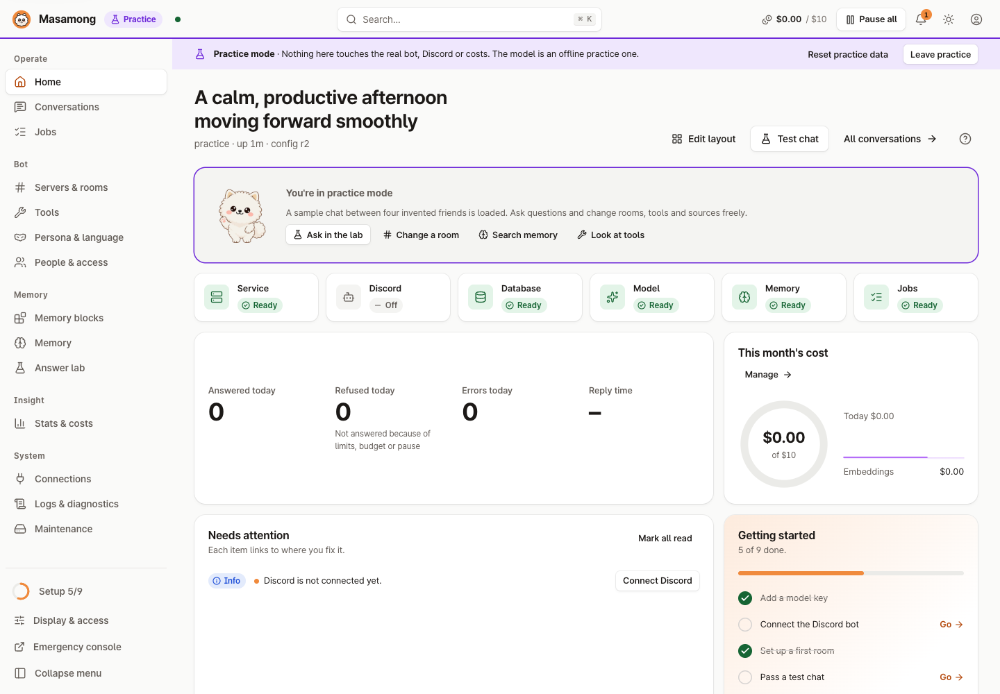
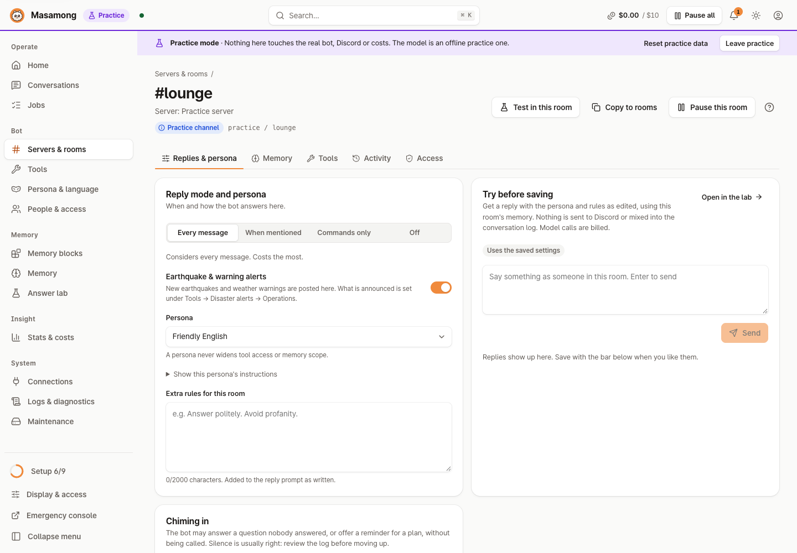
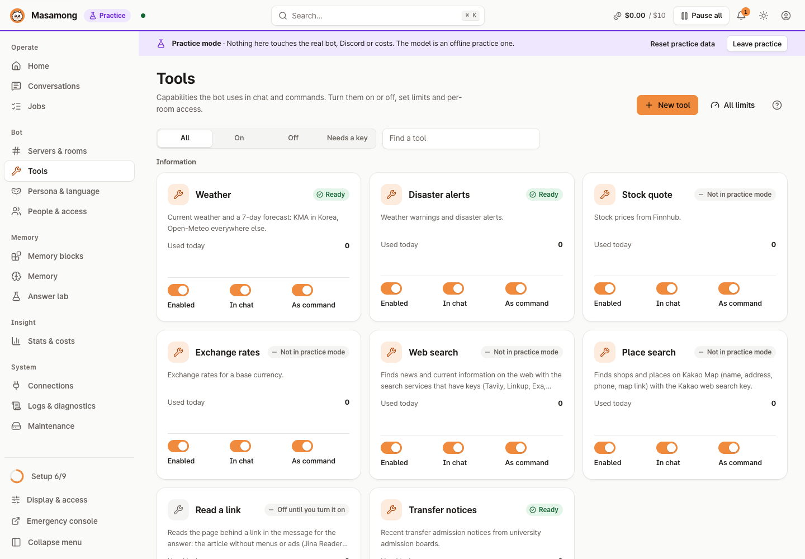
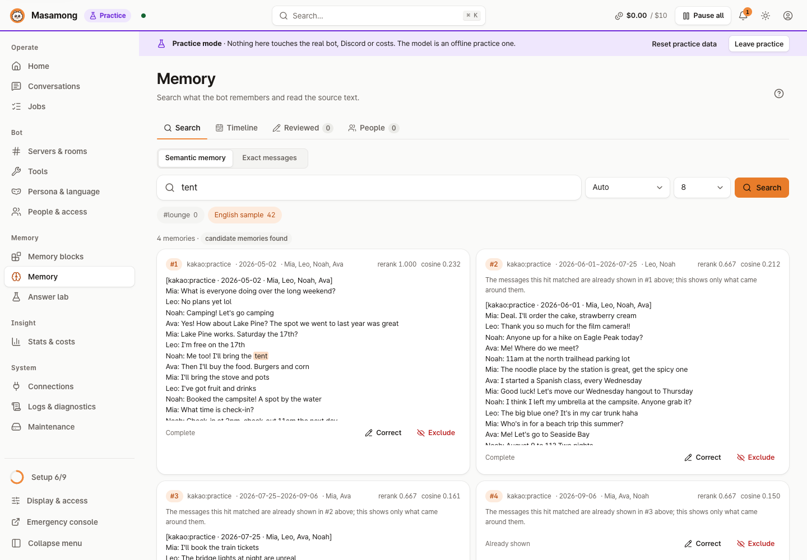

# Admin console

[한국어](https://github.com/kim0040/masamong2/wiki/관리-콘솔) | **English**

The admin console is a web interface built into the `masamongd` service. Day-to-day monitoring and settings happen in the console; the command line is for scripts and emergency recovery. Everything the console does can also be done from the CLI ([CLI commands](https://github.com/kim0040/masamong2/wiki/CLI-Commands)).

## Opening it

| Where | Command or address | What it does |
|---|---|---|
| This computer | `masamong open` | Opens the console in your browser with a one-time sign-in |
| A remote server | `masamong connect user@server` | Opens an SSH tunnel to the server and the console through it |
| Your Tailscale devices | `http://<tailnet name>:<port>/` | `tailscale serve` on the server connects the console to your tailnet; allow that name on Display & access (below) |
| Light / text-only | `http://127.0.0.1:<port>/lite` | A page without JavaScript: status and restart, in all five console languages. Signing in there is a form that sends the token in the request body, not in the address, and the page shows the command for this system and where the token file is |
| Desktop tray | `masamong tray` | Menu bar (macOS) or notification area (Windows, Linux) icon that opens the console |

The console binds to **the loopback interface (`127.0.0.1`) only**. No port is opened to the outside, and sign-in happens only through the one-time links that `open` and `connect` issue. There are no passwords or user accounts to manage.

On Windows, the commands the console shows you (sign in again, sign out, "the service is stopped") are written for the shell you are likely in: PowerShell as `& "C:\...\masamong.exe" open` with a `cmd.exe` form beside it when it differs. The login page prints the home folder as `$env:USERPROFILE` / `%USERPROFILE%`, not your account's real path.

### How `connect` works

1. It logs in to the server over SSH and runs `masamong open --no-browser` there (starting the daemon if needed).
2. The server returns a one-time sign-in link.
3. A free local port is forwarded to the server's console port (`ssh -L`).
4. The link opens in your local browser. `Ctrl+C` in the terminal closes the tunnel.

| Option | Meaning |
|---|---|
| `--port 9000` | Local port (default: any free port) |
| `--remote_data_root /srv/masamong` | The server's data folder |
| `--remote_command /opt/masamong/bin/masamong` | Path of `masamong` on the server (default search: `~/.local/bin`, then `/usr/local/bin`) |

With SSH key login on the server, you can manage it without opening the console port in the firewall.

### Through a Tailscale name

When the server and your device are on the same Tailscale network (tailnet), one address opens the console without SSH. The console still listens on `127.0.0.1` only; `tailscale serve` on the server forwards requests for the tailnet name to it.

1. On **Display & access → How to get in**, click **Allow this name** next to this computer's detected Tailscale name. The name goes into `admin.web.hosts`.
2. Run the command shown on the same card once in the server's terminal: `tailscale serve --bg --http=8787 http://127.0.0.1:8787` (the console port).
3. On a device in the tailnet, open `http://<name>:8787/` and sign in once with the access token (`masamong admin token`).

Requests for any name not in `admin.web.hosts` are refused (DNS rebinding). `tailscale serve` is tailnet-only; do not use `tailscale funnel`, which publishes to the internet. To turn it off, run `tailscale serve --http=8787 off` and remove the name.

## Pages

| Home | Room settings |
|---|---|
|  |  |
| **Tools** | **Memory** |
|  |  |

(All screenshots are from practice mode.)

The left menu has 14 entries (Operate 3 · Bot 4 · Memory 3 · Insight 1 · System 3). Pages used together share one entry with tabs on top: **Stats & costs** (Stats | Costs & limits) and **Maintenance** (Service & backup | Config & history). **Display & access** is at the bottom of the menu and in the top bar. Addresses did not change, so old bookmarks (`/usage`, `/settings`, `/display`) still open.

The **?** button next to each page title shows that page's guide. Only the home page shows its guide on its own the first time.

| Path | Menu | What it is for |
|---|---|---|
| `/` | Home | Health checks, the setup checklist, this month's API spend, notifications, recent conversations |
| `/turns` | Conversations | Each turn's reasoning (intent, tool calls, memory evidence, reply, latency, cost), and why a message was not answered (limit, budget, pause, …). Reactions people put on a reply in Discord and **Rate this reply** show as 👍/👎 (with the reasons given for bad) |
| `/jobs` | Jobs | Background jobs (memory indexing, CSV analysis, migration): progress, time left, cancel and retry |
| `/rooms` | Servers & rooms | **Server approval** for newly invited servers (approve, decline and leave, revoke) and per-server block lists. Each server's **Server log** picks its log channel (off at first; automatic = a channel named `logs`), what goes there (deleted messages, problems) and sends a test entry. Pick each room's persona in the list, switch replies on or off per room, or tick several rooms and use the bar at the bottom of the screen to turn them on or off, or change reply mode and persona, all at once. Each room has its own workspace: **Replies & persona** (reply mode, persona, rules, try before saving; chiming in off / log only / speak, with its decision history), **Memory** (collect and search switches, attached blocks, channel summary, catching up missed messages, timeline), tools and access, copying settings to other rooms. In practice mode the sample room shows as "Practice server · practice channel" |
| `/tools` | Tools | Built-in and custom HTTP tools: on/off, limits, test runs, usage. Notice collection status and refresh; morning fortune delivery status. The server shows whether each tool can answer right now (no key, needs a model, memory needs indexing, nothing to remember yet, unavailable in practice mode). **Read a link** sends links to an outside service (Jina Reader), so it must be turned on explicitly, with a dialog that explains what leaves. Earthquake and warning posts are switched under **Disaster alerts → Operations** (all, warnings, marine, magnitude, advisory regions), and per room on the room's Replies tab |
| `/persona` | Persona & language | Create personas (from an example; the ID comes from the name, a readable one even for a name without Latin letters, and it stays editable) and edit them, **apply to rooms** (many at once, different per room), see where each is used, try before saving. Choices are grouped by language, the room's language first. The list follows the console/system language automatically (a per-admin manual choice is remembered); built-in personas can be hidden and restored. The default for a room with none is marked: `warm_ko` / `warm_ja` when **New rooms start polite** is on, otherwise the casual preset |
| `/people` | People & access | People seen in stored Discord messages by server (names, message counts, first/last seen, active card counts; no message text), linked to their consent/settings record when one exists; each person's consents, subscriptions (fortune, notices) and settings; withdraw consent and delete personal data; operators and block lists; **DM conversation** (who may chat, per-person and all-DM daily limits, today's use); **operator alerts** (Discord DM on/off, severity, test, last result) |
| `/blocks` | Memory blocks | Upload chat CSV, estimate time and cost, index in the background, block details, attach to rooms, indexing schedule |
| `/lab` | Answer lab | Compare search modes (keyword, meaning, rerank), test conversations, check search quality |
| `/memory` | Memory | Meaning and keyword search, timeline of events, evidence review, correct or exclude memories, merge people by hand |
| `/stats` | Stats & costs › Stats | Daily and monthly usage, reply latency, cost per model |
| `/usage` | Stats & costs › Costs & limits | Monthly budget and daily tool limits. **Reset this month's spend** starts the budget count from now; it can be undone this month, while daily history and provider usage or key limits stay unchanged. The count resets automatically next month. A **limit preset** (relaxed, normal, strict) fills every tool's per-person and per-room limits and cooldowns at once (overall daily limits stay), and nothing changes until you save. Tools used today, tools with limits and paid tools come first |
| `/connections` | Connections | Starts with a summary row (whether models, Discord and search & data work now, with the one button that fixes what is blocked), then models → Discord → search & data services. Roles stopped by a missing key are listed in one line above the table, and a price is changed by clicking its cell. Models per role (reply, planner, summary, embedding, rerank, image), token prices, key status, Discord and outside services. A saved key is tried at once with a free request, and a rejected one shows "key rejected" on the card (the wizard's model step does the same). Optional services without keys (search, data) are listed on one line instead of cards. **Fill with recommended models** has a checkbox per role; if memory is already indexed, the embedding model is left out by default and checking it shows how much would be re-indexed and what it would cost (re-indexing can start right after). Reference prices older than four months are flagged for a re-check. Input the host served from its prompt cache is priced at the cache price: from the model list API first (OpenRouter `input_cache_read`), then the published price, and it can be entered by hand in the price dialog (optional). The Discord card checks the bot's name, ID and message-reading permission with Discord using the saved token |
| `/settings` | Maintenance › Config & history | The full settings form (a fitting input for every value: switches, choices, times, weekdays, time zones, amounts; the default shown when a field is empty; person aliases edited row by row. Items with their own page — Discord, models, budget, memory, tools, servers, personas, access, alerts, backup — show a button to that page first, and the values appear after "Edit here"), YAML import and export, revision history, named snapshots and rollback |
| `/logs` | Logs & diagnostics | Live log (the service's real log, last 3,000 lines), health checks (`doctor`), uptime history, trace lookup. Follows the light/dark theme. Viewing logs does not itself create log or history entries |
| `/maintenance` | Maintenance › Service & backup | Create and verify backups, one-click restore, SQLite integrity check, migration from the previous bot, restart, start at login, update check and update from the console, reset (a warning and a typed word; a backup first by default) |
| `/display` | Display & access | Theme (light, dark, system), language, density, reduced motion, how to connect (this computer, SSH command, manual tunnel), reset the guides |

## Conveniences

- Light, dark and system themes, three density levels, Korean, English, Japanese, Simplified Chinese and Spanish interface (more languages are picked up automatically)
- A command palette (`Cmd+K` / `Ctrl+K`), a notification center, and **Pause all** (stop replies in every room)
- Live updates over server-sent events, an unsaved-changes bar, confirmation dialogs for destructive actions
- Layouts for phones (drawer menu), tablets and desktops. On a phone the menu is a real dialog: while it is open the page behind it is inert, Tab stays inside it, `Esc` or a tap outside closes it, and focus returns to the menu button. A table wider than the screen scrolls sideways and shows a soft edge on the side that has more
- **When something does not load**: a page or card that cannot load shows a card with the reason and a **Retry** button instead of an endless skeleton, and after 3 seconds a "still loading" line. If a refresh fails while data is showing, one strip says "some data could not be refreshed" with Retry. A request that cannot reach the service (network down) never leaves a button spinning or throws away what you typed.
- **Dialogs and forms**: Enter in a text field runs the dialog's main button (not while a Korean, Japanese or Chinese IME is composing); a click outside a dialog you have typed into does not close it; leaving a page with unsaved changes asks in the console's own dialog; wrong values (a room ID, a budget amount) are flagged next to the field while you type. The browser tab title is the page name (`Rooms · Masamong`).
- **Browser history and unsaved edits**: Back and Forward use the same guard as console links. If you choose to stay, the current page and address are restored. Closing or reloading the tab while a draft is dirty opens the browser's unsaved-changes prompt.
- Scrolling down slides the top bar away to give the page the whole screen; scrolling up a little brings it back (it always shows near the top of the page, while keyboard focus is in it, and while the menu or search is open). The left menu and side panels move up with it.
- **Stop and restart**: after a stop (console button, `masamong stop` or the menu bar icon), the console switches to a "service stopped" screen with the command to start it again, and reloads by itself when the service is back. During a restart it shows "restarting" instead of a connection warning. The change history records where the stop or restart came from (console, CLI, menu bar icon).
- **Sign out**: the dialog first shows how to get back in (the `open` and `admin token` commands for this install, in PowerShell and `cmd.exe` form on Windows); the sign-in page shows the same with copy buttons. Since the console only opens on this computer or through an SSH tunnel, closing the window is enough.
- **Practice mode**: a sample environment fully separate from the real database, with no outside calls and no costs. Sample data exists only there: the first lines of the log (`example=practice`) and a month of uptime history are examples; in normal mode logs, history and health checks are the real service's. What you do in practice mode is logged only in the practice log.

## Revisions and rollback

Every change made from the console, the CLI or Discord admin commands is recorded as a **revision**.

- **Change history**: who (console or Discord name), from where (console, Discord, CLI, automatic), in which server, and a before/after diff. Filter by source, result or text, load older entries, export as CSV. Calls that change nothing (lists, status) are not recorded.
- **Rollback**: return to any earlier revision (`masamong config rollback --revision N`).
- **Snapshots**: save a known-good configuration under a name and restore it at once.
- Concurrent edits are serialized, and saving over a stale view is detected as a conflict instead of overwriting. The Settings form saves against the revision its draft started from: if the settings changed elsewhere in the meantime you get the conflict message and the draft is rebased on the newest settings with your edits on top.

Most changes apply immediately without a restart. Changes that need one (such as a new Discord token) say so in the console.
