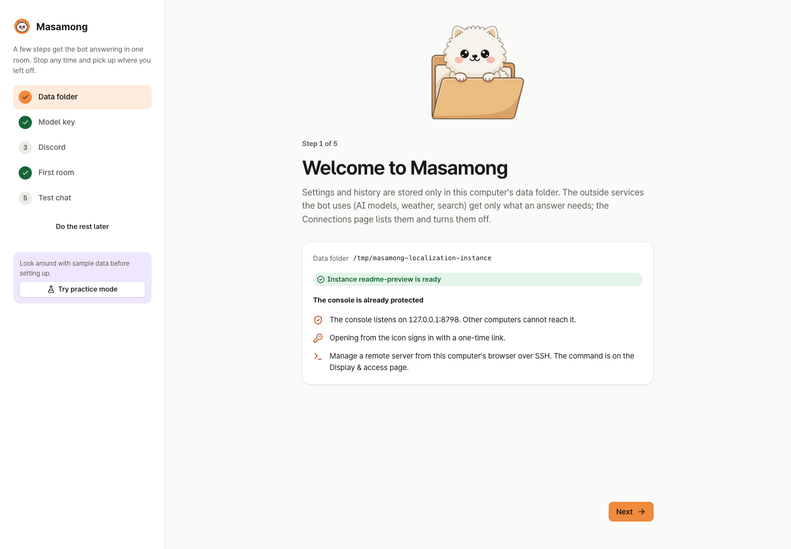

# Quick start

[한국어](https://github.com/kim0040/masamong2/wiki/빠른-시작) | **English**

Once Masamong is installed ([Installation](https://github.com/kim0040/masamong2/wiki/Installation)), open the console and follow the setup steps. There is no account or password to create.

## 1. Open the console

```bash
masamong open
```

`masamong open` starts the background service if it is not running, then opens a **one-time sign-in link** in your browser. The console listens on the loopback address (`http://127.0.0.1:8787`) only and cannot be reached from other machines.

- Where no browser can be opened, the link is printed in the terminal.
- On Windows, if `masamong` is "not recognized" right after installing, open a new PowerShell or use the full path the installer printed ([Installation](https://github.com/kim0040/masamong2/wiki/Installation#windows)).
- If the console asks you to sign in again, it shows the command for your system: for PowerShell `& "C:\...\masamong.exe" open` (and a `cmd.exe` form), otherwise the plain `masamong open`. The sign-in token itself is the file `admin/web-token` in the data folder (Windows: `%APPDATA%\Masamong\admin\web-token`; print it with `masamong admin token`).
- For a server install, run `masamong connect user@server` on your own computer to reach it over an SSH tunnel ([Admin console](https://github.com/kim0040/masamong2/wiki/Admin-Console)).
- Without a GUI or JavaScript, `http://127.0.0.1:8787/lite` offers status checks and restart.

## 2. The setup wizard

On first visit, a wizard walks you through:

1. **Data folder** — where data is stored, the instance name, **the language the bot answers in** (the console's language is suggested; it sets `i18n.default_locale`, see [Languages](https://github.com/kim0040/masamong2/wiki/Languages)), and how the console is protected (opens on this computer only, one-time sign-in links, SSH tunnels for remote use)
2. **Model key** — pick OpenRouter, Google Gemini, OpenAI, CometAPI or NanoGPT and paste an API key (once it checks out, the latest model for each role is filled in)
3. **Discord** — paste only the bot token; the console asks Discord for the bot's ID and whether it may read messages ([Connecting Discord](https://github.com/kim0040/masamong2/wiki/Connecting-Discord)). The step needs a token (typed now or saved earlier) and counts as done only once Discord has answered for it. A token Discord refuses does not switch Discord on
4. **First room** — the Discord channel the bot joins and when it replies
5. **Test chat** — try a conversation in the console without posting to Discord



> [!TIP]
> To look around before entering anything, use **practice mode**. It is separate from real data and makes no outside calls and no costs. Press **Try practice mode** on the first screen: a sample chat between four made-up people is prepared, and **Ask in the lab** on the home page lets you ask right away. Leave with **Leave practice** in the band at the top.

## 3. Model API key

Pick a provider in the wizard's model step. [OpenRouter](https://openrouter.ai) is the default: one key reaches many companies' models, and it supports reranking for memory search. With Gemini or OpenAI, the roles are filled with that provider's latest models as soon as the key checks out (only reranking is missing). CometAPI and NanoGPT are resellers of many models behind one key. OpenRouter's default models per role:

| Role | Job | Default model |
|---|---|---|
| `response` | The reply people see | `deepseek/deepseek-v4.1-flash` |
| `planner` | Understanding the message and picking tools | `openai/gpt-5.6-luna` |
| `summary` | Summaries of memory snippets | `deepseek/deepseek-v4.1-flash` |
| `embed` | Vectors for meaning search | `qwen/qwen3-embedding-8b` |
| `rerank` | Reordering search results | `voyageai/rerank-2.5-lite` |

Enter keys under **Connections → Models**. Where a key is kept depends on the system:

| System | Where | Protection |
|---|---|---|
| macOS | Keychain | The system key store |
| Windows | Credential Manager (an entry `masamong/<account>`) | Windows' own store for your user account |
| Linux · FreeBSD | A file in the data folder (`secrets/`) | Owner-only permissions (`0600`); the file is **not encrypted** |

`MASAMONG_SECRET_STORE=file` makes macOS and Windows use owner-only files too, and keys in files are plain text. Files are protected by permissions only, so use full-disk encryption on laptops ([Security and privacy](https://github.com/kim0040/masamong2/wiki/Security-and-Privacy)).

To pass a key through the environment instead, the variable must exist in the process that **starts** the service, so stop the service, set the variable, then start it again:

```bash
# macOS · Linux
masamong stop
export MASAMONG_OPENROUTER_KEY=sk-or-...   # Gemini: MASAMONG_GEMINI_KEY, OpenAI: MASAMONG_OPENAI_KEY
masamong start
```

```powershell
# Windows PowerShell: this window only
masamong stop
$env:MASAMONG_OPENROUTER_KEY = 'sk-or-...'
masamong start

# or for every new process of your user (then open a new PowerShell and run masamong start)
[Environment]::SetEnvironmentVariable('MASAMONG_OPENROUTER_KEY', 'sk-or-...', 'User')
```

A service started from the tray icon or at login does not see variables you set in a terminal window, so on Windows the console is usually the easier place for keys.

Models can be changed any time under **Connections → Models**. With token prices filled in, costs are counted even when a provider does not report them.

## 4. Discord and reply modes

Create the bot and invite it as in [Connecting Discord](https://github.com/kim0040/masamong2/wiki/Connecting-Discord), then choose rooms and reply modes under **Servers & rooms**.

| Reply mode | Behavior |
|---|---|
| `mention` (recommended) | Replies when called by name, @mentioned, or when someone replies to its message |
| `always` | Considers every message in the room |
| `command` | Only `!` and `/` commands |
| `off` | Never replies in the room (can still keep collecting conversation) |

## 5. Final check

- **Home**: every item in the setup checklist is green
- **Conversations**: a test message shows the planner's decision, tool calls and memory evidence
- **CLI**: `masamong doctor` checks the environment and lists likely problems

Next: [Memory blocks](https://github.com/kim0040/masamong2/wiki/Memory-Blocks) · [Tools and limits](https://github.com/kim0040/masamong2/wiki/Tools-and-Limits) · [Troubleshooting](https://github.com/kim0040/masamong2/wiki/Troubleshooting)
