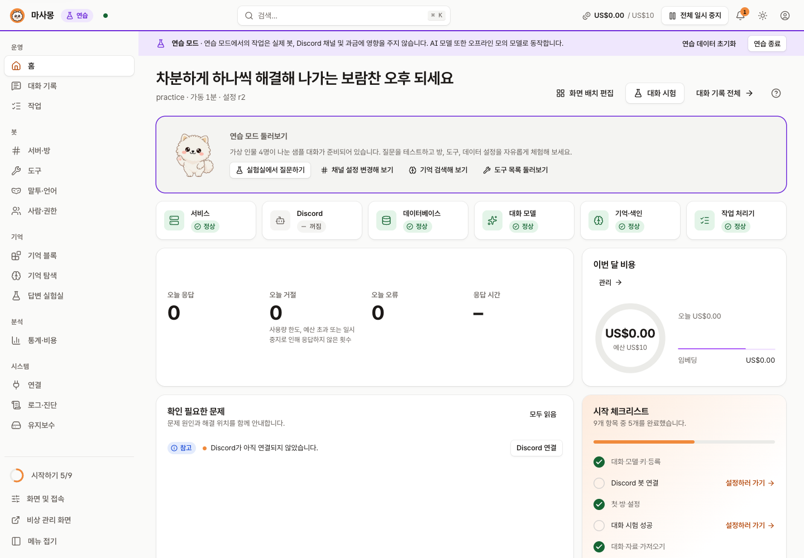
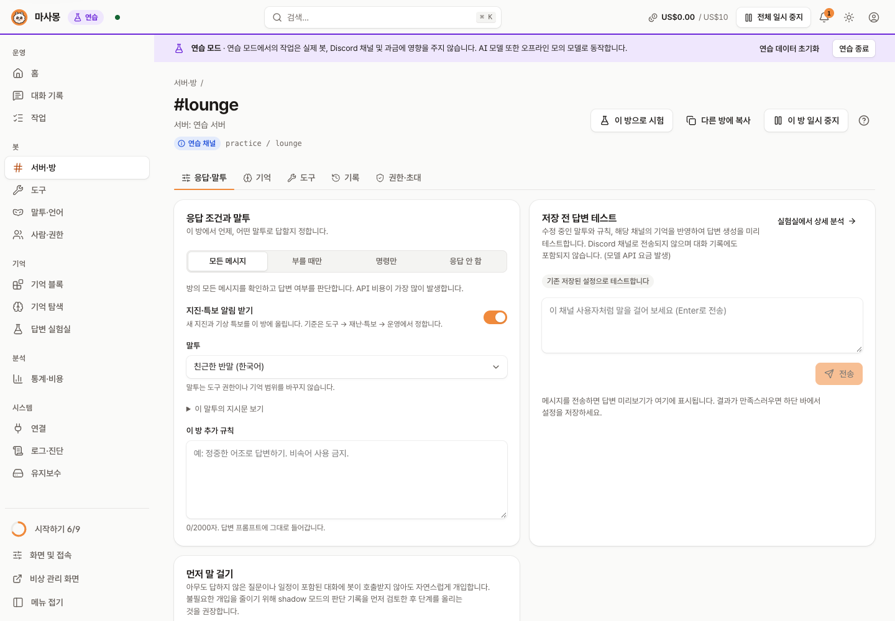
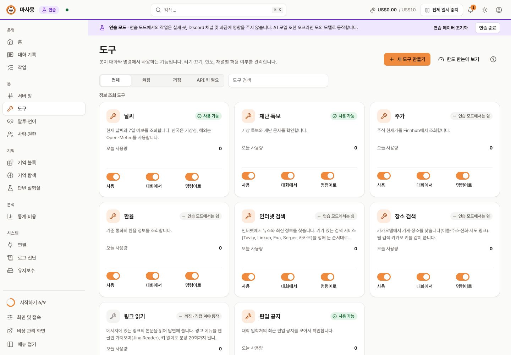
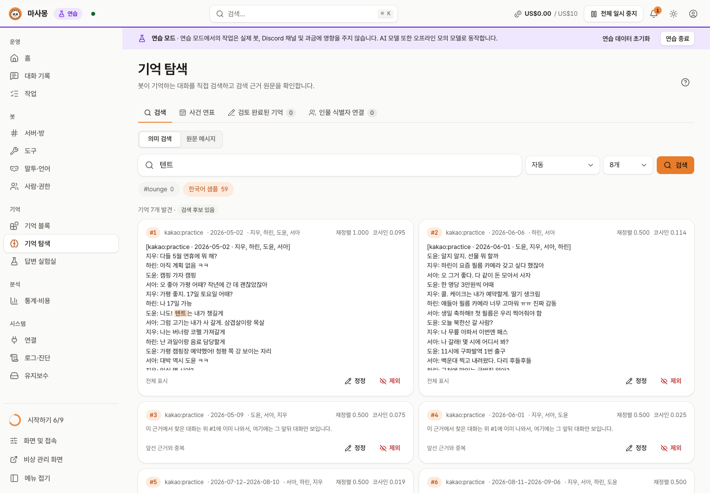

# 관리 콘솔

**한국어** | [English](https://github.com/kim0040/masamong2/wiki/Admin-Console)

관리 콘솔은 `masamongd` 백그라운드 서비스에 내장된 웹 인터페이스입니다. 일상적인 모니터링과 설정 관리는 편리한 웹 콘솔에서 진행하고, 명령줄(CLI)은 스크립트 자동화나 비상 복구에 활용합니다. 콘솔에서 지원하는 모든 기능은 CLI 명령어로도 완벽히 제어할 수 있습니다([CLI 명령어](https://github.com/kim0040/masamong2/wiki/CLI-명령어)).

## 접속 방법

| 접속 환경 | 명령어 및 경로 | 설명 |
|---|---|---|
| 로컬 컴퓨터 | `masamong open` | 브라우저에 보안 1회용 로그인 세션을 열고 콘솔 접속 |
| 원격 서버 | `masamong connect user@server` | 로컬과 원격 간 SSH 포트 포워딩 터널을 맺고 콘솔 접속 |
| 내 Tailscale 기기 | `http://<tailnet 이름>:<port>/` | 서버에서 `tailscale serve`로 콘솔을 tailnet에 연결하고, 화면 및 접속 설정에서 그 이름을 허용 (아래) |
| 경량/텍스트 환경 | `http://127.0.0.1:<port>/lite` | JavaScript 없이 동작하는 경량 관리 페이지 (상태 확인 및 재시작). 콘솔 5개 언어를 모두 지원합니다. 로그인은 토큰을 주소가 아니라 요청 본문으로 보내는 양식이며, 이 시스템에 맞는 명령과 토큰 파일 위치를 알려 줍니다 |
| 데스크톱 트레이 | `masamong tray` | 메뉴 막대(macOS) 또는 알림 영역(Windows·Linux) 아이콘으로 원클릭 콘솔 열기 |

보안을 위해 관리 콘솔은 **로컬 루프백 인터페이스(`127.0.0.1`)에만 바인딩**됩니다. 외부에 포트를 직접 개방하지 않으며, `open` 또는 `connect` 명령이 동적으로 발행하는 보안 1회용 링크를 통해서만 인증됩니다. 별도의 비밀번호나 다중 계정 설정이 필요 없습니다.

Windows에서는 콘솔이 알려 주는 명령(다시 로그인, 로그아웃, "서비스가 종료되었습니다")이 지금 쓰고 있을 셸에 맞게 나옵니다. PowerShell용 `& "C:\...\masamong.exe" open`이 먼저, 다르면 `cmd.exe`용 형태가 옆에 함께 나옵니다. 로그인 화면은 홈 폴더를 내 계정의 실제 경로가 아니라 `$env:USERPROFILE` / `%USERPROFILE%`로 적습니다.

### SSH 원격 터널 접속(`connect`)의 동작 원리

1. SSH로 원격 서버에 접속하여 `masamong open --no-browser`를 내부 실행합니다 (데몬이 중지되어 있다면 자동 기동).
2. 원격 서버에서 인증용 1회용 로그인 링크를 생성하여 반환합니다.
3. 로컬 컴퓨터의 유휴 포트를 원격 서버 콘솔 포트로 SSH 터널링(`ssh -L`)합니다.
4. 로컬 브라우저로 로그인 링크를 자동으로 엽니다. 터미널에서 `Ctrl+C`를 누르면 SSH 터널이 안전하게 종료됩니다.

| 주요 옵션 | 설명 |
|---|---|
| `--port 9000` | 로컬 컴퓨터 측 바인딩 포트 지정 (기본값: 유휴 포트 자동 탐색) |
| `--remote_data_root /srv/masamong` | 원격 서버의 데이터 디렉터리 경로 지정 |
| `--remote_command /opt/masamong/bin/masamong` | 원격 서버의 `masamong` 바이너리 실행 경로 (기본 탐색: `~/.local/bin`, `/usr/local/bin` 순) |

원격 서버에 SSH 키 기반 로그인이 설정되어 있다면, 방화벽에 콘솔 포트를 외부에 열지 않고도 안전하게 접속할 수 있습니다.

### Tailscale 주소로 접속

서버와 내 기기가 같은 Tailscale 네트워크(tailnet)에 있으면 SSH 없이 주소 하나로 열 수 있습니다. 콘솔은 그대로 `127.0.0.1`에서만 수신하고, 서버의 `tailscale serve`가 tailnet 이름으로 들어온 요청을 콘솔로 넘깁니다.

1. 콘솔 **화면 및 접속 설정 → 접속 안내**에서 감지된 이 컴퓨터의 Tailscale 이름 옆 **이 이름으로 접속 허용**을 누릅니다. 설정 `admin.web.hosts`에 그 이름이 들어갑니다.
2. 같은 카드에 나오는 명령을 서버 터미널에서 한 번 실행합니다: `tailscale serve --bg --http=8787 http://127.0.0.1:8787` (포트는 콘솔 포트).
3. tailnet 안의 기기에서 `http://<이름>:8787/`을 열고, 처음 한 번은 접속 토큰(`masamong admin token`)으로 로그인합니다.

`admin.web.hosts`에 없는 이름으로 온 요청은 모두 거절합니다(DNS rebinding 방어). `tailscale serve`는 tailnet 안에만 열리며 인터넷에 공개하는 `tailscale funnel`은 쓰지 마세요. 끌 때는 `tailscale serve --http=8787 off`를 실행하고 허용도 해제합니다.

## 주요 메뉴 안내

| 홈 | 방 설정 |
|---|---|
|  |  |
| **도구** | **기억 탐색** |
|  |  |

(모두 연습 모드 화면입니다.)

왼쪽 메뉴는 14개입니다(운영 3 · 봇 4 · 기억 3 · 분석 1 · 시스템 3). 함께 쓰는 화면은 한 메뉴로 묶여 있고, 묶인 화면 위에는 탭이 나옵니다: **통계·비용**(통계 | 비용·한도), **유지보수**(서비스·백업 | 설정 파일·기록). **화면 및 접속**은 메뉴 아래쪽과 상단 막대에 있습니다. 주소는 그대로라 예전 북마크(`/usage`, `/settings`, `/display`)도 열립니다.

화면마다 제목 옆의 **?** 버튼이 그 화면의 안내를 보여 줍니다. 처음 들어왔을 때 저절로 뜨는 안내는 홈 하나뿐입니다.

| 경로 | 메뉴명 | 주요 기능 및 역할 |
|---|---|---|
| `/` | 홈 | 시스템 헬스체크, 온보딩 체크리스트, 당월 누적 API 비용, 시스템 알림, 최근 대화 활동, 5개 시간대별 다채로운 인사말 헤더 |
| `/turns` | 대화 기록 | 턴별 추론 흐름(의도 파악, 도구 호출, 검색된 기억 근거, 응답 본문, 지연 시간, 소요 비용). 미응답 건(한도 초과, 예산 소진, 일시 정지 등)의 상세 사유 분석. Discord에서 사람들이 답변에 단 반응과 **답변 평가**는 👍/👎(별로의 이유 포함)로 표시. 답변 뒤의 행동에서 자동으로 감지한 신호(다시 부름, 고마움, 웃음, 정정, 건너뛴 말 뒤 재태그, 스레드 제안 거절)는 점선 칩 "자동 감지(참고용)"으로 따로 보이며 평가 합계에 들지 않음. **운영자 표시**: 턴 상세의 "이 답은 맞았나요?"에서 `맞음`·`틀림`·`낡은 정보`를 남기면 사람들의 평가와 따로 저장하고(한 턴에 하나, 사유 칸 없음), 위쪽에 기간별·도구별 합계가 보임. "도구 쓴 턴만" 필터와 "검색 턴 무작위 30건 뽑기"(아직 표시하지 않은 검색 턴을 무작위로 뽑아 하나씩 표시)로 검색 답이 맞았는지 재 볼 수 있음. 메시지가 삭제되었거나 기억 동의 철회·보존 기간 경과·기록 안 하는 방으로 내용이 지워진 턴은 표시할 수 없음. 표시는 봇의 동작에 반영되지 않음 |
| `/jobs` | 작업 | 백그라운드 비동기 작업(기억 색인, CSV 분석, 마이그레이션) 진행률, 예상 완료 시간 확인 및 취소/재시도 |
| `/rooms` | 서버·방 | **서버 승인**: 새로 초대된 서버 승인·거절(나가기)·승인 취소, 서버별 차단 목록. 서버마다 **서버 로그**에서 로그 채널(처음엔 꺼짐, 자동 = 이름이 `logs`인 채널), 올릴 내용(메시지 삭제·오류)을 고르고 시험 글을 보냅니다. 방 목록에서 방마다 말투를 바로 고르고, 방마다 응답 스위치로 켜고 끄며, 여러 방을 체크하면 화면 아래 막대에서 켜기·끄기와 응답 조건·말투를 한 번에 변경. 채널별 독립 작업 공간. **응답·말투**: 응답 방식, 페르소나, 규칙 수정 및 저장 전 시뮬레이션 비교. 먼저 말 걸기(사용 안 함/판단만 기록/실제로 말 걸기) 및 판단 이력 검토. 연습 모드의 예시 방은 "연습 서버 · 연습 채널"로 보입니다. **기억**: 기억 수집/검색 토글, 연결된 블록 관리, 채널 요약, 부재 중 대화 동기화, 타임라인(사건 연표). 도구 및 권한 설정, 타 채널로의 설정 복제 |
| `/tools` | 도구 | 내장 도구 및 커스텀 HTTP 도구 활성화, 호출 한도, 테스트 실행, 사용 통계. 공지사항 도구의 수집 현황 및 즉시 갱신. 아침 운세 브리핑 발송 현황. 도구마다 지금 답할 수 있는지를 서버가 판단해 보여 줍니다(키 없음, 모델 설정 필요, 기억 색인 필요, 기억할 대화 없음, 연습 모드에서는 쉼). **링크 읽기**는 대화 속 링크를 외부 서비스(Jina Reader)로 보내므로 직접 켜야 동작하고, 켤 때 무엇이 나가는지 확인 창을 띄웁니다. **특보·지진 → 운영** 탭에서 지진·특보 자동 공지(전체·특보·바다 스위치, 규모 기준, 주의보 지역)를 켜고 끄며, 채널별로는 방의 답장 탭에서 끕니다 |
| `/persona` | 말투 | 말투 만들기(예시로 시작, ID는 이름에서 자동. 라틴 글자가 없는 이름도 읽을 수 있는 ID가 되고 직접 고칠 수 있음)·편집, **방에 적용**(여러 방을 한 번에, 방마다 다른 말투), 사용 중인 방 표시, 저장 전 시험. 선택지는 언어별로 묶여 있고 방의 언어가 맨 앞입니다. 목록은 화면·시스템 언어를 자동으로 따르고(관리자별 수동 선택은 기억됨), 기본 제공 말투는 숨기고 되돌릴 수 있음. 말투를 정하지 않은 방의 기본값에 표시가 붙습니다. **새 방은 존댓말로 시작**이 켜져 있으면 `warm_ko`·`warm_ja`, 아니면 반말 프리셋입니다 |
| `/people` | 사람·권한 | 저장된 Discord 메시지에서 본 인물을 서버별로 표시(이름, 메시지 수, 처음·마지막으로 본 때, 활성 기억 항목 수; 메시지 내용은 표시하지 않음). 동의·설정 항목이 있으면 기존 사용자 정보로 연결. 사용자별 기능 동의 현황, 구독 내역(운세/공지), 개인 설정 관리. 동의 철회 및 개인 데이터 완전 파기, 운영자·차단 목록, **DM 대화**(허용 대상, 한 사람당·전체 하루 한도, 오늘 사용량), **운영자 알림**(Discord DM 켜기·심각도·테스트·마지막 발송 결과) |
| `/blocks` | 기억 블록 | 대화 CSV 업로드, 리소스 산출 및 백그라운드 색인 실행, 블록 상세 조회, 채널별 연결 및 인덱싱 주기 설정 |
| `/lab` | 답변 실험실 | 검색 방식(단어·의미 검색, 재정렬) 비교 평가, 가상 대화 테스트, 검색 품질 검증 |
| `/memory` | 기억 탐색 | 의미/키워드 통합 검색, 사건 연표(타임라인), 근거 검토, 기억 정정/제외 및 사용자 계정 수동 병합 |
| `/stats` | 통계·비용 › 통계 | 일별/월별 대화 사용 추이, 응답 지연 시간 통계, 모델별 비용 분석 보고서 |
| `/usage` | 통계·비용 › 비용·한도 | 월간 예산, 도구별 하루 한도. **이번 달 비용 초기화**는 예산 계산을 지금부터 다시 시작합니다. 이번 달에는 되돌릴 수 있고, 일별 기록과 제공자 사용량·키 한도는 그대로이며 다음 달에는 자동으로 새로 시작합니다. **한도 프리셋**(여유·보통·엄격)을 고르면 모든 도구의 사람당·방당 한도와 대기 시간이 한 번에 채워지고(하루 전체 한도는 그대로), 저장 전까지는 바뀌지 않습니다. 표는 오늘 쓴 도구·한도가 있는 도구·유료 도구를 먼저 보여 줍니다 |
| `/connections` | 연결 | 맨 위 요약 줄(대화 모델 · Discord · 검색·데이터가 지금 되는지, 막힌 것은 바로 고치는 버튼)에서 시작해 대화 모델 → Discord → 검색·데이터 서비스 순서로 나뉩니다. 키가 없어 멈춘 역할은 표 위에 한 줄로 모아 알려 주고, 단가는 표의 단가 칸을 눌러 바꿉니다. 역할별 LLM 매핑(답변/의도 파악/요약/임베딩/재정렬/이미지), 토큰 단가표, API 키 상태 점검, Discord 봇 및 외부 서비스 연동. 키를 저장하면 바로 무료 요청으로 시험해 보고, 거절되면 카드에 '키 거절됨'이 뜹니다(첫 설정의 모델 키 단계도 같음). 키가 없는 선택 서비스(검색·데이터)는 카드 대신 한 줄 목록으로 모여 있습니다. **추천 모델로 채우기**는 역할마다 체크로 고르며, 기억이 이미 색인돼 있으면 임베딩은 기본으로 빠지고 체크하면 다시 색인할 양과 예상 비용을 보여 줍니다(적용 후 바로 다시 색인 시작 가능). 공식 가격표 기준 단가는 확인한 지 넉 달이 지나면 다시 확인하라고 표시합니다. 공급자가 프롬프트 캐시로 처리한 입력은 캐시 단가로 계산합니다. 캐시 단가는 모델 목록 API(OpenRouter의 `input_cache_read`)에서 먼저 가져오고, 없으면 공식 가격표 값을 씁니다. 단가 설정 창에서 직접 넣을 수도 있습니다(선택). Discord 카드는 저장된 토큰으로 봇 이름·ID와 메시지 읽기 권한을 Discord에서 직접 확인합니다 |
| `/settings` | 유지보수 › 설정 파일·기록 | 전체 환경설정 양식(값마다 알맞은 입력: 스위치·선택·시각·요일·시간대·금액, 비워 둘 때 적용되는 기본값 표시, 인물 별칭은 행 단위 편집. 전용 화면이 있는 항목(Discord·모델·예산·기억·도구·서버·말투·권한·알림·백업)은 그 화면을 여는 버튼을 먼저 보여 주고, 값은 "여기서 직접 편집"을 눌러야 나옵니다), YAML 가져오기·내보내기, 리비전 변경 이력, 스냅샷 저장 및 이전 구성 롤백 |
| `/logs` | 로그 | 실시간 로그(서비스의 실제 로그, 최근 3,000줄), 상태 점검(`doctor`), 가동 이력, 추적 조회. 라이트·다크 테마를 따릅니다. 로그를 보는 것 자체는 로그나 변경 기록을 남기지 않습니다 |
| `/maintenance` | 유지보수 › 서비스·백업 | 안전 백업 생성 및 검증, 원클릭 복원, SQLite 무결성 점검, V1 레거시 데이터 마이그레이션, 서비스 재시작, 자동 시작 등록, 새 버전 확인과 앱에서 업데이트, 초기화(경고와 확인 단어 입력, 기본으로 백업 먼저) |
| `/display` | 화면 및 접속 | 테마(라이트/다크/시스템), 언어 설정, UI 밀도(여백), 모션 감소, 접속 방법(이 컴퓨터·SSH 연결 명령, 수동 SSH 터널), 온보딩 가이드 초기화 |

## 사용자 경험 및 편의 기능

- 라이트, 다크, 시스템 자동 테마 지원, 3단계 레이아웃 밀도 조절, 한국어·영어·일본어·중국어(간체)·스페인어 인터페이스 지원 (추가 언어 자동 감지)
- 키보드 중심의 빠른 탐색을 돕는 명령 팔레트(`Cmd+K` / `Ctrl+K`), 실시간 시스템 알림 센터, **전체 일시 정지**(모든 채널 응답 일시 중단)
- 서버-전송 이벤트(SSE) 기반의 무중단 실시간 상태 동기화, 변경 사항 감지 및 미저장 경고 바, 파괴적 작업에 대한 안전 확인 모달
- 모바일(반응형 드로어), 태블릿, 데스크톱 화면 비율 최적화. 모바일에서 메뉴는 진짜 대화 상자처럼 동작합니다. 열려 있는 동안 뒤의 화면은 비활성화되고, Tab 이동이 메뉴 안에 머물며, `Esc`나 바깥을 누르면 닫히고, 닫으면 포커스가 메뉴 버튼으로 돌아갑니다. 화면보다 넓은 표는 옆으로 스크롤되며 더 있는 쪽 가장자리에 흐린 표시가 나옵니다
- **불러오지 못할 때**: 화면이나 카드가 불러오지 못하면 끝없는 스켈레톤 대신 이유와 **다시 시도** 버튼이 있는 카드를 보여 주고, 3초가 지나면 "아직 불러오는 중" 문구가 나옵니다. 데이터가 보이는 중에 새로고침이 실패하면 "일부 데이터를 새로 불러오지 못했습니다"와 다시 시도 버튼이 있는 띠 하나만 나옵니다. 서비스에 닿지 못하는 요청(네트워크 끊김)은 버튼을 계속 돌게 두거나 입력한 내용을 날리지 않습니다.
- **대화 상자와 입력**: 글자 입력칸에서 Enter를 누르면 대화 상자의 주 버튼이 실행됩니다(한국어·일본어·중국어 입력기로 조합 중일 때는 제외). 글을 입력한 대화 상자의 바깥을 눌러도 닫히지 않습니다. 저장하지 않은 변경이 있는 채로 화면을 나가면 콘솔 자체 대화 상자로 묻습니다. 잘못된 값(방 ID, 예산 금액)은 입력하는 동안 칸 옆에 바로 표시됩니다. 브라우저 탭 제목은 화면 이름입니다(`서버·방 · Masamong`).
- **브라우저 뒤로·앞으로와 저장하지 않은 변경**: 브라우저의 뒤로·앞으로도 콘솔 링크와 같은 확인을 거칩니다. 화면에 남기를 고르면 현재 화면과 주소를 복원합니다. 초안이 바뀐 상태에서 탭을 닫거나 새로고침하면 브라우저 자체의 저장하지 않은 변경 안내가 나옵니다.
- 아래로 스크롤하면 상단 막대가 숨어 화면을 넓게 쓰고, 위로 조금만 올리면 다시 나타납니다(페이지 맨 위, 상단 막대에 키보드 초점이 있을 때, 메뉴·검색 창이 열려 있을 때는 항상 보임). 왼쪽 메뉴와 옆 패널도 함께 위로 붙습니다.
- **서비스 종료·재시작**: 종료하면(콘솔 버튼·`masamong stop`·메뉴 막대 아이콘 어느 쪽이든) 콘솔이 '서비스가 종료되었습니다' 화면으로 바뀌고 다시 시작하는 명령을 보여 줍니다. 서비스가 다시 뜨면 화면이 알아서 새로고침됩니다. 재시작 중에는 연결 끊김 경고 대신 '다시 시작하는 중' 안내가 나옵니다. 변경 기록에는 종료·재시작을 누른 곳(관리 화면·CLI·메뉴 막대 아이콘)이 남습니다.
- **로그아웃**: 확인 창에서 다시 들어오는 방법(이 설치에 맞는 `open`·`admin token` 명령. Windows에서는 PowerShell과 `cmd.exe` 형태)을 먼저 보여 줍니다. 로그인 화면에도 같은 명령이 복사 버튼과 함께 나옵니다. 콘솔은 이 컴퓨터(또는 SSH 터널)에서만 열리므로 로그아웃 없이 창만 닫아도 됩니다.
- **샌드박스 연습 모드**: 운영 데이터베이스와 완벽히 격리된 샘플 환경으로, 외부 API 호출 및 비용 지출 없이 모든 기능을 안전하게 사전 검증 가능. 예시 데이터는 연습 모드에만 있습니다: 로그 화면의 처음 몇 줄(`example=practice`)과 가동 이력 한 달치가 예시이고, 실제 모드의 로그·이력·상태 점검은 모두 실제 서비스의 값입니다. 연습 모드에서 한 일의 로그는 연습 모드 로그에만 나옵니다

## 설정 리비전 관리 및 안전 롤백

콘솔, CLI 명령어, Discord 관리 명령을 통해 변경된 모든 설정은 **리비전(Revision)** 단위로 영구 기록됩니다.

- **설정 → 변경 기록**: 누가(콘솔 계정 또는 Discord 이름), 어디서(관리 화면·Discord·CLI·자동), 어느 서버에서 바꿨는지와 변경 전후 차이(Diff). 경로·결과·검색으로 거르고, 이전 기록을 이어서 불러오고, CSV로 내보낼 수 있습니다. 목록·상태 조회처럼 아무것도 바꾸지 않은 호출은 기록하지 않습니다.
- **안전 롤백**: 잘못된 설정 변경 시 언제든지 특정 과거 리비전으로 복구 (`masamong config rollback --revision N`)
- **스냅샷 생성**: 안정적인 운영 상태의 구성을 이름 붙여 스냅샷으로 저장해 두고 필요 시 즉시 복원
- 동시 수정 방지: 여러 관리자가 동시에 설정을 변경할 경우 순차적으로 직렬화되어 처리되며, 이전 화면 기반의 덮어쓰기 저장은 자동으로 충돌을 감지하여 방지합니다. 설정 양식은 초안을 시작한 시점의 리비전을 기준으로 저장하므로, 그사이 다른 곳에서 설정이 바뀌었다면 충돌 안내가 나오고 초안은 최신 설정 위에 내 수정만 얹어 다시 맞춰 줍니다.

대부분의 설정 변경은 서비스 재시작 없이 즉시 메모리에 반영됩니다. (Discord 봇 토큰 변경 등 재기동이 필요한 작업은 콘솔에서 재시작 필요성을 명확히 안내합니다.)
