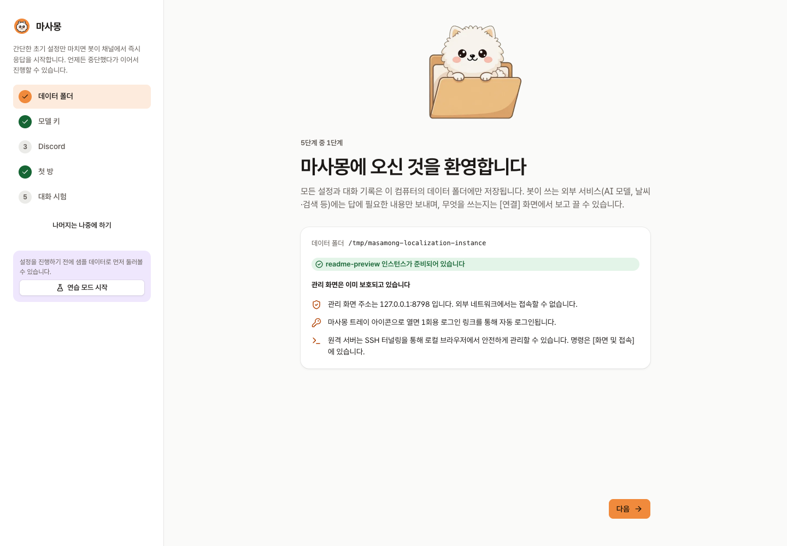

# 빠른 시작

**한국어** | [English](https://github.com/kim0040/masamong2/wiki/Quick-Start)

프로그램 설치를 마쳤다면([설치](https://github.com/kim0040/masamong2/wiki/설치)) 관리 콘솔을 실행하여 초기 설정을 단계별로 진행할 수 있습니다. 별도의 계정 등록이나 비밀번호 설정 없이 안전하게 시작할 수 있습니다.

## 1. 관리 콘솔 실행

```bash
masamong open
```

`masamong open` 명령은 백그라운드 서비스 데몬의 구동 상태를 점검하여 필요 시 자동 시작한 뒤, 기본 브라우저에 **보안 1회용 로그인 링크**를 엽니다. 콘솔은 로컬 루프백 주소(`http://127.0.0.1:8787`)로 바인딩되며, 외부에서는 접속할 수 없습니다.

- 브라우저 자동 실행을 지원하지 않는 환경에서는 터미널에 콘솔 접속 URL이 출력됩니다.
- Windows에서 설치 직후 `masamong`이 "인식할 수 없는 명령"이라고 나오면 새 PowerShell을 열거나 설치 스크립트가 알려 준 전체 경로로 실행하세요([설치](https://github.com/kim0040/masamong2/wiki/설치#windows)).
- 콘솔이 다시 로그인하라고 하면 내 시스템에 맞는 명령을 보여 줍니다. PowerShell에서는 `& "C:\...\masamong.exe" open`(과 `cmd.exe`용 형태), 그 밖에는 `masamong open`입니다. 로그인 토큰은 데이터 폴더의 `admin/web-token` 파일이며(Windows: `%APPDATA%\Masamong\admin\web-token`) `masamong admin token`으로 출력할 수 있습니다.
- 원격 서버에 설치한 경우, 내 컴퓨터 터미널에서 `masamong connect user@server`를 실행하여 SSH 터널을 통해 접속합니다([관리 콘솔](https://github.com/kim0040/masamong2/wiki/관리-콘솔)).
- GUI나 JavaScript를 사용할 수 없는 환경에서는 `http://127.0.0.1:8787/lite`에 접속하여 상태 점검 및 재시작 작업을 수행할 수 있습니다.

## 2. 온보딩 가이드 진행

콘솔에 처음 접속하면 온보딩 마법사가 다음 순서로 설정을 안내합니다:

1. **데이터 폴더** — 데이터 저장 디렉터리와 인스턴스 식별자 확인, **봇이 답하는 언어**(콘솔 언어가 기본으로 제안되며 `i18n.default_locale`이 됩니다. [언어 설정](https://github.com/kim0040/masamong2/wiki/언어-설정) 참고), 관리 화면이 어떻게 보호되는지(이 컴퓨터에서만 열림, 1회용 로그인 링크, 원격은 SSH 터널) 안내
2. **모델 연동** — OpenRouter·Google Gemini·OpenAI·CometAPI·NanoGPT 중 하나를 골라 API 키 등록 (확인되면 역할별 최신 모델이 자동으로 채워짐)
3. **Discord 연동** — Discord 봇 토큰만 등록. 봇 ID와 메시지 읽기 권한은 콘솔이 Discord에서 확인 ([Discord 연결](https://github.com/kim0040/masamong2/wiki/Discord-연결)). 이 단계에는 토큰(지금 입력했거나 이전에 저장한 것)이 필요하고, Discord가 그 토큰에 답해야 완료로 표시됩니다. Discord가 거절한 토큰은 Discord를 켜지 않습니다
4. **첫 채널 설정** — 봇이 참여할 Discord 채널 및 응답 정책 선택
5. **테스트 대화** — 실제 Discord 채널에 메시지를 전송하지 않고 콘솔 내에서 안전하게 테스트 대화 진행



> [!TIP]
> 설정을 등록하기 전에 기능을 먼저 둘러보고 싶다면 **샌드박스 연습 모드**를 켜보세요. 실제 데이터와 격리된 환경에서 외부 API 호출 및 비용 발생 없이 주요 기능을 자유롭게 체험할 수 있습니다. 첫 화면의 **연습 모드 시작**을 누르면 가상 인물 4명의 샘플 대화가 준비되고, 홈의 **실험실에서 질문하기**로 바로 질문해 볼 수 있습니다. 끝내려면 위쪽 띠의 **연습 종료**.

## 3. 모델 API 키 등록

첫 설정의 모델 키 단계에서 공급자를 고릅니다. [OpenRouter](https://openrouter.ai)는 여러 회사 모델을 키 하나로 쓰고 기억 검색의 재정렬까지 지원해서 기본값입니다. Google Gemini나 OpenAI를 고르면 키가 확인되는 즉시 그 공급자의 최신 모델로 역할이 채워집니다(재정렬만 없음). OpenRouter의 역할별 기본 모델은 다음과 같습니다:

| 역할(Role) | 담당 작업 | 기본 권장 모델 |
|---|---|---|
| `response` | 최종 사용자 응답 생성 | `deepseek/deepseek-v4.1-flash` |
| `planner` | 사용자 의도 분석 및 도구 라우팅 | `openai/gpt-5.6-luna` |
| `summary` | 기억 청크 단락 요약 | `deepseek/deepseek-v4.1-flash` |
| `embed` | 의미 검색용 벡터 임베딩 생성 | `qwen/qwen3-embedding-8b` |
| `rerank` | 검색 결과 상호 순위 재정렬 | `voyageai/rerank-2.5-lite` |

API 키는 콘솔의 **연결 → 모델** 메뉴에서 입력할 수 있습니다. 키가 보관되는 곳은 운영체제마다 다릅니다.

| 운영체제 | 보관 위치 | 보호 방식 |
|---|---|---|
| macOS | Keychain | 시스템 키 저장소 |
| Windows | 자격 증명 관리자(`masamong/<계정>` 항목) | 내 Windows 계정 전용 저장소 |
| Linux · FreeBSD | 데이터 폴더의 `secrets/` 파일 | 소유자만 읽도록 권한 설정(`0600`). 파일 내용은 **암호화되지 않습니다** |

`MASAMONG_SECRET_STORE=file`을 설정하면 macOS와 Windows도 소유자 전용 파일에 저장하며, 파일에 든 키는 평문입니다. 파일은 권한으로만 보호되므로 노트북이라면 디스크 전체 암호화를 켜 두세요([보안과 개인정보](https://github.com/kim0040/masamong2/wiki/보안과-개인정보)).

환경 변수로 키를 주입하려면 서비스를 **시작하는** 프로세스에 변수가 있어야 합니다. 서비스를 멈추고, 변수를 설정한 뒤, 다시 시작하세요.

```bash
# macOS · Linux
masamong stop
export MASAMONG_OPENROUTER_KEY=sk-or-...   # Gemini는 MASAMONG_GEMINI_KEY, OpenAI는 MASAMONG_OPENAI_KEY
masamong start
```

```powershell
# Windows PowerShell: 이 창에서만
masamong stop
$env:MASAMONG_OPENROUTER_KEY = 'sk-or-...'
masamong start

# 또는 내 계정의 모든 새 프로세스에 적용(그 뒤 새 PowerShell을 열어 masamong start)
[Environment]::SetEnvironmentVariable('MASAMONG_OPENROUTER_KEY', 'sk-or-...', 'User')
```

트레이 아이콘이나 로그인 시 자동 시작으로 뜬 서비스는 터미널 창에서 설정한 변수를 보지 못합니다. Windows에서는 키를 콘솔에 입력하는 쪽이 보통 더 쉽습니다.

모델 구성은 콘솔의 **연결 → 모델** 메뉴에서 언제든지 교체할 수 있으며, 토큰 단가를 입력해 두면 API 공급자가 비용 정보를 반환하지 않더라도 시스템이 실시간으로 비용을 정산합니다.

## 4. Discord 연동 및 채널 응답 정책 설정

[Discord 연결](https://github.com/kim0040/masamong2/wiki/Discord-연결) 가이드를 참고하여 봇을 생성하고 Discord 서버에 초대한 뒤, 콘솔의 **서버·방** 메뉴에서 봇을 활성화할 채널과 응답 방식을 지정합니다.

| 응답 방식 | 동작 설명 |
|---|---|
| `mention` (기본 권장) | 봇의 이름을 직접 부르거나, @멘션 및 봇 메시지에 답장(Reply)했을 때만 응답 |
| `always` | 채널에 올라오는 모든 대화에 실시간으로 응답 |
| `command` | 느낌표(`!`) 또는 슬래시(`/`)로 시작하는 명령어에만 응답 |
| `off` | 해당 채널에서 봇 응답을 완전히 비활성화 (필요 시 대화 수집만 유지) |

## 5. 최종 점검

- **콘솔 홈**: 시작 체크리스트의 모든 항목이 정상(초록색)으로 표시되는지 확인
- **콘솔 대화 기록**: 테스트 대화 시 플래너 판단, 도구 호출, 기억 검색 근거가 정상적으로 기록되는지 검토
- **CLI 진단**: 터미널에서 `masamong doctor`를 실행하여 환경 진단 및 잠재적 문제 점검

다음 단계: [기억 블록](https://github.com/kim0040/masamong2/wiki/기억-블록) · [도구와 한도](https://github.com/kim0040/masamong2/wiki/도구와-한도) · [문제 해결](https://github.com/kim0040/masamong2/wiki/문제-해결)
